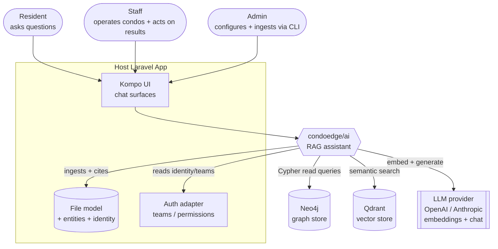
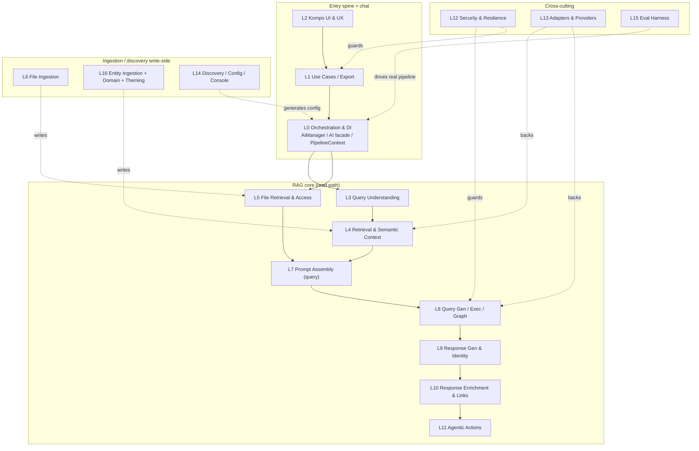

# condoedge/ai — Next-Level RAG Audit (Overview)

## How to read this audit

This document is the human entry point. The detailed, per-layer findings live in `layers/NN-slug.md` — one file per audited subsystem (17 lanes, L0–L16), each opening with its own finer-grained C4 component diagram and a per-file `KEEP`/`REFACTOR`/`SPLIT`/`MERGE`/`DELETE` checklist. Three cross-cutting roll-ups sit beside this overview: **`91-contracts.md`** (the interface/DTO surface and where contracts lie about their implementations), **`93-dead-code.md`** (the consolidated kill-list of unreached classes, methods, and config keys), and **`99-roadmap.md`** (the sequenced "to-10/10" plan). Every finding carries an ID like `L8-1`; the lane doc has the file:line evidence. Crucially, this audit ran an **adversarial verification pass** over every flagged finding: a claim is treated as **solid** here only if verification returned `CONFIRMED`; findings marked **NEEDS_NUANCE** are flagged inline with the specific overreach so you don't over-correct; and the handful verification **refuted** (`FALSE_POSITIVE`) are dropped or explicitly called out. Read top-to-bottom for the shape of the system, then jump to the layer doc for any box you want to fix.

## System context (C4 L1)

The package is a RAG assistant that embeds into a host Laravel app. It owns no users, no files, and no auth of its own — it borrows the host's identity adapter, file model, and Kompo UI, and talks to three external engines (graph, vector, LLM).



**Trust note:** the LLM is an *external* third party. Today the query prompt ships the authenticated user's name and email to it by default (`L7-7`), the team-scoped read-only guarantees are enforced by regex string-scanning rather than at the database driver (`L8-1`/`L8-3`/`L8-4`), and the default file ACL is a coarse team-grain filter shipped as "secure" (`L5-1`). The trust boundary around Neo4j, Qdrant, and the LLM is thinner than the architecture implies.

## Container view (C4 L2)

The 17 audited lanes group into five bands: the entry/orchestration spine and chat application, the RAG read-path core, the ingestion/discovery write-side, and the cross-cutting guards/adapters/eval.



(Each layer doc opens with its own component-level diagram.)

## The pipeline, plainly

This is the linear path of a single question through `AiManager::answerQuestion` (the single real entry — `ask()`/`askQuestion()` are dead duplicate pipelines, `L0-3`), with one-line "today" and "to improve" per stage.

```text
user asks
   │
   ▼
[1] get important words  (L3 Query Understanding)
   │
   ▼
[2] get files            (L4 Retrieval + L5 File Access; L6/L16 ingested content)
   │
   ▼
[3] enhance prompt       (L7 Prompt Assembly)
   │
   ▼
[4] get query            (L8 Query Generation + Execution + Graph)
   │
   ▼
[5] answer               (L9 Response Generation + model-agnostic Identity)
   │
   ▼
[6] actions / links      (L10 Response Enrichment + L11 Agentic Actions)
```

- **[1] Get important words (QU).** *Today:* one fast LLM call returns structured hints (entity types, names, rewritten search query, tags, question-type) with graceful fallback and catalog validation that blocks hallucinated labels. *To improve:* the advertised confidence-gate is dead config — QU always runs (`L3-1`); `intent` is computed and logged but drives nothing (`L3-3`); a `knowledge_query` asserts confidence 1.0 even when no documents were found (`L3-5`) — add abstention.
- **[2] Get files (retrieval + access).** *Today:* embeds the rewritten question, queries pre-built vector indexes for similar Q→Cypher pairs / schema / entity metadata, and a separate file-search path finds + access-filters candidate documents. *To improve:* the retriever is a 1686-line god-class with a dead parallel "legacy array" API and a fallback that does forbidden substring matching (`L4-1`/`L4-7`/`L4-9`); the default file ACL is team-grain and leaky (`L5-1`, P0); cross-collection score normalization boosts weak docs past the threshold (`L5-5`); the reranker exists but is wired only into file search, leaving the graph path recall-biased (`L4-8`/`L13-5`).
- **[3] Enhance prompt (assembly).** *Today:* priority-sorted prompt sections read the typed context and emit a real `{system, user}` role split, with most sections conditional and earning their tokens. *To improve:* system-role rules reference data that lives in the *user* message ("use the schema above", `L7-1`), output-format rules are duplicated (`L7-2`), and user email leaks into the prompt by default (`L7-7`).
- **[4] Get query (gen + exec).** *Today:* regex templates + LLM-with-retries produce Cypher, executed against Neo4j with a fail-closed per-tenant team filter that correctly uses the threaded acting user. *To improve:* tenant-scoping rests on a regex over the LLM's string and can be **bypassed** on label-free queries (`L8-1`, P0); the team filter mis-parenthesizes against `OR` heads and leaks (`L8-14`); the advertised timeout is never enforced server-side (`L8-3`); count/pagination breaks on non-simple queries (`L8-2`).
- **[5] Answer (response + identity).** *Today:* the headline model-agnostic identity goal is genuinely met — identity + privacy guidelines ride a real system role, untrusted question/data ride the user role inside tamper-evident markers. *To improve:* the dedicated abstention method is never wired (`L9-1`); carried-over file content is re-injected without the spotlight wrapper (`L9-2`); ~180 lines of visualization/insight analytics are computed and never rendered (`L9-9`).
- **[6] Actions / links.** *Today:* `[N]` citations and `entity://`/`action://` links are scanned out of the markdown answer; read-only actions render inline as Kompo elements, mutating ones defer behind a signed token + approval card. *To improve:* the whole approach is a brittle markdown-regex round-trip (replace with native tool-calling); the approval/write-gate has **zero real producers** and no end-to-end test (`L11-1`); the pending-action token has no expiry/single-use (`L11-6`); the inline `[N]` citation chips render nothing live (`L10-5`/`L10-6`).

## Layer index

Health is the post-verification gestalt. "Files" = source files checklisted by that lane.

| Layer | Doc | 1-line health | Files |
|---|---|---|---:|
| L0 | [layers/00-orchestration-entry.md](layers/00-orchestration-entry.md) | Clean DI wiring around a 1118-line god-class facade (~40% dead pass-throughs) that silently breaks the sync observer and ships a no-op security stub | 5 |
| L1 | [layers/01-chat-application.md](layers/01-chat-application.md) | Clean-arch use-case path has landed; undermined by dead test-only wrappers, a dead suggestions feature, unreachable PDF/Xlsx export, and triplicated error mapping | 19 |
| L2 | [layers/02-kompo-ui-ux.md](layers/02-kompo-ui-ux.md) | Good presenter seam, but PHP-as-JS templating, three+ copies of typing HTML, inert config toggles, and badly stale UI docs | 16 |
| L3 | [layers/03-query-understanding.md](layers/03-query-understanding.md) | Healthy core (fallback + catalog validation) carrying dead confidence-gate config, a decorative `intent`, and prompt-quality debt | 2 |
| L4 | [layers/04-retrieval-semantic-context.md](layers/04-retrieval-semantic-context.md) | The giant: 1686-line retriever, a fully dead 460-line matcher, three indexers / multiple collections, no rerank on the graph path | 10 |
| L5 | [layers/05-file-retrieval-access.md](layers/05-file-retrieval-access.md) | Retrieval works; security is the weak point — team-grain default ACL (P0), ignored `access_scope`, dead audit log, a score-normalization bug | 13 |
| L6 | [layers/06-file-ingestion.md](layers/06-file-ingestion.md) | Strong OCR engineering; correctness gaps in chunking, fabricated offsets, byte/char mixing, and double-dispatch double-ingestion | 22 |
| L7 | [layers/07-prompt-assembly-query.md](layers/07-prompt-assembly-query.md) | Well-structured role-split assembly with trimmable duplication, a PII-by-default leak, and dead pattern-library machinery | 24 |
| L8 | [layers/08-query-gen-exec-graph.md](layers/08-query-gen-exec-graph.md) | Sound fail-closed posture, fragile mechanics: regex tenant-scope with a real bypass, OR-precedence filter leak, unenforced timeout, dead transaction API | 21 |
| L9 | [layers/09-response-identity.md](layers/09-response-identity.md) | Headline identity goal achieved; carries dead abstention, an unused analytics engine, and one injection gap on carried-over content | 19 |
| L10 | [layers/10-response-enrichment-links.md](layers/10-response-enrichment-links.md) | Action-link path is the cleanest part; file-citation path is largely dead theatre + an over-eager `[N]` strip and duplicated grammar | 7 |
| L11 | [layers/11-agentic-actions.md](layers/11-agentic-actions.md) | Wired end-to-end but brittle markdown-regex (not tool-calling); the approval/write half has zero real producers and an unhardened token | 13 |
| L12 | [layers/12-security-resilience.md](layers/12-security-resilience.md) | Solid fail-closed team-filter core, but a default auth adapter that fatals without kompo/auth (P0), a racy rate limiter, and no LLM-path resilience | 11 |
| L13 | [layers/13-adapters-providers.md](layers/13-adapters-providers.md) | Right-sized contracts + a genuinely good reranker; model-agnostic promise leaks (Anthropic JSON, inert per-role models, no provider retries) | 14 |
| L14 | [layers/14-discovery-config-commands.md](layers/14-discovery-config-commands.md) | Functional offline tooling; config-key mismatches, a broken `ai:setup`, an unreachable split-config path, and hardcoded CondoEdge domain word lists | 30 |
| L15 | [layers/15-eval-harness.md](layers/15-eval-harness.md) | Clean graceful-degrading engineering, but prompt/generation attribution is two re-slices of one verdict and several config knobs are inert | 8 |
| L16 | [layers/16-crosscutting.md](layers/16-crosscutting.md) | Clean value objects/logger; two divergent ingestion paths, over-abstracted theming (5 classes / 2 factories / 2 palettes), and several real bugs | 31 |

(The `10-of-10-acceptance-rubric.md` in this directory defines the bar each layer is measured against.)

## Executive summary

### Top P0s (confirmed)

Four P0s survived verification. Read the nuance — two of the lanes' P0 labels were downgraded, and two of the "P0" facade bugs are latent-in-practice public-contract breaks.

1. **Default auth adapter fatals without `kompo/auth` (L12-1, CONFIRMED).** `KompoAuthAdapter` is the sole, unconditional binding for the auth interface, and its `isEnabled()` calls the undefined global `globalSecurityBypass()` plus a `kompo/auth` `Permission` class that is **not in composer.json/lock**. `isEnabled()` runs at the front of every secured query, so any install without `kompo/auth` fatals on the first check — directly contradicting the framework-agnostic claim. Fix: ship a fail-closed `NullAuthAdapter` default and bind Kompo only when detected.
2. **Cypher tenant-scoping can be bypassed (L8-1, CONFIRMED with nuance).** The team filter is only injected when a regex finds an inline `(alias:Label)` in the LLM-authored query. A query whose primary node carries **no label at all** (`MATCH (n {id:$x}) RETURN n`) yields no entity and runs **unfiltered under security-enabled/deny**. The entire fail-closed posture rests on a regex over a string the model wrote. *Nuance: the lane's "returned alias with no inline label" example actually does get filtered by the fallback regex; the real bypass needs a query with no `:Label` token anywhere.* Fix: scope off the known entity threaded via `PipelineContext`/QU and fail closed when no entity is provable.
3. **Default file ACL is a team-grain OR-filter shipped as "secure" (L5-1, CONFIRMED).** With `security_enabled=true` by default, any host that doesn't override `scopeAccessibleBy` exposes *every* team file the AI retrieves to *every* team member, ignoring per-file ACLs. Compounded by `L5-2`: the documented `access_scope` config knob is never read, so hosts who wire a stricter scope silently fall back to the leaky default.
4. **Broken public facade methods that TypeError under `strict_types` (L4-5/L4-6/L0-2 + L8-2, CONFIRMED, latent).** `AI::searchSimilar(string, array $options)` forwards an array to a `string $collection` param; `getExampleEntities(array)` forwards an array to a `string $label` param; `executePaginated` builds malformed Cypher for `OPTIONAL MATCH`/`CALL`/`WITH` shapes. All are documented public facade methods and guaranteed failures — but **dead internally** (no `src/` caller), so they only detonate when a host follows the docs. Severity is P0-as-public-contract, latent in the package's own runtime.

**Downgraded by verification (do not treat as P0):**
- `L0-1` (sync-observer "crash") is CONFIRMED but **fails silently** — the observer wraps the call in `try/catch`, swallows the `BadMethodCallException`, and logs it, so the host doesn't crash; instead **related-model graph sync never happens** (stale data). Real, but a silent-data-staleness P0, not a hard crash.
- `L2-3` (`link_hover` magic-null) is CONFIRMED as a bug but impact is **cosmetic** (one reset link loses a hover class). Its real value is proving the `__get` magic fails silently for any unmapped property. Realistically P2/P3.
- `L0-5` `filterSensitiveResults()` is a security-named no-op on the hot path, but it is **not** the only control — `HasSecurity` enforces at the Eloquent layer — so it's misleading dead code, not a live leak.

### Biggest themes

- **Giant files doing ~13 jobs each.** `ContextRetriever` (1686), `DataIngestionService` (1197), `AiManager` (1118), `QueryExecutor` (863), `MessagesQuery` (736), `QueryGenerator` (670), `ResponseGenerator` (648), `OcrPdfParser` (625), `SchemaInspector`/`RelationshipDiscoverer` (~700 each). Each is the primary split target in its layer; collectively they make the codebase hard to test in isolation and easy to break across unrelated paths.
- **Single-path violations / drift.** The file-context multi-query fan-out is re-implemented in 3 places — `AiManager`, `TestQuestionCommand`, `PipelineEvalDriver` — so **eval measures a divergent pipeline from production** (`L0-8`/`L15-8`). Error mapping exists in 3 copies, two locale-broken (`L1-13`). Typing/animation HTML in 3+ places (`L2-5`). The deny/bypass security policy in 2 (`L8-5`/`L12-4`). `extractEntityId` triplicated (`L10-9`). Two divergent ingestion paths produce different vectors/payloads by entry point (`L16-1`/`L16-4`), with copy-pasted, already-drifted graph helpers (`L16-8`).
- **Half-done / dead subsystems advertised as live.** A fully dead 460-line `SemanticMatcher` (`L4-2`); the inline `[N]` file-citation chips render zero UI (`L10-5`/`L10-6`/`L10-7`); the agentic approval/mutation centerpiece has **zero real producers** (`L11-1`); the access-audit log has no production writer (`L5-3`); `generateEmptyResponse` abstention is never called (`L9-1`); the `suggestions` feature is dead end-to-end (`L1-3`); PDF/Xlsx export is unreachable (no `{type}` route, `L1-4`); a dead transaction API spans both graph stores (`L8-6`); a dead `EntityAccessCheckerInterface` implies node-level access control that doesn't exist (`L12-2`); and a large cluster of inert config keys (QU confidence-gate `L3-1`, chunking/OCR knobs `L6-10`, eval `generation.*`/`offline_default` `L15-5`/`L15-6`, discovery `ai.discovery.*` read under the wrong prefix `L14-3`).
- **Model-agnostic claim leaks at the seams.** Anthropic `chatJson` has no JSON-mode/fence handling, so it degrades the moment it's selected (`L13-2`); per-role model selection for query/response generation is never actually requested (`L13-1`); a throwing Anthropic embedding placeholder is config-selectable (`L13-7`). Hardcoded English/French/condo word lists appear in QU (`L3-2`), discovery (`L14-6`/`L14-7`), the context fallback (`L4-9`), and follow-up/entity detection (`L5-8`/`L5-9`) — all violating the project's own no-hardcoded-semantics rule.
- **Security mechanics weaker than the posture.** The fail-closed *design* is genuinely good (threaded acting user, `deny` defaults, a bound `$ai_team_ids` parameter instead of string-spliced `IN[...]`), but enforcement leans on bypassable regex (`L8-1`/`L8-4`), a non-atomic read-modify-write rate limiter that both undercounts and slides its window (`L12-3`), an over-broad 40-char "AWS secret" redactor that mangles SHA-1/base64 in logs (`L12-6`), and the most failure-prone dependency — the LLM call — has **no circuit breaker or retry** while Neo4j does (`L12-13`).

### Headline opportunities

- **One thin orchestrator + a threaded identity.** Collapse `AiManager` to a single canonical `answerQuestion`; delete the ~15 dead pass-throughs and 2 dead pipeline entries (`L0-3`/`L0-4`); thread a `PipelineIdentity` actor from `$options['user']` so every static `auth()->id()`/`currentTeamId()` call disappears and CLI/queue/impersonation/eval behave correctly (`L0-7`/`L8-15`).
- **Parse, don't regex, for tenant isolation.** Drive the team filter off the known entity in `PipelineContext`, parenthesized and provable, closing `L8-1` + `L8-14` together; enforce read-only and row/time limits **at the Neo4j driver** (READ access mode / transaction timeout) so the guarantees are physical, not cosmetic (`L8-3`/`L8-4`); back it with an adversarial tenant-isolation test corpus.
- **Fail-closed, policy-driven file authz + safe-by-default PII.** Replace the team-grain default with a host-resolved visibility/role/union policy that returns *nothing* when unconfigured (`L5-1`), honor `access_scope` (`L5-2`), ship a `NullAuthAdapter` default (`L12-1`), and gate user email behind an off-by-default switch (`L7-7`).
- **Wire the good reranker into the main path + go hybrid.** `LlmReranker` is genuinely well-built but only touches file search; route similar-query and semantic-selection candidates through it (over-fetch → rerank → cut) and add BM25/sparse + RRF fusion (`L4-8`/`L13-5`).
- **Native tool-calling for actions.** Replace the brittle markdown-regex `entity://`/`action://` round-trip with provider-native structured tool calls; consolidate the duplicated link/citation/entity-id grammar into shared value objects (`L10-8`/`L10-9`); ship one real mutating reference action with a hardened token (TTL + single-use) and a booted-app approval test (`L11-1`/`L11-6`).
- **Unify ingestion + wrap the LLM in resilience.** Collapse the single and batch ingestion paths behind one sensible-column-aware embed/metadata builder with a payload-parity test so they can never diverge again (`L16-1`/`L16-8`); wrap the LLM call in the existing circuit-breaker/retry that today only Neo4j enjoys (`L12-13`).

## Coverage

- **Files in inventory: 259.**
- **Files checklisted by lanes: 259.**

Every source file in the package was assigned to exactly one of the 17 lanes (L0–L16) and received a `KEEP` / `REFACTOR` / `SPLIT` / `MERGE` / `DELETE` verdict in its lane doc. The findings surfaced in this overview reflect the adversarial verification pass: `FALSE_POSITIVE` claims (e.g. `L2-9` `fileReferenceCard` "punning", which is correct-by-contract) were dropped, and `NEEDS_NUANCE` claims are flagged inline so severity and remediation are not overstated.
