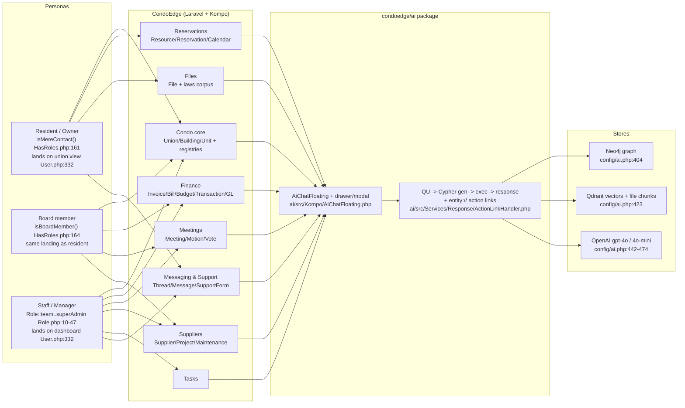
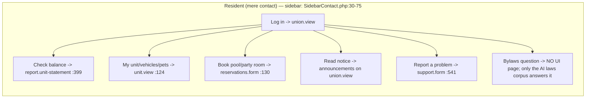
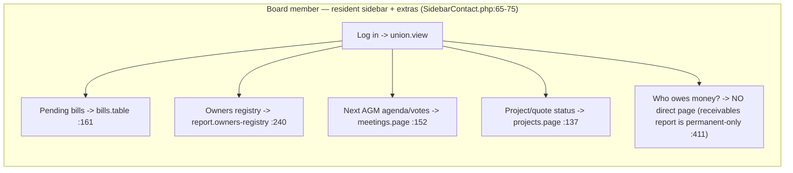
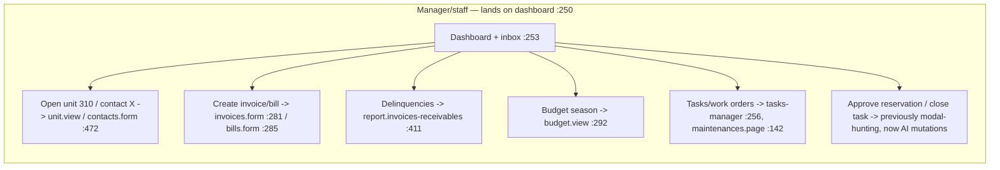

# CondoEdge Domain Map — what the app is, who uses it, what the AI covers

> Evidence date 2026-06-09, **refreshed 2026-06-10** after the overnight fix batches. Host:
> `C:/Users/jkend/Documents/Projects/kompo/CondoEdge` (paths below are host-relative unless prefixed `ai/`).
> **Status note:** everything is still **UNCOMMITTED** (host: `config/ai.php`, 10 entity catalogs, 9 view
> mounts; package: the whole working tree incl. native tool-calling + polymorphic sync) — the last committed
> touch to host `config/ai.php` is `b6828a93 2026-04-02`. Since the 06-09 revision of this document:
> the 46-pattern Cypher sweep + 3 suspect resolutions landed (see `96-…questions.md` §1), the closed eval
> `90c-condoedge-closed-eval-2026-06-10.md` graded 70 questions (overall 5.0/10, root causes W1-W8), and the
> same-morning fix batch closed **W1** (stale prompt-section overrides deleted, ai.php:1750-1757), **W2**
> (clicked suggestions carry page context, package), **W4(a)** (security fail-open → `deny`, ai.php:335),
> **W5** (3 Resource scopes, condo.php:1422-1473) and implemented **94c** polymorphic edge sync (package).
> A second same-day **application batch** then closed more of the queue in source: W3 host decimal
> casts (15 models), the `$boardOrStaff` gate + `bills_table` generic, the Resource and Thread
> possessive paths, and the W6 authorize-filtered action advertisement (package, test-covered).
> §4/§5 below reflect the post-fix state; line citations were re-verified 2026-06-10 (third pass).

---

## 1. Context (C4-1): personas → CondoEdge → condoedge/ai → stores

---

## 2. Module map: pages/routes per module and who reaches them

Role tiers from `routes/web.php`: **has-plan** group (`:109`, no role middleware → residents+board+staff), **Role::team** (`:243,:448,:473,:488,:532,:545`), **Role::permanent** (`:275,:392,:402,:435`), **Role::lead** (`:518`), **Role::superAdmin** (`:315,:647`). Middleware chain: superAdmin ⊂ lead ⊂ manager ⊂ administration ⊂ permanent ⊂ team (`app/Rbac/Role.php:10-47`). Board members fail ALL role middleware (they are role `contact`, `HasRoles.php:156`).

```mermaid
flowchart TD
    subgraph CondoCore ["Condo core"]
        u1["unit.view :124 — has-plan"]
        u2["union.view :128 — has-plan"]
        u3["units.catalog :122 — has-plan"]
        u4["union.manager :277 — permanent"]
        u5["vehicles/accesses/extras.form :528-531 — open route, UI gates add to staff"]
        u6["announcements.form :525 — open route"]
        u7["union.stats :165 — has-plan"]
    end
    subgraph Finance
        f1["report.unit-statement :399 — has-plan, polymorphic customer_id"]
        f2["bills.table :161 — has-plan (board sees it: SidebarContact.php:69)"]
        f3["invoices.form/.table :281,:284 — permanent"]
        f4["bills.form :285 — permanent"]
        f5["budget / budget.view :291-292 — permanent"]
        f6["transactions / chart-of-accounts :299,:280 — permanent"]
        f7["finance reports :405-419 — permanent"]
    end
    subgraph Meetings
        m1["meetings :151 — has-plan"]
        m2["meetings.page :152 — has-plan"]
        m3["meetings.form/motions.form :489-491 — team"]
    end
    subgraph Suppliers
        s1["suppliers.page :135 — has-plan"]
        s2["projects.page :137 — has-plan"]
        s3["maintenances.page :142 — has-plan"]
    end
    subgraph FilesSupport ["Files / Support / Tasks / Messaging"]
        d1["files-manager :254 — team"]
        d2["file-info.form :510 — open route, ACL inside"]
        d3["support.form :541 — has-plan"]
        d4["inbox :253 — team"]
        d5["tasks-manager :256 — team"]
    end
    subgraph Reservations ["Reservations / Calendar"]
        r1["reservations.form :130 — has-plan"]
        r2["calendar :118 — has-plan"]
    end
    subgraph BoardReports ["Registry reports (board-reachable)"]
        b1["report.owners-registry :240 — has-plan"]
        b2["report.unit-registry :238 / emergency-registry :239 / quote-part :237"]
    end
    RES["Resident"] --> u1 & u2 & f1 & m1 & r1 & r2 & d3
    BRD["Board"] --> f2 & b1 & b2 & m2 & s1 & s2 & s3
    STF["Staff"] --> u4 & f3 & f4 & f5 & f6 & f7 & d1 & d4 & d5 & m3
```

Domain breadth (model classes per dir, `app/Models/`): Condo 19, Finance 29, Supplier 20, Contact 9, Messaging 10, Billing(SaaS) 7, Meetings 5, Task 5, Discussions 6, FileManager 2, Eft 2, Phone 3 — 137 model files reference `Nodeable`.

---

## 3. Day in the life per persona

---

## 4. AI coverage by module (current working-tree state)

Catalogs: 16 files / **128 labels** under `config/ai-entities/` (condo 19, finance 28, supplier 20, general 16, messaging 9, billing 6, contact 5, discussions 5, meetings 5, task 4, eft/filemanager/imports/phone/settings 2 each, calendar 1) — all rich (description + per-field docs + scopes + embed_fields + aliases), and as of 2026-06-10 swept: 246 Cypher fragments re-derived, 46 dead patterns fixed (`96-…questions.md` §1). `auto_sync` on (`config/ai.php:252`); **runtime Neo4j/Qdrant node counts unverified here — run `ai:ingest` + count per label before trusting "answerable"** (and note the next re-ingest is the first to materialize 94c polymorphic edges and needs host decimal casts first — `96-…questions.md` §4).

| Module | Cataloged | "my X" path (`user_entity_paths`) | Actions wired | Chat surface mounted |
|---|---|---|---|---|
| Condo core (Union/Building/Unit) | yes | Unit `config/ai.php:729`, Contact `:735` | Unit view/statement/add_vehicle/add_access `:1277-1309`; Union view/manage `:1313+`; units/contacts generics under `generic_actions` `:1546-1748` | **UnitView.php:131**, **UnionView.php:138** (full page_context) |
| Registries (Vehicle/Pet/Access/Extra) | yes | Vehicle `:754`, Pet `:762`, Access `:770`, Extra `:778` | add_vehicle/add_access under Unit | via UnitView |
| Announcements | yes | `:789` (Unit→`[:UNION]` hop fixed) | Announcement.edit staff `:1504-1516`; new_announcement `:1612` | none (modal-only feature) |
| Reservations/Resources | yes | Reservation `:816` (edge-traversal fix); Resource `:826` (added 06-10 — "what can I reserve?") | make_reservation `:1558`; **mutations** approve/reject `:1376-1397` | none on calendar/reservation pages |
| Finance receivables | yes | Invoice `:745-753` (polymorphic property join) | Invoice.edit (entity_actions `:1270+`); my_statement `:1570`; report_receivables `:1664` | **InvoiceForm.php:188** |
| Finance payables/GL (Bill/Budget/Txn/Account) | yes | none (intentional — staff data) | Bill/Budget/Transaction actions (entity_actions `:1270+`, Budget.view `:1482-1487`); budget/transactions/chart_of_accounts/report_* generics `:1546-1748` | **BudgetView.php:100** (mounted 06-10) |
| Meetings (Meeting/Motion/Vote) | yes | Meeting `:779` (hop fixed) | Meeting.view `:1330`; meetings generic `:1546-1748` | **MeetingPage.php:71** |
| Suppliers/Projects/Maintenance | yes | none | Supplier.view `:1339-1343`, Project.view `:1348`, Maintenance.view `:1357`; suppliers generic `:1731-1738` | **SupplierPage.php:76**, **ProjectPage.php:165**, **MaintenancePage.php:130** (last two mounted 06-10) |
| Tasks | yes | none | **mutations** Task.close / TaskDetail.complete (`'Task'` block `:1402+`) | none |
| Messaging/Support | yes | Thread `:841` (added 06-10 — "my support requests", via sender EmailAccount morph properties; no workflow status column, `96-…questions.md` [f15]) | support `:1564`, inbox (generics `:1546-1748`) | none |
| Files / laws corpus | File wired: `file_model`+`accessibleBy` `:1001-1006`; `public/laws/**/*.md` `:947-949` | n/a (retrieval) | File.info staff `:1517-1545`; files_manager `:1718` | n/a |
| BoardMember | yes | `:852` ("am I on the board") | none (board-members.form :474 is team-gated) | n/a |
| Discussions / Billing-SaaS / EFT / Phone / Imports | yes | none | none | none — acceptable noise floor |

Cross-cutting state (all four 06-09 flags now resolved): `example_questions` resident-persona `:1066-1073`; `page_examples` for **all nine** keys Unit/Union/Meeting/Contact/Invoice/Supplier/Project/Maintenance/Budget `:1083-1143` — every key has a live mount except Contact (modal-only surface, `96-…questions.md` [f11]); `chat.surface` **defaults `'drawer'`** `:1046`; complete `identity` block `:157-176` (name/persona/language_policy/non_disclosure); `security.on_permission_unexistent => 'deny'` `:335` (the host `AiAuthAdapter` team-scopes all normal queries, so `deny` only closes the unscopeable-query fail-open — residual: scoping grain is team-level, see §5). Also new: the host no longer overrides the prompt-section lists (deleted, comment at `:1750-1757`) — package defaults apply, restoring PageContext/NameResolution/TenantScopingRules to the generator prompt and Identity/ResponseGuardrails to the response prompt.

---

## 5. Value gap: why would anyone prefer the AI over clicking?

The 2026-06-10 closed eval (`90c-condoedge-closed-eval-2026-06-10.md`, 70 questions) put numbers on this
section: **Resident 7.7/10 (shippable), Board 5.3 (split), Staff 4.1 (no — but one root-cause), overall
5.0 with 44% confidently-wrong answers.** The dominant defect was a single context-binding break (W1
host section overrides + W2 clicked-suggestion drop) attributed in 34/70 questions — **both fixed the
same morning**, with the eval's own projection putting post-fix staff at ≈7 and overall at ≈7 once W3
(decimals) also lands. The paragraphs below fold those findings in.

**Resident** — the UI is already 2 clicks to everything they own (sidebar is per-unit, `SidebarContact.php:43-60`). The AI wins ONLY on (a) the laws/bylaws corpus — "can I have a dog / install an EV charger?" has **no UI page at all**, only `public/laws/**/*.md` retrieval (`config/ai.php:947-949`); (b) cross-entity asks ("how much do I owe and when is the next meeting"). Both wired, and the eval confirms it: 7.7 average, zero confident-wrong, action/navigation questions grading 9. The remaining resident friction is writes: booking an amenity in-chat is a nav link, not a transaction. Residual risk: team-grain tenant scoping can leak neighbours' financial rows on vague phrasings ("payments?" graded 2 in the eval) until row-level possessive scoping lands (90c W4b).

**Board member** — the persona with the WORST coverage relative to legitimate access. Every staff-gated action uses the `$staffOnly`/`$permanentOnly` role gates (`config/ai.php:21-45`), and board members hold `Membership.role 'contact'` (`HasRoles.php:156-167`, rationale `ai.php:3-20`) — correct for `Role::permanent` routes, but it also suppresses links the board reaches daily via their own sidebar: owners registry (`web.php:240`, no role middleware; menu `SidebarCommon.php:268-276`) and the payables table (`web.php:161`; menu `SidebarContact.php:69`). The AI used to serve the board persona less than the sidebar does — **fixed 2026-06-10**: the `$boardOrStaff` gate (ai.php:47-68) now advertises the owners registry and the new payables link to board members, and the W6 advertisement filter (package) stops staff-only offers rendering as dead text. The eval's sharper failure — every money aggregate riding string-typed decimals (90c W3) — is also closed in source (15 host models now carry decimal casts), pending one re-ingest. A board member's trust now hinges on that re-ingest happening before they compare a receivables total against the report page.

**Staff** — wins are real: jump-to-record ("open unit 310"), aggregate queries the UI scatters across reports, and the three approval-gated mutations (reservation approve/reject, task close). The eval's 4.1 was NOT a coverage problem: 28 of their 38 questions are page-scoped and every one failed on the same id-binding break — the host section-list override dropped `PageContextSection` (W1) and clicked suggestions dropped page context (W2). Both are now fixed (overrides deleted `ai.php:1750-1757`; package forwards pageContext), and the missing mounts (Budget/Project/Maintenance) landed — the eval projects this persona at ≈7, the cheapest persona-level win available. Remaining: the W3 casts are in source but money aggregates stay coin-flips until the re-ingest runs; and nothing surfaces the chat in inbox/tasks where their day actually happens.

### Improvement queue — status as of 2026-06-10

**Done since the 06-09 revision (all verified in source this pass):**

| Was # | Improvement | Evidence |
|---|---|---|
| 5 | `chat.surface` default `'drawer'` | `config/ai.php:1046` |
| 6 | ProjectPage/MaintenancePage/BudgetView mounts + `page_examples` keys | mounts `ProjectPage.php:165`, `MaintenancePage.php:130`, `BudgetView.php:100`; keys `ai.php:1125/1131/1136` |
| 7 | Fail-open security resolved — `on_permission_unexistent => 'deny'` | `config/ai.php:335` + rationale comment `:325-334`; safe because `AiAuthAdapter` team-scopes all normal queries (`app/Auth/AiAuthAdapter.php`) |
| 8 | Complete `identity` block | `config/ai.php:157-176` |
| — | (90c W1) stale prompt-section overrides deleted | `config/ai.php:1750-1757` |
| — | (90c W2) clicked suggestions carry page context | package `ai/src/Kompo/MessagesQuery.php:358-364` |
| — | (90c W5) 3 Resource scopes → WHERE fragments | `config/ai-entities/condo.php:1422-1473` |
| — | (94c) polymorphic edge sync implemented | package `PolymorphicTargetResolver` + `RelationshipSyncer`/`BatchDataIngestionService`/`RelationshipsSection`; effective at next re-ingest |
| — | (90c W3, host side) decimal casts on all 15 models with synced DECIMAL columns | `FIX(90c W3)` comments at each site (Invoice/Bill/Entry/Transaction/InvoiceDetail/BillDetail/InvoiceItem/BillItem/BudgetDetail/BudgetDetailDate/Tax/UnionApproval/Billing\Price/MaintenanceContract/WorkOrder); package coercion test 15/15 green; effective at next re-ingest |
| — | Board tier: `$boardOrStaff` gate; owners registry re-gated; new `bills_table` generic | `config/ai.php:47-68`, `:1671-1682`, `:1739-1747` |
| — | (90c W6) authorize-filtered action advertisement | package `EntityAutoDiscovery::getAuthorizedGenericActions/-EntityActions` + `ResponseEntityActionsSection`/`ResponseGenerator`/`ResponseEntityEnricher`; new test `EntityAutoDiscoveryAuthorizedActionsTest` + 4 updated files, all green |
| — | "My support requests" path (Thread) | `config/ai.php:841` — full trace verified (SupportForm → Thread type 8 + Message; sender = user's EmailAccount); caveats `96-…questions.md` [f15] |
| — | Resource path ("what amenities can I reserve?") | `config/ai.php:826` |

**Remaining (user value ÷ effort, re-ranked after the 06-10 application batch):**

| # | Improvement | Evidence / target file | Value | Effort |
|---|---|---|---|---|
| 1 | **Commit + verify the working-tree state.** Now spans host `config/ai.php` + 10 entity catalogs + 9 view mounts + 15 model cast edits, and the package working tree (native tool-calling, polymorphic sync, W6 filtering). Run the plan's checklist incl. `ai:ingest` label counts | plan `ai/docs/audit/CondoEdge-10of10-config-plan.md:607-621`; `git status` both repos | everything else is moot if lost | trivial |
| 2 | **(90c W7) Re-ingest with health checks:** full `ai:ingest` + `ai:ingest --docs` + `ai:sync-relationships`, then per-label node counts (§4 of `96-…questions.md`), per-type polymorphic edge counts (94c), numeric-type spot checks on money labels (W3), and `documentation_chunks` count — before any suggestion list ships. This single run is now the gate on W3 floats, 94c edges, and the Thread/Resource questions | `96-…questions.md` §4 commands | converts everything "applied" into "answerable" | operational, half a day |
| 3 | **(90c W4b) Resident row-level scoping:** treat `Membership.role='contact'` as implicit possessive scope for financial entities so "payments?" can't list neighbours' transactions; make the Supplier team rule NULL-tolerant (`team_id IS NULL` = shared central list). Needs design sign-off (tenant-scoping architecture memory) | 90c W4 (grade-2 leak); package `AiSecurityService` + host adapter | privacy — disqualifying for messy real input | medium (package + host) |
| 4 | **Book-amenity as an approval-gated mutation** (wrap the same create path `ReservationForm` uses, like the existing `$mutation` helper does for approve/reject `config/ai.php:1376-1397`) — today residents get a nav link only (`:1558`); add a `cancel_reservation` alias while there (90c W5) | `app/View/Condo/ReservationForm.php`, `App\Models\Condo\Reservation` | the single resident "wow" write | medium (slot validation + input_schema) |
| 5 | **Board example set:** `example_questions` is resident-only (`config/ai.php:1066-1073`); board users see resident suggestions on the same union.view landing. Add role-aware examples (board: arrears posture, open quotes `quote-requests.management web.php:144`, the now-working registry/payables links) | `config/ai.php:1066`; package `MessagesQuery::resolveExampleQuestions` (`ai/src/Kompo/MessagesQuery.php:268-280`) | first-impression for the influencer persona | medium (needs role-aware resolution hook in package) |
| 6 | **(90c W8) Contact page surface** — `page_examples.Contact` (`ai.php:1102`) is dead config until a routed Contact page, an in-modal chat affordance, or modal-context threading exists ( `96-…questions.md` [f11] documents the structural blocker + 3 options) | `app/View/Contact/ContactForm.php` (Modal); package `AiChatFloating.php:31` | 4 staff questions, typed-only today | medium-high (product decision) |

**Non-goals (deliberately skip):** Phone/EFT/Imports/Billing-SaaS chat coverage (cataloged, zero persona demand); Discussions integration (overlaps `condoedge/chatbot` per audit memory); resident `File.info` exposure (plan's reasoning holds — residents get content via retrieval, the form is team-gated `web.php:510` + ACL).
