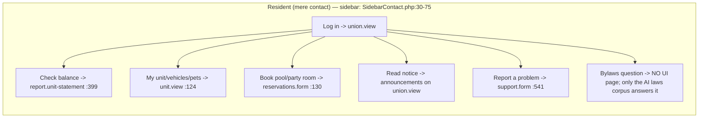
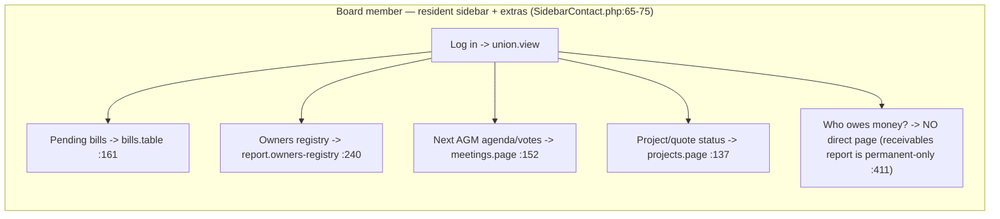
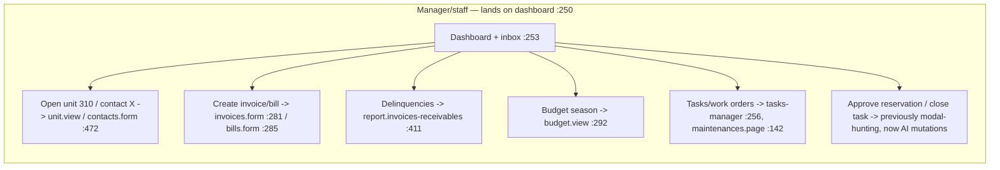

# CondoEdge Domain Map — what the app is, who uses it, what the AI covers

> Evidence date 2026-06-09. Host: `C:/Users/jkend/Documents/Projects/kompo/CondoEdge` (paths below are host-relative unless prefixed `ai/`).
> **Status note:** the 10/10 plan (`ai/docs/audit/CondoEdge-10of10-config-plan.md`) is **largely implemented but UNCOMMITTED** —
> `config/ai.php` + 5 view mounts are all `M` in the working tree; the last committed touch to `config/ai.php` is `b6828a93 2026-04-02`.

---

## 1. Context (C4-1): personas → CondoEdge → condoedge/ai → stores

---

## 2. Module map: pages/routes per module and who reaches them

Role tiers from `routes/web.php`: **has-plan** group (`:109`, no role middleware → residents+board+staff), **Role::team** (`:243,:448,:473,:488,:532,:545`), **Role::permanent** (`:275,:392,:402,:435`), **Role::lead** (`:518`), **Role::superAdmin** (`:315,:647`). Middleware chain: superAdmin ⊂ lead ⊂ manager ⊂ administration ⊂ permanent ⊂ team (`app/Rbac/Role.php:10-47`). Board members fail ALL role middleware (they are role `contact`, `HasRoles.php:156`).

```mermaid
flowchart TD
    subgraph CondoCore ["Condo core"]
        u1["unit.view :124 — has-plan"]
        u2["union.view :128 — has-plan"]
        u3["units.catalog :122 — has-plan"]
        u4["union.manager :277 — permanent"]
        u5["vehicles/accesses/extras.form :528-531 — open route, UI gates add to staff"]
        u6["announcements.form :525 — open route"]
        u7["union.stats :165 — has-plan"]
    end
    subgraph Finance
        f1["report.unit-statement :399 — has-plan, polymorphic customer_id"]
        f2["bills.table :161 — has-plan (board sees it: SidebarContact.php:69)"]
        f3["invoices.form/.table :281,:284 — permanent"]
        f4["bills.form :285 — permanent"]
        f5["budget / budget.view :291-292 — permanent"]
        f6["transactions / chart-of-accounts :299,:280 — permanent"]
        f7["finance reports :405-419 — permanent"]
    end
    subgraph Meetings
        m1["meetings :151 — has-plan"]
        m2["meetings.page :152 — has-plan"]
        m3["meetings.form/motions.form :489-491 — team"]
    end
    subgraph Suppliers
        s1["suppliers.page :135 — has-plan"]
        s2["projects.page :137 — has-plan"]
        s3["maintenances.page :142 — has-plan"]
    end
    subgraph FilesSupport ["Files / Support / Tasks / Messaging"]
        d1["files-manager :254 — team"]
        d2["file-info.form :510 — open route, ACL inside"]
        d3["support.form :541 — has-plan"]
        d4["inbox :253 — team"]
        d5["tasks-manager :256 — team"]
    end
    subgraph Reservations ["Reservations / Calendar"]
        r1["reservations.form :130 — has-plan"]
        r2["calendar :118 — has-plan"]
    end
    subgraph BoardReports ["Registry reports (board-reachable)"]
        b1["report.owners-registry :240 — has-plan"]
        b2["report.unit-registry :238 / emergency-registry :239 / quote-part :237"]
    end
    RES["Resident"] --> u1 & u2 & f1 & m1 & r1 & r2 & d3
    BRD["Board"] --> f2 & b1 & b2 & m2 & s1 & s2 & s3
    STF["Staff"] --> u4 & f3 & f4 & f5 & f6 & f7 & d1 & d4 & d5 & m3
```

Domain breadth (model classes per dir, `app/Models/`): Condo 19, Finance 29, Supplier 20, Contact 9, Messaging 10, Billing(SaaS) 7, Meetings 5, Task 5, Discussions 6, FileManager 2, Eft 2, Phone 3 — 137 model files reference `Nodeable`.

---

## 3. Day in the life per persona

---

## 4. AI coverage by module (current working-tree state)

Catalogs: 16 files / **128 labels** under `config/ai-entities/` (condo 19, finance 28, supplier 20, general 16, messaging 9, billing 6, contact 5, discussions 5, meetings 5, task 4, eft/filemanager/imports/phone/settings 2 each, calendar 1) — all rich (description + per-field docs + scopes + embed_fields + aliases, e.g. `config/ai-entities/condo.php:89-155`). `auto_sync` on (`config/ai.php:174`); **runtime Neo4j/Qdrant node counts unverified here — run `ai:ingest` + count per label before trusting "answerable"**.

| Module | Cataloged | "my X" path (`user_entity_paths`) | Actions wired | Chat surface mounted |
|---|---|---|---|---|
| Condo core (Union/Building/Unit) | yes | Unit `config/ai.php:640`, Contact `:646` | Unit view/statement/add_vehicle/add_access `:1109-1141`; Union view/manage `:1144-1157`; generics units/contacts `:1451-1464` | **UnitView.php:131**, **UnionView.php:138** (full page_context) |
| Registries (Vehicle/Pet/Access/Extra) | yes | Vehicle `:665`, Pet `:673` (fixed), Access `:681`, Extra `:689` | add_vehicle/add_access under Unit | via UnitView |
| Announcements | yes | `:697` | Announcement.edit staff `:1328`; new_announcement `:1430` | none (modal-only feature) |
| Reservations/Resources | yes | Reservation `:717`; **no Resource path** | make_reservation `:1380`; **mutations** approve/reject `:1207-1228` | none on calendar/reservation pages |
| Finance receivables | yes | Invoice `:656` (polymorphic fix in place) | Invoice.edit `:1285`; my_statement `:1392`; report_receivables `:1479` | **InvoiceForm.php:188** |
| Finance payables/GL (Bill/Budget/Txn/Account) | yes | none (intentional — staff data) | Bill/Budget/Transaction actions `:1295-1324`; budget/transactions/chart_of_accounts/report_* generics `:1465-1520` | **BudgetView NOT mounted** (plan §7 row undone) |
| Meetings (Meeting/Motion/Vote) | yes | Meeting `:707` | Meeting.view `:1160`; meetings generic `:1399` | **MeetingPage.php:71** |
| Suppliers/Projects/Maintenance | yes | none | view actions `:1169-1193`; suppliers generic `:1542` | **SupplierPage.php:76**; **ProjectPage/MaintenancePage NOT mounted** (plan §7 rows undone) |
| Tasks | yes | none | **mutations** Task.close `:1233`, TaskDetail.complete `:1250` | none |
| Messaging/Support | yes | **none** — "status of my support request" unanswerable | support `:1386`, inbox `:1535` (nav only) | none |
| Files / laws corpus | File wired: `file_model`+`accessibleBy` `:874-879`; `public/laws/**/*.md` `:820-822` | n/a (retrieval) | File.info staff `:1339`; files_manager `:1528` | n/a |
| BoardMember | yes | `:725` ("am I on the board") | none (board-members.form :474 is team-gated) | n/a |
| Discussions / Billing-SaaS / EFT / Phone / Imports | yes | none | none | none — acceptable noise floor |

Cross-cutting state: `example_questions` resident-persona `:931-938`; `page_examples` for Unit/Union/Meeting/Contact/Invoice/Supplier `:943-975` (no Project/Maintenance/Budget keys); `chat.surface` **default `'modal'`** `:916` (plan said drawer); **no `identity` block** in host (package default interpolates APP_NAME, `ai/config/ai.php:56-57`); `security.on_permission_unexistent => 'bypass'` (fail-open) `:246` — flagged in plan, still unresolved.

---

## 5. Value gap: why would anyone prefer the AI over clicking?

**Resident** — the UI is already 2 clicks to everything they own (sidebar is per-unit, `SidebarContact.php:43-60`). The AI wins ONLY on (a) the laws/bylaws corpus — "can I have a dog / install an EV charger?" has **no UI page at all**, only `public/laws/**/*.md` retrieval (`config/ai.php:820`); (b) cross-entity asks ("how much do I owe and when is the next meeting"). Both wired. The remaining resident friction is writes: booking an amenity in-chat is a nav link, not a transaction.

**Board member** — the persona with the WORST coverage relative to legitimate access. Every staff-gated action uses `$staffOnly = !isContact()` (`config/ai.php:14-22`), and board members ARE `isContact()` (`HasRoles.php:156-167`) — correct for `Role::permanent` routes, but it also suppresses links the board reaches daily via their own sidebar: owners registry (`web.php:240`, no role middleware; menu `SidebarCommon.php:268-276`) and the payables table (`web.php:161`; menu `SidebarContact.php:69`). The AI literally serves the board persona less than the sidebar does.

**Staff** — wins are real: jump-to-record ("open unit 310"), aggregate queries the UI scatters across reports, and the three approval-gated mutations (reservation approve/reject, task close). Coverage is good; the gap is mounts on the pages where staff live (Budget/Project/Maintenance) and that nothing surfaces the chat in inbox/tasks where their day actually happens.

### Top 10 improvements (user value ÷ effort, descending)

| # | Improvement | Evidence / target file | Value | Effort |
|---|---|---|---|---|
| 1 | **Commit + verify the working-tree enrichment.** All 6 wiring files are uncommitted (`git status`: M `config/ai.php`, UnitView, UnionView, MeetingPage, SupplierPage, InvoiceForm); run the plan's 12-step checklist incl. `ai:ingest` label counts | plan `ai/docs/audit/CondoEdge-10of10-config-plan.md:607-621` | everything else is moot if lost | trivial |
| 2 | **Board tier on the gate:** add `$boardOrStaff = !isMereContact()` and apply it to actions whose routes are has-plan: `report_owners_registry` (`config/ai.php:1486-1492` vs route `web.php:240`), plus a new `bills_table` generic (`web.php:161`, board menu `SidebarContact.php:69`). Keep `$staffOnly` for permanent/team routes | `config/ai.php:14-22` | unlocks the whole board persona | low (config-only) |
| 3 | **"My support requests" path:** add a Thread/support `user_entity_paths` entry so "what's the status of my request?" answers instead of re-linking the form | `config/ai.php:639` (no Thread key today); catalog `config/ai-entities/messaging.php`; route `web.php:541` | top resident follow-up question | low-med (verify Thread→user rel in catalog first) |
| 4 | **Book-amenity as an approval-gated mutation** (wrap the same create path `ReservationForm` uses, like the existing `$mutation` helper does for approve/reject `config/ai.php:1207-1228`) — today residents get a nav link only (`:1380`) | `app/View/Condo/ReservationForm.php`, `App\Models\Condo\Reservation` | the single resident "wow" write | medium (slot validation + input_schema) |
| 5 | **Flip `chat.surface` default to `'drawer'`** — a modal hides the very page the user is asking about; plan §6 specified drawer, host still defaults modal | `config/ai.php:916` | every chat session | one line |
| 6 | **Mount AiChatFloating on ProjectPage/MaintenancePage/BudgetView + add their `page_examples` keys** — plan §7 rows verified NOT done (`rg AiChatFloating` misses all three) | `app/View/Supplier/ProjectPage.php`, `app/View/Supplier/MaintenancePage.php`, `app/View/Finance/BudgetView.php`; examples `config/ai.php:943` | staff/board live on these pages | low (copy the SupplierPage.php:76 pattern) |
| 7 | **Resolve `on_permission_unexistent => 'bypass'`** (fail-open) with owner sign-off — multi-tenant condo data; verify `{Entity}.AiRetrieving` permission rows exist, then flip to `deny` | `config/ai.php:246`; plan checklist item 11 | trust/safety, pre-GA blocker | low config, real verification cost |
| 8 | **Add `identity` block** — host has none, so the assistant brands as raw APP_NAME with a generic persona; plan §6 wrote one | host `config/ai.php` (absent); package default `ai/config/ai.php:56-72` | product feel, non-disclosure consistency | trivial |
| 9 | **Resource path + amenity answer:** "What amenities can I reserve?" is literally a shipped Union page_example (`config/ai.php:954`) but Resource has no user path/action — add Union→RESOURCES path + a Resource action anchored to `reservations.form` | `config/ai.php:639` (no Resource key); catalog `config/ai-entities/condo.php` | makes a shipped suggestion actually work | low |
| 10 | **Board example set:** `example_questions` is resident-only (`config/ai.php:931-938`); board users see resident suggestions on the same union.view landing. Add role-aware examples (board: arrears posture, open quotes `quote-requests.management web.php:144`, registry reports) | `config/ai.php:931`; package `MessagesQuery::resolveExampleQuestions` | first-impression for the influencer persona | medium (needs role-aware resolution hook in package) |

**Non-goals (deliberately skip):** Phone/EFT/Imports/Billing-SaaS chat coverage (cataloged, zero persona demand); Discussions integration (overlaps `condoedge/chatbot` per audit memory); resident `File.info` exposure (plan's reasoning holds — residents get content via retrieval, the form is team-gated `web.php:510` + ACL).
