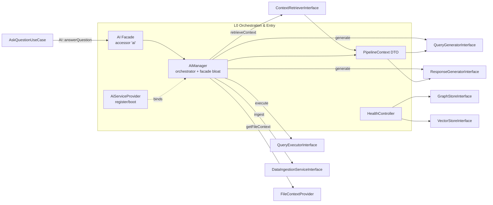

# Layer 00 — Orchestration, Entry & DI Wiring

## 1. Purpose (plain language)

This layer is the package's front door and switchboard. `AiServiceProvider` wires every service into Laravel's container (which embedding/LLM/vector/graph implementation to use, the RAG retriever, query generator/executor, response generator, chat, discovery, security, etc.). The `AI` facade + `AiManager` are the public entry point that consumers call: in the real flow ("user asks -> important words -> files -> enhance prompt -> query -> answer -> actions"), the chat use case calls `AI::answerQuestion()`, which orchestrates the whole pipeline (retrieve context/QU -> file context -> generate+execute Cypher -> build NL answer). `PipelineContext` is the single typed bag that carries data between every downstream stage, and `HealthController` is a tiny readiness probe for Neo4j/Qdrant/LLM config.

## 2. C4 component diagram

## 3. Data in / data out

In:
- `string $question` + `array $options` (keys: `user`, `style`, `conversation_id`, `conversation_context`) from `AskQuestionUseCase` via `AI::answerQuestion`.
- `Nodeable $entity` for ingestion (jobs, traits, plugins, observer).
- Raw config arrays (`config/ai.php`) consumed by `AiServiceProvider::register()` closures.

Out:
- `array` response shape: `question, answer, insights, visualizations, cypher, data, stats, referenced_files, metadata` (from `answerQuestion`/`buildFinalResponse`).
- `PipelineContext` (typed) emitted by `retrieveContext`, mutated in-place through the pipeline; embeds `QueryUnderstandingResult`, `SemanticSelectionResult`, `QueryGenerationResult`, `QueryExecutionResult`.
- Bound service instances (singletons) into the container.
- `JsonResponse` (health 200/503) from `HealthController`.

## 4. Contracts (owned / consumed)

Owned by this layer: none defined here except the public `AiManager` surface and the `PipelineContext` DTO shape (a concrete class, not an interface).

Consumed (injected into `AiManager`): `DataIngestionServiceInterface`, `ContextRetrieverInterface`, `EmbeddingProviderInterface`, `LlmProviderInterface`, `QueryGeneratorInterface`, `QueryExecutorInterface`, `ResponseGeneratorInterface`, `VectorStoreInterface`, plus concretes `FileContextProvider`, `ResponseFileEnricher`, `ResponseEntityEnricher`. `HealthController` consumes `GraphStoreInterface`, `VectorStoreInterface`. The provider wires ~25 interface bindings + aliases for the whole package.

## 5. Findings

| ID | Sev | Type | File:line | What | Why it matters | Recommendation | Verified |
|----|-----|------|-----------|------|----------------|----------------|----------|
| L0-1 | P0 | bug | src/Services/AiManager.php (no method) vs src/Observers/RelatedModelSyncObserver.php:156 | `RelatedModelSyncObserver` calls `AI::syncRelationships([$parent])`, but `AiManager` has **no** `syncRelationships()` method and no `__call`/`__callStatic` magic. The method exists only on `DataIngestionService`/`BatchDataIngestionService`/the interface. | The sync-observer path (wired in `registerSyncObservers()`) throws `BadMethodCallException` at runtime whenever a related model changes. A core "stay in sync" feature is ships-broken. The facade wraps ~40 methods but forgot the one the observer needs. | Add `public function syncRelationships(array $entities): array { return $this->ingestion->syncRelationships($entities); }` to `AiManager`, or change the observer to resolve `DataIngestionServiceInterface` directly. Add a test asserting the observer path. | true |
| L0-2 | P1 | bug | src/Services/AiManager.php:206-209 | `getExampleEntities(array $labels, int $limit)` delegates to `$this->context->getExampleEntities($labels, $limit)` but `ContextRetrieverInterface::getExampleEntities(string $label, ...)` (Contracts/ContextRetrieverInterface.php:154, impl ContextRetriever.php:645) takes a **string** and runs `empty($label)`/`isValidLabel($label)`. Passing an array TypeErrors against the declared `string` param. | The wrapper is both wrong (type mismatch) and dead (only referenced in docs/facade docblock). Anyone trusting the facade signature gets a crash. | Delete the wrapper, or fix it to loop labels and call the string API per label. | true |
| L0-3 | P1 | dead-code | src/Services/AiManager.php:547-576, 659-697 | `askQuestion()` and `ask()` are pipeline methods with **zero** production callers — only `resources/docs/**` and the `AI.php` docblock reference `AI::askQuestion(`/`AI::ask(`. `answerQuestion()` (754) is the single real chat path (called by `AskQuestionUseCase.php:135`). | Three overlapping "full pipeline" entry points (ask/askQuestion/answerQuestion) is a single-path violation: future maintainers don't know which is canonical, and the two dead ones duplicate retrieve+generate logic that has already drifted from `answerQuestion`. | Delete `ask()` and `askQuestion()` (and their `@method` lines + docs), or collapse them into thin wrappers over `answerQuestion`. | true |
| L0-4 | P1 | dead-code | src/Services/AiManager.php:184,206,361,394,424,435,514,524,535,604,619,636,647,723,735 | ~15 one-line pass-throughs are never called through the facade/manager anywhere in `src/`: `searchSimilar`, `getExampleEntities`, `chatJson`, `stream`, `getLlmMaxTokens`, `countTokens`, `sanitizeQuery`, `getQueryTemplates`, `detectQueryTemplate`, `executeCount`, `executePaginated`, `explainQuery`, `testQuery`, `extractInsights`, `suggestVisualizations`. Consumers call the underlying services directly (e.g. `ResponseGenerator->extractInsights`, `ContextRetriever->searchSimilar`, `QueryExecutor->executeCount`, providers' `chatJson`). | Facade bloat: ~50% of `AiManager` is an unused mirror of 5 service interfaces. It inflates the class to 1118 lines, doubles the maintenance surface, and the `@method` block must be hand-synced (it already drifted — see L0-2, L0-6). | Drop the manager to the methods actually used (`ingest/ingestBatch/sync/remove`, `retrieveContext`, `getSchema`, `storeQuery`, `embed`, `complete`/`chat`, `generateQuery`, `executeQuery`, `generateResponse`, `answerQuestion`, `retrieveFileContext`, `+ syncRelationships`). Consumers wanting the rest should inject the specific interface. | true |
| L0-5 | P1 | half-done | src/Services/AiManager.php:1101-1117 | `filterSensitiveResults()` is an explicit no-op: it returns `$executionResult` unchanged with a docblock "kept as a placeholder for future AiAccessGate integration". It is still called in the hot path at 874. | Dead/half-done security stub on the live chat path. It reads as a security control but does nothing; `$user` is accepted and ignored. Real filtering is at the Eloquent/`HasSecurity` layer, so the call is pure misdirection. | Remove the call and the method until `AiAccessGate` exists; or implement it. Do not ship a security-named no-op. | true |
| L0-6 | P1 | dead-code | src/AiServiceProvider.php:909-970 | `provides()` lists ~60 bindings, but the provider is **not deferrable** — `boot()` unconditionally loads routes, migrations, translations, commands, observers, and FileModel plugins, and `register()` calls `mergeConfigFrom`. Laravel only consults `provides()` for deferred providers (those that set `$defer`/`isDeferred`). No `isDeferred`/`$defer` exists in the package. | `provides()` is dead code that is also misleading: it's out of sync with the real bindings (e.g. `RerankerInterface`, `AiActionRegistry`, `ActionDispatcher`, `ChunkStoreInterface`, `PdfParserInterface`, `ContentLinkProcessor`, UI/settings interfaces are registered but absent from the list), so a reader assumes a deferral contract that doesn't hold. | Delete `provides()` (the provider can't be deferred while `boot()` does eager I/O), or actually make it deferrable by moving route/migration/observer loading out. | true |
| L0-7 | P1 | security | src/Services/AiManager.php:1006-1012, 982-993 | `resolveQueryParameters()` (static) reads `auth()->id()` and `currentTeamId()` for both parameterize (storing similar queries) and **de**parameterize (serving them via `SimilarQueriesSection.php:55`). It ignores the pipeline-threaded `$options['user']`. | In CLI (`TestQuestionCommand`), queued jobs, eval runs, or impersonation, `auth()->id()` is null or the wrong user, so stored example queries are de-parameterized with the wrong identity and injected into the prompt — a cross-user data-shaping / leak smell. The codebase explicitly threads `$options['user']` elsewhere (comment at 863-865) precisely to avoid `auth()->user()`, then this path falls back to it. | Thread the resolved user/team through `parameterizeCypher`/`deparameterizeCypher` from `$options['user']` instead of static `auth()`. Make the methods instance methods or pass identity explicitly. | true |
| L0-8 | P1 | single-path-violation | src/Services/AiManager.php:795-840, 1040-1052; src/Console/Commands/TestQuestionCommand.php:148-160; src/Services/Eval/PipelineEvalDriver.php:220-230 | The multi-query file-context fan-out (build queries from `qu.searchQuery/question/clarifiedQuestion/searchTags`, loop, merge by relevance) lives in `retrieveAndSetFileContext()`, while `TestQuestionCommand` and `PipelineEvalDriver` re-implement their own `retrieveFileContext` fan-out loops. | Three copies of the same recall-merging algorithm drift independently; a fix to relevance/merge logic in one won't reach the others. The eval driver and test command therefore measure a different pipeline than production. | Extract the fan-out into one method/service (`FileContextProvider` or a dedicated retriever) and have all three call it. | true |
| L0-9 | P2 | abstraction | src/DTOs/PipelineContext.php:13-49 | `PipelineContext` is a public-mutable bag: 13 public properties, four typed sub-DTOs, plus 7 loosely-typed `array` fields (`fileContext`, `conversationContext`, `selectionInfo`, `quality`, etc.). `AiManager` mutates it in place across 3 private steps. | A god-DTO with public writable arrays gives no invariants — any stage can stomp any field, and `fileContext` is sometimes a flat list, sometimes a `{relevant_files,...}` shape (see 826-836 vs the `!empty($ctx->fileContext['relevant_files'] ?? $ctx->fileContext)` defensive read at 847). Hard to reason about, easy to break. | Type the array fields (FileContext DTO, ConversationContext DTO), make setters intent-revealing, or split read vs write views. At minimum document the canonical `fileContext` shape. | true |
| L0-10 | P2 | complexity-without-value | src/Services/AiManager.php:23-66, 69-101; src/Facades/AI.php:9-131 | Heavy "novel"-length docblocks: 40+ lines of usage/testing prose on the class, full per-method Mockery examples on the facade, and obvious docblocks on trivial one-liners (`embed`, `getEmbeddingModel`, etc.). The `@method` block (91-127) is a 37-line hand-maintained mirror that has already drifted (lists `askQuestion`/`ask`/`getExampleEntities(array)` that are dead/wrong). | Token/maintenance waste; the docblock duplicates the README and goes stale, actively misleading callers (it documents methods that crash or don't exist). | Trim to one-line intent docs; generate `@method` from the real surface or drop dead entries; move tutorials to docs/. | true |
| L0-11 | P2 | bug | src/Http/Controllers/HealthController.php:41-45 | Health reports overall `unhealthy` (HTTP 503) when the LLM key is merely `not_configured`, and the LLM "check" only verifies a config key exists — it never pings the provider, unlike Neo4j/Qdrant which do a real call. | Inconsistent liveness semantics: a perfectly reachable LLM with a key set but invalid returns "configured"/healthy, while a deliberately keyless dev box returns 503. The probe gives false confidence and false alarms. | Either do a cheap real LLM check (e.g. `getModel()`/tiny ping) or downgrade missing-key to a soft warning that doesn't flip the 503. Make the three checks symmetric. | true |
| L0-12 | P3 | coupling | src/Services/AiManager.php:480,562,682,775,1049 | Uses the `\Log` facade and `now()` global helpers directly inside the orchestrator instead of an injected logger/clock (the package already has `AiLogger` injected into many services). | Inconsistent logging (some services use `AiLogger`, the manager uses `\Log`), and harder to test/silence. Minor, but the manager is the one class that should model the package's own conventions. | Inject `AiLogger` (already a singleton) into `AiManager` and use it. | true |

## 6. File checklist

| File | Verdict | Note |
|------|---------|------|
| src/AiServiceProvider.php | REFACTOR | Solid, readable wiring, but delete the dead/misleading `provides()` (L0-6); it's not deferrable and is out of sync with real bindings. Otherwise the per-section register methods are well organized. |
| src/DTOs/PipelineContext.php | KEEP | Right idea (one typed bag through the pipeline) and small, but tighten the loosely-typed `array` fields and document the `fileContext` shape (L0-9). Keep. |
| src/Facades/AI.php | REFACTOR | Trivial accessor is fine; the 130-line docblock + `@method` mirror is bloated and drifted (documents `ask`/`askQuestion`/`getExampleEntities(array)` that are dead/broken, omits `syncRelationships`). Trim and regenerate (L0-10). |
| src/Http/Controllers/HealthController.php | REFACTOR | Useful probe but the LLM check is asymmetric (config-only) and flips 503 on a missing key (L0-11). Make the three checks consistent. |
| src/Services/AiManager.php | SPLIT | 1118 lines, ~50% dead facade pass-throughs (L0-4), 2 dead pipeline entries (L0-3), a missing method that crashes the observer (L0-1), a type-mismatch wrapper (L0-2), a no-op security stub (L0-5), and an auth-leak in parameterization (L0-7). Split into a thin orchestrator (`answerQuestion` + the genuinely-used ingest/context/response methods) and drop the rest. |

## 7. What to add (next-level)

- One canonical entry method (`answerQuestion`) with `ask`/`askQuestion` deleted; consumers inject specific interfaces for low-level access instead of going through a 40-method god-facade.
- A real `AiAccessGate` (or remove `filterSensitiveResults`); the answer pipeline should have an explicit, testable post-retrieval authorization step rather than a no-op.
- Identity-as-a-dependency: a `PipelineIdentity`/actor object threaded from `$options['user']` into parameterize/deparameterize and the executor, eliminating every `auth()->id()`/`currentTeamId()` static call (L0-7) so CLI/queue/impersonation/eval all behave correctly.
- Typed sub-DTOs for `fileContext`/`conversationContext` with one canonical shape, plus a builder so stages can't stomp arbitrary fields on `PipelineContext`.
- A single `FileContextRetriever` service owning the multi-query fan-out, injected into the manager, the test command, and the eval driver (kills L0-8 and makes eval measure prod).
- A genuine health/readiness check that pings the LLM (and reports per-dependency status without a binary 503), plus a separate `/ready` vs `/live` split.
- Auto-generated `@method`/facade docs (or an IDE-helper meta file) sourced from the real `AiManager` reflection so the facade can never drift from the implementation again.

## 8. Open questions / risks

- L0-1 is a P0 only if `sync_triggers` is configured in a host app (the observer is only registered when `config('ai.sync_triggers')` is non-empty). Confirm whether any shipping config populates it; if so this is a live crash, if not it's a latent landmine. The package default `config/ai.php` should be checked (out of this lane).
- `retrieveFileContext` is declared `public` (AiManager.php:1040) but `tests/Unit/Services/AiManagerFileContextTest.php:104` asserts it `isProtected()` — the test and code disagree; one of them is stale. (Test file is out of lane; flagging for the test/owner lane.)
- Removing the dead pass-throughs (L0-4) is safe re: `src/`, but external host apps may call `AI::executePaginated()` etc. via the documented facade. Treat as a documented breaking change / deprecation cycle, not a silent delete.
- `provides()` removal (L0-6) is safe given non-deferral, but confirm no host relies on the provider being treated as deferred (it isn't, so this is low risk).
