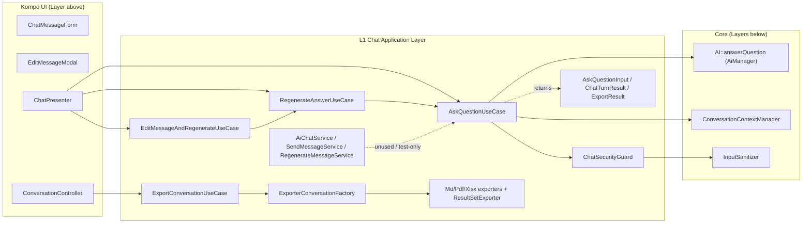

# Layer 01 — Chat Application Layer (Use Cases / Services / Export)

## 1. Purpose (plain language)

This layer is the "what happens when a user sends a chat message" orchestration layer. It sits between the Kompo UI components (forms/modals/presenter) and the heavy RAG engine (`AiManager`). When a user asks a question, this layer runs the security gate, threads the message through conversation-context tracking, calls the RAG pipeline to get an answer, persists both the user and assistant messages in one transaction, and hands back an immutable result the UI can render. It also owns the regenerate / edit-and-regenerate variants and the "export this whole conversation to a file" flow (Markdown / PDF / Xlsx).

In the "user asks -> important words -> files -> enhance prompt -> query -> answer -> actions" flow, this layer is the **front door and the bookkeeper**: it does not generate queries or read files itself — it delegates that to `AI::answerQuestion()` — but it decides *whether* a turn runs (auth + injection), records context for follow-ups, and packages the answer.

## 2. C4 component diagram

## 3. Data in / data out

**In:**
- `AskQuestionInput` DTO (question string, `AiConversation`, style, user, allowAnonymous) — or loose positional args on the use cases (`AiConversation`, `AiMessage`, `newContent`, style, user).
- For export: `conversationId:int`, `format:string`, `user`.

**Out:**
- `ChatTurnResult` (immutable): `answer`, `data`, `suggestions`, `sources`, `cypher`, `assistantMessage` (persisted `AiMessage`), `error`, `degraded`. `failed()` is the soft-failure signal.
- `ExportResult` (immutable): `content` (bytes/string), `mime`, `filename`.
- Side effects: persisted `AiMessage` rows (user + assistant), updated `context_snapshot` on the conversation.
- The legacy services (`AiChatService`, `SendMessageService`, `RegenerateMessageService`) return a loose **array** shape `{answer, data, suggestions, sources, cypher_query}`.

## 4. Contracts (owned / consumed)

**Owned (defined in this layer):**
- `AiChatServiceInterface` — legacy chat seam (askWithConversation/getSchema/isAvailable).
- `ExportConversationServiceInterface` — `export($conversation)`, `getMimeType()`, `getFileExtension()`.
- DTOs as de-facto contracts: `AskQuestionInput`, `ChatTurnResult`, `ExportResult`.

**Consumed (from other layers):**
- `Facades\AI` -> `AiManager::answerQuestion()` / `getSchema()`.
- `ConversationContextManager` (Context layer).
- `InputSanitizer` (Security layer) via `ChatSecurityGuard`.
- `AiActionResult` (Actions layer) — `ResultSetExporter` returns it.
- `AiConversation` / `AiMessage` Eloquent models.

## 5. Findings

| ID | Sev | Type | File:line | What | Why it matters | Recommendation | Verified |
|----|-----|------|-----------|------|----------------|----------------|----------|
| L1-1 | P1 | dead-code | src/Services/Chat/SendMessageService.php (whole file) | `SendMessageService` is referenced only by its own test; not bound in `AiServiceProvider`, not used by `ChatPresenter`/`ChatMessageForm` (which call `AskQuestionUseCase` directly). | A "thin guard" that nothing calls is pure surface area + a misleading second path. The empty-message check it claims to own is already done in `ChatMessageForm::sendMessage` and `EditMessageModal`. | Delete the file + its test, or make `ChatPresenter::handleSend` route through it if validation truly belongs here. Pick ONE entry path. | true |
| L1-2 | P1 | dead-code / single-path-violation | src/Services/Chat/RegenerateMessageService.php (whole file) | `RegenerateMessageService` (regenerateFromMessage / regenerateFromAssistantMessage) is bound (provider:608) but called by NOTHING except its test; the real regenerate path is `ChatPresenter::handleRegenerate -> RegenerateAnswerUseCase`. Its own header docblock calls it a "thin guard … the actual flow lives in RegenerateAnswerUseCase". | Redundant thin wrapper over `RegenerateAnswerUseCase`; the `regenerateFromAssistantMessage` "walk back to preceding user message" logic exists nowhere else and is therefore unreachable functionality. | Delete, or fold `regenerateFromAssistantMessage`'s walk-back into `ChatPresenter`/`RegenerateAnswerUseCase` if that entry is actually wanted. Remove the provider singleton + deferred-list entry. | true |
| L1-3 | P1 | half-done | src/Services/Chat/UseCases/AskQuestionUseCase.php:146 | `$suggestions = $aiResponse['suggestions'] ?? []` — but `AiManager::answerQuestion` NEVER returns a `suggestions` key (verified: buildFinalResponse return @AiManager:920-936 and error return :778-788 have no such key). | `suggestions` is dead end-to-end: always `[]`, stored empty in `AiMessage` metadata, and `MessagesQuery.php:261` `renderSuggestions` can never fire. A whole UI feature is wired to a value that is structurally always empty. | Either have the response generator actually return suggestions, or remove the suggestions plumbing from the use case, `ChatTurnResult`, `AiMessage` metadata, and `MessagesQuery`. | true |
| L1-4 | P1 | half-done / dead-code | src/Services/Chat/Exporter/ExportConversationPdfService.php, ExportConversationXlsxService.php | PDF/Xlsx exporters are registered in the factory (ExporterConversationFactory:9-10), but the ONLY route `export-chat/{id}` (routes/web.php:7) has no `{type}` segment, the controller defaults `$type='md'` (ConversationController:10), and the UI link hardcodes `.md` (MessagesQuery.php:122-123). | The PDF/Xlsx exporters + `ResultSetExporter` (~250 LOC) are completely unreachable in production. The in-file "NOTE FOR THE MAIN SESSION: register this in the factory" comments are stale (already done) — classic half-landed slice. | Add `{type?}` to the route and pass it from the UI (a format menu), or drop PDF/Xlsx until there is a real entry point. Remove the stale NOTE comments. | true |
| L1-5 | P2 | complexity-without-value | src/Services/Chat/UseCases/RegenerateAnswerUseCase.php:59 + AskQuestionUseCase.php:89 + EditMessageAndRegenerateUseCase.php:50 | Nested `DB::transaction`: Edit opens a txn -> Regenerate opens a txn -> AskQuestionUseCase::regenerate opens a txn. Three nested transactions for one logical operation. | Laravel emulates nesting with savepoints so it's not broken, but it's confusing, costs savepoint round-trips, and obscures where atomicity actually lives. The runTurn try/catch also swallows failures and still `addMessage`s an error row INSIDE the outer txn. | Collapse to a single transaction at the outermost use case; inner methods should assume they run in a txn (or take an explicit "already in transaction" contract). | true |
| L1-6 | P2 | single-path-violation | src/Services/Chat/UseCases/RegenerateAnswerUseCase.php:55 + AskQuestionUseCase.php:85 | The injection scan runs TWICE per regenerate: `RegenerateAnswerUseCase::execute` calls `assertSafe`, then `AskQuestionUseCase::regenerate` calls `assertSafe` again on the same content. Comment hand-waves it as "idempotent and cheap". | `InputSanitizer::analyze` is not free (and a future LLM-based sanitizer would be expensive). Double-scanning the same string is wasteful and signals unclear ownership of the gate. | Pick one owner of the gate. Have the public entry (RegenerateAnswerUseCase) assert safe, and let the private `regenerate()` trust its caller. | true |
| L1-7 | P2 | single-path-violation / dead-code | src/Services/Chat/AiChatService.php:89-154 | `AiChatService::askWithConversation` / `regenerateResponse` still exist and re-delegate to `AskQuestionUseCase` via `app(...)`, returning the legacy array. Production no longer uses them (only `TestConversationCommand` + tests do). | A second public path into the same orchestration, kept "for migration". It duplicates the result->array mapping that also lives in `SendMessageService` and `RegenerateMessageService` (three copies). Drift risk. | After the console command is migrated to the use case, delete the two methods (keep `isAvailable`/`getSchema` if `AiChatServiceInterface` is still a published contract). Centralize result->array in ONE place if the legacy shape must survive. | true |
| L1-8 | P2 | coupling / leaky-abstraction | src/Services/Chat/UseCases/ExportConversationUseCase.php:42-48 | Authorization is done by `where('user_id', $user->id ?? null)`. With an unauthenticated/object-less `$user`, `$user->id ?? null` becomes `null` and the query matches conversations with `user_id IS NULL` (or none), but the intent (deny) is implicit, not explicit. | Silent reliance on "no row matches" for authz is fragile; a future seed/import with `user_id = null` conversations would leak. Authz logic also lives here instead of a Policy (the package HAS `AiConversationPolicy`). | Reuse `AiConversationPolicy` (Gate::authorize) for export ownership, and fail fast on a null user rather than relying on a non-matching WHERE. | true |
| L1-9 | P2 | bug | src/Http/Controllers/ConversationController.php:10-18 | The controller catches nothing. `ExportConversationUseCase` throws `ModelNotFoundException` (not owned/not found) and `InvalidArgumentException` (bad format); PDF/Xlsx exporters throw `RuntimeException` when the lib is missing. All become raw 500s / Laravel's default 404. | The whole point of `ResultSetExporter`'s "guarded degradation + clear summary" is lost: the user gets a 500 instead of "install dompdf". No user-facing handling of an unsupported format. | Map `ModelNotFoundException`->404, `InvalidArgumentException`/`RuntimeException`->422 with the exception message. Or let the use case return an `ExportResult` error variant. | true |
| L1-10 | P3 | ai-comment / token-waste | src/Services/Chat/UseCases/AskQuestionUseCase.php:20-35, 50-64, 83-96; RegenerateAnswerUseCase.php:16-23,76; EditMessageAndRegenerateUseCase.php:16-21 | Docblocks are migration-narrative: they cite exact OLD line numbers ("AiChatService.php:79-189", "EditMessageModal.php:151-153/186-188") and editorial notes ("fixing the old ordering bug", "Concrete, container-autowired … per the Sisc UseCase convention"). | These line refs are already stale (the cited files changed) and will rot further. They document the diff, not the behavior — noise for the next reader, and a maintenance lie once lines move. | Replace with a 1-line behavioral docblock. Keep rationale in the PR/commit, not in perpetuity in the source. | true |
| L1-11 | P3 | abstraction | src/Services/Chat/Exporter/ExportConversationServiceInterface.php:7 | `export($conversation)` has no type hint on `$conversation` and no return type; `ExportConversationMdService` also omits `declare(strict_types)`. Md/Pdf/Xlsx implementations diverge (Pdf returns dompdf bytes, Md returns a string) but the contract can't express that. | Untyped boundary on an extension point host apps are meant to implement (`registerExporter`). Weak contract = weak DX for the "easy to inject into other projects" goal. | Type as `export(AiConversation $conversation): string`. Add `declare(strict_types=1)` to the Md service and the interface/factory for consistency. | true |
| L1-12 | P3 | coupling | src/Services/Chat/Exporter/ExportConversationPdfService.php:20-24, ExportConversationXlsxService.php:21-25 | Constructor does `$exporter ?? new ResultSetExporter()` — a hand-rolled fallback instead of letting the container inject `ResultSetExporter`. | Bypasses DI; if `ResultSetExporter` ever gains dependencies, these `new` calls break it. Minor, but it's the over-engineered "nullable + new" pattern repeated in two files. | Drop the nullable default; type-hint `ResultSetExporter $exporter` and let the container (factory uses `app()->make`) inject it. | true |
| L1-13 | P3 | complexity-without-value | src/Services/Chat/AiChatService.php:160-173, 200-218 | `getSchemaForContext`/`getUserFriendlyError` remain in `AiChatService` but the live error-mapping moved to `ChatPresenter::friendlyError` (by exception type, not substring). The substring `getUserFriendlyError` is also re-implemented verbatim inside `AskQuestionUseCase:220-237`. | Three copies of error mapping (presenter by-type, use case by-substring, service by-substring). The English-keyword substring versions are known-broken for non-English locales (the presenter docblock says so) yet still execute on the real turn (the use case's copy runs in runTurn's catch). | Use the presenter's by-type mapping as the single source; have `runTurn` produce a translation KEY, not English prose. Delete the duplicated substring mappers. | true |

## 6. File checklist

| File | Verdict | Note |
|------|---------|------|
| src/Http/Controllers/ConversationController.php | REFACTOR | No exception handling (L1-9); no `{type}` support so only md is reachable (L1-4). |
| src/Services/Chat/AiChatService.php | REFACTOR | Legacy second path; methods now only used by console/tests (L1-7); duplicate error mapping (L1-13). Keep only if interface stays published. |
| src/Services/Chat/AiChatServiceInterface.php | KEEP | Reasonable published contract; verify a host actually needs it now that UI bypasses it. |
| src/Services/Chat/RegenerateMessageService.php | DELETE | Dead thin wrapper over RegenerateAnswerUseCase, test-only (L1-2). |
| src/Services/Chat/SendMessageService.php | DELETE | Dead thin guard, unbound, test-only (L1-1). |
| src/Services/Chat/Exporter/ExportConversationMdService.php | KEEP | The only reachable exporter; add type hints + strict_types (L1-11). |
| src/Services/Chat/Exporter/ExportConversationPdfService.php | REFACTOR | Unreachable via route (L1-4); DI fallback smell (L1-12); remove stale NOTE comment. |
| src/Services/Chat/Exporter/ExportConversationServiceInterface.php | REFACTOR | Untyped boundary (L1-11). |
| src/Services/Chat/Exporter/ExportConversationXlsxService.php | REFACTOR | Same as Pdf service (L1-4, L1-12). |
| src/Services/Chat/Exporter/ExporterConversationFactory.php | KEEP | Small, correct, extensible. Add strict_types + types for consistency. |
| src/Services/Chat/Exporter/ResultSetExporter.php | KEEP | Well-built guarded-degradation exporter; just currently unreachable (L1-4). Solid once a route exists. |
| src/Services/Chat/Inputs/AskQuestionInput.php | KEEP | Clean immutable DTO. `user` typed `mixed` is loose but acceptable. |
| src/Services/Chat/Results/ChatTurnResult.php | KEEP | Good immutable result; the `suggestions` field is currently always empty (L1-3). |
| src/Services/Chat/Results/ExportResult.php | KEEP | Clean immutable DTO. |
| src/Services/Chat/Support/ChatSecurityGuard.php | KEEP | Right-sized, single-responsibility, well-isolated. Best file in the layer. |
| src/Services/Chat/UseCases/AskQuestionUseCase.php | REFACTOR | Real single home of turn logic (good), but: dead suggestions (L1-3), duplicated error mapper (L1-13), migration-narrative docblocks (L1-10). |
| src/Services/Chat/UseCases/EditMessageAndRegenerateUseCase.php | KEEP | Thin, correct; only smell is the nested-txn chain (L1-5). |
| src/Services/Chat/UseCases/ExportConversationUseCase.php | REFACTOR | Move authz to Policy / fail-fast on null user (L1-8). |
| src/Services/Chat/UseCases/RegenerateAnswerUseCase.php | REFACTOR | Double security scan (L1-6) + nested txn (L1-5); otherwise the correct truncation owner. |

## 7. What to add (next-level)

- **One entry path, enforced.** Today there are 3+ ways in (Presenter->UseCase, AiChatService legacy, SendMessage/RegenerateMessage services). Delete the dead ones (L1-1, L1-2, L1-7) so there is exactly one: `ChatPresenter -> UseCase -> ChatTurnResult`.
- **Real suggestions or none.** Wire the response generator to emit follow-up suggestions, or strip the field end-to-end (L1-3). A field that is structurally always empty is worse than absent.
- **Export as a first-class, format-aware flow:** route `export-chat/{id}/{type?}`, a format picker in the UI, controller exception->HTTP mapping, and use of `ResultSetExporter::canExportExcel/canExportPdf` to hide unavailable formats up front instead of throwing at the end (L1-4, L1-9).
- **Centralized, locale-safe error mapping.** Make `ChatPresenter::friendlyError` (by exception type) the ONLY mapper; have use cases throw/return translation KEYS, never English prose (L1-13). Delete the substring matchers.
- **Authorization via Policy, not WHERE clauses.** `ExportConversationUseCase` (and the Kompo components' inline `where('user_id', auth()->id())`) should call `AiConversationPolicy` so ownership rules live in one place (L1-8).
- **Single transaction boundary** at the outermost use case, with inner steps documented as "must run in a transaction" (L1-5).
- **Streaming / async turn support.** `AskQuestionUseCase` is fully synchronous; a `ChatTurnResult` that can represent a streamed/queued turn (job id + partial answer) is the obvious next capability for a real assistant.
- **Behavioral docblocks** that describe the contract, not the migration diff (L1-10).

## 8. Open questions / risks

- Is `AiChatServiceInterface` a **published** extension point host apps already implement (config `ai.chat.service`)? If yes, L1-7 deletions must keep the interface; if no, the whole legacy service can go.
- The export link `download` attribute hardcodes `.md` (MessagesQuery:123) AND the route serves `Content-Disposition: attachment` — double download semantics; confirm which wins and whether the filename is correct for non-md once `{type}` is added.
- `ExportConversationUseCase` is read-only but the controller route is behind `auth` middleware only — no team-scope check. If conversations can be team-shared (the security docs mention "team conversations"), `where('user_id', ...)` would wrongly deny a teammate. Confirm the intended sharing model.
- Nested `DB::transaction` + the `runTurn` catch that writes an error `AiMessage` *inside* the transaction: confirm an AI/LLM failure still leaves a visible error row (it should, since the catch is inside but the txn commits normally on return) — but a DB failure that aborts the txn would roll the error row back too. Verify the intended behavior on hard DB failure.
- `AiMessage::getReferencedFiles()` reads `metadata['sources']` first, but the use case stores under `metadata['referenced_files']`; nothing writes `sources`. Harmless today (fallback works) but the dual key is a latent trap — confirm no other writer is expected to use `sources`.
