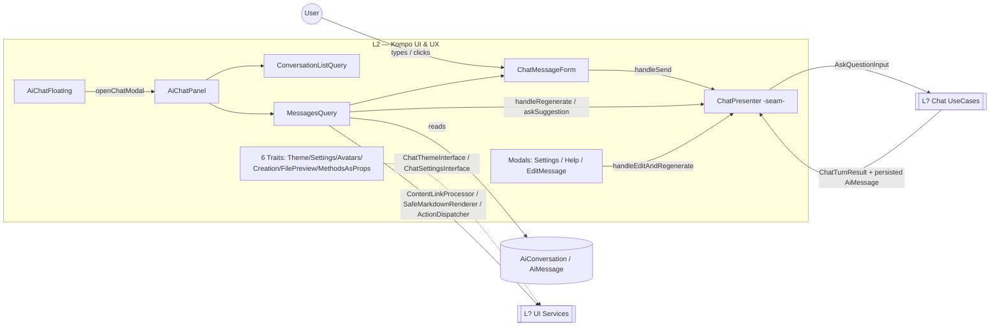

# Layer 02 — Kompo UI Components & UX

## 1. Purpose (plain language)

This layer is the **chat surface the user actually sees and clicks**. It collects the question the user types, shows an optimistic "you said…" bubble plus a typing animation, and after the server runs the RAG pipeline it re-renders the persisted user + assistant messages from the database. It also owns conversation management UX (list, search, pin, archive, delete, export), per-message actions (copy, feedback, regenerate, edit), rich-data rendering (tables/metrics/lists), file-citation cards, settings, and theming. It does **not** contain pipeline logic: every server action funnels through `ChatPresenter`, the single Kompo↔application seam, which delegates to Phase-1 use cases. In the end-to-end flow ("user asks → important words → files → enhance prompt → query → answer → actions"), this layer is the **first and last mile**: input capture and answer presentation.

## 2. C4 component diagram

## 3. Data in / data out

**In (from user / upstream):**
- Raw `message` string + `style` string (textarea / quick action / suggestion / example question).
- `prop()` bag: `conversation_id`, `response_style`, `message_id`, `selected_id`, `ui_theme`, `ui_colors`.
- Session: `selected_conversation_id`, `ai_chat_settings`.
- `ChatThemeInterface` / `ChatSettingsInterface` (DI), `AiConversation` / `AiMessage` Eloquent models.

**Out (to downstream / user):**
- `AskQuestionInput` DTO → `ChatPresenter` → use cases.
- `ChatTurnResult` (immutable) returned from presenter; components only check `failed()`.
- Rendered Kompo element trees (HTML) + injected JS template strings (`$USER_BUBBLE_TEMPLATE`, typing animations).
- Session writes (`selected_conversation_id`, `ai_chat_settings`), DB writes for feedback/pin/archive/delete (done **directly** in `MessagesQuery`, bypassing the presenter — see findings).

## 4. Contracts (owned / consumed)

**Owned by this layer:** none. There is no `ChatPresenterInterface`; `ChatPresenter` is a concrete, container-autowired class by design (mirrors Sisc's presenter idiom). Components expose `selfPost`/`selfGet` action methods as their de-facto contract.

**Consumed:**
- `Condoedge\Ai\Services\Settings\ChatSettingsInterface` (via `HasChatSettings`)
- `Condoedge\Ai\Services\UI\ChatThemeInterface` + `ChatThemeFactoryInterface` (via `HasChatTheme`)
- `Condoedge\Ai\Services\Chat\AiChatServiceInterface` (availability check in `AiChatPanel`)
- Use cases `AskQuestionUseCase` / `RegenerateAnswerUseCase` / `EditMessageAndRegenerateUseCase` (via `ChatPresenter`)
- `ContentLinkProcessor`, `SafeMarkdownRenderer`, `ActionDispatcher`, `FileModel` facade.

## 5. Findings

| ID | Sev | Type | File:line | What | Why it matters | Recommendation | Verified |
|----|-----|------|-----------|------|----------------|----------------|----------|
| L2-1 | P1 | missing | (whole layer) | No page-context injection. There is no `page_context`/route/model passed from the host page into the pipeline; `grep page_context` = 0 hits, and the only "context" prop (`'context' => ['order_id']`) is documented but never read. | The assistant cannot know which page/record it was opened from — a core agentic-assistant capability. The seed lead's "knows WHICH PAGE it was opened from" is entirely absent. | Add a `page_context` prop on `AiChatPanel`/`AiChatFloating`, thread it through `AskQuestionInput` into the prompt-section pipeline. | true |
| L2-2 | P1 | missing | Kompo/ (surfaces) | Only two surfaces exist: floating button + modal panel. `AiChatDrawer` and `AiChatModal` are referenced in `config/ai.php:898-899` and the docs but **do not exist as classes** (`grep AiChatDrawer` → 1 hit, config comment only; `grep AiChatModal` → docs+config only). No dedicated full-screen route. | Promised surfaces ship broken; docs reference non-existent classes. No full-page chat for power users. | Ship `AiChatDrawer` + a routed full-screen surface, or delete the dead config/doc references. | true |
| L2-3 | P0 | bug | src/Kompo/Modals/ChatSettingsModal.php:174 | `$this->link_hover` resolves via `HasMethodsAsProperties::__get` → `linkHover()`, but **no component/trait defines `linkHover()`** (it lives only on `ChatThemeInterface`). `method_exists($this,'linkHover')` is false → magic returns `null`. | The reset link silently renders with no hover class. Worse, it proves the magic-property layer fails silently for any theme method not re-exposed on `HasChatTheme`. | Use `$this->theme()->linkHover()` directly; remove the brittle magic accessor (see L2-12). | true |
| L2-4 | P1 | dead-code | src/Kompo/Components/TypingIndicator.php:9 | Entire `TypingIndicator` class is never instantiated anywhere (`grep "new TypingIndicator"` → 0). `AiChatPanel` builds its own typing HTML inline (`typingIndicatorHtml()` + 4 `*AnimationHtml()`), duplicating this class's 4 animations. | Dead 118-line file + a second copy of the same animation HTML. Pure maintenance tax and confusion. | Delete `TypingIndicator`, or make `AiChatPanel`/`MessagesQuery` use it as the single source for typing/animation HTML. | true |
| L2-5 | P1 | single-path-violation | src/Kompo/AiChatPanel.php:210-266; src/Kompo/Components/TypingIndicator.php:47-104 | The dots/wave/pulse/brain animation HTML exists in **three** places: `AiChatPanel` (PHP→JS template), `TypingIndicator` (PHP element), and a hardcoded dots block in `MessagesQuery::messageActionBar` regenerate JS (line 334). | One visual concept, three diverging definitions. A theme/animation change must be made in 3 spots; they already differ (`bg-gradient-to-r` vs `primarySolid`). | Centralize animation HTML in one renderer keyed by style; have all three call it. | true |
| L2-6 | P1 | half-done | config/ai.php:946; src/Kompo/MessagesQuery.php:238 | `enable_markdown` config key exists but is **never honored**: `renderMarkdown()` is always called on assistant content, and `ChatSettingsInterface` has no `enableMarkdown()`. | Operators set a config flag that does nothing — silent dead toggle, false sense of control. | Add `enableMarkdown()` to the settings contract and gate `renderMarkdown()`, or remove the config key. | true |
| L2-7 | P1 | half-done | config/ai.php:932; ChatSettingsInterface:51 | `show_typing_indicator` / `showTyping()` setting is defined but the typing indicator is injected unconditionally by JS; no UI component ever reads `showTyping()`. | Another inert toggle. Same false-control problem as L2-6. | Gate the JS typing-template injection on `showTyping()`, or drop the setting. | true |
| L2-8 | P2 | dead-code | src/Kompo/AiChatPanel.php:92-94; ConversationListQuery.php:26 | `AiChatPanel` passes `'selected_id' => $this->selectedConversationId` into `ConversationListQuery`, but `ConversationListQuery` ignores the prop entirely and re-reads `session('selected_conversation_id')`. | Dead prop wiring; misleads a reader into thinking selection flows by prop when it actually flows by session. | Drop the prop, or make `ConversationListQuery` read it (and stop the session round-trip). | true |
| L2-9 | P2 | bug | src/Kompo/MessagesQuery.php:459-472 | `fileReferenceCard(array $file)` overwrites its array param with an Eloquent model (`$file = FileModel::find($file['id'])`), then mixes array access (`$file['name']`) and model access (`$file->file_type_enum`), and passes the **model** to `getPreviewButton($link, $file)`. The `empty($files)` guard at line 447 is also redundant (caller already guards at line 256). | Confusing type punning; if `getPreviewButton` expects the original array it silently misbehaves; the redundant guard signals copy-paste. | Use a distinct `$fileModel` variable; pass the shape `getPreviewButton` actually expects; drop the redundant guard. | true |
| L2-10 | P1 | coupling | src/Kompo/MessagesQuery.php:516-534, 707-721 | `togglePin`, `feedback`, `deleteConversation`, `archiveConversation` mutate the DB **directly inside the Kompo component**, bypassing `ChatPresenter`/use cases — unlike send/regenerate/edit which correctly go through the seam. | Inconsistent architecture: half the mutations honor the "single seam" rule, half don't. Authorization is re-implemented inline (`where('user_id', auth()->id())`) instead of via policy/use case. | Route these through the presenter/use cases (or a `ConversationActionsUseCase`) for consistent authz + testability. | true |
| L2-11 | P1 | complexity-without-value | src/Kompo/AiChatPanel.php:146-217 | `AiChatPanel::js()` reads two JS files off disk per render, string-replaces ~9 `$PLACEHOLDER` tokens with PHP-generated HTML, and hand-escapes backticks. The panel is half PHP-templating-engine for JS. | Brittle (placeholder drift, escaping bugs), untestable, and couples PHP theme rendering to JS string internals. The `$DOT_COLOR`/`$TYPING_STYLE`/4×`$*_ANIMATION_HTML` substitutions duplicate L2-5. | Move templates to data attributes / a JSON config object consumed by the JS module; stop string-replacing HTML into JS. | true |
| L2-12 | P2 | abstraction | src/Kompo/Traits/HasMethodsAsProperties.php:7-18 | `__get` magic maps snake_case props to camelCase methods returning `' '.$v.' '`. It silently returns `null` for any miss (root cause of L2-3), space-pads every value (hidden class-string coupling), and hides which methods are "properties". Only 3 modal/floating files use it. | Magic that fails silently and pads strings is a debugging trap for marginal sugar (`$this->theme_gradient` vs `$this->themeGradient()`). | Delete the trait; call the explicit `theme*()` methods. Net loss of ~6 chars per call site, large gain in clarity/safety. | true |
| L2-13 | P3 | abstraction | src/Kompo/Traits/HasFilePreview.php; HasConversationCreation.php | `HasFilePreview` is one tiny method; `viewFile` is reachable from file-citation links but verify it's still wired post-`ContentLinkProcessor`. `HasConversationCreation::createConversation()` is a public wrapper whose only job is to call the protected `createNewConversation()` "for backward compatibility." | Trait-per-method tends toward soup; the BC wrapper is speculative (no second caller). | Consider folding single-method traits into a base chat component; drop the BC wrapper if no external caller exists. | false |
| L2-14 | P1 | bug | src/Kompo/ChatMessageForm.php:29 | Docblock usage example references `AiChatPanel::MESSAGES_PANEL_ID`, which **does not exist** (`AiChatPanel` only defines `ID = 'chat-panel'`). | A copy-pasted example will fatal with "undefined constant." Signals the messages-panel id is inconsistently named (`MessagesQuery::ID` is the real one). | Fix the docblock to `MessagesQuery::ID`; add a real `MESSAGES_PANEL_ID` const if the public API is meant to exist. | true |
| L2-15 | P1 | prompt-quality | resources/docs/1.0/chat/chat-ui.md (whole file) | The primary UI doc is badly stale: documents `AiChatModal` (no such class), a fluent `AiChatFloating` API (`->position()/->size()/->theme()/->withLabel()/->withPulse()/->modalConfig()` — none exist), props like `context`/`persist_history`/`max_messages` that aren't read, and traits `HasAiChatConfig/HasAiMessages/HasMessageBubbles/HasWelcomeScreen` that don't exist. | Every integrator following this doc writes code that fatals. This is the public face of the layer. | Rewrite against the real API (`AiChatPanel`, `AiChatFloating`, prop bag, settings/theme contracts). | true |
| L2-16 | P3 | ai-comment | src/Kompo/ChatMessageForm.php:234-247; MessagesQuery.php:611-620 | Several long narrative comments restate what the code does ("1. Show placeholder immediately", "RE-DECODES + RE-VERIFIES", "the single Kompo<->app seam"). Some are genuinely useful (approval flow), but the step-by-step ones are obvious. | Comment bloat; a few are load-bearing, most narrate. | Keep the security/approval rationale; trim the numbered play-by-play. | false |
| L2-17 | P2 | ux | src/Kompo/MessagesQuery.php:97, 454; ConversationListQuery.php | Hardcoded English/emoji strings escape i18n: `'... messages'` (line 97), `'📎 Referenced Files:'` (line 454), `'Pinned'` in the pinned badge (line 93). Everything else uses `__()`. | Inconsistent localization; French locale shows English fragments. Memory note explicitly forbids hardcoded English. | Move to `ai.*` translation keys. | true |
| L2-18 | P2 | ux | src/Kompo/MessagesQuery.php:378-435 | Rich-data renderers silently truncate: tables to 10 rows (line 395), lists to 5 (line 431), with no "+N more" affordance. | Users see partial data with no signal it was cut — a correctness-of-perception gap for a data assistant. | Show a "showing 10 of N" footer / link to full result. | true |

## 6. File checklist

| File | Verdict | Note |
|------|---------|------|
| src/Kompo/AiChatFloating.php | KEEP | Thin, render-only. Inline SVG is acceptable. Add `page_context` prop (L2-1). Docs claim a fluent API it doesn't have (L2-15). |
| src/Kompo/AiChatPanel.php | REFACTOR | Mostly orchestration, but `js()` (L2-11) and 5 animation-HTML methods (L2-5) bloat it and duplicate `TypingIndicator`. Extract JS-template + animation concerns. |
| src/Kompo/ChatMessageForm.php | KEEP | Good seam discipline (routes through presenter). Fix the `MESSAGES_PANEL_ID` docblock (L2-14); trim narration (L2-16). |
| src/Kompo/ConversationListQuery.php | REFACTOR | Solid list query, but ignores its `selected_id` prop (L2-8) and has hardcoded `'Pinned'`/emoji strings (L2-17). |
| src/Kompo/MessagesQuery.php | SPLIT | 736 lines doing rendering + rich-data + file cards + direct DB mutations (L2-10) + result-set extraction. Split rendering vs. actions vs. rich-data renderers. |
| src/Kompo/Components/TypingIndicator.php | DELETE | Never instantiated (L2-4); animations duplicated inline in `AiChatPanel` (L2-5). |
| src/Kompo/Modals/ChatHelpModal.php | REFACTOR | `shortcutsTab()` is unreachable (tab commented out at line 41) yet `showTab` still routes to it — half-done shortcuts feature. Large inline SVG icon map could be a shared helper. |
| src/Kompo/Modals/ChatSettingsModal.php | REFACTOR | Contains the `link_hover` null bug (L2-3); large commented-out animation block (lines 82-104) is dead. `afterSave` duplicates the full settings array — fragile. |
| src/Kompo/Modals/EditMessageModal.php | KEEP | Clean: own-message check, presenter seam, optimistic JS. Verify referenced JS injector fns stay in sync. |
| src/Kompo/Presenters/ChatPresenter.php | KEEP | The standout of the layer: thin, typed, type-based `friendlyError` (locale-safe). Good model for the L2-10 mutations to follow. |
| src/Kompo/Traits/HasAvatars.php | KEEP | Self-contained, escapes initials. Minor: `method_exists($this,'theme')` fallback is defensive coupling. |
| src/Kompo/Traits/HasChatSettings.php | KEEP | Clean DI cache trait; right-sized. |
| src/Kompo/Traits/HasChatTheme.php | REFACTOR | `theme*()` shorthands (41-51) are only reached via magic `__get` (L2-12), and `link_hover`/`linkHover()` is not among them (L2-3). Either expose all theme methods or drop the magic. |
| src/Kompo/Traits/HasConversationCreation.php | KEEP | Fine; drop the speculative BC `createConversation()` wrapper (L2-13). |
| src/Kompo/Traits/HasFilePreview.php | KEEP | One method; confirm `viewFile` is still wired from citations post-`ContentLinkProcessor` (L2-13). |
| src/Kompo/Traits/HasMethodsAsProperties.php | DELETE | Silent-null magic + space-padding is a debugging trap for trivial sugar; root cause of L2-3 (L2-12). |

## 7. What to add (next-level)

- **Page-context injection (L2-1):** a `page_context` prop (route name, current model class+id, visible filters) threaded `AiChatPanel/Floating → AskQuestionInput → prompt sections`. This is the single biggest UX gap for an "agentic assistant."
- **Surface set (L2-2):** ship `AiChatDrawer` (slide-over) and a **routed full-screen** surface so the floating/modal/drawer/full-page quartet the config already implies actually exists. Extract the shared layout into one base so surfaces are thin shells.
- **A presenter seam for ALL mutations (L2-10):** route pin/feedback/archive/delete through the presenter/use cases so authorization and side effects live in one tested place, matching send/regenerate/edit.
- **Single animation/typing renderer (L2-4/L2-5/L2-11):** one PHP source for typing + message animations, consumed by both server render and the JS module via data attributes — eliminate the PHP-as-JS-templating in `js()`.
- **Honor or remove inert settings (L2-6/L2-7):** wire `enable_markdown` and `show_typing_indicator` to behavior, or delete them; an assistant that lies about its toggles erodes trust.
- **Streaming + stop:** there is no token-streaming or "stop generating" affordance; the optimistic-placeholder-then-refresh model blocks until the full turn completes. A streamed surface is table-stakes for a 10/10 chat.
- **Result-set "view all" (L2-18)** and **full i18n (L2-17)** for the few hardcoded strings.

## 8. Open questions / risks

- **Session as selection state:** selection flows via `session('selected_conversation_id')` re-read in three components' `created()`. In a multi-tab scenario the tabs fight over one session key — is single-tab assumed? A prop-driven selection (L2-8) would be safer.
- **`getPreviewButton($link, $file)` contract (L2-9):** does it expect the original `['id','name']` array or the Eloquent model? The code passes the model after overwriting the array — needs confirmation against the file-type enum implementation (outside this lane).
- **`AiChatPanel::js()` per-render disk reads:** `file_get_contents` on two JS files every render — acceptable for a modal, but if `AiChatFloating` ever embeds the panel inline on every page it becomes a hot path. Cache?
- **Does `ChatPresenter` need an interface?** It deliberately has none (Sisc idiom). Fine for this package, but if a host app must swap chat orchestration, there's no seam to bind. Confirm that's intended.
- **`HasMethodsAsProperties` blast radius:** deleting it (L2-12) requires touching `AiChatFloating`, `ChatHelpModal`, `ChatSettingsModal` magic props — low risk but must be done together with L2-3.
