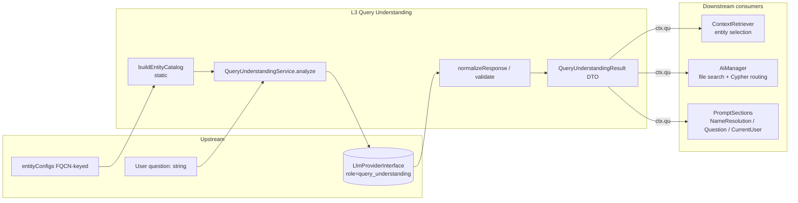

# Layer 03 — Query Understanding

## 1. Purpose (plain language)

Before the system tries to find data or documents, it makes one fast LLM call to "understand" the raw user question and turn it into machine-usable hints. From a question like *"Can I tear down a wall in my apartment?"* it extracts: which entity types matter, any person names, abstract data concepts, a cleaned-up search query, broad keyword tags for document search, a clarified version of the question, whether the user is asking about their own data, the intent (count/list/etc.), and the question type (data vs. knowledge vs. hybrid). These structured hints are stamped onto the shared `PipelineContext.qu` and consumed downstream to bias entity selection, drive file search, route around Cypher for pure-knowledge questions, and inject prompt sections.

## 2. C4 component diagram

## 3. Data in / data out

Data in:
- `string $question` — raw user NL question.
- `array $entityCatalog` — compact `[{label, aliases[], description}]` built by `QueryUnderstandingService::buildEntityCatalog($entityConfigs)`.
- An `LlmProviderInterface` (role `query_understanding`) + config (`max_tokens`, `temperature`).

Data out:
- `QueryUnderstandingResult` DTO (readonly): `entityTypes[]`, `personNames[]`, `propertyConcepts[]`, `searchQuery`, `isPossessive`, `intent`, `questionType`, `clarifiedQuestion`, `searchTags[]`.
- Stored on `PipelineContext::$qu`. On any failure → `QueryUnderstandingResult::empty($question)` (all signals blank except a regex-guessed `isPossessive`).

## 4. Contracts (owned / consumed)

Owned:
- `QueryUnderstandingResult` (DTO, not an interface) — the output contract every downstream consumer reads.
- No interface is defined for `QueryUnderstandingService` itself; it is type-hinted by concrete class in `ContextRetriever::setQueryUnderstanding()` and the container.

Consumed:
- `LlmProviderInterface::chatJson()` (resolved via `LlmResolver->forRole('query_understanding')`).
- `AiLogger` (concrete class, not an interface).

## 5. Findings

| ID | Sev | Type | File:line | What | Why it matters | Recommendation | Verified |
|----|-----|------|-----------|------|----------------|----------------|----------|
| L3-1 | P1 | half-done | config/ai.php:722-725 | `confidence_threshold` config + its docblock describe "QU only runs when semantic selection's top entity score is below this value." No code reads `confidence_threshold` (repo search: only the config line + an unrelated `template_confidence_threshold`). | The documented confidence-gate does not exist. `ContextRetriever::retrieveContext` (line 217-218) comment says "Query Understanding (always runs if available)" and runs it unconditionally. Ships a config knob that silently does nothing and a doc that lies about behavior — misleads operators tuning cost. | Either implement the gate (skip QU when semantic top-score ≥ threshold) or delete the key + `AI_QUERY_UNDERSTANDING_CONFIDENCE` env and fix the comment. | true |
| L3-2 | P1 | prompt-quality | src/Services/QueryUnderstandingService.php:135 | `search_tags` instruction screams "EXACTLY 10 tags. CRITICAL: You MUST return exactly 10 tags" with CAPS and a hardcoded wall/copropriété/French example baked into the system prompt. | (a) The "exactly 10" is never validated in `normalizeResponse` (`ensureStringArray` only filters non-strings) — the constraint is pure prompt theater and burns tokens on every call. (b) The condo/French example hardcodes domain assumptions into a package that is supposed to be domain-agnostic and model-agnostic — leaks tenant semantics. | Drop the CAPS/CRITICAL and the baked example; ask for "5-10 relevant search tags, include domain synonyms and translations where useful." Derive any domain/language hint from config, not the prompt literal. | true |
| L3-3 | P2 | dead-code | src/Services/QueryUnderstandingService.php:196,270-281 | `intent` is parsed, `normalizeIntent`-validated against a 6-value list, logged, and surfaced in `TestQuestionCommand` display — but no pipeline branch ever reads `qu->intent` to change behavior (repo search for `->intent`: 3 hits, all logging/display). | A normalized, token-costing output signal that influences nothing. Either it should drive aggregate/count query shaping or it is overhead + maintenance surface. The prompt also spends a key + enum spec describing it. | Wire `intent` into query generation (e.g. count→`RETURN count`, aggregate hints) or remove it from the DTO and prompt. | true |
| L3-4 | P2 | prompt-quality | src/Services/QueryUnderstandingService.php:133-134 | The `clarified_question` prompt entry opens with a stray quote (`"Usually the concrete...`), is a two-paragraph run-on mixing two different definitions ("clarify data relationships for debugging" vs. "base significance / rules"), and ends mid-thought. | Ambiguous, malformed instruction → inconsistent `clarifiedQuestion` output that is then fed verbatim into file-search queries (AiManager:807) and the QuestionSection prompt. Token-heavy and self-contradictory. | Rewrite as one tight sentence: "A concise restatement of the underlying data/document need behind the question." Remove the stray quote and the long worked examples. | true |
| L3-5 | P2 | missing | src/Services/AiManager.php:850-858 | When `questionType === 'knowledge_query'`, Cypher is skipped and the answer is declared "answered from documents" with `confidence: 1.0` — with no check that `retrieveAndSetFileContext` actually found any file. | If file search returns nothing (e.g. `searchTags` were weak, or no docs ingested), the pipeline still asserts confidence 1.0 and answers a knowledge question with zero grounding → hallucination/data-gap with false confidence. No abstention path. | Gate on `!empty($ctx->fileContext['relevant_files'])`; if empty, either fall back to hybrid/Cypher or emit an explicit "no source found" abstention instead of confidence 1.0. | true |
| L3-6 | P2 | abstraction | src/Services/QueryUnderstandingService.php:42,49 | `analyze()` type-hints the concrete `QueryUnderstandingService` everywhere (ContextRetriever, container, tests) — there is no `QueryUnderstandingInterface`, unlike most sibling services here which are interface-bound. | Inconsistent with the package's own contract-driven DI style; makes QU harder to swap/mock for downstream projects injecting the package. Tests resort to `Mockery::mock(concrete)`. | Extract a `QueryUnderstandingInterface` (analyze + buildEntityCatalog or move catalog-building out) and bind it; depend on the interface in ContextRetriever. | true |
| L3-7 | P3 | single-path-violation | src/DTOs/QueryUnderstandingResult.php:37-40 | `looksLikePossessive()` uses a hardcoded English regex word list (`my|mine|i have|i own|belong...to me`) to guess `isPossessive` on the empty/fallback path. | Violates the repo's stated "no hardcoded semantics — use the LLM" rule, and it is a second code path computing a signal the LLM already returns. Only fires on the error/empty path, where every OTHER signal is dropped anyway, so the heuristic is near-useless and English-only. | Drop the regex; `empty()` should return `isPossessive: false` (or re-run a minimal LLM probe). Keep one source of truth for possessiveness. | true |
| L3-8 | P3 | complexity-without-value | src/Services/QueryUnderstandingService.php:87-110 | `buildEntityCatalog` is a `static` method on the service that builds a compact catalog (label/aliases/description) — separate concern bolted onto the analyzer, and `aliases` slice (5) / description truncate (120) are magic constants. | Mild SRP smell + untunable magic numbers; static coupling means `ContextRetriever` calls `QueryUnderstandingService::buildEntityCatalog(...)` statically (line 220), tying the retriever to this concrete class beyond the injected instance. | Move catalog building to a small `EntityCatalogBuilder` (or the entity-config layer) and inject; pull the 5/120 limits into config. | true |

## 6. File checklist

| File | Verdict | Note |
|------|---------|------|
| src/DTOs/QueryUnderstandingResult.php | REFACTOR | Clean readonly DTO and a good single output contract. But `empty()`/`looksLikePossessive()` (L3-7) sneaks a hardcoded English heuristic in — strip it. Consider dropping `intent` if L3-3 isn't wired. |
| src/Services/QueryUnderstandingService.php | REFACTOR | Solid structure: graceful fallback, entity-type validation against catalog (good defense against hallucinated labels), case-insensitive canonicalization. Needs: prompt cleanup (L3-2, L3-4), wire-or-drop `intent` (L3-3), extract an interface (L3-6) and catalog builder (L3-8). |

## 7. What to add (next-level)

- Implement (or delete) the advertised confidence gate so QU isn't an unconditional per-question LLM tax; current behavior contradicts its own config docs.
- Knowledge-query abstention: when `questionType=knowledge_query` and no file context is found, refuse/route to hybrid instead of asserting `confidence: 1.0` (L3-5).
- A `QueryUnderstandingInterface` + bound DI, so downstream projects can swap the analyzer; move catalog-building to its own injectable builder.
- Make `intent` load-bearing (drive count/aggregate query shape) instead of decorative, or remove it.
- Validate/cap `searchTags` and `entityTypes` post-LLM (e.g. cap tag count, dedupe) rather than asking the model for "EXACTLY 10" in caps; cheaper and more reliable.
- Move domain/language hints (the condo/French baggage in the prompt) into config so the prompt stays generic and the package is truly tenant-agnostic.
- Add a lightweight eval fixture asserting QU outputs per question class (the `PipelineEvalDriver` already reads `qu->*`) to catch prompt regressions.

## 8. Open questions / risks

- Cost/latency: QU is a full extra LLM round-trip on every question (no gate). On a fast/cheap model that's acceptable; on a slow provider it doubles first-token latency. The dead `confidence_threshold` suggests gating was intended but never finished.
- `searchQuery` rewrite is now the retrieval query for ALL graph grounding (ContextRetriever:241-245, `retrievalQuery`). If the LLM produces a poor rewrite, it silently degrades entity selection AND file search — single point of failure with no quality check on the rewrite.
- `clarifiedQuestion` is injected raw into both file-search queries and the prompt; a malformed prompt spec (L3-4) makes its content unpredictable.
- Entity-type validation only runs when a non-empty catalog is passed; `validateEntityTypes` passes labels through unchanged when the catalog is empty (line 233-235) — a hallucinated label then force-injects at score 0.8 into selection. Low risk in prod (catalog is always built) but a latent foot-gun.
