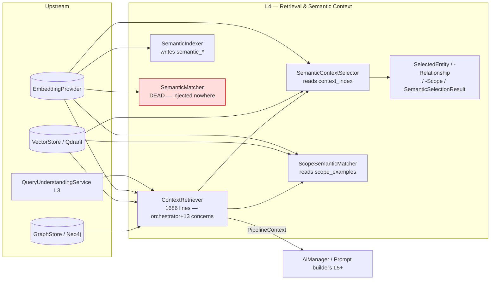

# Layer 04 — Retrieval & Semantic Context (the giant)

## 1. Purpose (plain language)

When a user asks a question, this layer figures out *which* parts of the domain model are relevant so the prompt only carries useful context instead of the entire schema. It embeds the (rewritten) question, looks it up against pre-built vector indexes, and returns: similar past Q→Cypher pairs (few-shot), a relevance-filtered slice of the graph schema, sample rows, and the metadata/scopes of the entities it selected. The goal is token efficiency: send the LLM "Person + volunteers scope + PersonTeam relationship" instead of every entity in the catalog. It is the bridge between "important words" (Query Understanding, L3) and "enhance prompt / generate query" (L5+).

## 2. C4 component diagram

## 3. Data in / data out

Data in:
- `string $question` (raw) + `array $options` (collection, limit, thresholds, `conversation_context.focused_entity`, `useSemanticSelection`).
- `QueryUnderstandingResult` (`$ctx->qu`) — supplies `searchQuery` rewrite, `entityTypes`, `isPossessive`.
- `array $entityConfigs` (from `config/entities.php`).
- Pre-built vector collections: `context_index`, `scope_examples`, `semantic_entities` (+ unused `semantic_scopes`, `semantic_templates`).
- Graph schema via `GraphStoreInterface::getSchema()`.

Data out:
- `PipelineContext` (the live return) carrying: `qu`, `semanticSelection: SemanticSelectionResult`, `similarQueries`, `graphSchema`, `relevantEntities`, `entityMetadata`, `selectionInfo`, `quality`, `errors`.
- DTOs: `SemanticSelectionResult { entities[], relationships[], scopes[], selectionMethod }`, keyed maps of `SelectedEntity`, `SelectedRelationship`, `SelectedScope`.
- Legacy **array** shapes from the unused `getMinimalContext / getContextWithBudget / getContextWithStats / getContextConfidence`.

## 4. Contracts (owned / consumed)

Owned:
- `ContextRetrieverInterface` (`retrieveContext`, `searchSimilar`, `getGraphSchema`, `getExampleEntities`).

Consumed:
- `VectorStoreInterface`, `GraphStoreInterface`, `EmbeddingProviderInterface`, `AiLogger`.
- `ResolvesEntityConfigKey` trait (entity-name resolution).
- `QueryUnderstandingService` (concrete class, setter-injected — not an interface).

Not owned but should be: `SemanticContextSelector`, `ScopeSemanticMatcher`, `SemanticIndexer`, `SemanticMatcher` are all concrete classes with **no interface**, so the selection/indexing strategy cannot be swapped or mocked cleanly — a leaky-abstraction gap for a package meant to be injected into other projects. `RerankerInterface` exists (L13) but this layer never consumes it.

## 5. Findings

| ID | Sev | Type | File:line | What | Why it matters | Recommendation | Verified |
|----|-----|------|-----------|------|----------------|----------------|----------|
| L4-1 | P1 | complexity-without-value | ContextRetriever.php:74-1686 | One class = 1686 lines holding ~13 responsibilities: QU orchestration, semantic selection merge, vector similar-query search, schema fetch/filter (3 variants), example fetch, metadata build (2 variants), quality scoring, token estimation, budget logic, confidence math, relationship weighting. | Untestable as a unit, every change risks unrelated paths, impossible to inject piecemeal. This is *the* decomposition target. | Split into `SimilarQuerySearcher`, `SchemaProjector` (owns the 3 filter methods), `EntityMetadataBuilder` (owns both metadata paths), `ContextQualityAssessor`, `TokenBudgeter` (owns estimate/stats/budget/confidence). `ContextRetriever` becomes a thin orchestrator (<200 lines). | true |
| L4-2 | P1 | dead-code | SemanticMatcher.php:53-509 | Whole class registered as singleton (AiServiceProvider:466) but its public API (`matchEntities`/`matchLabel`/`findBestMatch`/`computeSimilarities`) is called only from its own file, docs, and never injected into any service. | ~460 lines of in-memory cosine + caching nobody runs. Pure maintenance tax; duplicates cosine logic that the vector store already does server-side. | Delete the class and its provider binding, or fold the one useful bit (embedding cache) into a shared helper if needed. Confirmed via repo search: zero non-doc/non-test callers. | true |
| L4-3 | P1 | single-path-violation | SemanticIndexer.php:38-450 vs SemanticContextSelector.php:249-508 vs ScopeSemanticMatcher.php:135-215 | THREE indexers embed near-identical text (entity name, aliases, description, scope concept, scope examples) into FOUR collections (`semantic_entities`, `semantic_scopes`, `semantic_templates`, `context_index`, `scope_examples`). | Same domain text is embedded 2-3× (cost + drift). The "right" collection (`context_index`) and `scope_examples` are the only ones the live path reads; the rest are parallel implementations of the same idea. | Collapse to ONE `SemanticIndexService` building ONE point-set with a `type` tag, written to ONE collection. Retire SemanticIndexer once `findRelevantEntityLabels` is repointed (see L4-4). | true |
| L4-4 | P2 | dead-code | SemanticIndexer.php:193-329 | `semantic_scopes` and `semantic_templates` collections are WRITTEN by SemanticIndexer but READ by no code (repo search: only writers + docs). `semantic_entities` is read only by the rarely-hit fallback `findRelevantEntityLabels`. | Indexing commands spend embedding budget building two collections that are never queried. | Drop scope/template indexing from SemanticIndexer; if entity-label fallback is kept, source it from `context_index` instead. | true |
| L4-5 | P0 | bug | AiManager.php:186 / ContextRetriever.php:580 | `AiManager::searchSimilar(string, array $options)` calls `$this->context->searchSimilar($question, $options)`, but the contract signature is `searchSimilar(string $question, string $collection='questions', int $limit=5)`. An **array** is passed where a **string** is required, under `declare(strict_types=1)`. | Any facade/`AI::searchSimilar(q, [...])` call throws `TypeError` at runtime. The public API is broken. | Fix AiManager to unpack `$options['collection']`/`$options['limit']`, or change the interface to accept `array $options`. Add a test that calls it with options. | true |
| L4-6 | P0 | bug | AiManager.php:208 / ContextRetriever.php:645 | `AiManager::getExampleEntities(array $labels, int $limit)` forwards `$labels` (array) to `ContextRetriever::getExampleEntities(string $label, int $limit)`. Array → string param under strict_types. | `AI::getExampleEntities(['Team','Person'])` (the documented facade shape) throws `TypeError`. Contract and manager disagree on cardinality. | Either expose a `getExampleEntitiesForLabels(array)` that loops, or have the manager iterate `$labels` and call the singular method. | true |
| L4-7 | P1 | dead-code | ContextRetriever.php:1229,1338,1469,1520,1605,1592,845,1640 | `getMinimalContext`, `getContextWithStats`, `getContextWithBudget`, `getContextConfidence`, `filterRelationshipsByImportance`, `getRelationshipWeight`, `getAllEntityMetadata`, `computeRetrievalConfidence` have no production callers (only docs + unit tests). `getMinimalContext` is reachable only from the also-dead `getContextWithBudget`. | ~450 lines of speculative API returning a *legacy array* shape that diverges from the `PipelineContext` the live path returns — two parallel context formats to maintain. | Delete the unused budget/confidence/minimal cluster, or extract to a separate opt-in `TokenBudgeter` collaborator behind an interface. `computeRetrievalConfidence` is explicitly "feeds a FUTURE loop" — wire it or cut it. | true |
| L4-8 | P1 | missing | ContextRetriever.php:313-394 / FileContextProvider.php:202 | The reranker (`RerankerInterface`/`LlmReranker`, L13) is wired ONLY into file search (`FileContextProvider::rerankResults`). The graph path — similar-query search, semantic entity selection, schema filtering — has **no rerank stage** and no hybrid (dense+sparse+RRF). | Retrieval here is recall-biased: it over-fetches (`top_k*2`), threshold-cuts, and dumps everything. The strongest precision tool in the codebase is bypassed for the main RAG path. | Route similar-query and semantic-selection candidates through `RerankerInterface` (over-fetch → rerank → cut). Add sparse/BM25 + RRF fusion for hybrid recall. | true |
| L4-9 | P1 | single-path-violation | ContextRetriever.php:706-803 (getEntityMetadata) vs 486-545 (buildMetadataFromSemanticSelection) | Two metadata builders. The fallback `getEntityMetadata` does `stripos`/`strpos` substring matching on entity names, aliases, and scope names — exactly the "hardcoded semantics" the project forbids. `ScopeSemanticMatcher::fallbackStringMatch` and `extractSignificantWords` keep a literal stopword list too. | Substring matching mis-fires ("order" in "in order to"), and contradicts the stated no-hardcoded-word-lists rule. Two code paths produce the same `detected_*` shape differently. | Make semantic selection the single path; if a fallback is required, make it embed-based with a clear "degraded" flag, not `stripos`. Remove the stopword list (extractSignificantWords). | true |
| L4-10 | P2 | bug | ContextRetriever.php:369-375 | Step 6 metadata fallback passes raw `$question` to `getEntityMetadata($question)`, while every other step uses `$retrievalQuery` (the QU rewrite). | Inconsistent: the abbreviation-expanded query that improves recall everywhere else is dropped exactly where string matching is weakest. | Pass `$retrievalQuery` to the fallback too. | true |
| L4-11 | P2 | bug | SemanticContextSelector.php:688-699 | `expandThroughUserEntityPaths` creates `SelectedRelationship` with empty `fromEntity`/`toEntity` and key `user_path_{type}`. `filterSchemaByRelevance` (ContextRetriever:429-453) then iterates these: `$relInfo->type ?: $relKey` is fine, but the empty from/to are skipped, so the path relationship contributes a relationship name with no connected entities. | Possessive ("my unit") queries inject relationship labels into the schema that reference no nodes — noise the LLM may try to traverse. | Either resolve real from/to labels from the path config, or don't emit schema relationships for synthetic user-paths. | true |
| L4-12 | P2 | abstraction | SemanticContextSelector.php / ScopeSemanticMatcher.php / SemanticIndexer.php / SemanticMatcher.php | None of the four collaborators implement an interface; `ContextRetriever` depends on the concrete `SemanticContextSelector`/`ScopeSemanticMatcher` and setter-injects concrete `QueryUnderstandingService`. | A package advertised as "model-agnostic, injectable" can't swap the selection/indexing strategy or mock it without subclassing. Setter injection (`setContextSelector`, `setScopeMatcher`, `setQueryUnderstanding`) also creates a half-constructed object. | Introduce `ContextSelectorInterface`, `ScopeMatcherInterface`, `SemanticIndexerInterface`; inject via constructor only; drop the setters. | true |
| L4-13 | P2 | complexity-without-value | ContextRetriever.php:1440-1456 / 1358-1427 | `estimateTokens` uses chars/4 + 1.2× JSON fudge; `getContextStats` builds a "compression_ratio" off `count(entityConfigs)`. Both are guesses feeding methods nothing in production calls (L4-7). | Fake precision: token math that no live path consumes and that will mislead anyone who does wire it (real tokenizer differs a lot for Cypher/JSON). | If kept, back it with the provider's real token counter; otherwise delete with the budget cluster. | true |
| L4-14 | P3 | prompt-quality | ContextRetriever.php:341 | `$ctx->graphSchema['all_relationship_types'] = $fullSchema['relationships']` re-attaches ALL relationship types after the schema was relevance-filtered. | Partly defeats the token-saving filter — the full relationship-type list rides along even on a "minimal" selection. | Cap/omit `all_relationship_types` unless explicitly requested; it leaks the whole edge vocabulary into every prompt. | true |
| L4-15 | P3 | ai-comment | ContextRetriever.php:18-71, 536-538; SemanticMatcher.php:30-50 | Large narrated docblocks with fake return-value examples ("Returns: [...]"), and explanatory "Note: X was removed to avoid..." archaeology comments. | Token-heavy, drift from real behavior (e.g. docblock says `retrieveContext` returns an array; it returns `PipelineContext`), and the interface docblock at ContextRetrieverInterface:53 still claims an array. | Trim to one-line intents; fix the stale "@return array" docs that contradict `PipelineContext`. | true |
| L4-16 | P2 | coupling | ContextRetriever.php:253,268,280,718,225 etc. | ~10 inline `config('ai...')` calls scattered through the class (thresholds, scores, weights, top_k). | Hidden global dependency makes the class hard to test deterministically and impossible to construct without the Laravel container/config. | Resolve all thresholds/weights once into a typed `RetrievalConfig` value object injected via constructor. | true |

## 6. File checklist

| File | Verdict | Note |
|------|---------|------|
| src/Contracts/ContextRetrieverInterface.php | REFACTOR | Stale `@return array` docs (line 53) contradict the real `PipelineContext` return; signatures disagree with AiManager facade (L4-5/L4-6). Keep, but tighten and align. |
| src/DTOs/SelectedEntity.php | KEEP | Clean, right-sized immutable DTO. |
| src/DTOs/SelectedRelationship.php | KEEP | Clean; only nit is consumers (user-paths) create instances with empty from/to (L4-11). |
| src/DTOs/SelectedScope.php | KEEP | Clean immutable DTO. |
| src/DTOs/SemanticSelectionResult.php | KEEP | Good aggregate DTO; `entities`/`relationships`/`scopes` are mutable by design (merged post-construction) — acceptable. |
| src/Services/ContextRetriever.php | SPLIT | 1686 lines, ~13 responsibilities, two context formats, dead budget/confidence cluster. Primary decomposition target (L4-1/L4-7/L4-9). |
| src/Services/ScopeSemanticMatcher.php | REFACTOR | Live for the metadata FALLBACK path only; `fallbackStringMatch` + `extractSignificantWords` hardcoded stopwords violate the no-hardcoded-semantics rule (L4-9). Fold into unified semantic index. |
| src/Services/SemanticContextSelector.php | REFACTOR | The live, correct selector — but needs an interface (L4-12), and its `indexContext` should be the single indexer (L4-3). user-path relationship emission needs fixing (L4-11). |
| src/Services/SemanticIndexer.php | MERGE | Builds `semantic_scopes`/`semantic_templates` nobody reads (L4-4) and duplicates SemanticContextSelector's indexing (L4-3). Merge into one indexer; drop dead collections. |
| src/Services/SemanticMatcher.php | DELETE | Registered singleton with zero non-doc/non-test callers (L4-2). |

## 7. What to add (next-level)

- **Reranking on the graph path.** Reuse the existing `RerankerInterface`: over-fetch similar-queries + semantic candidates, rerank, then cut. Today only file search reranks (L4-8).
- **Hybrid retrieval + RRF.** Add sparse/BM25 over entity names/aliases/scope text and fuse with dense via Reciprocal Rank Fusion. Pure-dense `top_k*2` + threshold is recall-biased and precision-thin.
- **One indexer, one collection.** A single `SemanticIndexService` writing one typed point-set (entity|relationship|property|scope|alias) to one collection, replacing the 3-indexer / 4-collection sprawl.
- **Interfaces for the collaborators** (`ContextSelectorInterface`, `ScopeMatcherInterface`, `SemanticIndexerInterface`) so the strategy is swappable/mockable — required for "injectable package" claims.
- **Wire the confidence signal.** `computeRetrievalConfidence` already exists but feeds nothing. Use it to gate a rephrase/abstain loop or to attach a calibrated confidence to `PipelineContext`.
- **Single context format.** Kill the legacy array path; everything returns `PipelineContext`. Token accounting via the provider's real tokenizer, not chars/4.
- **Embedding cache at the provider boundary** (the only good idea in SemanticMatcher) so repeated entity/scope embeddings during a request aren't recomputed.

## 8. Open questions / risks

- Is `AiManager::searchSimilar` / `getExampleEntities` actually reachable from any host app, or facade-only? Either way the signatures are broken (L4-5/L4-6) and should be fixed or removed before they ship as "public API."
- `semantic_entities` is read only by the rarely-hit `findRelevantEntityLabels` fallback (when `context_index` is empty). Is that fallback still wanted, or can SemanticIndexer be retired entirely once selection is mandatory?
- The `getMinimalContext`/budget cluster returns a different shape than `retrieveContext`. Was a host project ever depending on the array shape? Removing it is safe only if not (repo shows no internal callers).
- `expandThroughUserEntityPaths` depends on `config('ai.user_entity_paths')`; with empty config it silently no-ops — is possessive expansion actually exercised in production, or dead-by-config?
- Removing the stopword list / `stripos` fallback assumes the semantic index is always populated. Need a guaranteed indexing step (or a degraded-mode flag) so a cold index doesn't silently return empty context.
