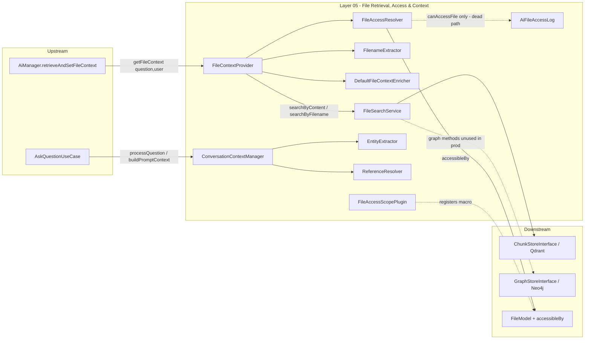

# Layer 05 — File Retrieval, Access & Context

## 1. Purpose (plain language)

When a user asks a question, this layer finds the documents that might answer it and decides which of those the user is *allowed* to see. It pulls candidate file chunks out of the vector store (by semantic similarity and by explicit filename references in the question), filters them down to the files the current user can access, trims them to short snippets, and hands them upstream so they can be injected into the LLM prompt as "relevant files". A sibling group of classes in the same `Services/Context` folder (`ConversationContextManager`, `EntityExtractor`, `ReferenceResolver`) tracks *conversation* state — which entity is being discussed, whether the new question is a follow-up like "show me those" — so the orchestrator can rewrite a vague follow-up into a self-contained question before retrieval runs.

## 2. C4 component diagram

## 3. Data in / data out

**In**
- `string $question` (raw or upstream-enriched), `mixed $user` (Authenticatable), `array $options` (`limit`, `min_score`, `conversation_context`, `collections`) — into `FileContextProvider::searchRelevantFiles`.
- `AiConversation`, `string $question`, `array $schema` (graph labels) — into `ConversationContextManager::processQuestion`.
- `?string $cypherQuery`, `array $queryResult` — into `recordResponse`.

**Out**
- File-reference arrays: `['file_id','filename','snippet','relevance','chunk_index','source','match_type']` (plus optional enricher keys `priority_tier`,`authority_note`,`priority_score`).
- `getFileContext` wraps those as `['relevant_files','file_count','has_physical','has_database']`.
- `buildPromptContext` returns a flat context snapshot (`focused_entity`, `last_referenced_files`, `recent_exchanges`, etc.) consumed by prompt sections.
- `array<int|string>` of accessible file IDs from `FileAccessResolver`.

No typed DTOs anywhere in this layer — everything is loose associative arrays.

## 4. Contracts (owned / consumed)

**Owned (defined here)**
- `FileAccessResolverInterface` — implemented by `FileAccessResolver`, bound + injected.
- `FileContextEnricherInterface` — implemented by `DefaultFileContextEnricher` (pass-through); host-extension seam.

**Consumed**
- `ChunkStoreInterface` (Qdrant) — the only store actually used by the live path.
- `GraphStoreInterface` (Neo4j) — used only by `FileSearchService`'s dead graph methods.
- `RerankerInterface` / `NullReranker` (L13) — optional, gated off by default.
- `Condoedge\Utils\Facades\FileModel` + the `accessibleBy` Builder macro (registered by `FileAccessScopePlugin`).

## 5. Findings

| ID | Sev | Type | File:line | What | Why it matters | Recommendation | Verified |
|----|-----|------|-----------|------|----------------|----------------|----------|
| L5-1 | P0 | security | src/Models/Plugins/FileAccessScopePlugin.php:26-51; src/Services/Context/FileAccessResolver.php:89-115 | The default `accessibleBy` scope (and the identical PHP fallback) filter with **OR logic on `user_id` / `team_id` only**: `where(user_id=me).orWhere(team_id=myTeam)`. No public/role/union/visibility policy. This is the prior **SEC-1 leak pattern verbatim**. | Any file whose `team_id` equals the caller's current team is exposed to the caller as AI context, regardless of per-file ACLs the host app may enforce elsewhere. A user on a shared team sees every team file the AI retrieves. The package ships this as the **secure default** (`security_enabled=true`), so hosts who don't override `scopeAccessibleBy` get a coarse, leaky filter and a false sense of security. | The package must NOT ship a default authz scope that only checks team membership. Either require the host to define `scopeAccessibleBy` (fail closed if absent) or document loudly that the built-in scope is team-grain only and unsafe for mixed-visibility files. At minimum honor the `access_scope` config key (see L5-2). | true |
| L5-2 | P1 | dead-code | config/ai.php:869-872; src/Services/Context/FileAccessResolver.php:71 | `ai.file_context.access_scope` ('accessibleBy') is documented as "the scope method to call" and is asserted in tests, but `FileAccessResolver` **hardcodes** `->accessibleBy($user)` (line 71) and never reads the config key. | The config knob is a lie: setting `access_scope` to a custom scope name does nothing. Hosts wiring a stricter scope via config silently get the leaky default (compounds L5-1). | Either read `config('ai.file_context.access_scope')` and call it dynamically, or delete the key and the docs that promise it works. | true |
| L5-3 | P1 | dead-code | src/Services/Context/FileAccessResolver.php:194-242; src/Models/AiFileAccessLog.php:24-43; database/migrations/2026_01_12_000001_create_ai_file_access_logs_table.php | `canAccessFile()` is the ONLY writer of `AiFileAccessLog`, and it has **zero production callers** (repo search: only tests + docs). The live path is `filterAccessibleFileIds()`, which never logs. | The entire "security audit trail" feature — model, `log_access` config, migration, `try/finally` logging block — is dead in real RAG flows. The audit table stays empty in production while the docs advertise an audit trail. Either a missing wiring (half-done) or pure dead weight. | Wire access logging into `filterAccessibleFileIds`/the retrieval path, or delete `canAccessFile` + `AiFileAccessLog` + the migration + the `log_access` config. Don't ship a security feature that never runs. | true |
| L5-4 | P1 | dead-code | src/Services/Context/FileContextProvider.php:90-236, 462-503 vs 281-311 | The orchestrator only ever calls `getFileContext($question,$user)` (AiManager:1047), which calls `searchRelevantFiles($question,$user)` with **no `$options`** (line 286). So `conversation_context`, the `limit`/`min_score` overrides, `enhanceQueryWithContext`, and `isFollowUpQuestion` are all unreachable in production. | A whole follow-up-query-enhancement subsystem (40+ lines) plus an options API that no caller uses. It also duplicates follow-up detection that `ReferenceResolver`/`ConversationContextManager` already do upstream (the question arrives pre-enriched as `$enrichedQuestion`). Dead + single-path violation. | Have `getFileContext` forward an `$options` array (so conversation context actually reaches retrieval) OR delete `enhanceQueryWithContext`/`isFollowUpQuestion` and the unused options. Pick one path for follow-up handling — `ReferenceResolver` already owns it. | true |
| L5-5 | P1 | bug | src/Services/FileSearchService.php:219-238, 121-126; src/Services/Context/FileContextProvider.php:181 | When >1 collection is searched, each collection's scores are **min-max normalized to [0,1]**, and a single-result (or all-equal) collection is forced to **1.0** (line 233). `FileContextProvider` then threshold-cuts content matches against `min_score` using this normalized score (line 181). | A weak physical doc that barely cleared the raw cosine floor gets boosted to 1.0 and always passes the `min_relevance_score=0.4` gate, while genuinely strong DB matches get squashed toward 0 by the same-collection max. Relevance ordering and the threshold become meaningless across collections — and the displayed `relevance` is a rescaled number, not a real similarity. | Don't surface normalized scores as `relevance`, and don't apply an absolute `min_score` threshold to rank-normalized scores. If you must merge collections, use rank fusion (RRF) and keep raw scores for thresholding. | true |
| L5-6 | P2 | dead-code | src/Services/FileSearchService.php:343-456, 516-601 | `searchByMetadata`, `hybridSearch`, `getRelatedFiles`, `getFilesByUser`, `getFilesByTeam`, `getFileRelationships`, `buildMetadataQuery`, `filterByMetadata` — the **entire Neo4j half of the service** — have no `src/` callers. The live consumer (`FileContextProvider`) calls only `searchByContent`/`searchByFilename`. | ~260 lines of graph-query code (plus the whole `FileSearch` facade, whose 150-line docblock advertises them) ship untested-in-production. `filterByMetadata` (585-601) is also buggy: `property_exists($file,$key)` on an Eloquent model returns false for DB attributes, so metadata filtering silently drops everything. | Move the graph methods + facade into an explicitly-optional "FileSearch public API" with its own tests, or delete them. Fix or remove `filterByMetadata`'s `property_exists` check. | true |
| L5-7 | P2 | dead-code | src/Services/Context/FileContextProvider.php:250-268 | `FileContextProvider::buildFileReference()` is referenced only by its own unit test. The live citation builder is `ResponseFileEnricher::buildFileReference()` (a different private method). | Two methods with the same name and overlapping purpose; the public one here is orphaned and misleads readers into thinking this class builds citations. | Delete `FileContextProvider::buildFileReference` (and its test), or consolidate citation-shape construction into one shared helper. | true |
| L5-8 | P2 | single-path-violation | src/Services/Context/FileContextProvider.php:491-503; src/Services/Context/ReferenceResolver.php:41-50 | Follow-up detection exists twice: `FileContextProvider::isFollowUpQuestion` (`['those','them','these','which of','any of','the same']`) and `ReferenceResolver::isFollowUp` (a different regex set). | Two hardcoded word lists for the same job drift apart; "follow-up" means different things in retrieval vs. conversation tracking. Also violates the project rule against hardcoded semantic word lists (use the LLM / QU layer). | Delete the FileContextProvider copy (it's dead per L5-4 anyway) and keep `ReferenceResolver` as the single follow-up authority — or push the decision into the QU layer. | true |
| L5-9 | P2 | abstraction | src/Services/Context/EntityExtractor.php:21-27, 49-74, 154-163; src/Services/Context/ReferenceResolver.php:18-36, 122-140 | Entity/query-type/operation detection is driven by hardcoded English+French regex word lists (`sum|total|revenue`, `montre|affiche`, `those|them`). `extractFromQuestion` does naive `str_contains` substring matching of labels against the lowercased question. | Brittle and locale-bound; substring matching yields false positives ("order" matches inside "reorder"); the project explicitly mandates LLM-based semantics, not word lists. The QU layer already produces structured intent — this is a parallel, weaker classifier. | Replace the regex classifiers with the QU layer's structured output (entities/queryType already exist there), or feed these through the LLM. At minimum use word-boundary matching. | true |
| L5-10 | P2 | bug | src/Services/Context/ReferenceResolver.php:152-164 | `buildEnrichedQuestion` pluralizes by naively appending `'s'` to a lowercased entity (`strtolower($entity).'s'`) and replaces pronouns with it. "Company" -> "companys", "Person" -> "persons". | Produces malformed search terms that are then used as the retrieval/Cypher query, degrading recall for any entity whose plural isn't `+s`. Note this path is reachable only via the (also questionable) follow-up flow. | Use `Str::plural($entity)` (already imported elsewhere) and preserve case, or stop string-munging the question and pass `focused_entity` as structured context. | true |
| L5-11 | P2 | coupling | src/Services/Context/FileAccessResolver.php:31; src/Services/Response/ResponseFileEnricher.php:28; database migration:14 | The `'physical:'` prefix is redeclared as a private/`const` literal in at least `FileAccessResolver`, `ResponseFileEnricher`, and `PhysicalFileIndexer`, plus a migration comment. | The single most security-relevant string ("always-accessible, skip authz") is copy-pasted. If one place drifts (e.g., `physical/`), files leak or break silently. | Hoist `PHYSICAL_PREFIX` into one shared place (e.g., the resolver) and reference it everywhere via `FileAccessResolver::PHYSICAL_PREFIX`. | true |
| L5-12 | P2 | complexity-without-value | src/Services/FileSearchService.php:100-258 vs src/Services/Context/FileContextProvider.php:399-417 | `FileSearchService` builds an elaborate `composite_id` + per-collection normalization to keep physical vs DB ids distinct, but physical ids already carry the `physical:` prefix (PhysicalFileIndexer), so bare-id collisions are near-impossible. Then `combineSearchResults` **discards** `composite_id`/`collection` and re-keys by bare `file_id` anyway (lines 405-406). | The disambiguation machinery solves a problem the `physical:` prefix already solves, and the one consumer throws away the composite key it produces — so the complexity buys nothing while introducing the L5-5 normalization bug. | Drop composite-id/normalization, or actually propagate `collection`/`composite_id` through `combineSearchResults` and dedupe on it. Don't pay for an abstraction the caller ignores. | true |
| L5-13 | P3 | ai-comment | src/Services/FileSearchService.php:83-99, 119-126, 128-141; src/Services/Context/FileContextProvider.php:104-109, 192-202 | Long expository block comments narrate the algorithm and reference internal audit tags ("(B2)", "(B3)", "(B4)", "FILE-2") that mean nothing to a reader of this package. | Token/maintenance noise; the audit-tag references are dangling pointers to a process doc, not the code. | Trim to one-line intent comments; strip the `(Bn)`/`FILE-n` tags. | true |
| L5-14 | P3 | prompt-quality | src/Facades/FileSearch.php:9-140 | 130 lines of usage/testing docblock on a 15-line facade, documenting methods that have no production caller (L5-6). | Doc bloat that will rot against the real (dead) methods; misleads integrators about what's exercised. | Slim the docblock to the two live methods, or move the long examples into the docs site. | true |
| L5-15 | P3 | bug | src/Models/AiFileAccessLog.php:30-42 | `AiFileAccessLog::log` reads `request()->ip()` / `request()->userAgent()` unconditionally. In console/queue/eval contexts (where RAG also runs) there is no HTTP request. | If ever wired (it isn't today, per L5-3), logging from a command/job would null those or error depending on the request binding — fragile. | Guard with `app()->runningInConsole()`/`request()?->...`. Moot if L5-3 deletes the feature. | true |

## 6. File checklist

| File | Verdict | Note |
|------|---------|------|
| src/Contracts/FileAccessResolverInterface.php | KEEP | Sound, right-sized contract. Docblock claims physical files are "always accessible (no security checks)" — accurate but underlines the trust placed in the prefix (L5-11). |
| src/Contracts/FileContextEnricherInterface.php | KEEP | Correct host-extension seam; bound + injected; pass-through default. Nothing to change. |
| src/Facades/FileSearch.php | REFACTOR | Facade is fine; the 130-line docblock advertises mostly-dead methods (L5-6, L5-14). Slim it. |
| src/Models/AiFileAccessLog.php | DELETE | Only writer (`canAccessFile`) has no prod caller (L5-3). Dead. Delete with the migration + `log_access` config, or wire logging into the live path. |
| src/Models/Plugins/FileAccessScopePlugin.php | REFACTOR | P0 leak: team-grain OR-filter shipped as the secure default (L5-1). Must fail closed or be documented as unsafe; should honor `access_scope` (L5-2). |
| src/Services/FileSearchService.php | SPLIT | Live Qdrant path (`searchByContent`/`searchByFilename`) vs dead Neo4j path (L5-6) vs over-built composite/normalization machinery (L5-5, L5-12). Split content-search from the unused graph API; fix/remove `filterByMetadata`. |
| src/Services/Context/ConversationContextManager.php | KEEP | Genuinely used (AskQuestionUseCase). Reasonable orchestrator. Minor: snapshot-building is verbose but cohesive. Depends on EntityExtractor/ReferenceResolver weaknesses (L5-9/10). |
| src/Services/Context/DefaultFileContextEnricher.php | KEEP | Correct trivial pass-through default for the enricher seam. |
| src/Services/Context/EntityExtractor.php | REFACTOR | Hardcoded multilingual regex word lists + substring label matching (L5-9). Replace with QU output / word-boundary matching. |
| src/Services/Context/FileAccessResolver.php | REFACTOR | Core of the layer. Ignores `access_scope` (L5-2); `canAccessFile` logging path is dead (L5-3); duplicates plugin's OR-filter (L5-1). Physical/DB split logic itself is clean. |
| src/Services/Context/FileContextProvider.php | REFACTOR | Live retrieval orchestrator, but carries dead options/follow-up code (L5-4), an orphaned `buildFileReference` (L5-7), duplicate follow-up detection (L5-8), and surfaces normalized scores as `relevance` (L5-5). |
| src/Services/Context/FilenameExtractor.php | KEEP | Focused, well-tested regex extractor with URL stripping and quoting handling. Hardcoded extension list is acceptable for its job. |
| src/Services/Context/ReferenceResolver.php | REFACTOR | Naive pluralization bug (L5-10) and hardcoded operation/reference word lists (L5-9). Should be the single follow-up authority (absorb L5-8). |

## 7. What to add (next-level)

- **Fail-closed, policy-driven authz.** Replace the OR-on-team default with a real per-file access decision (visibility enum + role/union/public policy), resolved by the host. If no host scope is configured and `security_enabled=true`, return nothing — never fall back to team-grain.
- **Typed DTOs.** A `FileReference` value object (id, filename, snippet, relevance, source, matchType, optional priority) instead of stringly-typed arrays passed between FileSearchService -> FileContextProvider -> enricher -> AiManager. Kills the `composite_id`-gets-dropped class of bug.
- **One follow-up authority.** Move pronoun/follow-up resolution entirely into the QU layer (LLM-driven) and delete the regex word lists in EntityExtractor/ReferenceResolver/FileContextProvider. Aligns with the project's "no hardcoded semantics" rule.
- **Hybrid + rerank on the file path for real.** Wire the existing `RerankerInterface` on by default for over-fetched candidates, add sparse/BM25 + RRF fusion across collections instead of the lossy min-max normalization, and threshold on raw scores only.
- **Actually-used access logging or none.** If an audit trail is a product requirement, log inside `filterAccessibleFileIds` (the live path), batched, console-safe. Otherwise delete the model/table/config.
- **Forward conversation context (or don't pretend to).** Either thread `conversation_context`/`options` from AiManager into `getFileContext`, or remove the dead enhancement API so the surface matches reality.

## 8. Open questions / risks

- **Does any host app define its own `scopeAccessibleBy`?** If CondoEdge overrides it with a real policy, L5-1 is latent (still ships unsafe for other integrators). If not, it is an active per-team leak today. Needs host verification.
- **Is the empty `ai_file_access_logs` table noticed by ops?** If a compliance story depends on it, L5-3 is a P0-for-them; if nobody looks, it's just dead weight.
- **Cross-collection scoring intent:** is the physical-doc-boost-to-1.0 (L5-5) deliberate ("always prefer docs") or accidental? If deliberate, it should be an explicit weight, not a normalization side effect.
- **`filterByMetadata` `property_exists` (L5-6):** confirm against the real Eloquent `File` model — if attributes aren't declared as public properties, hybrid/metadata filtering silently returns nothing whenever invoked. (Currently moot since the method is dead.)
- **`config('entities')` shape:** `EntityExtractor::buildAliasMap` reads `config['metadata']['aliases']` / `config['graph']['label']`; if a host's entity config omits these, alias matching silently no-ops (acceptable, but undocumented).
