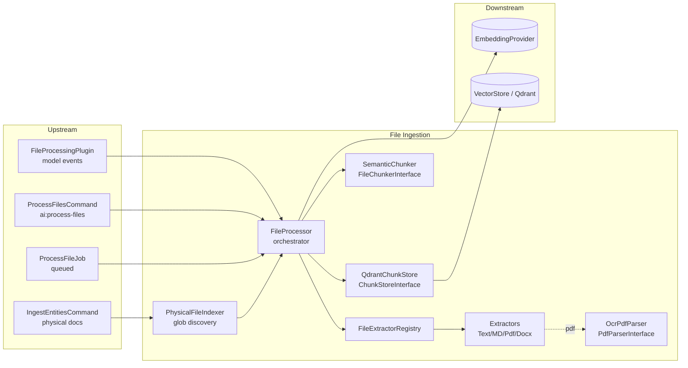

# Layer 06 — File Ingestion & Processing

## 1. Purpose (plain language)

This layer turns raw uploaded/physical files (PDF, DOCX, Markdown, plain text) into searchable knowledge. It extracts the text out of each file, splits that text into overlapping "chunks" small enough to embed, asks the embedding provider for a vector per chunk, and stores those vectors + the chunk text in Qdrant. Later, when a user asks a question, the retrieval layers (L7/L8) search those stored chunks to pull the relevant passages into the prompt. In the "user asks -> important words -> files -> enhance prompt" flow, this layer is the offline half that populates the "files" side so retrieval has something to find.

## 2. C4 component diagram

## 3. Data in / data out

**In:**
- A `file` object (Eloquent model or `stdClass`) with at least `id`, `name`, `path` (optional `disk`, `size`, `is_physical`). DB files use int `id`; physical docs use `physical:<relpath>` string ids from `PhysicalFileIndexer`.
- `options` array: `collection`, `chunk_size`, `overlap`, `force`.
- Glob patterns (`PhysicalFileIndexer`) from `config('ai.file_context.physical_paths')`.

**Out:**
- `ProcessingResult` DTO (success/failure, counts, timing, metadata).
- `FileChunk[]` upserted as Qdrant points (`id`, `vector`, `payload{file_id,file_name,content,chunk_index,...}`).
- Search results: `['chunk' => FileChunk, 'score' => float]` from `searchByContent`/`searchByFilename`/`getFileChunks` (consumed by L7 FileSearchService).

## 4. Contracts (owned / consumed)

**Owned (defined in this layer):**
- `FileProcessorInterface` — orchestration entry point.
- `FileExtractorInterface` — per-format text extraction (+ `extractMetadata`, largely dead).
- `PdfParserInterface` — PDF text extraction (OCR-capable).
- `FileChunkerInterface` — text -> chunks.
- `ChunkStoreInterface` — chunk persistence + retrieval.

**Consumed (from other layers):**
- `EmbeddingProviderInterface` (embeddings layer) — `embed`, `embedBatch`.
- `VectorStoreInterface` (vector-store layer / QdrantStore).
- `FileAccessResolver::PHYSICAL_PREFIX` (file-context layer) — for physical ids.
- `Nodeable`, `AI` facade (graph layer) — for the Neo4j half inside `FileProcessingPlugin`.

## 5. Findings

| ID | Sev | Type | File:line | What | Why it matters | Recommendation | Verified |
|----|-----|------|-----------|------|----------------|----------------|----------|
| L6-1 | P1 | bug | FileProcessor.php:307-337 | `createFileChunks` computes `startPosition`/`endPosition` by summing `strlen($chunkText)` sequentially, but `SemanticChunker` emits **overlapping** chunks (and drops whitespace between paragraphs/sentences). The positions therefore do not map to real offsets in the source text. | These offsets are persisted to Qdrant and exposed on `FileChunk`. Any feature using them (highlighting, citation ranges, re-stitching adjacent chunks) gets garbage; overlap means later chunks' "start" runs past the true end. Silently wrong. | Compute real offsets via `mb_strpos` from a moving cursor, or drop start/end and stop pretending they are meaningful. | true |
| L6-2 | P2 | bug | SemanticChunker.php:68,177 vs 201,215,219,246,253; FileChunk.php:100-103 | The size guard uses `mb_strlen` (line 68) and `chunkByCharacters` slices with `mb_substr`, but `groupIntoChunks`/`getOverlapUnits` measure with byte `strlen` (lines 201,209,215,219,246,253), and `FileChunk::getContentLength` is byte `strlen`. | Mixed byte/char counting means chunk-size and overlap budgets are miscounted for non-ASCII (French/accented) content — exactly the OCR `fra` target locale. Chunks overshoot/undershoot the intended size for multibyte text. | Pick one unit (mb_* everywhere) for all length math in the chunker and DTO. | true |
| L6-3 | P1 | single-path-violation | SemanticChunker.php:203-206 | In `groupIntoChunks`, if **any single** paragraph (or sentence) is longer than `chunkSize`, the whole method bails with `return []`, forcing `chunk()` to fall through to the next strategy — ultimately `chunkByCharacters` for the **entire document**. | One oversized paragraph (common in PDFs/Markdown with long code blocks or tables) discards good paragraph/sentence boundaries for the *whole* file and degrades everything to blind character slicing. The "semantic" chunker silently stops being semantic. | Split only the oversized unit (recurse to sentence/char chunking for that unit) and keep boundary-aware chunking for the rest. | true |
| L6-4 | P1 | half-done | FileProcessingPlugin.php:36-66 | Each model event (`created`, `updated`, `saved`) wraps its handler in `dispatch(closure)`, AND `saved` re-dispatches `handleFileCreated`/`handleFileUpdated` that `created`/`updated` already dispatch. A single save fires the same work twice. | Double processing: redundant extraction+embedding+upsert per file (wasted OCR/LLM cost) and a race between two closures both calling process/reprocess. `getVectorId` is deterministic so Qdrant dedups, but the cost is paid twice. | Drive everything from `saved` only (it already covers create + path-dirty update) and delete the `created`/`updated` listeners, or vice-versa — not both. | true |
| L6-5 | P1 | bug | FileProcessingPlugin.php:197,225,245,322-345; ProcessFileJob.php:71-77 | The plugin's `processFileContent`/`reprocessFileContent`/`removeFileContent` and `ProcessFileJob::handle` call `processFile($file)` / `reprocessFile($file)` / `removeFile($file)` with **no collection**. Physical/docs ingestion lives in `documentation_chunks`, but these auto-paths always target the default `file_chunks`. | Collection routing is half-wired: present on the API/`IngestEntitiesCommand` path, absent on the auto-triggers. If a model-backed file is ever meant for the docs collection (or the default changes), the plugin/job paths silently write to the wrong collection. | Thread the target collection through the plugin/job (config or per-model), or document that auto-processing is `file_chunks`-only and make `IngestEntitiesCommand` the sole docs path. | true |
| L6-6 | P2 | dead-code | QdrantChunkStore.php:428-433,452-473; ChunkStoreInterface.php:71,88 | `getChunkCount()` and `getChunk()` have **zero production callers** (confirmed: `->getChunk(` returns no hits; `getChunkCount` appears only in iface+impl). `getChunkCount` is also the only store method that ignores the `collection` arg — hardwired to `$this->collection`. | Dead interface surface other implementers must satisfy; `getChunkCount` would silently query the wrong collection in the multi-collection (docs) setup if revived. | Remove both from `ChunkStoreInterface` and `QdrantChunkStore`, or give `getChunkCount` a `?collection` param and a real caller. | true |
| L6-7 | P2 | dead-code | FileExtractorInterface.php:43; FileExtractorRegistry.php:114-127,147-159 | `extractMetadata()` is implemented by all four extractors and exposed via `FileExtractorRegistry::extractMetadata`/`getStats`, but no production code calls any of them (tests only). | Four non-trivial metadata methods are pure maintenance weight. `PdfExtractor::extractMetadata` even re-parses the entire PDF twice (`metadataParser->parseFile` at :82 plus `parser->extractText` again at :100) for output nobody consumes. | Drop `extractMetadata`/`getStats`, or wire the metadata into `FileChunk::metadata` so it actually reaches retrieval. | true |
| L6-8 | P2 | bug | ProcessFilesCommand.php:122-129,131; database/migrations/add_processed_at_to_files_table.php | `processed_at` is shipped as a migration and is the only "already processed" signal the command uses (`whereNull('processed_at')`), but **nothing in the package ever writes it** (`FileProcessor`/`FileProcessingPlugin` never set it). | The unprocessed filter is a permanent no-op: every `ai:process-files` run loads ALL files and relies on a per-file Qdrant `isProcessed` round-trip (one `count` per file). Scales poorly and the column is dead schema. | Define a canonical processed-state: write `processed_at` on success, or batch `hasFileChunks`/use a content hash and delete the column. | true |
| L6-9 | P2 | coupling | FileProcessingPlugin.php (whole class) | One ModelPlugin couples Neo4j metadata sync (`AI::ingest/sync/remove`), Qdrant content processing, queue routing, and per-operation error policy. Errors in any path funnel through `handleError` with `fail_silently=true` default (:357-372). | Mixing two storage systems + queueing + swallow-by-default means a broken extractor/embedder during a model save produces a logged-but-invisible failure; the user never learns their file is unindexed. Hard to test in isolation. | Split Neo4j-sync and Qdrant-processing into two focused listeners; default `fail_silently` to false for the synchronous path or surface a status the UI can read. | true |
| L6-10 | P2 | complexity-without-value | OcrPdfParser.php:18-65,161-170,471-485 | `extractText`'s `?int $pageLimit` is steered mainly by the `OCR_PAGE_LIMIT` **env var** (`resolvePageLimit`), and no caller passes the arg (`FileProcessor`/`PdfExtractor` call `extractText($path)` with one arg). All OCR tuning (`OCR_LANG`, `OCR_MIN_WORD_CONF`, `OCR_DIRECT_TEXT_MIN_WORDS`, ...) is `getenv`-only. | The interface advertises a `pageLimit` knob callers can't meaningfully use, and behavior is steered by undocumented env vars instead of config/options. Non-reproducible across environments. | Thread page-limit + OCR thresholds through `processFile($options)` -> extractor -> parser; move `OCR_*` env reads into `config/ai.php`. | true |
| L6-11 | P2 | bug | OcrPdfParser.php:52-62,67-78 | When native pages exist but a page is text-poor, the code OCRs **only that page** via `convertSinglePageWithGhostscript`. `extractNativePages` returns `[]` (the batched-OCR trigger) only if parsing throws or yields zero pages — a scanned PDF that parses to N empty pages returns N empty strings, so `$nativePages !== []`, every page fails `hasEnoughNativeTextSignals`, and each page is rasterized with a **separate** Ghostscript process. | For a fully scanned PDF this spawns one Ghostscript process per page instead of one batched conversion, multiplying process/exec overhead. The batched `convertPdfToImages` path is only reached when parsing returns literally zero pages. | Detect "native text globally insufficient" up front (total signal across pages) and switch to the batched rasterize path instead of per-page spawns. | true |
| L6-12 | P3 | missing | FileProcessor.php:113-122 | `embedBatch($textChunks)` is assumed to return one vector per chunk positionally; `createFileChunks` does `$embeddings[$index] ?? []`. A short/empty/failed embedding silently becomes `[]` and is upserted as an empty vector. | An empty-vector point is unsearchable and may be silently dropped or rejected by Qdrant; `ProcessingResult` still reports success. No integrity check ties embeddings to chunks. | Assert `count($embeddings) === count($textChunks)` and reject empty / wrong-dimension vectors before upsert; fail the `ProcessingResult` otherwise. | true |
| L6-13 | P3 | bug | MarkdownExtractor.php:176-196 | `extractFrontMatter` is a hand-rolled "basic YAML subset" that only parses flat `key: value` lines and strips quotes; nested maps, lists, multiline scalars are silently dropped. | Latent today because front matter is only surfaced via `extractMetadata` (itself dead, L6-7) — but if metadata is ever wired into chunks, structured front matter is silently lost/mangled. | Use `symfony/yaml` (already transitively present via the Symfony stack) or drop front-matter parsing. | true |
| L6-14 | P3 | ai-comment | FileProcessor.php:135; ProcessFilesCommand.php:124-125,150-154 | Obvious/placeholder comments: `// Success!`, `// Assuming there's a processed_at column or similar / You might need to adjust this based on your File model`, plus a commented-out `confirm()` block left in place (:150-154). | Noise plus a half-finished feel; the "you might need to adjust this" comment confirms the `processed_at` heuristic (L6-8) was never designed for this package's models. | Remove the dead commented block and apologetic comments; encode the assumption in code, not prose. | true |
| L6-15 | P3 | single-path-violation | QdrantChunkStore.php:438-447 vs 354-364 | `hasFileChunks` builds the count filter as the flat `['file_id' => $fileId]` shape, while `getFileChunks` builds the pre-built `['must' => [...]]` shape for the same logical query. | Two filter idioms for one concept inside one class. It works only because `QdrantStore::buildFilter` accepts both — couples `QdrantChunkStore` to that lenient adapter and invites drift if a stricter VectorStore is swapped in. | Standardize on one filter shape (the explicit `must` form) across the store. | true |
| L6-16 | P3 | abstraction | FileProcessor.php:39,114; FileProcessorInterface.php:23 | `FileProcessor` injects `EmbeddingProviderInterface` directly AND `QdrantChunkStore` also injects its own `EmbeddingProviderInterface` (for query embedding). The interface docblock advertises an `async` option that `processFile` never reads (async is decided by the plugin, not the processor). | Duplicate embedding dependency across two collaborators, and a documented-but-ignored `async` option misleads callers about where async is controlled. | Drop the `async` option from the docblock; decide one owner of the embedder dependency. | true |

## 6. File checklist

| File | Verdict | Note |
|------|---------|------|
| src/Console/Commands/ProcessFilesCommand.php | REFACTOR | `processed_at` no-op heuristic (L6-8); dead comments / commented confirm block (L6-14). Otherwise sound batch UX with progress bar + dry-run. Registered in AiServiceProvider:782. |
| src/Contracts/ChunkStoreInterface.php | REFACTOR | Trim dead `getChunk`/`getChunkCount` (L6-6); `getChunkCount` is the only method missing a `?collection` param. |
| src/Contracts/FileChunkerInterface.php | KEEP | Small, focused, right-sized. |
| src/Contracts/FileExtractorInterface.php | REFACTOR | Drop unused `extractMetadata` (L6-7) or give it a consumer. |
| src/Contracts/FileProcessorInterface.php | REFACTOR | Remove documented-but-ignored `async` option (L6-16); otherwise good. |
| src/Contracts/PdfParserInterface.php | KEEP | Minimal; the `pageLimit` param is currently unreachable from callers (L6-10) but the contract is fine. |
| src/DTOs/FileChunk.php | REFACTOR | `getContentLength` byte vs chunker char mismatch (L6-2); deterministic `getVectorId` (UUIDv5) is good. |
| src/DTOs/ProcessingResult.php | KEEP | Clean success/failure DTO; sensible factory methods and summary. |
| src/Jobs/ProcessFileJob.php | KEEP | Reasonable retry/timeout/tags and logging. Inherits the no-collection reprocess gap (L6-5). |
| src/Models/Plugins/FileProcessingPlugin.php | SPLIT | Double-dispatch of save events (L6-4), no-collection routing (L6-5), Neo4j+Qdrant+queue+error-policy coupling with swallow-by-default (L6-9). |
| src/Services/FileExtractorRegistry.php | REFACTOR | `extractMetadata`/`getStats` dead (L6-7). Routing logic is clean; consider an interface for injectability. |
| src/Services/FileProcessor.php | REFACTOR | Fabricated chunk positions (L6-1), no embedding-count check (L6-12), `// Success!` noise (L6-14), duplicate embedder dep (L6-16). Core flow is otherwise clear. |
| src/Services/QdrantChunkStore.php | REFACTOR | Dead `getChunk`/`getChunkCount` (L6-6), filter-shape inconsistency (L6-15). The filename indexed+scroll fallback is genuinely good defensive work. |
| src/Services/SemanticChunker.php | REFACTOR | Oversized-unit bailout degrades whole doc (L6-3); byte/char unit mixing (L6-2). Strategy ladder concept is sound. |
| src/Services/Extractors/DocxExtractor.php | KEEP | Solid recursive container walk; only the dead `extractMetadata` weight (L6-7). |
| src/Services/Extractors/MarkdownExtractor.php | REFACTOR | Hand-rolled YAML front matter (L6-13); `extractMetadata` dead (L6-7). Strip/clean logic is fine. |
| src/Services/Extractors/OcrPdfParser.php | REFACTOR | Per-page Ghostscript spawn pattern (L6-11), env-only knobs / unreachable pageLimit (L6-10). Confidence-filtered TSV + rasterizer fallbacks are strong engineering, just hard to configure. |
| src/Services/Extractors/PdfExtractor.php | KEEP | Thin wrapper over the parser; `extractMetadata` re-parses the file twice (L6-7) — only matters if metadata is revived. |
| src/Services/Extractors/TextExtractor.php | KEEP | Minimal and correct. |
| src/Services/Files/PhysicalFileIndexer.php | KEEP | Clean glob/Finder discovery; good separation (used by IngestEntitiesCommand + AiServiceProvider). Minor: `GLOB_BRACE` not portable to every libc but acceptable on target platforms. |

## 7. What to add (next-level)

- **Truthful chunk provenance.** Compute real character offsets (or page/section anchors) so citations can deep-link into the source, instead of the fabricated cumulative offsets (L6-1).
- **Idempotent, batched processed-state.** Replace the optional-`processed_at` heuristic with a content hash stored in the chunk payload; skip re-embedding unchanged files and batch the `hasFileChunks` check (L6-8).
- **Embedding integrity gate.** Enforce `count(embeddings)==count(chunks)` and non-empty, correct-dimension vectors before upsert; surface partial failures in `ProcessingResult` (L6-12).
- **Config-driven OCR/chunking.** Move all `OCR_*` env reads and chunk-size/overlap tables into `config/ai.php`, threaded through `options`, so behavior is reproducible and per-project tunable (L6-10).
- **Structure-aware chunking.** Use Markdown headers / DOCX section boundaries / PDF page breaks as chunk anchors and store them in `FileChunk::metadata`, rather than blind character windows; recurse only oversized units (L6-3).
- **One ingestion trigger, two clear responsibilities.** Collapse the duplicate model-event listeners (L6-4) and split graph-sync from content-processing so each is independently testable and the user gets a real "indexing failed" signal.
- **Backpressure & cost controls.** Batch embeddings across files (not per-file), cap concurrent OCR jobs, and record token/time cost per file for observability.

## 8. Open questions / risks

- **Is `fail_silently=true` the right default for a library?** Today a failed extraction during a model save is logged and forgotten (L6-9). For a RAG product, an unindexed-but-"saved" file is a silent correctness hole the end user cannot see.
- **Second-embedder / `chatbot_indexed` cleanup: CLEARED.** Repo-wide search for `chatbot_indexed` returns zero hits in source (only this audit doc references the term). The only secondary collection is the legitimate `documentation_chunks`, routed through the same `QdrantChunkStore` via the `?collection` parameter — there is no parallel chatbot embedding system or `chatbot_indexed` column assumption left in this layer.
- **OCR runtime dependencies (Ghostscript, Tesseract, Imagick) are discovered by probing the filesystem / `where` / `command -v`** with hardcoded Windows paths (OcrPdfParser.php:301-320,487-531). On a containerized Linux deploy without these binaries, scanned PDFs throw "No PDF rasterizer available" — verify the deploy provisions them or that the failure is acceptable.
- **Physical-doc collection routing depends entirely on `IngestEntitiesCommand` passing the collection**; the plugin/job auto-paths never do (L6-5). If a project ever marks DB-backed files as documentation, they will land in the wrong collection.
- **`ProcessFilesCommand` hardcodes the `Condoedge\Utils\Facades\FileModel` default and a `name LIKE '%.ext'` extension filter** — fragile against models whose filename column differs or whose extension isn't part of `name`.
