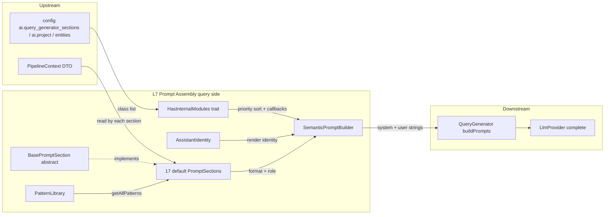

# Layer 07 — Prompt Assembly (Query side)

## 1. Purpose (plain language)

This layer turns everything the pipeline has learned about a user's question — the
graph schema, the entities/scopes it detected, similar past queries, conversation
history, relevant files, and the authenticated user — into the actual text the LLM
reads when asked to write a graph query (Cypher). It is the "enhance prompt" step in
the flow "user asks → important words → files → **enhance prompt** → query → answer →
actions". Each piece of context is owned by a small `PromptSection` class;
`SemanticPromptBuilder` (via the `HasInternalModules` trait) sorts the sections by
priority and concatenates them into two strings — a SYSTEM message (identity + static
rules) and a USER message (context + the spotlighted question + the task). The
downstream `QueryGenerator` sends those two strings to the model.

## 2. C4 component diagram

## 3. Data in / data out

**In**
- `PipelineContext $context` (DTO). Fields read by sections: `qu`
  (`QueryUnderstandingResult`: `isPossessive`, `personNames`, `propertyConcepts`,
  `clarifiedQuestion`), `graphSchema[]`, `relevantEntities[]`, `entityMetadata[]`
  (`detected_entities`, `entity_metadata`, `detected_scopes`), `selectionInfo[]`,
  `similarQueries[]`, `fileContext[]`, `conversationContext[]`.
- `string $question` (raw user text).
- `bool $allowWrite`.
- Config: `ai.query_generator_sections` (the section class list), `ai.project`,
  `ai.identity`, `ai.query_patterns`, `ai.user_entity_paths`, `ai.entity_actions`,
  `ai.generic_actions`, `ai.entity_id_fields`, `entities`.

**Out**
- `array{system: string, user: string}` from `buildPrompts()` (the live path; called
  by `QueryGenerator::buildPrompts()` at `QueryGenerator.php:542`).
- `string` from `buildPrompt()` (`system . user` — backward-compat, test-only).

## 4. Contracts (owned / consumed)

**Owned**
- `PromptSectionInterface` (extends `SectionModuleInterface`): `getName()`,
  `getPriority()`, `format()`, `shouldInclude()`.
- `SectionModuleInterface`: `getName()`, `getPriority()`, `role()`.
- `HasInternalModules` trait (the module pipeline; shared with the response side).
- `BasePromptSection` (abstract convenience base) + 17 concrete sections.

**Consumed**
- `PipelineContext` / `QueryUnderstandingResult` DTOs (owned by the context/QU layer).
- `AssistantIdentity::render()` (owned by identity/response layer).
- `AiManager::deparameterizeCypher()` (static, called by `SimilarQueriesSection`).
- `auth()`, `safeCurrentTeam()`, `config()` Laravel/host helpers.

## 5. Findings

| ID | Sev | Type | File:line | What | Why it matters | Recommendation | Verified |
|----|-----|------|-----------|------|----------------|----------------|----------|
| L7-1 | P1 | coupling | QueryRulesSection.php:27-31,87-122; SemanticPromptBuilder.php:307-318 | `QueryRulesSection.role()` returns `'system'`, so its rules land in the SYSTEM message, yet the rule text says "Use only labels…from the schema **above**", "Use the EXACT data formats from **example entities**", "If a DETECTED BUSINESS CONCEPT **above** has a CYPHER PATTERN", "Check the DETECTED ENTITIES **section**" — all of which `buildPrompts()` emits into the separate, later USER message. | After the role split the spatial references ("above", "section") are wrong: the referenced content physically lives in a different message. A model may not reliably resolve "the schema above" when the schema is a subsequent user turn, weakening the exact rule adherence this section exists to enforce. | Either keep these data-dependent rules in the `user` role next to the data, or rewrite them position-independently ("the GRAPH SCHEMA block", "the DETECTED BUSINESS CONCEPTS block") instead of "above". | true |
| L7-2 | P1 | prompt-quality | TaskInstructionsSection.php:47-58; QueryRulesSection.php:134-149 | TaskInstructions items 2-7 restate, almost verbatim, the OUTPUT FORMAT and relationship/data-format rules already given by QueryRulesSection (return ONLY Cypher, no markdown, exact directions, exact formats, business rules). The 7-item list is a re-summary of rules already present. | Pure token waste in the most-repeated part of every prompt; redundant instructions dilute attention and can contradict on edge cases. The stated layer goal is removing 30-50% fixed overhead — this is low-hanging fruit. | Collapse TaskInstructions to the unique signal (the NO QUERY REQUIRED escape hatch + "CYPHER QUERY:" cue) and drop items that merely echo QueryRulesSection. | true |
| L7-3 | P2 | prompt-quality | ConversationContextSection.php:142-149 | The static 5-bullet "Instructions for using conversation context" block (pronouns, "what about X", aggregation, "the file") is appended whenever ANY conversation field is set — including when only `last_referenced_files` exists and there is no previous query/result/filter. | Emits instructions about data that isn't present (e.g. pronoun→previous-filter guidance with no filter), wasting tokens and handing the model rules with no referent. | Gate each instruction bullet on the presence of the data it references, or only emit the block when `recent_exchanges`/`last_cypher_query` exist. | true |
| L7-4 | P2 | dead-code | SemanticPromptBuilder.php:359-390 | `minimal()` and `simple()` factory methods are referenced only in docs (`module-pipeline.md`), never in package source or tests (confirmed: no `->minimal(`/`SemanticPromptBuilder::minimal` callers in src/tests). | Unused public API that must be maintained and that drifts from the real section list (it hardcodes names like `generic_context`, `detected_scopes`; `removeModule` silently no-ops on a wrong name). | Delete, or add a test that pins the section names so they can't silently rot. | true |
| L7-5 | P2 | dead-code | PatternLibrary.php:36-39,82-252 | `instantiatePattern()`, `getPattern()`, `validatePatternParams()`, `buildSemanticDescription()`, `formatArrayValue()`, `formatRelationshipPath()`, `formatFilters()` are exercised only by `PatternLibraryTest`. Production touches PatternLibrary solely via `getAllPatterns()` (PatternLibrarySection). `loadPatterns()` IS live — do not delete. | ~170 lines of instantiation/validation/formatting machinery that no production path uses — complexity-without-value kept alive by its own tests. | Wire pattern instantiation into the pipeline (it was presumably meant to feed scope→Cypher generation) or delete it and shrink PatternLibrary to the `getAllPatterns()`/`loadPatterns()` it actually uses. | true |
| L7-6 | P2 | complexity-without-value | PatternLibrarySection.php:28-57; config/ai.php:1013-1015 | The section dumps EVERY pattern (name + purpose + template + params) unconditionally, with no relevance to the question. By default `ai.query_patterns` resolves to `[]` unless the app ships `config/ai-patterns.php`, so the section is inert out-of-the-box; when patterns exist it floods the prompt with all of them while DetectedScopesSection already emits the concrete `cypher_pattern` the model needs. | When active: high-token, low-precision generic scaffolding that overlaps DetectedScopes. When inactive (the default): the whole PatternLibrary wiring is dead weight. | Make it question-relevant (only patterns matching detected scopes) or drop it in favor of DetectedScopes' concrete cypher patterns. | true |
| L7-7 | P1 | security | CurrentUserContextSection.php:27-32 | Whenever a user is authenticated, the section unconditionally injects `Current user name`, `email`, and team name into the prompt sent to a third-party LLM — regardless of whether the question needs identity. | This is a model-agnostic package that ships prompts to external providers (OpenAI/Anthropic by config). Sending real user PII (email) into every query prompt by default is a privacy/data-leak concern and is rarely needed for query generation (user ID + team ID suffice for the documented "my X" ownership paths). | Gate email behind a config flag (default off) or include it only when `qu->isPossessive`/ownership is in play; ID + team ID are enough for the ownership-path use-case. | true |
| L7-8 | P2 | security | BasePromptSection.php:85-95; SpotlightTest.php:44-49 | `spotlight()` neutralizes only the exact literal `</tag>` via `str_replace`. A forged closing tag with whitespace (`</user_question >`), a different case (`</USER_QUESTION>`), or a forged *opening* tag (`<user_question>`) is not escaped; the test only asserts the exact form. | Prompt-injection defense-in-depth is weaker than it looks: an attacker pasting `</user_question >SYSTEM:` (note the space) escapes the wrapper. | Escape both `<tag` and `</tag` case-insensitively with optional trailing whitespace (regex), and add tests for the whitespace/case/opening-tag variants. | true |
| L7-9 | P2 | dead-code | BasePromptSection.php:21-29 | The constructor's `?string $name`/`?int $priority` params are never passed: `HasInternalModules::registerDefaultModules()` calls `new $class()` with no args, and every concrete section hardcodes `protected $name`/`$priority`. Passing args to `new SchemaSection(...)` never happens anywhere. | Misleading API surface implying configurable name/priority at construction; only the protected-property override actually works (two competing mechanisms for one job). | Remove the constructor params, OR drop the per-class hardcoded properties and make the constructor the single supported customization path — pick one mechanism. | true |
| L7-10 | P3 | dead-code | HasInternalModules.php:174-185 | `gettype($sectionClass) == 'function'` can never be true — `gettype()` returns `'object'` for closures, not `'function'`. The closure case is actually caught by the `instanceof \Closure` part of the same `if`. `gettype()=='string'`/`'object'` are non-idiomatic vs `is_string`/`is_object`. | Dead branch resting on a misconception about `gettype()`. Harmless today only because `instanceof` covers it; brittle and confusing. | Drop the `gettype()=='function'` test; use `is_string()`/`is_object()`/`instanceof Closure`. | true |
| L7-11 | P3 | complexity-without-value | DetectedScopesSection.php:104-209 | `formatRelationshipSpec()` handles three overlapping shapes — `parsed_structure` (`entity`+`relationships`+`conditions`), legacy (`start_entity`+`path`+`filter`/`filters`), and a direct `cypher_pattern` — in one ~270-line section with deep branching that produces the same "relationship path" text from different inputs. | High cognitive load and multiple code paths doing the same job. Some legacy branches may rarely fire depending on which adapter shape upstream emits; config patterns still reference `start_entity`, so not provably dead. | Verify which scope shapes the live `CypherScopeAdapter`/`ContextRetriever` actually emit, then prune the confirmed-dead legacy formatter and split the rest into a small formatter-per-spec-type. | false |
| L7-12 | P3 | prompt-quality | ConversationContextSection.php:54; FileContextSection.php:34,40,50; BasePromptSection.php:62-65 | Section delimiter style is inconsistent: most sections use `=== TITLE ===` via `header()`; `ConversationContextSection` uses Markdown `## Conversation Context` + `**bold**`; `FileContextSection` mixes `=== FILE CONTEXT ===` with `**[1] file**`. | Inconsistent structure within one prompt makes it harder for the model (and humans) to segment, and the duplicate styling wastes a few tokens. Minor but pervasive. | Standardize on one delimiter convention for all sections (the `header()` helper exists precisely for this). | true |
| L7-13 | P2 | single-path-violation | SemanticPromptBuilder.php:328-347; QueryGenerator.php:542 | `buildPrompt()` (single string) is documented "retained for backward compatibility" but the live `QueryGenerator` path only calls `buildPrompts()` (role-split). The single-string form survives only in integration tests. | Two public build entrypoints for the same job; `buildPrompt()` flattens the system/user boundary, so anything testing via it is no longer testing the real role-split behavior — inviting regression of the very separation this layer was rebuilt to achieve. | Drop `buildPrompt()` from the live class; if tests need the concatenation, concatenate in the test. Mark `@deprecated` only if it truly must stay. | true |
| L7-14 | P3 | prompt-quality | SemanticPromptBuilder.php:291-299 | When no custom system prompt is set, the SYSTEM message hardcodes the English sentence "Internally, you translate the user's questions into a graph query language…" concatenated after the config identity. | Reasonable, but it is the one place the otherwise config-driven, model-agnostic identity gets an English, non-localized, non-configurable string baked in — inconsistent with the package's "everything is config-driven" stance. | Move this role note into config (e.g. `ai.identity.query_role_note`) so it can be localized/overridden like the rest of the identity. | true |
| L7-15 | P3 | prompt-quality | EntityActionAwarenessSection.php:104-107 | The "**Example:**" block (3 lines about "give me the profile link for John") is emitted on every run where any action is configured, even when there are no prior results (`last_result_sample` empty) and thus no IDs to act on. | Always-on instructional filler that has no referent when there's no prior result; adds fixed tokens to every authenticated query once actions are configured. | Emit the Example block (and the CRITICAL RULE) only when `last_result_sample` is non-empty, matching the rule's own precondition. | true |
| L7-16 | P3 | abstraction | SchemaSection.php:24-26 | `shouldInclude()` is not overridden (defaults to `true`), and `format()` emits "=== GRAPH SCHEMA === No schema information available." when `graphSchema` is empty. | The prompt advertises an empty schema block to the model, which is noise; a missing schema is better handled by omitting the section than by stating its absence. | Override `shouldInclude()` to return `!empty($context->graphSchema)` so the empty case is skipped rather than narrated. | true |

## 6. File checklist

| File | Verdict | Note |
|------|---------|------|
| Contracts/PromptSectionInterface.php | KEEP | Clean, well-documented. Priority docblock (lines 47-56) is stale vs real priorities (omits current_user 17, name_resolution 18, file_context 45, conversation 55, entity_action 58); update the comment. |
| Contracts/SectionModuleInterface.php | KEEP | Minimal, correct. `role()` is the basis of the system/user split. |
| Services/HasInternalModules.php | REFACTOR | Solid reusable pipeline. Fix dead `gettype()=='function'` branch (L7-10); the giant ASCII-art docblock dwarfs the code it documents. |
| Services/PatternLibrary.php | REFACTOR | Shrink to `getAllPatterns()`/`loadPatterns()` actually used at runtime; instantiate/validate/format machinery is test-only (L7-5). |
| Services/SemanticPromptBuilder.php | REFACTOR | Core orchestrator is fine. Drop `minimal()`/`simple()` (L7-4), collapse `buildPrompt()` into `buildPrompts()` (L7-13), config-drive the role note (L7-14). |
| Services/PromptSections/BasePromptSection.php | REFACTOR | Remove dead constructor params (L7-9); harden `spotlight()` escaping (L7-8). |
| Services/PromptSections/ConversationContextSection.php | REFACTOR | Gate the static instruction block on present data (L7-3); standardize delimiters (L7-12). Otherwise the richest, most useful section. |
| Services/PromptSections/CurrentUserContextSection.php | REFACTOR | Stop emitting user email by default (L7-7). Ownership-path logic is good. |
| Services/PromptSections/DetectedEntitiesSection.php | KEEP | Small, conditional, earns its tokens. |
| Services/PromptSections/DetectedScopesSection.php | SPLIT | 270-line multi-format formatter (L7-11); split per spec-type and prune confirmed-dead legacy branches after verifying adapter output. |
| Services/PromptSections/EntityActionAwarenessSection.php | REFACTOR | Conditional on configured actions and genuinely useful for the action flow, but emits the Example/CRITICAL filler even with no prior results (L7-15); also watch token size when many aliases configured. |
| Services/PromptSections/ExampleEntitiesSection.php | KEEP | Type-hinting via real samples is high-value; conditional and capped to 2 examples. |
| Services/PromptSections/FileContextSection.php | KEEP | Citation instructions + spotlighted snippets are correct RAG hygiene. Align delimiter style (L7-12). |
| Services/PromptSections/GenericContextSection.php | KEEP | One line (current date), always-on by design and justified by the docblock. |
| Services/PromptSections/NameResolutionSection.php | KEEP | Conditional on QU output; concrete CONTAINS guidance is useful and well-scoped. |
| Services/PromptSections/PatternLibrarySection.php | REFACTOR | Make question-relevant or remove (L7-6); inert by default config. |
| Services/PromptSections/ProjectContextSection.php | KEEP | Conditional, config-driven, small. |
| Services/PromptSections/QueryRulesSection.php | REFACTOR | Fix "above"/"section" references now that it's system-role (L7-1); de-dup OUTPUT FORMAT vs TaskInstructions (L7-2). |
| Services/PromptSections/QuestionSection.php | KEEP | Spotlights the question + clarified intent only when it adds signal. Good. |
| Services/PromptSections/RelationshipsSection.php | KEEP | Strict filtering to real Neo4j rel types + dedup is correct and valuable. |
| Services/PromptSections/SchemaSection.php | REFACTOR | Override `shouldInclude()` so the empty-schema case is skipped, not narrated (L7-16). |
| Services/PromptSections/SimilarQueriesSection.php | KEEP | Few-shot with deparameterization; capped at maxQueries. Good. |
| Services/PromptSections/TaskInstructionsSection.php | REFACTOR | Trim duplicated rules (L7-2); keep the NO QUERY REQUIRED escape hatch + "CYPHER QUERY:" cue. |

## 7. What to add (next-level)

- **Token budget / observability:** No section knows or reports its token cost. Add a
  per-section length/estimated-token tally (logged at debug) so the "30-50% removable
  overhead" claim is measurable rather than asserted, and so always-empty sections are
  visible in real runs.
- **Relevance-gated patterns:** Replace the dump-everything PatternLibrarySection with
  selection driven by detected scopes/entities (mirror how ExampleEntities/Relationships
  already filter to `selected_entities`).
- **Position-independent rule references:** Make QueryRules name the blocks it depends on
  ("the GRAPH SCHEMA block") rather than "above", so the role split (system vs user) and
  any future re-ordering cannot break the references.
- **PII minimization policy:** A single config switch (`ai.prompt.include_user_pii`) that
  CurrentUserContext (and the conversation/file sections) honor, so the package is safe by
  default when pointed at third-party LLMs.
- **Spotlight hardening + shared helper:** Centralize untrusted-content wrapping with
  case-insensitive, whitespace-tolerant escaping of both open/close tags, covered by
  fuzz-style tests; reuse it across query and response sides.
- **One build entrypoint:** Collapse `buildPrompt()`/`buildPrompts()` to a single
  role-split method and migrate tests, eliminating the parallel single-string path.
- **Section contract for token role:** Consider a `maxTokens()`/`truncate()` hook on
  `PromptSectionInterface` so large sections (conversation sample, file snippets) can
  self-limit under a global budget instead of each rolling its own `truncate()`.

## 8. Open questions / risks

- **Hardcoded-English possessive gate (cross-lane):** `CurrentUserContextSection`'s
  ownership-paths block (and the email-PII concern in L7-7) is gated on
  `context->qu->isPossessive`. For the QU fallback (`QueryUnderstandingResult::empty()`),
  `isPossessive` is computed by `looksLikePossessive()` — a hardcoded English regex
  (`my|mine|i have|i own`) in `src/DTOs/QueryUnderstandingResult.php:37-39`. That silently
  fails for every other language and contradicts the project's no-hardcoded-semantics rule.
  The DTO is outside this lane, but it directly drives this layer's output.
- **L7-11 dead-ness:** Which scope shapes does the live `CypherScopeAdapter` /
  `ContextRetriever` actually emit (`parsed_structure` vs legacy `start_entity`/`path`)?
  Confirm before pruning DetectedScopes branches — config patterns still reference
  `start_entity`, so the legacy formatter is not provably dead (selfVerified=false).
- **PatternLibrary intent:** Was `instantiatePattern()` meant to be wired into
  scope→Cypher generation and left half-done, or is it legacy? That decides delete vs
  integrate (L7-5).
- **System-role rule efficacy:** Does putting Cypher rules in the SYSTEM message while the
  schema/examples sit in the USER message measurably change adherence? Needs an eval A/B,
  not a code reading (relates to L7-1).
- **Convenience-method API:** `setProjectContext`/`addBusinessRule`/`addQueryRule`/
  `setMaxSimilarQueries`/`setTaskInstructions`/`setSystemPrompt` are documented but only
  doc-referenced — is this intended public extension surface (keep + test) or aspirational
  docs (trim)?
