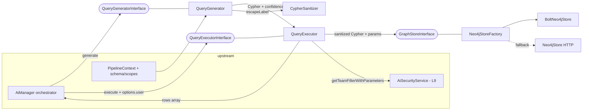

# Layer 08 — Query Generation, Execution & Graph

## 1. Purpose (plain language)

This layer turns the user's clarified question into a database query, runs it
safely, and hands back rows. `QueryGenerator` takes the question plus the
enriched `PipelineContext` (graph schema, detected entities/scopes) and produces
a Cypher string — either from a fast regex template or from the LLM with a
retry/validate loop. `QueryExecutor` then runs that Cypher against Neo4j, but
first injects a per-tenant **team filter** so a user only sees their own data,
enforces read-only/rate-limit/limit guards, formats the rows, and logs the
attempt. The `GraphStore/*` classes are the actual Neo4j drivers (Bolt binary or
HTTP) plus the `CypherSanitizer` that makes label/relationship interpolation
injection-safe. In the spine "ask -> words -> files -> prompt -> **query ->
answer**", this is the "query" stage.

## 2. C4 component diagram

## 3. Data in / data out

In:
- `string $question` (clarified) and `PipelineContext` (`graphSchema`,
  `entityMetadata['detected_scopes']`, project metadata) into
  `QueryGenerator::generate`.
- `string $cypher`, `array $parameters`, and an `$options` map that carries the
  threaded actor (`$options['user']`), `original_question`, `conversation_id`,
  and toggles (`skip_security`, `read_only`, `format`, `limit`, `timeout`) into
  `QueryExecutor::execute`.

Out:
- Generator returns a loose **array** (`cypher`, `explanation`, `confidence`,
  `warnings`, `metadata`). `AiManager` rehydrates it into the DTO
  `QueryGenerationResult` (AiManager.php:877-883).
- Executor returns a loose **array** (`success`, `data`, `stats`, `metadata`,
  `errors`). `AiManager` rehydrates it into `QueryExecutionResult`
  (AiManager.php:884-890).
- `GraphStore::query` returns `array` of plain-PHP rows. Exceptions thrown:
  `QueryGenerationException`, `QueryExecutionException`, `QueryTimeoutException`,
  `ReadOnlyViolationException`, `SecurityException`, `CypherInjectionException`,
  `CircuitBreakerOpenException` (HTTP store), `DataConsistencyException` (ingest).

## 4. Contracts (owned / consumed)

Owned by this layer:
- `QueryGeneratorInterface`, `QueryExecutorInterface`, `GraphStoreInterface`.

Consumed:
- `LlmProviderInterface` (Layer 07) — generation.
- `AiSecurityService` (Layer 09) — `getTeamFilterWithParameters`,
  `shouldSkipTeamFilterForCount` (a concrete, not an interface — coupling).
- `RateLimiter`, `RetryPolicy`, `CircuitBreaker`, `SensitiveDataSanitizer`
  (Layer 12) — resilience/security helpers.
- `SemanticPromptBuilder` / `PatternLibrary` (Layer 06) — prompt construction.
- `AiQueryLog` model, `AiLogger` — logging.

## 5. Findings

| ID | Sev | Type | File:line | What | Why it matters | Recommendation | Verified |
|----|-----|------|-----------|------|----------------|----------------|----------|
| L8-1 | P0 | security | QueryExecutor.php:633-660, 733-750 | Fail-closed team-filter only triggers if `extractPrimaryEntity()` (a regex) finds an inline `(alias:Label)`. Any query whose primary node has **no inline label** (e.g. `MATCH (n {id:$x})`, or `MATCH ()-[r]-(m:Invoice)` where the returned alias is unlabeled) yields `entity = null` → the query runs **unfiltered** even with security enabled (line 657-660). The "sensitive entity" gate is a regex, not a parse. | A model-generated or facade-supplied Cypher that dodges the labeled-match shape bypasses tenant scoping entirely — cross-tenant read. The whole fail-closed posture rests on a brittle regex over an LLM-authored string. | Drive scoping off the *known* entity from `PipelineContext`/QU, not a regex over the generated string; if no entity can be proven, treat as sensitive and fail closed. | true |
| L8-2 | P1 | bug | QueryExecutor.php:241-257 | RESOLVED. `executeCount` now wraps the original query as `CALL { {$inner} } RETURN count(*) AS total` (QueryExecutor.php:257), the recommended fix; the malformed `WITH * MATCH ... RETURN count(*)` fallback is gone, so OPTIONAL MATCH / CALL / leading-WITH shapes count correctly. | (Historical) `executePaginated` always calls `executeCount` first, so pagination of any non-simple query used to throw a Neo4j syntax error before the real query ran. | Done. Keep a test covering OPTIONAL/CALL/WITH count shapes. | resolved |
| L8-3 | P1 | bug | QueryExecutor.php:173-191 | Timeout classification is `elapsed_wall_ms >= timeout*1000`, but **no timeout is ever passed to the graph store** — neither Bolt `client->run` nor the HTTP store honors `$options['timeout']` (HTTP uses a fixed `CURLOPT_TIMEOUT=30/10`). A fast failure is reported as `QueryExecutionException`; a real hang is bounded only by the driver's fixed timeout, not the requested one. | The `timeout` option is decorative; `QueryTimeoutException` fires only by luck of wall-clock math after the store already returned/threw. There is no actual server-side query guard. | Pass the timeout into the store (driver transaction timeout / per-request `CURLOPT_TIMEOUT`) and classify by the driver's timeout signal, not wall-clock. | true |
| L8-4 | P1 | single-path-violation | QueryExecutor.php:44 vs CypherValidator.php:26-27 | RESOLVED. The keyword list was extracted to `CypherValidator::DANGEROUS_KEYWORDS` (CypherValidator.php:26-27, includes `DROP`) and the executor now consumes it directly: `private array $writeKeywords = CypherValidator::DANGEROUS_KEYWORDS;` (QueryExecutor.php:44). One canonical list backs both `validate()` and the executor read-only gate; `DROP` is now flagged by the executor. | (Historical) divergent executor/generator lists silently weakened enforcement of `DROP`. | Done. | resolved |
| L8-5 | P1 | single-path-violation | QueryExecutor.php:705-727 vs AiSecurityService.php:57-68 | The `on_permission_unexistent` deny/bypass decision (incl. the warning log) is implemented twice: once in `AiSecurityService` and once in `QueryExecutor::failClosedOrBypass`. | Two homes for the same security policy → divergence risk: changing deny semantics in one leaves the other fail-open. Security decisions must have one home. | Make `failClosedOrBypass` delegate to a single policy method on `AiSecurityService`. | true |
| L8-6 | P1 | dead-code | BoltNeo4jStore.php:264-358; Neo4jStore.php:269-448; GraphStoreInterface.php:138-164 | The entire transaction API (`beginTransaction`/`commit`/`rollback`/`queryInTransaction`) is implemented in both stores + the interface but called nowhere in `src/` (only integration tests). `DataIngestionService` does manual compensation instead. | ~250 LOC of two divergent, in-anger-untested transaction models (Bolt sessions vs HTTP tx URLs) giving a false sense of transactional safety. | Wire ingestion to use it, or delete the four methods from the interface and both stores. | true |
| L8-7 | P1 | dead-code | QueryExecutorInterface.php:75-91; QueryExecutor.php:285-351 | `explain()`, `test()`, and `cancel()` have zero `src/` callers (only tests/docs). `cancel()` references `dbms.killQuery` with a `$queryId` the app never produces. | Interface surface that ships unused; `test()`/`explain()` are EXPLAIN round-trips that cost a DB call nobody makes. | Drop from the interface + class, or move to an optional `GraphIntrospection` capability used only where needed. | true |
| L8-8 | P1 | half-done | CypherValidator.php:111-128 (`sanitize`) | `sanitize()` was extracted from `QueryGenerator` to `CypherValidator` (CypherValidator.php:111; `QueryGenerator::sanitize` at :347 now only delegates). It still strips write keywords with `preg_replace('/\bKEYWORD\b[^;]*(;|$)/i', '')` — a regex butcher that can leave half a clause and yield invalid Cypher, and is **never called in the execution path** (only `validate()` is). It is exposed via `AI::sanitizeQuery()`. | A "security" method that produces structurally-broken queries and gives a false impression of being a safety net. `validate()` already rejects writes; `sanitize()` is a worse, unused parallel path. | Delete `sanitize()` (validator + generator delegate + `AiManager::sanitizeQuery`); rely on `validate()` + the executor's read-only gate as the single path. | true |
| L8-9 | P2 | bug | QueryGenerator.php:218 | `if ($response == 'NO QUERY REQUIRED' \|\| !isset($response) \|\| empty($response))` uses loose `==` and exact-case match. A response like `"no query required"` or with trailing whitespace is not matched. | The LLM "no query needed" signal is matched by exact-case string equality, so casing/whitespace variance silently produces a (likely invalid) Cypher attempt + retries. | Normalize/trim + case-insensitive compare (`strcasecmp` on a trimmed value), or instruct the model to emit a strict sentinel token. | true |
| L8-10 | P2 | dead-code | Neo4jStore.php:643-665 (`arrayToCypherProps`); CypherSanitizer.php:52-67,131-138 | `arrayToCypherProps` is `@deprecated` and test-only. `CypherSanitizer::validateLabel`/`validateRelationshipType`/`validateIdentifiers` (the throwing variants) are used only by tests; production uses `escapeLabel`/`escapeRelationshipType`/`validateIdentifierSafe`. | Two parallel validation styles (throwing-strict vs escape-safe) inflate surface and confuse which is canonical. | Delete `arrayToCypherProps`; collapse to the single `escape*` path production uses. | true |
| L8-11 | P2 | abstraction | QueryGeneratorInterface.php:35; QueryExecutorInterface.php:35; DTOs/QueryGenerationResult.php; DTOs/QueryExecutionResult.php | Typed DTOs exist but both interfaces still return loosely-typed `array`; `AiManager` hand-rebuilds the DTOs from those arrays (AiManager.php:877-890). | Two representations of the same data; callers rely on phpdoc'd string keys; refactors are unsafe. | Make the interfaces return the DTOs and delete the array contract (or delete the DTOs). Don't keep both. | true |
| L8-12 | P2 | complexity-without-value | TemplateMatcher.php:48,67,109 (getTemplates/detectTemplate/generateFromTemplate) | The template path was extracted from `QueryGenerator` into `TemplateMatcher` (`QueryGenerator::getTemplates`/`detectTemplate` at :369/:382 now delegate; the template branch is at :135). The 6 hardcoded regex templates (`list_all`, `count`, ...) are still English-only, brittle (`/^(show\|list...)/`), and hardcode `LIMIT 100`. The template path is bypassed the moment any scope ≥0.7 is detected. | A second, lower-quality generation path that fires only for trivially-phrased English questions and is muted for any real filter; maintenance cost > value vs always calling the (already mandatory) LLM path. | Drop templates and rely on `SemanticPromptBuilder`, or make templates config/data-driven and language-agnostic — not a hardcoded English regex wall. | true |
| L8-13 | P2 | bug | TemplateMatcher.php:174 (`inferLabel`) | `inferLabel` was extracted from `QueryGenerator` to `TemplateMatcher` (TemplateMatcher.php:174). It still does naive singularization `rtrim(strtolower($x),'s')` + `ucfirst` ("companies"->"Companie", "status"->"Statu"), and on a schema miss returns the bogus label anyway; the caller then throws `Unknown label` or (if it coincidentally matches config) interpolates it. | Template queries silently target wrong/nonexistent labels for any irregular plural, producing empty results that look like "no data". | Resolve labels via the entity catalog/schema with proper singular/plural aliasing, not string trimming. | true |
| L8-14 | P2 | bug | QueryExecutor.php:850-862 (`injectTeamFilterIntoBranch`) | When the head already has a `WHERE`, the team predicate is appended as `rtrim($head) . ' AND ' . $condition`. With a head `WHERE a OR b`, Cypher precedence makes the result `a OR (b AND team)` — the team filter does **not** constrain the `a` branch. The existing condition is never parenthesized. | A tenant filter `AND`'d onto an `OR` predicate can leak rows from the un-parenthesized branch. Security-critical rewrite without precedence guarding. | Wrap the existing head condition: `WHERE (<existing>) AND <team>`. Add OR-predicate tests. | true |
| L8-15 | P2 | coupling | QueryExecutor.php:583-600, 514-527, 550-567 | Executor reaches into ambient identity: `getCurrentTeamId()` probes `currentTeamId()`/`auth()->user()` reflection, and `logQuerySuccess/Failure` use `auth()->id()` — even though the real actor is threaded as `$options['user']` and used for the filter. | Logs/`team_id` are attributed to `auth()` (null/wrong on CLI/queue/impersonation) while the *filter* correctly uses `$options['user']`. Provenance and the security filter disagree on who the actor is. | Thread the resolved actor + team into logging too; drop the `function_exists/method_exists` reflection probes. | true |
| L8-16 | P2 | coupling | QueryGenerator.php:85-86,89; QueryExecutor.php:626 | Service-location inside the class: generator `new SemanticPromptBuilder(new PatternLibrary())` (QueryGenerator.php:85-86) + `app(AiLogger::class)` (:89); executor `app(AiSecurityService::class)`. The old `config('entities')` read moved out with the template path into `TemplateMatcher`. | Hidden dependencies make these hard to test/inject into a host app and couple them to the Laravel container at call time. | Constructor-inject `AiSecurityService` into the executor and the prompt builder into the generator; drop in-method `app()`/`new`. | true |
| L8-17 | P2 | leaky-abstraction | Neo4jStoreFactory.php:58-89 (+ README.md:418, installing.md:140) | The factory is the registered binding, yet docs/tests instantiate `new Neo4jStore()` / `new BoltNeo4jStore()` directly, bypassing scheme detection + the Bolt-unavailable fallback. The HTTP `Neo4jStore` is only reachable via fallback or direct construction. | Two construction paths; users following docs get the HTTP store with retry/circuit-breaker semantics the Bolt store lacks — inconsistent behavior depending on how you built it. | Make the factory the single documented entry point; update docs/tests; consider a resilience decorator wrapping either store. | true |
| L8-18 | P3 | leaky-abstraction | GraphStoreInterface.php:5-11, 80-86, 164 | Interface doc claims to abstract "Neo4j, ArangoDB, OrientDB" but `query(string $cypher,...)` and `queryInTransaction(...)` are Cypher-specific; it mixes generic CRUD (`createNode`, `getSchema`) with Cypher execution. | The portability promise is false; no non-Cypher store can back this interface. Misleads extenders. | Narrow the doc to "Cypher graph stores", or split a `CypherExecutorInterface` from the CRUD interface. | true |
| L8-19 | P3 | bug | QueryExecutor.php:80-88 | Empty-Cypher short-circuit returns `'context' => 'NO QUERY'` and omits `errors`, while the success path returns `errors => []` and no `context`. The executor's return shape is inconsistent across branches. | `AiManager` tolerates it via `?? []`, but the contract drift (sometimes `context`, sometimes `errors`) is exactly why L8-11 (DTO-first) matters. | Return a consistent shape (the `QueryExecutionResult` DTO) from every branch. | true |
| L8-20 | P3 | bug | QueryExecutor.php:392-466; BoltNeo4jStore.php:406-458 | `formatAsGraph`/`extractNodesAndRelationships` assume a raw shape (`['id'], ['labels'], ['start'], ['end']`) that the stores do not emit — `BoltNeo4jStore::convertValue` collapses a `Node` to just its properties (no id/labels), so graph format yields empty nodes/relationships. | A result-format mode that silently returns nothing because the upstream converter strips the metadata it needs. Dead-on-arrival feature. | Either preserve node id/labels/rel endpoints in `convertValue` and test `format:'graph'`, or remove the graph format. | true |

## 6. File checklist

| File | Verdict | Note |
|------|---------|------|
| Contracts/GraphStoreInterface.php | REFACTOR | Cypher-leaky doc + dead transaction methods (L8-6, L8-18). |
| Contracts/QueryExecutorInterface.php | REFACTOR | `explain`/`test`/`cancel` unused; returns `array` not the DTO (L8-7, L8-11). |
| Contracts/QueryGeneratorInterface.php | REFACTOR | Returns `array` instead of `QueryGenerationResult` (L8-11). |
| DTOs/QueryExecutionResult.php | KEEP | Clean readonly DTO; make it the interface return type (L8-11). |
| DTOs/QueryGenerationResult.php | KEEP | Clean readonly DTO; same unification note (L8-11). |
| Exceptions/CircuitBreakerOpenException.php | KEEP | Used by CircuitBreaker + ChatPresenter. |
| Exceptions/CypherInjectionException.php | KEEP | Thrown by CypherSanitizer's validate/escape paths. |
| Exceptions/DataConsistencyException.php | KEEP | Used by DataIngestionService (rich-context exception). |
| Exceptions/QueryExecutionException.php | KEEP | Core executor error type, widely caught (ChatPresenter). |
| Exceptions/QueryGenerationException.php | KEEP | Core generator error type. |
| Exceptions/QueryTimeoutException.php | KEEP | Type fine, but its trigger logic is broken (L8-3). |
| Exceptions/ReadOnlyViolationException.php | KEEP | Used by executor read-only gate (weakened by L8-4). |
| Exceptions/SecurityException.php | KEEP | Central security exception; HTTP 403 default sensible. |
| GraphStore/BoltNeo4jStore.php | REFACTOR | Drop transaction API (L8-6); preserve node metadata for graph format (L8-20). |
| GraphStore/CypherSanitizer.php | REFACTOR | Collapse throwing vs escape validation styles (L8-10). |
| GraphStore/Neo4jCredentialsTrait.php | KEEP | Small, correct encrypted/plain password resolver. |
| GraphStore/Neo4jStore.php | REFACTOR | HTTP store: delete `arrayToCypherProps` + transaction API; mark fallback-only (L8-6, L8-10, L8-17). |
| GraphStore/Neo4jStoreFactory.php | KEEP | Sensible scheme dispatch; make it the only documented constructor (L8-17). |
| Services/QueryExecutor.php | REFACTOR | Regex entity gate (L8-1), count bug RESOLVED (L8-2), timeout fiction (L8-3), keyword drift RESOLVED — now shares `CypherValidator::DANGEROUS_KEYWORDS` (L8-4), policy dup (L8-5), OR-precedence splice (L8-14), identity coupling (L8-15). |
| Services/QueryGenerator.php | REFACTOR | `app()`/`new` coupling (L8-16), no-query match (L8-9). NOTE: `sanitize` (L8-8), the template wall (L8-12), and `inferLabel` (L8-13) were extracted to `CypherValidator`/`TemplateMatcher`; QueryGenerator now only delegates to them. |
| Services/TemplateMatcher.php | REFACTOR | Extracted template path: English-only regex templates + `LIMIT 100` (L8-12), naive `inferLabel` singularization (L8-13). |
| Services/CypherValidator.php | REFACTOR | Extracted validation: canonical `DANGEROUS_KEYWORDS` shared with the executor (L8-4); dead `sanitize` regex butcher (L8-8). |

## 7. What to add (next-level)

- **Parse, don't regex.** Replace `extractPrimaryEntity`/`extractEntityAlias`/
  `injectTeamFilter` with a real Cypher AST step (or pass the known
  entity/alias from QU through `PipelineContext`) so tenant scoping is provable,
  parenthesized, and applied to *every* node — not inferred from string shape.
  This closes L8-1 and L8-14 together.
- **Server-enforced limits.** Push timeout + max-rows into the driver
  (Bolt transaction timeout / per-request `CURLOPT_TIMEOUT`; Neo4j
  `transaction.timeout`) so `QueryTimeoutException` reflects a real guard (L8-3).
- **DTO-first contracts.** Interfaces return `QueryGenerationResult` /
  `QueryExecutionResult`; delete the loose-array contract (L8-11). Add an
  `EXPLAIN`-based cost estimate so the orchestrator can refuse expensive queries
  before running them.
- **One validation style** shared by generator and executor (L8-10). The single
  keyword authority is done: both consume `CypherValidator::DANGEROUS_KEYWORDS`
  (L8-4 resolved).
- **A single GraphStore resilience decorator** (retry + circuit breaker)
  wrapping either Bolt or HTTP, so behavior is transport-independent and the
  factory is the only construction path (L8-17). Remove the unused transaction
  API or actually use it in ingestion (L8-6).
- **Result provenance** on `QueryExecutionResult` (which rows came from which
  label/team) to feed the answer layer and to *prove* the team filter
  constrained the result set.

## 8. Open questions / risks

- **L8-1 is the headline risk.** The fail-closed *posture* is correct
  (`$options['user']` is threaded from `AiManager::generateAndExecute`,
  AiManager.php:866-872, and preferred over `auth()->user()` in
  `applySecurityFilter`), but it only engages when the entity-extraction regex
  finds an inline `(alias:Label)`. I could not confirm (the LLM prompt is in
  Layer 06) that every generated query carries an inline label on its primary
  match. If unlabeled primary matches are possible, those queries run
  unfiltered.
- **L8-14 OR-precedence:** depends on whether any team-path filter or generated
  query ever produces a head `WHERE ... OR ...`. Low frequency, but
  security-critical when it happens; should be parenthesized regardless.
- **Bolt vs HTTP divergence:** only the HTTP `Neo4jStore` has retry +
  circuit-breaker; the Bolt store relies on the library. Hosts following the
  docs (`new Neo4jStore`/`new BoltNeo4jStore`) get inconsistent resilience. Is
  HTTP intended to be a supported public store or pure fallback? If fallback
  only, it should not be a documented public constructor.
- **Dead facade methods** (`executeCount`/`executePaginated`/`explain`/`test`/
  `cancel`) appear unused in `src/` but are public `AI::*` facade methods, so
  deletion is a documented breaking change for host apps, not a silent removal.
