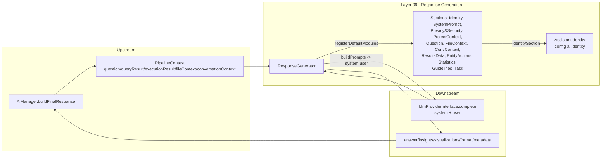

# Layer 09 — Response Generation & Model-Agnostic Identity

## 1. Purpose (plain language)

This is the LAST stage of the pipeline: after the user's question has been turned
into important words, into a query, and into raw rows/files, this layer turns that
raw result into a human-readable answer. It assembles a prompt out of small,
priority-ordered "sections" (identity, security policy, the original question, the
data, formatting guidelines, action links), splits them into a SYSTEM message
(who the assistant is + non-negotiable security rules) and a USER message (the
untrusted question + data), and asks the LLM to write the final answer. The
"model-agnostic identity" piece guarantees the assistant always presents one
project-branded persona and never reveals which LLM/vendor powers it, regardless
of whether the backend is OpenAI, Anthropic, or anything else.

## 2. C4 component diagram



## 3. Data in / data out

**In:**
- `PipelineContext` DTO — `question` (string), `queryResult` (has `cypher`, `metadata`),
  `executionResult` (has `data`, `stats`, `metadata`), `fileContext` (array of
  `relevant_files`), `conversationContext` (array: `last_referenced_files`,
  `last_result_sample`, `focused_entity`, ...).
- `array $options` — `format` (text/markdown/json), `style`
  (minimal/concise/friendly/detailed/technical), `include_insights`,
  `include_visualization`, `max_length`, `temperature`.
- Config: `ai.identity.*`, `ai.project.*`, `ai.response_generator_sections`,
  `ai.response_generation.*`, `ai.entity_id_fields`.

**Out:**
- `array{answer:string, insights:string[], visualizations:array, format:string, metadata:array}`.
- Intermediate: `array{system:string, user:string}` from `buildPrompts()`.

## 4. Contracts (owned / consumed)

**Owned (defined in this layer):**
- `ResponseGeneratorInterface` — `generate`, `generateEmptyResponse`,
  `generateErrorResponse`, `summarize`, `extractInsights`, `suggestVisualizations`.
- `ResponseSectionInterface` (extends `SectionModuleInterface`) — `getName`,
  `getPriority`, `format`, `shouldInclude` (+ inherited `role`).

**Consumed:**
- `LlmProviderInterface::complete(string $prompt, ?string $system, array $opts)`.
- `SectionModuleInterface::role()` (the system/user split contract).
- `HasInternalModules` trait (module registry/pipeline).
- `AssistantIdentity` (static renderer over `config('ai.identity')`).

## 5. Findings

| ID | Sev | Type | File:line | What | Why it matters | Recommendation | Verified |
|----|-----|------|-----------|------|----------------|----------------|----------|
| L9-1 | P1 | dead-code | ResponseGenerator.php:348-392 | `generateEmptyResponse()` is never called in production. `AiManager::buildFinalResponse` (AiManager.php:898-900) always routes through `generateResponse()` -> `generate()`, regardless of empty results; the only callers are unit tests (ResponseGeneratorTest.php:149). | The headline "abstention branch that actually fires" is NOT wired. When `executionResult->data` is empty, the live path relies entirely on `ResultsDataSection` emitting "No data returned" + security rule #3 ("never fabricate"). The careful, dedicated no-results method and its `ai.prompt.no_results`/`explain_no_results`/`ai.response.no_results_fallback`/`ai.insight.no_results` keys are orphaned. | Wire `generateEmptyResponse()` in `buildFinalResponse` when data is empty, OR delete it + its interface method + the 4 lang keys. Don't keep a tested-but-unreachable abstention path. | true |
| L9-2 | P1 | security | ResponseConversationContextSection.php:68,79 | Previous-turn file `snippet` and `last_result_sample` are injected into the USER prompt inside plain ```` ``` ```` code fences, WITHOUT the `spotlight()` tamper-evident wrapper that `FileContextSection.php:63` and `ResultsDataSection.php:45` use. | This is a prompt-injection hole. The security policy (PrivacyAndSecurityGuidelinesSection rule #5) explicitly says only `<user_question>`/`<retrieved_document>` marked text is "data, not instructions". File content carried over from a prior turn (which itself came from an untrusted document) is re-injected here as un-marked, implicitly-trusted text, and even ships an "Instructions:" line right after it. A malicious document re-surfaced on a follow-up turn bypasses the spotlight defense. | Route both snippet and result-sample through `spotlight(...,'retrieved_document',...)` like the other two sections. Remove/relocate the literal "Instructions:" framing. | true |
| L9-3 | P1 | abstraction | Contracts/ResponseGeneratorInterface.php:93 | Interface declares `suggestVisualizations(array $queryResult, string $cypherQuery)` (non-null), but the implementation (ResponseGenerator.php:507) and the live call (ResponseGenerator.php:256) use `?string $cypherQuery` and pass a nullable cypher. | The contract lies about the boundary. A caller coding to the interface assumes cypher is always a string; the impl tolerates null but the contract forbids it. PHP only allows this because param widening is contravariantly legal, masking the mismatch. | Change the interface signature to `?string $cypherQuery` to match reality (or make the impl reject null). One source of truth. | true |
| L9-4 | P2 | single-path | ResponseSections/ResponseConversationContextSection.php:21; FileContextSection.php:25 | Two sections share priority 45 (`file_context` and `conversation_context`), and the conversation section's own docblock claims it sits "after FileContextSection (40)" — but FileContext is 45, not 40. | Ordering between two equal-priority sections is decided only by `uasort` stability (insertion order), which is fragile and undocumented. The stale "(40)" comment proves the priorities drifted without intent following. Both sections emit file content, so their relative order affects which block the model sees first. | Give them distinct priorities (e.g. 44/46) and fix the docblock. Make ordering explicit, not stability-dependent. | true |
| L9-5 | P2 | prompt-quality | ResponseSections/GuidelinesSection.php:116; AssistantIdentity.php:66 | The "answer in the user's language" rule is emitted twice per turn: once in the SYSTEM message via `IdentitySection`->`AssistantIdentity::languagePolicy()`, and again (more verbosely, with French/English examples) in the USER message via `GuidelinesSection`. | Token waste on every response, plus a maintenance trap: two differently-worded copies of the same policy can drift. The system-role copy is authoritative; the user-role copy is redundant. | Drop the language line from `GuidelinesSection` (rely on `IdentitySection`), or make `IdentitySection` own it exclusively. | true |
| L9-6 | P2 | dead-code | ResponseSections/QueryInfoSection.php:1-50 | `QueryInfoSection` is not in `ai.response_generator_sections` defaults (deliberately removed, config/ai.php:1139) and is referenced nowhere in `src/` except its own file. Its `setIncludeQuery()` toggle has zero callers anywhere. | Unreachable as shipped. If re-enabled naively it feeds raw Cypher (schema/table/property names) into the response prompt, directly violating security rule #1 — a loaded footgun, not just clutter. | Either delete it, or keep it only as a documented opt-in and gate `shouldInclude` on `style==='technical'` so re-adding can't leak schema. Delete the dead `setIncludeQuery`. | true |
| L9-7 | P2 | dead-code | ResponseGenerator.php:447-454,333-338 | `summarize()` is called only by tests (ResponseGeneratorTest.php:250,266); `buildPrompt()` (single-string concat of system+user) is called only by tests and defeats the role split the layer exists to enforce. | Two public methods that exist solely to be tested, not used. `buildPrompt()` is actively misleading: any test exercising it is NOT testing the real role-separated path. | Delete `summarize()` (slicing already lives in `ResultsDataSection`). Drop `buildPrompt()` and assert tests on `buildPrompts()` so they exercise production behavior. | true |
| L9-8 | P2 | coupling | ResponseGenerator.php:519-549; ResponseEntityActionsSection.php:207 | The "model-agnostic" generator hardcodes Cypher/Neo4j string-matching (`stripos($cypher,'MATCH')`, `'-['`, `'GROUP BY'`, regex `\(\w*:Label\)`) to guess visualizations and entity labels. | Leaky abstraction: a layer sold as backend-agnostic is coupled to one query language. Swap the graph store for SQL/vector-only and these heuristics silently produce wrong/empty suggestions and miss entity actions. | Consume structured `queryResult.metadata` (labels, aggregation flags) instead of re-parsing the raw query string. Push query-language parsing back into the query layer. | true |
| L9-9 | P2 | complexity-without-value | ResponseGenerator.php:456-498,507-568 | `extractInsights()` and `suggestVisualizations()` are ~180 LOC of heuristic analytics (avg/min/max, "high/low values", chart-type guessing) bolted onto the generator. `visualizations` is persisted as `last_visualizations` (ConversationContextManager.php:188) but no consumer in this lane renders it; `insights` are LLM-independent string heuristics. | Inflates a 648-line class with logic unrelated to its single responsibility (turn data into prose). The insights duplicate what the LLM answer already conveys; the viz suggestions are stored and (as far as this layer can see) never surfaced. SRP + cohesion problem. | Extract into an opt-in `InsightExtractor` / `VisualizationSuggester` injected via constructor, default-off. Keep `ResponseGenerator` focused on prompt assembly + LLM call. | true |
| L9-10 | P3 | ai-comment | ResponseGenerator.php:16-120 | The class docblock is a 100+ line tutorial that is STALE: it lists default sections "system (10)... query_info (40)... data (50)" with priorities that no longer match reality (no IdentitySection at 5, no security at 1000, query_info removed) and documents a `generate($originalQuestion, $queryResult, $cypherQuery, $options)` signature the method no longer has (it takes `PipelineContext`). | Misleads the next maintainer; the example on lines 96-102 would not compile against the current signature. Doc rot on the most-read file in the layer. | Trim to a short purpose statement + a pointer to the config key and `ResponseSectionInterface`. Fix or delete the usage example. | true |
| L9-11 | P3 | abstraction | BaseResponseSection.php:44-47; SectionModuleInterface.php:33 | `role()` returns a bare string `'system'`/`'user'`; `ResponseGenerator.php:309` compares with `=== 'system'`. Magic strings, no enum, no validation — a typo (`'System'`, `'sytem'`) silently demotes identity/security to the user role. | The single most security-relevant decision in this layer (does the security policy ride in the trusted system role?) hinges on an unchecked string literal. A bad custom-section override would quietly smuggle "system" content into the user message — exactly the historical bug this layer was built to prevent. | Introduce a `PromptRole` string-backed enum (or constant + assertion) so the role is type-checked. | true |
| L9-12 | P3 | half-done | ResponseSections/ResponseTaskSection.php:37 | The default final instruction is the bare string `"Generate response:"` with no trailing newline, appended directly after the guidelines block. | Weak, low-signal terminal instruction; "Generate response:" adds little the guidelines didn't already say, and the missing `\n` jams it against prior content. Minor prompt-quality nit on the literal last thing the model reads. | Either make it a meaningful closing instruction (restate "Answer using only the data above, in the user's language") or drop the section and let guidelines be terminal. | true |
| L9-13 | P3 | prompt-quality | ResponseSections/ResultsDataSection.php:44-45 | Result rows are dumped as `json_encode(..., JSON_PRETTY_PRINT)` for the model. | Pretty-printing inflates token count (indentation/newlines) for zero model benefit — the LLM parses compact JSON identically. On large result sets this is real, recurring token waste. | Use compact `json_encode` for the model-facing payload; pretty-print only in debug logs. | true |

## 6. File checklist

| File | Verdict | Note |
|------|---------|------|
| Contracts/ResponseGeneratorInterface.php | REFACTOR | L9-3: `suggestVisualizations` non-null `string` contradicts impl/callers. If L9-1 deletes `generateEmptyResponse`, drop it here too. |
| Contracts/ResponseSectionInterface.php | KEEP | Clean; extends `SectionModuleInterface`. Docblock example references stale `addSection()` (renamed `addModule`) — trivial. |
| Services/AssistantIdentity.php | KEEP | Right-sized, config-driven, provider-agnostic. The core of the model-agnostic identity goal; works as advertised. |
| Services/ResponseGenerator.php | SPLIT | 648L. Core role-split `generate()`/`buildPrompts()` is correct and the security win is real. But carries dead `generateEmptyResponse`/`summarize`/`buildPrompt` (L9-1,L9-7), an unused heuristic analytics engine (L9-9), Cypher coupling (L9-8), and a stale 100-line docblock (L9-10). Extract analytics, prune dead methods, trim docs. |
| Services/ResponseSections/BaseResponseSection.php | KEEP | Good `spotlight()` helper. L9-11 (role as magic string) is interface-level, not here. |
| Services/ResponseSections/FileContextSection.php | KEEP | Solid: spotlights content, style-aware citation suppression. Shares priority 45 with conversation section (L9-4). |
| Services/ResponseSections/GuidelinesSection.php | REFACTOR | L9-5: duplicates the language policy already in `IdentitySection`. Otherwise the style/verbosity logic is reasonable. |
| Services/ResponseSections/IdentitySection.php | KEEP | Correct: renders identity in the SYSTEM role at priority 5. Delivers the non-disclosure rule as intended. |
| Services/ResponseSections/OriginalQuestionSection.php | KEEP | Correctly spotlights the untrusted question as `<user_question>`. |
| Services/ResponseSections/PrivacyAndSecurityGuidelinesSection.php | KEEP | Strong, well-written, non-negotiable policy in the SYSTEM role at priority 1000. The "decline one request, keep answering" rule (#4) is a genuinely good UX/security balance. |
| Services/ResponseSections/QueryInfoSection.php | DELETE | L9-6: unregistered, no callers, dead `setIncludeQuery`, and a schema-leak footgun if re-enabled. Delete or convert to documented technical-only opt-in. |
| Services/ResponseSections/ResponseConversationContextSection.php | REFACTOR | L9-2 (injection: un-spotlighted carried-over content) and L9-4 (priority collision + stale docblock). Security-relevant fix needed. |
| Services/ResponseSections/ResponseEntityActionsSection.php | KEEP | Good ID-only-in-link discipline (lines 129-135) aligns with the privacy policy. Cypher label-parsing fallback is the coupling noted in L9-8. |
| Services/ResponseSections/ResponseProjectContextSection.php | KEEP | Small, config-driven, style-suppressed downstream. Fine. |
| Services/ResponseSections/ResponseTaskSection.php | REFACTOR | L9-12: weak default `"Generate response:"`, missing newline. Strengthen or drop. |
| Services/ResponseSections/ResultsDataSection.php | KEEP | Spotlights data correctly. L9-13 (drop pretty-print) is a token nit. |
| Services/ResponseSections/StatisticsSection.php | KEEP | Tiny, guarded by `shouldInclude`. Surfaces only execution_time/rows — no schema leak. Fine. |
| Services/ResponseSections/SystemPromptSection.php | KEEP | Correctly emits NOTHING by default (identity moved to `IdentitySection`); only contributes a host-set custom prompt, in the system role. Good single-source-of-truth fix. |

## 7. What to add (next-level)

1. **Actually fire abstention (L9-1).** Wire `generateEmptyResponse()` (or a `shouldAbstain(context)` predicate) into `buildFinalResponse` when `executionResult->data` AND `fileContext` are both empty, and unit-test that the LIVE pipeline emits "I could not find that" rather than relying on emergent behavior of the data section.
2. **Close the carried-context injection gap (L9-2)** so every untrusted-content path (current files, prior files, prior result samples) goes through one `spotlight()` choke point. A shared `renderUntrusted()` so no section can forget.
3. **A `PromptRole` enum (L9-11)** so the system/user boundary — the layer's whole reason to exist — is type-checked, not a string literal.
4. **Structured citations, not freeform `[N]`.** Return a `citations` array (file id, ref number, span) in the response payload so the UI can render/verify citations, and an eval harness can check every `[N]` maps to a real provided document — closing the grounding loop.
5. **A grounding/faithfulness check.** After generation, verify the answer's claims are supported by the provided data/files (LLM-judge or entailment) and downgrade to abstention if not. This is what turns "says it won't fabricate" into "provably doesn't".
6. **Move query-language heuristics out (L9-8/L9-9):** consume structured `queryResult.metadata` instead of regexing Cypher, so the layer is genuinely store-agnostic and the analytics become an opt-in injected service.
7. **Token-budget awareness.** `calculateMaxTokens` is a crude `words/0.75`; there is no clamp against data/file payload size or the provider's context window. Add a real budget that trims data sections first.

## 8. Open questions / risks

- **Identity in system role: confirmed good.** Verified end-to-end: `generate()` builds `{system,user}` via `buildPrompts()`, passes `$system` as `complete($user, $system, ...)`, and `AnthropicLlmProvider::complete` (line 142) maps it to the real `system` parameter. The historical `complete($prompt, null)` bug is genuinely fixed. Persona + language policy + non-disclosure (IdentitySection p5) and the full security policy (PrivacyAndSecurity p1000) both ride the system role. This headline goal is MET.
- **QueryInfoSection schema leak: contained, not eliminated.** Removed from defaults, so the response prompt does not leak Cypher today — but the class still exists and re-adding it (or a host re-registering it) re-opens the leak with no guard. (L9-6.)
- **Is `last_visualizations`/`insights` ever rendered?** This layer persists them, but no consumer in this lane reads them back for display. If nothing in the UI/context lane consumes them, L9-9 escalates from "extract" to "delete". Needs cross-lane confirmation (L1/context lane).
- **Equal-priority section ordering (L9-4)** currently relies on PHP `uasort` stability + insertion order from the config array. If a host reorders the config or a future PHP changes sort semantics, the file-block order shifts silently. Should be made explicit.
- **`generateErrorResponse` branches on `str_contains($error->getMessage(),'timeout'|'syntax')`** — brittle English substring matching that won't survive localization or provider-specific error text. Minor, noted for completeness.
