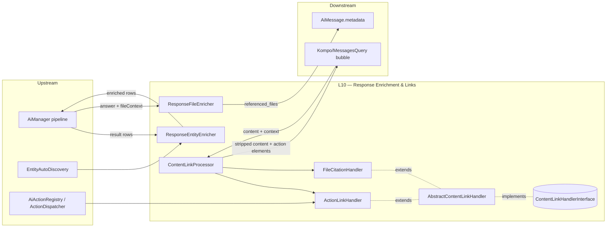

# Layer 10 — Response Enrichment & Content/Action Links

## 1. Purpose (plain language)

After the LLM produces its answer text, this layer turns that plain markdown into interactive UI. It has two jobs. (a) **Enrichment** — it annotates query-result rows with the actions available for each entity (`ResponseEntityEnricher`) and maps `[1]`/`[2]` citation markers in the answer back to the source files with download/preview metadata (`ResponseFileEnricher`). (b) **Link rendering** — at display time it scans the answer for special markdown links (`[text](entity://Type/id/key)`, `[text](action://key)`, and `[N]` file citations), strips them out of the prose, and replaces the action links with real clickable Kompo elements (action chips, approval cards). It is the bridge between "the model wrote a string" and "the user can click a button" in the `answer -> actions` part of the flow.

## 2. C4 component diagram

## 3. Data in / data out

**In:**
- `ResponseEntityEnricher::enrichEntityResults(array $results)` — query-result rows (each an assoc array carrying `_label`/`type` + id fields).
- `ResponseFileEnricher::enrichResponse(array $response, array $fileContext, array $options)` — response array (`answer`/`content`), `fileContext.relevant_files` (keys: `file_id`, `filename`, `snippet`, `relevance`, `chunk_index`, `source`, `mime_type`, `morphable_type`), plus optional resolver closures.
- `ContentLinkProcessor::processForDirectRendering(string $content, array $context)` — raw answer markdown + `['files' => ..., 'result_set' => ..., 'user' => ...]`.

**Out:**
- Enriched rows with `has_actions`, `available_actions`, `entity_type`, `action_links` (last one dead — see L10-1).
- `referenced_files` array (ref, id, name, snippet, relevance_score, source, chunk_index, download_url, preview_url, can_download, morphable_type, mime_type) + `has_file_references`, merged into the response and persisted to `AiMessage.metadata['referenced_files']`.
- `{content, elements, has_links, file_citations}` — stripped prose + Kompo action elements (`ApprovalCard` or renderables). `file_citations` is metadata only.

## 4. Contracts (owned / consumed)

**Owned:** `ContentLinkHandlerInterface` (`getPatterns`, `hasLinks`, `createElements`, `stripLinks`).

**Consumed:** `ActionDispatcher` + `AiActionRegistry` (L11), `EntityAutoDiscovery` (discovery), `ApprovalCard` (Kompo/Actions), `config('ai.entity_id_fields')`. No interface abstracts the enrichers or the processor — `AiManager` and `MessagesQuery` depend on the concrete classes directly.

## 5. Findings

| ID | Sev | Type | File:line | What | Why it matters | Recommendation | Verified |
|----|-----|------|-----------|------|----------------|----------------|----------|
| L10-1 | P1 | dead-code | ResponseEntityEnricher.php:20,63,77-98 | `action_links` is built per-row by `buildActionLinks()` and merged into every result, but no `src/` code ever reads `['action_links']` (only tests reference the string). The class docblock claims it "actually DRIVES the UI" and "drives the UI instead of being computed-and-discarded" — the opposite of reality; the LLM authors the rendered links via `ResponseEntityActionsSection`. | ~22 LOC of computed-and-discarded work plus a docblock that actively lies to the next maintainer, who will assume a wiring that doesn't exist. | Delete `buildActionLinks()` and the `action_links` key (keep the live `has_actions`/`available_actions`/`entity_type`). If per-row chips are wanted, wire them through a single shared formatter. | true |
| L10-2 | P1 | single-path-violation | ResponseEntityEnricher.php:94 vs ResponseSections/ResponseEntityActionsSection.php:91,106 | The `entity://Type/ID/key` link grammar is hand-built in two places with no shared formatter, and they have already drifted: the enricher emits `"{label}: {name}"` visible text, the live section emits a different format. | Two string builders for one grammar; the dead one (L10-1) drifts unnoticed, and a future format change must be found in N spots. | Extract one `EntityActionLinkFormatter` owning the `entity://` grammar; have the live path use it (and delete the dead one). | true |
| L10-3 | P1 | half-done | ResponseFileEnricher.php:67-69,157-163,205-213 | `download_url_resolver` / `preview_url_resolver` / `can_download_resolver` are referenced only inside this class; `AiManager::enrichResponseWithFiles` (`AiManager.php:1062-1069`) forwards the generic pipeline `$options`, which never contains these keys. So `download_url`/`preview_url` are ALWAYS null and `can_download` ALWAYS defaults to `true` (line 209). | A whole "actionable metadata" abstraction is inert in production. `can_download = true`-by-default is a quiet authorization gap if any consumer ever trusts it. | Inject real resolvers from the host (FileAccessResolver already exists), or drop the closures + url/can_download fields until they have a real consumer. Default `can_download` to **false**, not true. | true |
| L10-4 | P1 | coupling | ResponseFileEnricher.php:132-179 vs Kompo/MessagesQuery.php:459-473 | The rich `referenced_files` array (snippet, relevance, urls, morphable_type, mime) IS persisted to the message and reaches the UI, but `fileReferenceCard()` does `FileModel::find($file['id'])` and renders only name + type — discarding nearly all enriched metadata and re-querying the DB it already carried. | Effort building per-file metadata that the only renderer ignores; the re-fetch defeats the point of persisting the data on the message and adds an N+1 query per referenced file. | Have the card consume the persisted enriched array (no re-fetch), or trim the enricher to the fields the card actually uses. | true |
| L10-5 | P1 | dead-code | FileCitationHandler.php (whole class) + ContentLinkProcessor.php:131-135 | `processForDirectRendering` deliberately returns **only** action elements (`elements = handlers['actions']->createElements(...)`); the FileCitationHandler `_Link("[N]")` chips are never added to `elements`. The promised JS wiring (`data-action-proxy`) exists **only** in comments/tests — no `src/` code emits it. So the entire inline `[N]` clickable-citation mechanism (the `_Link`, `data-action-slot`, `createFileLink`) renders nothing in the live chat. | A whole handler + its element-building path is built, tested, and DI-registered but produces zero user-visible output; the comment at FileCitationHandler.php:106-108 describes a wiring that does not exist. Pure maintenance weight + misleading docs. | Either finish the proxy wiring (emit `data-action-proxy` elements and include citation elements in the rendered output) or delete the element-building half of FileCitationHandler and keep only the strip behavior. | true |
| L10-6 | P1 | bug | FileCitationHandler.php:21,97-101 (via ContentLinkProcessor::stripLinks → MessagesQuery.php:238) | The citation pattern `/\[(\d+)\]/` strips **any** bracketed integer to empty, then the stripped content is rendered as prose. A literal `[2024]`, a list step `[3]`, or `[404]` in the answer is silently deleted from the user-visible text. | Data loss in the rendered answer for perfectly normal content; the strip happens before markdown render so the user never sees those tokens. | Strip `[N]` only when `N` resolves to a real file in `context['files']`; leave non-resolving brackets untouched. | true |
| L10-7 | P1 | dead-code | ResponseFileEnricher.php:99 vs Services/UI/SafeMarkdownRenderer.php:99 | `SafeMarkdownRenderer` wraps `[N]` in `` at line 99, but in the chat path `MessagesQuery::assistantBubble` strips ALL `[N]` to empty (via the processor) BEFORE calling `renderMarkdown` (MessagesQuery.php:228,238,679-686). So the sup-styling branch can never fire for citations on the live chat path. | Dead rendering branch giving a false impression that citations are visually styled in chat; combined with L10-5/L10-6 the citation story is incoherent across three components. | Decide ONE citation rendering owner. If citations should show as styled superscripts, do not strip them in the processor; if they should become chips, wire L10-5. Remove the unused branch. | true |
| L10-8 | P2 | single-path-violation | ResponseFileEnricher.php:40 · FileCitationHandler.php:21 · Services/UI/SafeMarkdownRenderer.php:99 | The citation grammar `/\[(\d+)\]/` + the 1→0 index parse is copy-pasted in (at least) three files. | Change the marker format once and you must hunt down every copy; already a source of the L10-6/L10-7 incoherence. | Centralize the pattern + parse + 1-index logic in one small `Citation` value object/util shared by all three. | true |
| L10-9 | P2 | single-path-violation | ResponseEntityEnricher.php:103-114 · PromptSections/EntityActionAwarenessSection.php:115-126 · ResponseSections/ResponseEntityActionsSection.php:223-234 | `extractEntityId()` (the `config('ai.entity_id_fields')` loop) is copy-pasted in three classes, each with the **stale** inline default `['id','_id','neo4j_id']` — missing `'uuid'`, which the published config (`config/ai.php:1036-1041`) DOES include. | Three copies of one resolver; if config is unpublished/null the fallback silently fails to resolve uuid-keyed rows, dropping their action links. Format drift across copies is invisible. | Extract one `EntityIdResolver`; make the inline default match the config (or read a single shared constant). | true |
| L10-10 | P2 | dead-code | ActionLinkHandler.php:42,45 | `EntityAutoDiscovery $discovery` is injected and assigned in the constructor but **never read** anywhere else in the class — the handler resolves actions via `$this->dispatcher->registry()`. It's a dead constructor dependency. | Misleading coupling: a reader assumes the handler uses discovery; the `app(EntityAutoDiscovery::class)` fallback also forces a container hit for an object that is never used. | Remove the `$discovery` parameter and property. | true |
| L10-11 | P2 | complexity-without-value | ActionLinkHandler.php:186-206 | Entity-vs-generic detection re-scans the full match string for `"entity://"` (`matchedEntityPattern`) even though the two patterns are matched separately and already distinguishable by which capture groups are populated. The two-method `isEntityMatch`/`matchedEntityPattern` pair plus three explanatory docblocks dwarf the one-line `str_contains`. | Over-engineered disambiguation with verbose justification comments for a trivial check; brittle if a generic action key ever contains the literal `entity://`. | Tag each pattern with a type at match time (e.g. iterate `[pattern => type]`) and drop the string re-scan. | true |
| L10-12 | P2 | dead-code | ContentLinkProcessor.php:55-59,82-92,100-107,156-159 | `registerHandler()`, the public `createElements()`/`hasLinks()`/`stripLinks()` aggregators, and `getHandlerNames()` are never called outside this class/tests; the live path uses only `processForDirectRendering`. The returned `file_citations` key is also read only in tests (the code comment even says "for potential future use"). | "Extensible processor" surface that nothing extends; `processForDirectRendering` even bypasses the generic `createElements` to special-case `handlers['actions']`, so the aggregators are doubly unused. | Trim to the methods the single caller uses, or genuinely route everything through the generic aggregators and document the extension point as supported. | true |
| L10-13 | P1 | abstraction | ContentLinkProcessor.php:31-46,123-143 + ContentLinkHandlerInterface.php | The processor special-cases `FileCitationHandler` by concrete type (`citationHandler` property, `resetMetadata()`, `getCitationMetadata()`), breaking the interface's "all handlers are equal" promise. The interface has no way to express "I only strip / I don't render inline / I expose metadata." | Leaky abstraction: adding a second metadata-bearing or strip-only handler requires editing the processor, not just implementing the interface — defeats the extension point. | Add `rendersInline(): bool` and/or `metadata(): array` to the interface so the processor stays generic and stops naming a concrete handler. | true |
| L10-14 | P3 | complexity-without-value | ContentLinkProcessor.php:34-46 | Nullable constructor params + the zero-handler fall-through let the processor silently no-op if both handlers are null. The trigger can't happen — the provider (`AiServiceProvider.php:667-672`) always passes `app->make()` of concrete handlers. | Defensive code for an impossible state; a silent no-op would be hard to diagnose if it ever did regress. | Make handlers required (typed non-nullable) or log a warning when zero handlers are registered. | true |
| L10-15 | P1 | abstraction | (whole layer) markdown-regex link protocol | The entire action/entity invocation surface rides on the LLM emitting exact `[text](entity://Type/id/key?query)` / `[text](action://key)` strings parsed by hand-rolled regex (`ActionLinkHandler.php:34,37`). One stray space, encoded char, or nested paren and the link silently fails to render (caught only by the try/catch that logs and drops it). | Brittle vs. provider-native tool/function calling: the model must reproduce a precise URL grammar in prose, params are then re-filtered against a schema anyway, and failures are invisible to the user. This is the core "next-level" gap for an agentic assistant. | Move action invocation to structured tool-calls (the model returns a tool name + JSON args), and keep the markdown-link path only as a legacy fallback. | true |

## 6. File checklist

| File | Verdict | Note |
|------|---------|------|
| src/Contracts/ContentLinkHandlerInterface.php | REFACTOR | Clean minimal contract, but too thin — can't express strip-only/metadata handlers, forcing the processor to special-case concrete types (L10-13). Add `rendersInline()`/`metadata()`. |
| src/Services/Response/AbstractContentLinkHandler.php | KEEP | Solid base: dedup, per-match try/catch, strip via callback. Right-sized. Minor: `\Log::warning` uses a global facade alias rather than DI — acceptable for this package's conventions. |
| src/Services/Response/ActionLinkHandler.php | REFACTOR | Core action rendering works and routes through the registry/dispatcher correctly. Remove dead `$discovery` dep (L10-10), simplify entity/generic detection (L10-11). |
| src/Services/Response/ContentLinkProcessor.php | REFACTOR | Live path (`processForDirectRendering`) is fine but bypasses its own generic aggregators and special-cases the citation handler (L10-13); trim the unused public surface (L10-12). |
| src/Services/Response/FileCitationHandler.php | SPLIT | Strip behavior is used; the element-building half (`createFileLink`, metadata, `data-action-slot`) renders nothing in the live UI and references a non-existent `data-action-proxy` wiring (L10-5). Keep strip, delete or finish the rest. |
| src/Services/Response/ResponseEntityEnricher.php | REFACTOR | `has_actions`/`available_actions`/`entity_type` are live and useful; `action_links`/`buildActionLinks` are dead with a lying docblock (L10-1); `extractEntityId` is a triplicated/stale copy (L10-9). |
| src/Services/Response/ResponseFileEnricher.php | REFACTOR | Citation→file mapping is real and persisted, but the URL/permission resolver layer is inert and `can_download` defaults to true (L10-3); output metadata is largely discarded by the renderer (L10-4); citation regex duplicated (L10-8). |

## 7. What to add (next-level)

- **Structured tool-calling instead of markdown-regex links (L10-15).** Have the model return tool name + JSON args (Anthropic tool-use / function-calling); render results from structured data. Keep the `entity://`/`action://` regex only as a legacy fallback. This removes the entire brittle-grammar failure mode and the schema re-filtering dance.
- **One citation value object.** Owns the `[N]` pattern, the 1-index parse, and "does this N resolve to a real file?" Used by the enricher, the handler, and the markdown renderer — fixing L10-6/L10-7/L10-8 in one place.
- **One `EntityIdResolver` + one `EntityActionLinkFormatter`.** Collapse the 3-way `extractEntityId` and the 2-way `entity://` grammar (L10-2/L10-9).
- **Real file-action authorization.** Wire `FileAccessResolver` into `ResponseFileEnricher` so `can_download`/`preview_url` reflect actual permissions; default-deny (L10-3).
- **Single file-reference renderer** that consumes the persisted enriched array (no `FileModel::find` re-fetch), unifying the inline-citation path and the reference-card path (L10-4/L10-5).
- **Generic handler contract** (`rendersInline()`/`metadata()`) so new handlers plug in without editing the processor (L10-13).
- **Tests that assert rendered output, not internal metadata.** Current tests assert `file_citations` shape and handler internals that the live UI never consumes (L10-5/L10-12), masking the dead paths.

## 8. Open questions / risks

- **Is inline `[N]` citation clicking a shipped feature or abandoned?** The handler, `data-action-slot`, tests, and comments imply yes; the live render path (L10-5) emits nothing. Decide before more code accretes around it.
- **Who owns file-reference rendering?** Three components touch it (`FileCitationHandler`, `ResponseFileEnricher`, `MessagesQuery::fileReferenceCard`) with overlapping, partly-dead responsibilities. Needs one owner.
- **Will the host app ever supply URL/permission resolvers?** If not, `ResponseFileEnricher`'s resolver layer should be deleted, not left inert with an authz-unsafe default (L10-3).
- **Security (defer to L11):** `parse_str`-based param parsing (ActionLinkHandler.php:168-179) is claimed to be filtered downstream against `inputSchema()`. Confirm in L11 that the dispatcher actually enforces that filter; if not, attacker-influenced LLM output could pass unexpected params to mutating actions.
- **`\Log` global alias** in `AbstractContentLinkHandler` assumes the Laravel facade is bootstrapped; fine inside the app, but the class otherwise looks framework-light.
