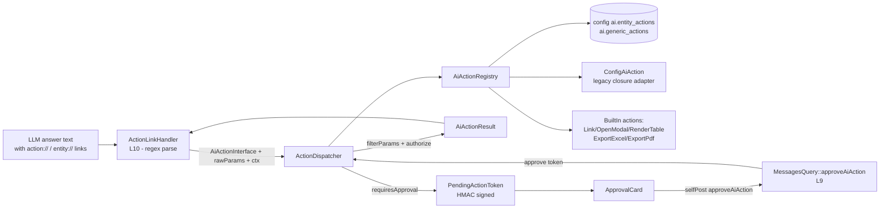

# Layer 11 — Agentic Action System (extensibility centerpiece)

## 1. Purpose (plain language)

This is the last stop in the "user asks -> important words -> files -> enhance prompt -> query -> answer -> **actions**" flow. After the assistant has written its answer, the LLM can embed special markdown links (e.g. `[Download Excel](action://export_excel)` or `[View John](entity://Person/152463/profile)`) that turn into clickable buttons, tables, downloads, modals, or links in the chat bubble. This layer is the registry + dispatcher that resolves each link to a typed action, validates/strips its params, re-checks server-side authorization, and either runs it immediately (read-only) or — for state-mutating actions — defers it behind a signed token and an "Are you sure?" approval card before executing. The promise is that ANY host project (CondoEdge, ActiviteDeFinancement, Sisc) can register its own actions with config-only effort and get an approval gate for writes for free.

## 2. C4 component diagram

## 3. Data in / data out

**In:**
- A resolved `AiActionInterface` instance (from the registry), `rawParams` (`array<string,mixed>` parsed from the link query string by `ActionLinkHandler`), and a render `context` (`entity_id`, `entity_type`, `text`, `result_set`/`rows`, `user`/`user_id`).
- On approval: a signed token `string` + approval `context`.

**Out:**
- `AiActionResult` (immutable DTO: `renderable` mixed | null, `summaryForLlm` string, `isError` bool). The `renderable` is either a Kompo element, a normalized `['type'=>'table',...]` / export `['content','mime','filename']` payload, or a deferred `['pending'=>true,'token'=>...,'label'=>...,'confirm_message'=>...]` map.
- For deferred actions: a `PendingActionToken` encoded string handed to `ApprovalCard::make()`.

## 4. Contracts (owned / consumed)

**Owned (defined here):**
- `AiActionInterface` — the canonical action contract (`key/label/aliases/description/inputSchema/presentation/requiresApproval/authorize/handle`).
- `AiActionResult` — result DTO.
- `PendingActionToken` — signed deferred-action carrier.

**Consumed:**
- `ResultSetExporter` (L9/export lane) — backs `export_excel`/`export_pdf`.
- Laravel helpers `app()`/`auth()`/`config()`/`route()`/`__()` and Kompo helpers `_Link/_Button/_Rows/_Flex/_Html/_Panel` (all guarded by `function_exists`).
- Consumed BY: `ActionLinkHandler` (L10), `MessagesQuery::approveAiAction` (L9), `EntityAutoDiscovery` + `ResponseEntityEnricher` + `ResponseEntityActionsSection` (prompt/enrichment), registered as singletons in `AiServiceProvider::registerActionServices()`.

## 5. Findings

| ID | Sev | Type | File:line | What | Why it matters | Recommendation | Verified |
|----|-----|------|-----------|------|----------------|----------------|----------|
| L11-1 | P1 | half-done | AiActionInterface.php:71; AbstractBuiltInAction.php:40; config/ai.php:1064-1111 | The entire approval/mutation subsystem (`requiresApproval`, `PendingActionToken`, `ApprovalCard`, `ActionDispatcher::defer/approve`) has **zero real producers**. No built-in action and no shipped config example ever returns `requiresApproval()===true`; only `SpyAction` in tests does. | The "approval gate for writes" — the stated centerpiece value prop — is theoretical. A host project gets export/link/table for free but has nothing to copy for the create-campaign / create-event mutating case, and the whole gate is unproven against a real Kompo round-trip. | Ship ONE real mutating reference action (or a documented example in config with `requires_approval=>true` + an `authorize` closure) and a feature test that exercises the full ApprovalCard -> approveAiAction -> handle round-trip in a booted app. | true |
| L11-2 | P1 | single-path-violation | EntityActionAwarenessSection.php:28-68 vs AiActionRegistry.php:145-180 | Action metadata is read via TWO disjoint paths. The response-side (`ResponseEntityActionsSection`/`EntityAutoDiscovery`) goes through the **registry** (so built-ins appear), but the query-generation-side `EntityActionAwarenessSection` reads **raw `config('ai.entity_actions')`/`generic_actions`** directly, bypassing the registry. | The QueryGenerator is therefore NEVER told that `export_excel`, `render_table`, `link`, `open_modal`, `export_pdf` exist as "action requests, not DB fields". A user saying "export this to excel" can get mis-routed to a Cypher query because the awareness section can't see registry-only built-ins. The two paths disagree on what actions exist. | Route `EntityActionAwarenessSection` through `AiActionRegistry::relevantActions()`/`genericActions()` so both prompt sides see the same source of truth. | true |
| L11-3 | P1 | dead-code | AiActionRegistry.php:182-210 | `relevantActions()` is dead in production — only referenced by `AiActionRegistryTest`. The advertised "resolve the focused, non-noisy set for the LLM and per-row chips" job is actually done ad hoc by `ResponseEntityActionsSection`/`ResponseEntityEnricher`, which call `entityActions()`/`genericActions()` directly. | Carrying an unused public method that claims to be THE relevance resolver is misleading and rots. Either it is the intended seam (then wire it) or it is cruft. | Either make `relevantActions()` the single entry point the response sections call, or delete it. | true |
| L11-4 | P2 | dead-code | AiActionInterface.php:64; AbstractBuiltInAction.php:35; ConfigAiAction.php:87 | `presentation()` is consumed NOWHERE in production — no renderer, dispatcher, or handler branches on it (verified: only test assertions reference `->presentation()`). The dispatcher detects "deferred" by inspecting the `['pending'=>true]` renderable array, not `presentation()==='approval'`. | A contract method every action must implement but nothing reads is pure ceremony and confuses implementers into thinking presentation is honored. | Drop `presentation()` from the interface, OR make `ActionLinkHandler::renderResult()` actually switch on it instead of sniffing the renderable shape. | true |
| L11-5 | P1 | bug | ApprovalCard.php:54,67 (and MessagesQuery.php:629) | `__('ai.actions.confirm') ?: 'Confirm'` relies on the translation key being undefined to fall through. But the package ships only `resources/lang/en.json`/`fr.json` (no `lang/ai.php`, and no `"ai.actions.confirm"` JSON key — verified absent). Laravel returns the **key string itself** (`"ai.actions.confirm"`, truthy), so `?:` never fires and the button renders the raw key text. | Any project that does enable an approval action gets a confirm button literally labelled `ai.actions.confirm` / a cancel labelled `ai.actions.cancel`. User-visible breakage on the one screen this layer exists to produce. | Add the `ai.actions.*` keys to the JSON lang files, or use `__('ai.actions.confirm', [], ...)` with a real namespaced PHP lang file and `loadTranslationsFrom`. Don't depend on missing-key fall-through. | true |
| L11-6 | P1 | security | PendingActionToken.php:105-116,122-129 | (a) No expiry: `issuedAt` (`t`) is signed but NEVER checked on `decode()`/`approve()`. A captured token is replayable forever (until APP_KEY rotates). (b) `belongsTo(null)` returns `true` — a token issued with `userId=null` (unauthenticated/missing-getKey path) matches ANY approver. (c) No nonce/single-use — the same token can be confirmed repeatedly, so a mutating action can be re-executed N times. | For a gate whose entire job is to safely authorize writes, an unbounded-lifetime, multi-use, sometimes-userless token undermines the guarantee. Defense-in-depth `authorize()` re-check helps, but replay of an idempotency-free mutation (e.g. "charge $450") is a real risk. | Add a max-age check in `decode()` (config `ai.actions.token_ttl`), reject `userId===null` in authenticated contexts, and add single-use protection (cache/db nonce or message-metadata consumption flag) before `handle()`. | true |
| L11-7 | P2 | abstraction | AiActionInterface.php:91; ActionDispatcher.php:67 | `handle(array $input, array $context): mixed` and `dispatch():?AiActionResult` return `mixed`/nullable with the renderable being "Kompo element OR AiActionResult OR `['pending'=>...]` map OR `['type'=>'table',...]` OR `['content','mime',...]`". The shape is discriminated by ad hoc array sniffing in `ActionLinkHandler` and `MessagesQuery`. | The contract is `mixed`, so every consumer must re-implement type-sniffing and they can drift (this is exactly how `presentation()` became dead). Weak boundary for "the extensibility centerpiece any project plugs into". | Narrow `handle()` to return `AiActionResult` (let `run()` wrap raw renderables once) and give `AiActionResult` typed variants/kind enum (`element|table|export|pending|error`) so consumers switch on a field, not `is_array(...)&&isset(...)`. | true |
| L11-8 | P2 | coupling | OpenModalAction.php:88-90; LinkAction.php:70-80; ApprovalCard.php:45-52 | Built-in actions and the card branch on `function_exists('_Link')` etc. and build Kompo elements inline. So action logic (params, validation) is entangled with Kompo rendering, and "non-Kompo" callers get a different return shape than Kompo callers. | Mixing the framework-agnostic action contract with Kompo element construction makes actions harder to unit-test and to reuse in a non-Kompo host, and forces the dual return shapes that cause L11-7. | Move element construction to a renderer/presenter keyed off `AiActionResult` kind; keep `handle()` returning data only (intent + payload), let one Kompo presenter turn intents into `_Link/_Rows`. | false |
| L11-9 | P2 | complexity-without-value | ConfigAiAction.php:139-180 | `handle()` + `invokeWithArity()` use `ReflectionFunction` per invocation to pass `[$id,$text,$input]` / `[$text,$input]` by arity. Reflection on every action render to support three legacy closure arities. | Per-render reflection is slow-ish and obscure; the "append `$input` if arity allows" trick is clever-but-fragile (a closure with a variadic or default-valued 3rd param behaves surprisingly). | Define a small typed closure signature (`fn(ActionContext $ctx): mixed`) for new config actions and keep a single legacy branch for bare `fn($id,$text)`; cache the reflected arity if reflection is kept. | false |
| L11-10 | P3 | leaky-abstraction | ActionDispatcher.php:44-58; PendingActionToken.php:136-156 | `currentUser()` and `secret()` each re-implement "is the container booted?" guards (`function_exists('app')`, `app()->bound(...)`, try/catch) so pure unit tests pass without a booted Laravel. The same pattern is duplicated in `EntityAutoDiscovery::actionRegistry()` and `ActionLinkHandler::resolveDispatcher()`. | Test-driven container-guarding leaks into production classes and is copy-pasted 4+ places; it signals the units are over-coupled to globals. | Inject the user resolver + secret (or a tiny `Environment` port) via constructor; let tests pass fakes instead of every method defending against an unbooted container. | true |
| L11-11 | P3 | ai-comment | AiActionRegistry.php (header & throughout), AbstractBuiltInAction.php:9-17, ActionDispatcher.php:10-27 | Heavy narrator-style docblocks ("The validate -> authorize -> execute-or-defer brain", "SAFE DEFAULTS: config keys may be entirely absent — the registry never throws", repeated "NEVER trusted from the client"). Accurate, but verbose and self-congratulatory. | Token/comment bloat; restates what small code already shows; the "never throws"/"SAFE DEFAULTS" mantra is repeated ~6 times across the layer. | Trim to one-line intents; keep the security note in ONE place (the contract), not echoed in every adapter. | false |
| L11-12 | P3 | bug | RenderTableAction.php:98-103 | Headers are derived from the union of keys across the **capped** rows only (after `array_slice` to `$limit`). A column present only in rows beyond the limit is silently dropped from headers, but earlier rows that DO have it still emit a cell value keyed by a header that... actually exists because union is over the sliced set — so a key in row[0] but absent from the header list cannot happen; the real gap is the opposite: a key appearing only past the limit is lost. | Minor: inconsistent tables when the first N rows are heterogeneous; mostly cosmetic given MAX_ROWS=100. | Derive headers from the full set (or document the cap-then-union behavior). Low priority. | true |

## 6. File checklist

| File | Verdict | Note |
|------|---------|------|
| src/Contracts/AiActionInterface.php | REFACTOR | Strong, model-agnostic contract — but `presentation()` is dead (L11-4) and `handle()` returns `mixed` (L11-7). Trim to what is actually consumed and narrow the return. |
| src/Kompo/Actions/ApprovalCard.php | REFACTOR | Clean thin factory, but the i18n keys it uses don't exist (L11-5) and it bakes Kompo construction into the action layer (L11-8). |
| src/Services/Actions/ActionDispatcher.php | KEEP | Correct validate->authorize->defer/run->approve flow with a real second auth pass. Container-guard duplication (L11-10) is the only blemish. Well tested. |
| src/Services/Actions/AiActionRegistry.php | REFACTOR | Good central registry; `relevantActions()` is dead (L11-3) and the registry is bypassed by `EntityActionAwarenessSection` (L11-2). Make it the single source of truth. |
| src/Services/Actions/ConfigAiAction.php | REFACTOR | Solid backward-compat adapter, but per-render reflection + arity juggling (L11-9) is more cleverness than the use case needs. |
| src/Services/Actions/PendingActionToken.php | REFACTOR | HMAC signing is correct and tamper-evident, but no expiry / no single-use / null-binding-matches-all (L11-6). Security hardening needed before any mutating action ships. |
| src/Services/Actions/BuiltIn/AbstractBuiltInAction.php | KEEP | Right-sized base with sensible safe defaults. `presentation()` default is moot if L11-4 lands. |
| src/Services/Actions/BuiltIn/ExportExcelAction.php | KEEP | Thin, delegates to `ResultSetExporter`, degrades gracefully. Fine. |
| src/Services/Actions/BuiltIn/ExportPdfAction.php | KEEP | Mirror of ExportExcel; could share an AbstractExportAction (title schema + result_set guard are duplicated) but low value. |
| src/Services/Actions/BuiltIn/LinkAction.php | KEEP | Reasonable; dual Kompo/non-Kompo return shape is the L11-8 pattern, not a per-file defect. |
| src/Services/Actions/BuiltIn/OpenModalAction.php | KEEP | Works; note `inputSchema` declares only `modal`+`prefill` yet `handle()` folds ALL other params into prefill — but `filterParams` drops undeclared params first, so arbitrary `unit_id=123` from the documented grammar is SILENTLY DROPPED (mismatch between advertised grammar and schema). Worth a follow-up. |
| src/Services/Actions/BuiltIn/RenderTableAction.php | KEEP | Good (MAX_ROWS cap, normalize). Minor header-union-after-cap nit (L11-12). |
| src/Services/Actions/Results/AiActionResult.php | REFACTOR | Clean immutable DTO, but `renderable: mixed` with no kind discriminator forces consumer sniffing (L11-7). Add a typed `kind`. |

## 7. What to add (next-level)

1. **Native tool-calling path.** Invocation is 100% brittle markdown-regex (`ActionLinkHandler` `ENTITY_PATTERN`/`ACTION_PATTERN`). For a 10/10, expose the registry as provider tool/function definitions (the contract already has `key/description/inputSchema` — exactly a JSON-schema tool spec) so capable models invoke actions structurally; keep markdown links as the fallback for models without tool support. This also fixes the "LLM is only told key+label+aliases, never description/params/approval" gap (`EntityAutoDiscovery::getEntityActions` drops `description()` and `inputSchema()`).
2. **One real mutating reference action + full booted-app feature test** for the approve round-trip (closes L11-1). Without it the centerpiece is unverified.
3. **Token hardening**: TTL + single-use nonce + reject null user-binding in authenticated contexts (L11-6). This is table stakes for "approval gate for writes".
4. **Single metadata source**: every prompt/enrichment consumer (`EntityActionAwarenessSection`, `ResponseEntityActionsSection`, `ResponseEntityEnricher`) must read the registry, not raw config (closes L11-2/L11-3). Advertise `description`, params, and "requires confirmation" to the LLM.
5. **Typed `AiActionResult` kind** (`element|table|export|pending|error`) + a single Kompo presenter, decoupling action logic from Kompo (closes L11-7/L11-8) so actions are reusable in non-Kompo hosts.
6. **Schema/grammar alignment**: actions that accept passthrough params (open_modal) must declare them, or `filterParams` will silently drop the documented `?unit_id=123` grammar. Add a validation step that warns when advertised link params aren't in `inputSchema`.
7. **`config-only` registration ergonomics**: a documented `config('ai.actions')` array of action class-strings (not just closures) that the registry auto-registers, so a host adds `CreateCampaignAction::class` with no service-provider code.

## 8. Open questions / risks

- **Is approval ever exercised in the real app?** No shipped action sets `requiresApproval`, and there's no booted-app feature test for the ApprovalCard -> `approveAiAction` -> `approve()` -> `handle()` round-trip. The selfPost wiring (`ApprovalCard` default branch -> `MessagesQuery::approveAiAction`) is plausible but unproven against live Kompo.
- **open_modal grammar vs schema mismatch**: docs advertise `action://open_modal?modal=editUnit&unit_id=123&amount=450`, but `inputSchema()` only declares `modal`+`prefill`, so `filterParams` drops `unit_id`/`amount`. Does the documented prefill actually survive? Needs a test.
- **Replay / idempotency**: with no nonce and infinite token lifetime, what stops a user clicking Confirm twice (or replaying a captured token) and double-executing a mutation? The `authorize()` re-check doesn't make a write idempotent.
- **Who owns `presentation()`?** It's in the contract and asserted in tests but read by nothing — was a renderer-by-presentation planned and abandoned, or is array-sniffing the intended design? Decide and converge.
- **i18n keys**: are `ai.actions.confirm/cancel/failed` expected to live in the host app or the package? Currently neither defines them, so the fall-through is broken (L11-5).
