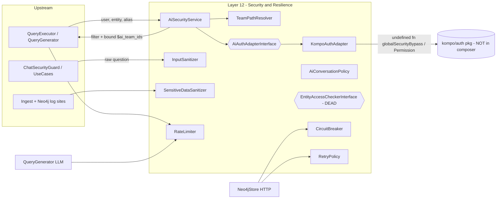

# Layer 12 — Security & Resilience

> Audit of `condoedge/ai` (namespace `Condoedge\Ai`). Lane L12. All findings cite `file:line` against the real code at audit time. Do NOT trust this doc's prose over the cited lines.

## 1. Purpose (plain language)

This layer is the package's guard rail. Two jobs:

1. **Security** — keep one tenant's data away from another, and keep the model honest. After the pipeline turns the user's question into a Cypher query but **before** that query runs, `AiSecurityService` + `TeamPathResolver` work out which `team_id`s the asking user is actually allowed to see and splice a bound `IN $ai_team_ids` filter into the query. It fails **closed**: if it cannot prove the user is allowed (no permission metadata, no resolvable user, no team_path), it blocks the query. `InputSanitizer` scans the raw question for prompt-injection ("ignore previous instructions") so the chat turn can politely decline that one message. `AiConversationPolicy` controls who may read/delete a conversation. `SensitiveDataSanitizer` scrubs API keys out of log lines.
2. **Resilience** — keep external dependencies (Neo4j, the LLM API) from taking the app down: `CircuitBreaker` (fail fast when Neo4j is dead), `RetryPolicy` (exponential backoff), `RateLimiter` (cap query/LLM call volume).

In the "user asks -> words -> files -> enhance prompt -> query -> answer -> actions" flow, this layer sits on the **query** edge (team filter injected just before execution) and wraps the flow's **external calls** (retry/breaker/rate-limit) and **logging**.

## 2. C4 component diagram

## 3. Data in / data out

**In:**
- Acting `$user` model + `$entity` name + Cypher `$alias` (to `AiSecurityService::getTeamFilterWithParameters`).
- Raw user question `string` (to `InputSanitizer::analyze` via `ChatSecurityGuard::assertSafe`).
- Arbitrary log payloads / `\Throwable` (to `SensitiveDataSanitizer::forLogging`).
- A `callable $operation` (to `CircuitBreaker::call` / `RetryPolicy::execute`).
- A `User` + `AiConversation` (to `AiConversationPolicy`).

**Out:**
- `array{filter: string|null, parameters: array<string,array<int>>}` — a Cypher fragment referencing bound `$ai_team_ids` (from `AiSecurityService`/`TeamPathResolver`).
- `array{has_injection_risk: bool, patterns_matched: array, risk_level: string}` from `InputSanitizer::analyze`.
- Redacted string/array/exception payloads from `SensitiveDataSanitizer`.
- The wrapped operation's result, or `SecurityException` / `CircuitBreakerOpenException` / a `false` rate-limit signal.
- `bool` authorize decisions from `AiConversationPolicy`.

## 4. Contracts (owned / consumed)

**Owned (defined in this layer / consumed by it):**
- `AiAuthAdapterInterface` — `getTeamsWithPermission`, `hasGlobalCountPermission`, `isEnabled`, `checkIfPermissionsExist`. Implemented by `KompoAuthAdapter` (the only impl and the default, unconditional singleton binding at `AiServiceProvider.php:711`).
- `EntityAccessCheckerInterface` — `canAccess(entityType, entityId, user)`. **Zero implementations, zero call sites, zero bindings. Dead.**

**De-facto concrete (no interface, injected by class name):**
- `AiSecurityService`, `TeamPathResolver`, `InputSanitizer`, `SensitiveDataSanitizer`, and the three Resilience classes (`CircuitBreaker`, `RateLimiter`, `RetryPolicy`).

**Consumed from outside the package (unguarded):**
- `Kompo\Auth\Models\Teams\Permission` + global `globalSecurityBypass()` — a hard, unguarded dependency on the `kompo/auth` package, which is **not declared in `composer.json` `require`** (only `condoedge/utils` is). See L12-1.

## 5. Findings

| ID | Sev | Type | File:line | What | Why it matters | Recommendation | Verified |
|----|-----|------|-----------|------|----------------|----------------|----------|
| L12-1 | P0 | coupling | `src/Auth/KompoAuthAdapter.php:71`, `:84`; `src/AiServiceProvider.php:711-713` | The **default** (and only) `AiAuthAdapterInterface` binding is `new KompoAuthAdapter()`, unconditional. `isEnabled()` (line 71) calls global `globalSecurityBypass()` and `checkIfPermissionsExist()` (line 84) calls `Kompo\Auth\Models\Teams\Permission::findByKey()`. Neither symbol is defined in this package, and **`kompo/auth` is not in `composer.json` `require`**. `isEnabled()` runs at the front of every secured query. | The README/interface sell a "model-agnostic, swappable auth adapter," but out of the box (no kompo/auth) the security path fatals with `Call to undefined function globalSecurityBypass()` / class-not-found on the first check. There is no `NullAuthAdapter` fallback. The package's core security gate cannot run standalone. (Line 101 `PermissionTypeEnum` is already `class_exists`-guarded; lines 71/84 are not.) | Ship a fail-closed `NullAuthAdapter` (deny) and bind it as default; bind `KompoAuthAdapter` only when kompo/auth is detected. Or guard `function_exists('globalSecurityBypass')` + `class_exists(Permission::class)` with a deny fallback. Add a no-kompo-auth boot test. | true |
| L12-2 | P1 | dead-code | `src/Contracts/EntityAccessCheckerInterface.php:13-24` | `EntityAccessCheckerInterface::canAccess()` has zero implementations, zero bindings, zero callers anywhere in `src/` (repo search: only its own self-reference). The live per-record access check is `FileAccessResolverInterface::canAccessFile()`, a different signature. | Orphaned scaffolding that misleads readers into thinking node-level (per-record) access control exists. It does not — filtering is **team-grain only**. Confuses the security model and implies a capability that ships unbuilt. | Delete the interface, or actually wire it (have `AiSecurityService` consume an `EntityAccessChecker` for node-level gating after retrieval). Today: delete. | true |
| L12-3 | P1 | bug | `src/Services/Resilience/RateLimiter.php:44-56` | `attempt()` is a non-atomic read-modify-write: `Cache::get($key)` then `Cache::put($key, $current+1, $windowSeconds)`. Two defects: (a) concurrent workers both read `$current` and both write → the limit is exceeded under load (the very flooding it claims to stop); (b) **every** write re-stamps the TTL to a fresh `$windowSeconds`, so a steady stream slides the expiry forward forever — the window never resets, and once at the cap it stays locked until traffic fully stops for a window. | This is the DoS guard for query/LLM flooding (`QueryExecutor:54` and `QueryGenerator:118` both consume it). Both the race and the sliding TTL make the limit wrong — too loose under bursts, too sticky under sustained load. `CircuitBreaker` already uses the correct atomic primitive (`Cache::increment`, line 126) in the same package. | Use atomic `Cache::increment` plus `Cache::add` to set the TTL only on first hit (fixed window), or use Laravel's `Illuminate\Cache\RateLimiter`. Return a `Retry-After`-style signal instead of a bare `false`. Add a race/TTL test. | true |
| L12-4 | P2 | single-path-violation | `src/Services/Security/AiSecurityService.php:58`, `src/Services/QueryExecutor.php:707` | The `on_permission_unexistent` deny/bypass decision is decoded in **two** places: `AiSecurityService::getTeamFilterWithParameters` (line 58) and `QueryExecutor::failClosedOrBypass` (line 707). Both read the same config key and make the same deny→throw / bypass→log decision. (Nuance: they fire on **different** failure modes — exec also handles `no_resolvable_user` / `injection_not_applicable`; and `handleMissingTeamPath` reads a *different* key `on_missing_team_path`. The warning logs are similar but not identical. So a contained extraction, not a P1 hole.) | Divergence risk: a future change to deny semantics in one place silently leaves the other fail-open. Security decisions should have one home. | Extract a single `SecurityFailurePolicy::decide(reason): deny|bypass` (with the warning log) consulted by both `AiSecurityService` and `QueryExecutor`. Do not over-claim "identical log / same key" — it's a small refactor. | true |
| L12-5 | P1 | half-done | `src/Services/Security/InputSanitizer.php:99-124,157-161` | Only `analyze()` is ever called in production (`ChatSecurityGuard.php:49`). `sanitize()`, `process()`, and `addPattern()` are dead in `src/` (repo search: the only `->sanitize`/`->process` callers are docs + tests; `process()` calls `sanitize()` internally but `process()` itself is never called). The chat pipeline forwards the **raw** question to the LLM — the `SYSTEM:` / code-block stripping the class advertises never runs. | Half of the prompt-injection defense is decorative. The class name and the architecture docs (`resources/docs/.../security.md`, `data-flows.md`) show input being *cleaned* before the model; it is not — only *detected* (decline-and-continue). Detection-only is a defensible design, but then `sanitize`/`process`/`addPattern` and the `sanitizePatterns` array are dead weight implying a guarantee that doesn't exist. | Either (a) actually call `sanitize()` on the question before it reaches the prompt, or (b) delete `sanitize`/`process`/`addPattern`/`sanitizePatterns` and rename the class to `PromptInjectionDetector`. Fix the docs either way. | true |
| L12-6 | P1 | security | `src/Services/Security/SensitiveDataSanitizer.php:42` | The "AWS secret" pattern `'/([A-Za-z0-9+\/]{40})/' => '***REDACTED_AWS_SECRET***'` redacts **any** 40-char base64-ish run. It runs after the specific API-key/bearer rules, so it also clobbers legitimate 40-char IDs, SHA-1 hex (exactly 40 chars), git hashes, JWT segments, Neo4j element IDs, and base64 chunks of normal log data. This class wraps 8+ ingest/Neo4j log sites (`DataIngestionService`, `Neo4jStore`), including the `cypher`/`error` diagnostics in retry warnings. | Over-redaction destroys log usefulness (every SHA-1, every git hash, every 40-char token vanishes from the very diagnostics you need during an incident) while giving false confidence. A redactor that eats everything is as bad as one that eats nothing. (Nuance: whitespace breaks the run, so prose/UUIDs survive — but the listed token types are real log content and do get mangled.) | Drop the bare 40-char rule, or anchor it to an AWS-secret context (`aws_secret`, `AWS_SECRET_ACCESS_KEY=`). Keep the specific `AKIA...` rule (line 41). Add a test asserting a SHA-1 hash survives and an `AKIA` key is redacted. | true |
| L12-7 | P2 | bug | `src/Auth/KompoAuthAdapter.php:75-90` | `checkIfPermissionsExist()` does **not** short-circuit on `isEnabled()` / `globalSecurityBypass()` like the other three adapter methods do, and runs `Permission::findByKey()` once per pattern in the chain. It is called on the deny path of every secured query (`AiSecurityService:57`). | Inconsistent with the rest of the adapter, and runs DB lookups even when security is effectively bypassed (`globalSecurityBypass()` true). It is also the *second* hard, unguarded kompo/auth coupling point (the `Permission` reference of L12-1). | Gate it behind `isEnabled()` first; cache/short-circuit `findByKey` results; or fold existence-checking into the adapter's `getTeamsWithPermission` so the orchestrator asks one question. | true |
| L12-8 | P2 | coupling | `src/Policies/AiConversationPolicy.php:70-85` | `userBelongsToTeam()` probes three different method shapes (`belongsToTeam`, `teams()`, `currentTeamId()`) via `method_exists` and silently returns `false` if none match. | Duck-typing the team membership of an arbitrary `Authenticatable` is fragile: a User that names its relation differently silently loses team-conversation access (fail-closed, but invisibly — no log). The policy re-implements team logic that `AiAuthAdapterInterface` already abstracts. | Route team membership through the injected `AiAuthAdapterInterface` (or a dedicated narrow method) instead of reflective probing. | true |
| L12-9 | P2 | complexity-without-value | `src/Services/Resilience/CircuitBreaker.php:99-117,332-338` | Half-open recovery is encoded by **decrementing the shared `failure_count` into negative numbers** and comparing `<= -successThreshold` (line 103). Meanwhile local instance props (`$state`, `$failureCount`, `$openedAt`, `$lastFailureTime`) are kept but overwritten by `syncFromCache()` at the top of every public call — pure dead bookkeeping. | The negative-count trick is clever-but-opaque and easy to break (a stray success in CLOSED also decrements the same counter — see L12-14). The dual local/cache state adds confusion with zero benefit. Resilience code must be obviously correct. | Track successes in a separate `success_count` cache key; drop the local mirror properties and read straight from cache (make the object effectively stateless over the cache). | true |
| L12-10 | P3 | bug | `src/Services/Resilience/RetryPolicy.php:122-137` | `calculateDelay()` computes `mt_rand((int)-$jitterRange, (int)$jitterRange)`. For small base delay × small jitter (`forDatabaseOperations`: 50ms base, 0.1 jitter → `$jitterRange` ≈ 5 on attempt 1) the integer cast keeps jitter tiny, and on the smallest cases truncates toward 0 — jitter is near-zero exactly where contention is highest. | The "prevent thundering herd" goal weakens for the fast DB-retry preset → near-synchronized retries under contention. Minor (jitter is non-zero, just coarse), so P3 — prior audits flagged "jitter disabled" as a false positive; the real issue is granularity. | Compute jitter in floats and round once at the end, or scale `mt_rand()/mt_getrandmax()` to the range. | true |
| L12-11 | P2 | complexity-without-value | `src/Services/Resilience/RetryPolicy.php:145-183` | Three named factories (`forApiCalls`, `forDatabaseOperations`, `forNetworkRequests`) but only `forDatabaseOperations` is used in `src/` (`Neo4jStore.php:57`). `forApiCalls` / `forNetworkRequests` are test-only. (`RateLimiter::forLlm` IS used at `QueryGenerator:118` — not dead.) | Speculative presets imply integrations that don't exist (there is no HTTP/LLM `RetryPolicy` usage — see L12-13) and add surface area. | Keep the one used preset; delete or relocate the other two to where/if they're consumed. | true |
| L12-13 | P1 | missing | `src/Services/QueryGenerator.php:118` (LLM path) + response generation | The LLM/Anthropic call path is protected by `RateLimiter` **only**. There is **no `CircuitBreaker` and no `RetryPolicy`** around the model API — both are instantiated solely in `Neo4jStore.php` (`:57-58`). A flaky/over-quota model (429 / 5xx / timeout) has no fail-fast and no backoff; the most expensive, most failure-prone external dependency is the least protected. | Backwards for a RAG product: a single LLM blip surfaces as a raw failure with no retry, and a sustained outage gives no fast-fail. | Wrap LLM calls in `CircuitBreaker('llm', ...)` + `RetryPolicy::forNetworkRequests()` (which would finally have a real consumer), retrying only on transient HTTP statuses. | true |
| L12-14 | P2 | bug | `src/Services/Resilience/CircuitBreaker.php:101,109-117` | In CLOSED state `recordSuccess()` decrements `failure_count` (lines 110-114) and in HALF_OPEN it decrements without a floor; because state is shared via cache across processes, a burst of successes can drive `failure_count` arbitrarily negative, so a later genuine failure run must climb back from a deep negative before it can reach `failureThreshold` and open. | The breaker can be slow to trip after a healthy period because the counter is a running tally, not "consecutive failures." Combined with L12-9 this makes open/close behavior hard to reason about and weakly correct. | Separate "consecutive failures" from "half-open successes" into distinct keys; reset failures to 0 on success rather than decrementing into negatives. | true |
| L12-15 | P3 | coupling | `src/Services/Resilience/CircuitBreaker.php` (whole class) | Cross-process state relies entirely on the cache driver being **shared and atomic** (`Cache::increment`). On an `array` or `file` driver (common in tests / CLI / single-box dev) the breaker silently degrades to per-process and `increment` is not cross-process atomic. Nothing documents or asserts the required driver. | A breaker that silently no-ops in some environments gives false safety. | Document the required cache driver (redis/memcached) for production resilience; optionally warn when an unsuitable driver is configured. | true |

## 6. File checklist

| File | Verdict | Note |
|------|---------|------|
| `src/Auth/KompoAuthAdapter.php` | REFACTOR | Default binding hard-depends on undefined `globalSecurityBypass()` + `Permission` (L12-1, P0) and `kompo/auth` isn't even in composer; `checkIfPermissionsExist` not gated by `isEnabled` (L12-7). Needs a Null fallback path. |
| `src/Contracts/AiAuthAdapterInterface.php` | KEEP | Sound, minimal, swappable contract — the one genuinely good abstraction in the layer. |
| `src/Contracts/EntityAccessCheckerInterface.php` | DELETE | Zero impls / callers / bindings; superseded by `FileAccessResolverInterface::canAccessFile`; implies node-level access control that doesn't exist (L12-2). |
| `src/Policies/AiConversationPolicy.php` | REFACTOR | Works and is wired (`AiServiceProvider.php:735`), but `userBelongsToTeam` duck-typing should go through the auth adapter (L12-8). |
| `src/Services/Resilience/CircuitBreaker.php` | REFACTOR | Wired (Neo4jStore only). Opaque negative-count half-open logic + redundant local state (L12-9), counter-can-go-negative trip lag (L12-14), undocumented driver requirement (L12-15). |
| `src/Services/Resilience/RateLimiter.php` | REFACTOR | Wired (QueryExecutor, QueryGenerator). Non-atomic read-modify-write + sliding-TTL make the limit wrong both ways (L12-3, P1). |
| `src/Services/Resilience/RetryPolicy.php` | REFACTOR | Only 1 of 4 presets used (L12-11); jitter truncation for fast presets (L12-10); not on the LLM path where it's most needed (L12-13). |
| `src/Services/Security/AiSecurityService.php` | KEEP | Correct fail-closed orchestration; bound-param `$ai_team_ids` filter is the right design. Only nit: extract the deny/bypass policy duplicated in QueryExecutor (L12-4). |
| `src/Services/Security/InputSanitizer.php` | SPLIT | Detection (`analyze`) is live; `sanitize`/`process`/`addPattern`/`sanitizePatterns` are dead and never reach the prompt (L12-5). Rename to a detector or wire sanitize in. |
| `src/Services/Security/SensitiveDataSanitizer.php` | REFACTOR | Heavily used in ingest/Neo4j logging. The bare 40-char "AWS secret" rule over-redacts SHA-1s/hashes/IDs (L12-6, P1). |
| `src/Services/Security/TeamPathResolver.php` | KEEP | Solid: emits a single bound `$ai_team_ids` param (no string-spliced `IN [...]`), normalizes IDs to ints as defence-in-depth, returns null for unknown shapes (handled fail-closed upstream). The best-written file in the layer. |

## 7. What to add (next-level)

- **A fail-closed `NullAuthAdapter` default + conditional kompo/auth binding** (L12-1). Bind `KompoAuthAdapter` only when kompo/auth is detected; otherwise deny. Add a "boots and denies cleanly with no kompo/auth" test. This is the single biggest gap to the "model/framework-agnostic" claim.
- **LLM-call resilience** (L12-13): `CircuitBreaker('llm', ...)` + `RetryPolicy::forNetworkRequests()` around the model API, retrying only transient HTTP statuses; plus a shared `RetryingGraphStore` decorator so both Bolt and HTTP transports get retry/breaker uniformly (today only the HTTP store does).
- **One failure-policy home** (L12-4): a single `SecurityFailurePolicy` consulted by both `AiSecurityService` and `QueryExecutor` so deny/bypass + the warning log can never diverge.
- **Correct, atomic rate limiting** (L12-3): swap the hand-rolled limiter for `Cache::increment` + first-hit TTL or Laravel's `Illuminate\Cache\RateLimiter`; surface a `Retry-After` signal instead of a bare throw.
- **Node-level access decision** (L12-2): either wire `EntityAccessCheckerInterface` so *retrieved records* (not just teams) are authorized, or delete it and stop implying the capability. Today filtering is team-grain only.
- **Decide InputSanitizer's contract** (L12-5): commit to detection-only (rename to `PromptInjectionDetector`, delete the dead sanitize API) or actually sanitize before the prompt. Fix the docs to match.
- **A redaction allow/deny test corpus** (L12-6): sample real log lines and assert that legitimate hashes/IDs survive while real secrets are redacted; drop or context-anchor the 40-char rule.
- **Tests for the failure modes**, not just happy paths: RateLimiter race/TTL, CircuitBreaker negative-count trip lag, AWS over-redaction, no-kompo-auth boot. None of these are currently asserted.
- **Document the required cache driver** for the breaker/limiter (redis/memcached) so they don't silently degrade to per-process (L12-15).

## 8. Open questions / risks

- **Is the package ever expected to run without kompo/auth?** The README claims framework-agnostic and the interface is "swappable," but the default binding hard-requires kompo/auth globals that aren't even a declared composer dependency (L12-1). If kompo/auth is in fact a hard requirement, the "swappable" framing and the `AiAuthAdapterInterface` abstraction are misleading and should be documented as such. Needs a product decision before fixing.
- **Detection-only prompt-injection by design?** If declining-and-continuing on detection is the intended UX, the `sanitize`/`process` API and the architecture diagrams that show input being cleaned before the LLM are wrong and should be removed/corrected (L12-5). Confirm intent before deleting vs wiring.
- **SensitiveDataSanitizer aggressiveness is unverified against real log volume** — the 40-char rule almost certainly redacts legitimate diagnostic data in practice (L12-6); needs a sample-log review to size the blast radius.
- **CircuitBreaker correctness under shared cache** — the open/close behavior depends on a running, signed counter that can go negative (L12-9, L12-14); it has happy-path unit tests but no concurrency/over-success test. Its real-world tripping behavior under a shared atomic driver is unverified.
- **`on_permission_unexistent` vs `on_missing_team_path`** are two separate config keys both defaulting to `deny` (config/ai.php:226,231). The split is defensible (different failure modes) but doubles the surface for a misconfiguration to fail open; worth confirming both are exercised in the deny-default tests.
