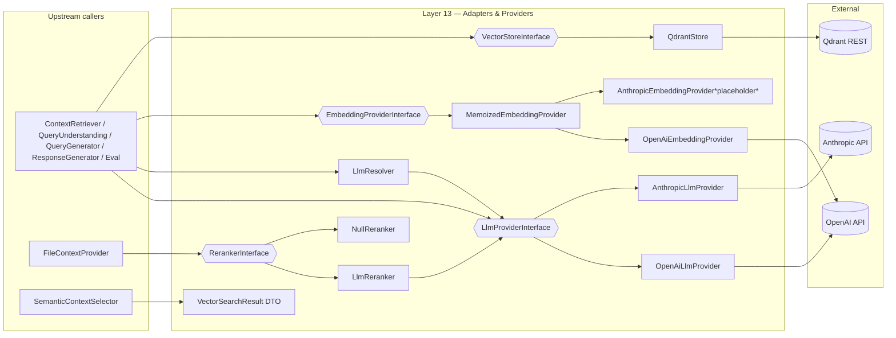

# Layer 13 — Storage Adapters & Model Providers

## 1. Purpose (plain language)

This layer is the package's "wire to the outside world." Everywhere the rest of the
system needs to (a) turn text into numbers a vector database understands (embeddings),
(b) ask a large language model to write/answer/judge something (LLM chat), or
(c) store and search those numbers (the Qdrant vector DB), it goes through the small,
swappable adapters defined here. The whole package's claim of being "model-agnostic"
lives or dies in this layer: every box here implements a narrow `*Interface` so you can
swap OpenAI for Anthropic (or Qdrant for Pinecone) without touching the pipeline.
It also owns two cross-cutting helpers: `LlmResolver` (pick a different model per
pipeline stage) and the `RerankerInterface` family (a precision re-ordering pass over
retrieval candidates that uses an LLM but must never break the pipeline).

## 2. C4 component diagram



## 3. Data in / data out

**In:**
- Plain `string` text (to embed or complete) and `array` chat-message lists
  (`[['role'=>'user','content'=>'…'], …]`).
- Per-call `array $options` (temperature, max_tokens, response_format, stream).
- Provider config `array`s read from `config('ai.embedding.*' | 'ai.llm.*' | 'ai.vector.qdrant')`.
- Query vectors (`array<float>`), points (`['id','vector','payload'|'metadata']`),
  payload filters (simple `['k'=>v]` or pre-built Qdrant `['must'=>…]`).
- Reranker: `(string $query, array $candidates, callable $textOf, int $limit)`.

**Out:**
- Embeddings: `array<float>` (single) / `array<array<float>>` (batch).
- LLM: `string` (chat/complete), `object|array` (chatJson), streamed chunks via callback.
- Vector store: raw Qdrant result `array`s (`['id','score','payload']`), booleans, ints.
- `VectorSearchResult` DTO: a normalized, read-only view over a single raw result
  (handles the `payload` vs `metadata` key inconsistency in one place).

## 4. Contracts (owned / consumed)

**Owned (defined in this layer):**
- `EmbeddingProviderInterface` — `embed/embedBatch/getDimensions/getModel/getMaxLength`.
- `LlmProviderInterface` — `chat/chatJson/complete/stream/getModel/getProvider/getMaxTokens/countTokens`.
- `VectorStoreInterface` — 16 methods (collection CRUD, upsert, search, scroll, payload index, …).
- `RerankerInterface` (`Services/Retrieval`) — `rerank(query, candidates, textOf, limit)`.

**Consumed:**
- `LlmReranker` and `LlmResolver` depend on `LlmProviderInterface`.
- `MemoizedEmbeddingProvider` decorates `EmbeddingProviderInterface`.
- `VectorSearchResult` is a plain DTO (no interface dependency); consumed by `SemanticContextSelector`.
- Wiring is in `AiServiceProvider` (`registerRetrievalServices`, embedding/LLM/vector singletons).

## 5. Findings

| ID | Sev | Type | File:line | What | Why it matters | Recommendation | Verified |
|----|-----|------|-----------|------|----------------|----------------|----------|
| L13-1 | P1 | half-done | src/AiServiceProvider.php:291,316 + src/Services/LlmResolver.php:13-15 + config/ai.php:362-368 | `LlmResolver->forRole()` is only ever called for `query_understanding` (AiServiceProvider:504) and the eval roles. `QueryGenerator` and `ResponseGenerator` are constructed with the **default** `LlmProviderInterface`, never via `forRole('query_generation')`/`forRole('response_generation')`. | The two most expensive, most-advertised role keys are inert. The LlmResolver docblock and config comments promise per-stage model selection ("query_generation needs reasoning power", "response_generation fast model OK") that silently does nothing. A user who sets `llm_roles.query_generation` gets no effect. | Inject `LlmResolver->forRole('query_generation')` into `QueryGenerator` and `forRole('response_generation')` into `ResponseGenerator`, or delete the two dead role keys + their docblock lines. | true |
| L13-2 | P1 | bug | src/LlmProviders/AnthropicLlmProvider.php:109-126 | `chatJson` only appends "Respond with valid JSON only." to the system message, then `json_decode($text)` with NO fence-stripping/extraction. The Anthropic Messages API has no native JSON mode (unlike OpenAI's `response_format: json_object` at OpenAiLlmProvider:107). | Claude routinely wraps JSON in ```json … ``` fences or adds a prose preface; that response fails `json_decode` and throws. `chatJson` is used by QueryUnderstandingService, LlmReranker, JudgeService, QuestionSetGenerator, AiConfigEnhancer — so selecting `anthropic` as the LLM provider degrades or breaks query understanding, reranking and the eval harness. Breaks the model-agnostic promise at the wire. | Strip markdown fences / extract the first balanced `{…}` before decoding, or use Anthropic tool-use / prefill (`{"role":"assistant","content":"{"}`) to force JSON. Add a parity test that feeds a fenced response. | true |
| L13-3 | P1 | bug | src/EmbeddingProviders/OpenAiEmbeddingProvider.php:60,93-99,197-208 + config/ai.php:433 | `dimensions` is read from config and returned by `getDimensions()` (used to size the Qdrant collection) but is **never sent** to the embeddings API (`makeApiRequest` only sets `input` + `model`). OpenAI `text-embedding-3-*` *supports* a `dimensions` request param. | If a user sets `dimensions` to anything other than the model's native size (e.g. 512 to save space), `getDimensions()` returns 512, the collection is created with size 512, but the API returns 1536-float vectors → upsert/search dimension mismatch at runtime. The config key is a silent footgun. | Pass `dimensions` into the request payload when set (3-series only), or document/validate that it must equal the model's native size and only use it as collection sizing. | true |
| L13-4 | P1 | single-path-violation | src/AiServiceProvider.php:438-446 + src/Services/Context/FileContextProvider.php:339-344,373-387 | Two independent gates for the same decision. The DI binding already returns `NullReranker` when `ai.rag.rerank_enabled` is false; `FileContextProvider::rerankResults` *also* reads the same config flag and short-circuits before resolving anything, and `resolveReranker()` re-implements a third NullReranker fallback by hand. | Three places encode "reranking is off ⇒ input order." The config flag is read twice, `NullReranker` is constructed in two ways, and the only consumer never actually exercises the bound `NullReranker`. Drift risk and dead-by-construction code. | Pick one path: inject `RerankerInterface` and always call `rerank()` (the contract guarantees safe fallback), delete the duplicate config check and the hand-rolled `resolveReranker()`/`new NullReranker()`. | true |
| L13-5 | P1 | missing | src/Services/Context/FileContextProvider.php (only caller) + docs/audit/layers/04 (L4-8) | `RerankerInterface`/`LlmReranker` — the single strongest precision tool in the package — is wired ONLY into file search. The main graph/RAG path (similar-query search, semantic entity selection) never reranks. | The headline retrieval path over-fetches and threshold-cuts with no precision pass, so the reranker investment is mostly unused. (Cross-confirms L4-8.) | Route similar-query + semantic-selection candidates through `RerankerInterface` (over-fetch → rerank → cut). | true |
| L13-6 | P2 | dead-code | src/Contracts/EmbeddingProviderInterface.php:52 + src/EmbeddingProviders/OpenAiEmbeddingProvider.php:183-188 | `getMaxLength()` is implemented by all three embedding providers and the memoized decorator but has **zero callers in `src/`** (only the provider classes and tests reference it). No code truncates or validates text against it. | Contract surface that nothing enforces. Worse, the meaning is inconsistent: OpenAI returns `8191` (tokens) while Anthropic returns `200000` (the doc calls it "max characters"), so even if a caller appeared it would compare tokens to chars. | Either wire it (pre-embed length guard in the ingestion/embedding path) or remove it from the interface and all impls. Fix the token-vs-char unit confusion if kept. | true |
| L13-7 | P2 | dead-code | src/EmbeddingProviders/AnthropicEmbeddingProvider.php:22-142 + config/ai.php:436-440 | Placeholder provider: `embed()`/`embedBatch()` always `throw`. It is selectable via `config('ai.embedding.default'=>'anthropic')` and instantiated by the container (AiServiceProvider:199) with a `claude-3-5-sonnet` model the config itself marks `// Hypothetical`. | A user can configure a provider that compiles, validates an API key, then throws at the first embed during ingestion — a sharp edge disguised as a real option. The config block, the `dimensions=1024`, and the `getMaxLength=200000` all imply functionality that does not exist. | Keep the class as an architectural marker if desired, but make `AiServiceProvider` reject `anthropic` embeddings with a clear "not supported yet" message at boot, and comment the config block out (like `llm_roles`). | true |
| L13-8 | P2 | bug | src/VectorStore/QdrantStore.php:153-170 + 404-409 | `upsert()` auto-creates a missing collection with `createCollection($collection, count($points[0]['vector']))` using the **default `cosine`** distance and ignoring `config('ai.embedding.vector_size')`. `deleteAll()` reads distance from collection info but `upsert` blind-creates. | Implicit collection creation hides config: the explicit `vector_size` override (config:428) is bypassed, and a collection silently gets `cosine` even if the project intended `dot`/`euclid`. Two creation paths (`ensureCollection` vs. inline `upsert`) with different defaults = drift. | Make `upsert` require the collection to exist (callers already use `ensureCollection`), or have it honor `config('ai.embedding.vector_size')` and a configured distance. Single collection-creation path. | true |
| L13-9 | P2 | coupling | src/VectorStore/QdrantStore.php:21-31,30 | Constructor reads `config('ai.vector.qdrant')` as its own fallback AND hardcodes `http://` in `baseUrl` (no TLS/`https` support, no scheme config). API key is sent over plaintext when host is remote. | The adapter both takes injected config and reaches into global `config()` (two sources of truth), and cannot talk to a TLS Qdrant Cloud endpoint — a real deployment blocker and a credential-in-cleartext risk for managed Qdrant. | Drop the internal `config()` fallback (DI already passes config). Add a `scheme`/`https` config and build `baseUrl` from it. | true |
| L13-10 | P2 | abstraction | src/DTOs/VectorSearchResult.php:11-44 + only consumer SemanticContextSelector.php:102 | The DTO has 12 graph-shaped fields (`relationshipKey`, `fromEntity`, `direction`, `scopeKey`, …) hardcoded for one consumer, and its docblock says "from Qdrant" while the class lives in generic `DTOs`. It is constructed in exactly one place. | Over-specific "normalizer" leaking graph-domain knowledge into a supposedly generic vector DTO; it cannot represent a file-chunk or a generic payload, so other vector consumers (`FileContextProvider`, `ScopeSemanticMatcher`) bypass it and re-read raw arrays — defeating the "normalize in one place" goal stated in its own docblock. | Either make it a thin generic `{id, score, payload}` and push graph-field extraction to the selector, or rename/move it to a graph-specific namespace and use it on every vector read. | true |
| L13-11 | P2 | bug | src/LlmProviders/OpenAiLlmProvider.php:286-336 + src/LlmProviders/AnthropicLlmProvider.php:321-376 | Streaming requests check only the final `$httpCode`; on a non-200 the error **body** is discarded (`$curlError` is empty for HTTP errors), and content-block deltas are parsed but `message_stop`/usage and OpenAI `[DONE]`-without-error edge cases aren't surfaced. No retry/backoff anywhere in either provider. | Streaming failures produce opaque "failed with HTTP 500: " (empty) messages, unlike the non-stream path which extracts `error.message`. Combined with zero resilience (no retry on 429/5xx), transient provider blips bubble straight to the user. | Capture the streamed body on error and reuse `handleErrorResponse`. Add shared retry/backoff (the repo already has `RetryPolicy`/`RateLimiter`). | true |
| L13-12 | P2 | complexity-without-value | src/LlmProviders/OpenAiLlmProvider.php:360-382 + src/LlmProviders/AnthropicLlmProvider.php:400-422 + 145-153 (extractScores etc.) | `ensureJsonSystemMessage()` is duplicated almost verbatim in both providers, as are `buildChatRequest`/`sendRequest`/`extractTextResponse`/`handleErrorResponse` skeletons (different field paths only). | Two ~410-line providers are ~70% structural copy-paste; a fix (e.g. the L13-2 fence-strip, or L13-11 streaming error) must be made twice and can drift. | Extract an `AbstractHttpLlmProvider` (shared curl, JSON-system injection, error mapping, streaming SSE loop) with provider-specific request-shaping/response-extraction hooks. | true |
| L13-13 | P2 | bug | src/EmbeddingProviders/MemoizedEmbeddingProvider.php:19-25 + src/AiServiceProvider.php:204 | Cache is an unbounded in-memory `array` keyed by `md5(text)`, and the wrapper is registered as a Laravel `singleton`. In a long-lived worker (queue/Octane/Swoole) the container singleton persists across jobs/requests, so the "lives only for the current request" docblock is false there. | Under Octane/queue workers this grows without bound (memory leak) and the docblock's "no cross-request leaks" guarantee is wrong — different tenants' texts share one cache (not a data leak of *values*, but stale/unbounded growth). | Bound the cache (LRU/size cap) and/or reset it per request (Octane `RequestReceived`), or scope the wrapper to `scoped()` binding. Fix the docblock. | true |
| L13-14 | P3 | ai-comment | src/EmbeddingProviders/OpenAiEmbeddingProvider.php:185-187; AnthropicLlmProvider.php:13-15; multiple | Obvious/restating comments: `// text-embedding-3-small supports 8191 tokens // Using token limit directly as max length`, class docs asserting fixed model versions ("Uses Claude 3.5 Sonnet", "GPT-4 … 128K") that contradict the configurable `model`. | Comment noise and stale "Uses Claude 3.5 Sonnet" claims drift from the actually-configured model; minor but misleading. | Trim restating comments; make class docblocks model-neutral ("the configured model"). | true |
| L13-15 | P3 | bug | src/LlmProviders/AnthropicLlmProvider.php:137-146,241-245 | `complete()` puts the system prompt into `$options['system']`, but if a `system`-role message ALSO exists in `$messages`, `buildChatRequest` prefers the messages one and silently ignores `$options['system']` (the `elseif` at :243). OpenAI's `complete()` (different code path) does not share this hazard. | A caller passing both forms loses one system prompt with no error — subtle correctness gap and a behavioral divergence between the two providers (model-agnosticism leak). | Define one precedence rule and apply it identically in both providers (ideally via the shared base from L13-12). | true |

## 6. File checklist

| File | Verdict | Note |
|------|---------|------|
| src/Contracts/EmbeddingProviderInterface.php | REFACTOR | Sound shape, but `getMaxLength()` is unenforced + unit-ambiguous (L13-6); drop or define units. |
| src/Contracts/LlmProviderInterface.php | KEEP | Right-sized abstraction; `countTokens` has no live src caller (facade-only) but is cheap to keep. |
| src/Contracts/VectorStoreInterface.php | KEEP | Comprehensive (16 methods). Slightly large but cohesive; consider a read-only sub-interface later. |
| src/DTOs/VectorSearchResult.php | REFACTOR | Over-specific graph fields with one consumer; either genericize or move to a graph namespace (L13-10). |
| src/EmbeddingProviders/AnthropicEmbeddingProvider.php | REFACTOR | Throwing placeholder selectable from config; gate it at boot + comment out config block (L13-7). |
| src/EmbeddingProviders/MemoizedEmbeddingProvider.php | REFACTOR | Good decorator, but unbounded cache + singleton lifetime contradicts its docblock (L13-13). |
| src/EmbeddingProviders/OpenAiEmbeddingProvider.php | REFACTOR | Solid; fix the unused `dimensions` request param (L13-3) and the token/char confusion (L13-6). |
| src/LlmProviders/AnthropicLlmProvider.php | REFACTOR | `chatJson` fence-strip gap (L13-2), system-prompt precedence hazard (L13-15), heavy copy-paste (L13-12). |
| src/LlmProviders/OpenAiLlmProvider.php | REFACTOR | Streaming error/resilience gaps (L13-11); extract shared base with Anthropic (L13-12). |
| src/Services/LlmResolver.php | REFACTOR | Clean per-role resolver, but two of its advertised roles are never requested (L13-1). |
| src/Services/Retrieval/LlmReranker.php | KEEP | Genuinely good: model-agnostic, single call, lenient parser, never throws. Only gap is it's barely wired (L13-5). |
| src/Services/Retrieval/NullReranker.php | KEEP | Correct, minimal identity reranker. |
| src/Services/Retrieval/RerankerInterface.php | KEEP | Well-specified contract (safe-fallback guarantee documented). |
| src/VectorStore/QdrantStore.php | REFACTOR | No TLS/`https` (L13-9), blind auto-create distance/size (L13-8), internal `config()` fallback coupling. |

## 7. What to add (next-level)

- **Make model-agnosticism real and tested.** A provider-parity contract test that runs the
  SAME assertions (chat, chatJson with a fenced response, streaming, error mapping) against
  both LLM providers, and against both embedding providers (skipping the placeholder explicitly).
  Today OpenAI and Anthropic diverge on JSON handling, system-prompt precedence, and streaming
  errors (L13-2/11/15) and nothing catches it.
- **Shared `AbstractHttpLlmProvider`** (curl, SSE loop, JSON-system injection, retry/backoff,
  error mapping) so a provider is ~60 lines of request-shaping + response-extraction (L13-12).
- **Resilience at the wire.** Wrap every provider call in the existing `RetryPolicy`/`RateLimiter`
  with jittered backoff on 429/5xx and a `Retry-After`-aware signal; today there is zero retry.
- **First-class JSON mode per provider** (OpenAI `response_format`, Anthropic tool-use/prefill)
  behind `chatJson`, with a robust extract-balanced-`{…}` fallback.
- **Wire the reranker into the graph path** and add sparse/BM25 + Reciprocal Rank Fusion hybrid
  retrieval (L13-5 / cross-ref L4-8) so the strongest precision tool isn't file-search-only.
- **Embedding correctness:** pass `dimensions` to the OpenAI request (3-series) or validate it
  equals native size; add a pre-embed length guard that actually uses `getMaxLength`/`countTokens`.
- **VectorStore portability proof:** the package claims swappability but ships only Qdrant. Either
  add a second adapter (Pinecone/pgvector) or a thin in-memory `ArrayVectorStore` for tests, which
  would also let the whole pipeline run without external infra.
- **TLS + cloud creds:** `https`/scheme config for Qdrant and a redaction guard so API keys never log.

## 8. Open questions / risks

- **Is Anthropic actually exercised end-to-end?** All integration tests for `anthropic`
  appear to hit the real API (skipped without a key), so the `chatJson` fence bug (L13-2) and the
  `forRole` no-op (L13-1) likely never ran in CI. If any deployment selects `anthropic`, query
  understanding/reranking break on the first fenced response. Needs a recorded-fixture test.
- **Was per-role model selection ever intended for generation/response, or only QU + eval?** If
  the former, L13-1 is a regression to fix; if the latter, the config/docblock are misleading and
  should be trimmed. Decide intent before wiring vs. deleting.
- **Octane/queue posture:** the `MemoizedEmbeddingProvider` singleton (L13-13) and every other
  `singleton(...)` provider binding assume a fresh container per request. Confirm the host app's
  runtime; under Octane several of these need `scoped()` or per-request reset.
- **`vector_size` override semantics:** `QdrantChunkStore` reads `ai.embedding.vector_size` but
  `QdrantStore::upsert` ignores it on auto-create (L13-8). Which is the source of truth?
- **`VectorSearchResult` is built in exactly one place** — is the "normalize payload/metadata in one
  place" intent abandoned, or should all vector reads route through it? Current state is half-done.
