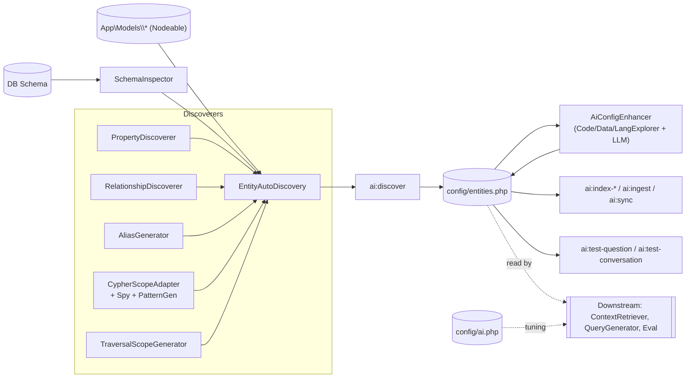

# Layer 14 — Discovery, Config & Console Commands

## 1. Purpose (plain language)

This layer is the **offline build pipeline** for the RAG system. Before a user can ask anything, someone runs `php artisan ai:discover` to introspect the app's Eloquent models (their columns, relationships, scopes, French aliases) and write a generated `config/entities.php`. That file is the "map" every downstream layer reads to turn *important words* in a question into *entities → graph queries → answers*. The layer also owns the two big config files (`ai.php`, `entities.php`), the optional LLM-powered "enhancer" that rewrites the generated config into richer prompt fodder, and ~12 artisan commands that ingest data, build semantic indexes, and let a developer test/diagnose the pipeline from the CLI. Nothing here runs at request time — it is all setup, indexing, and dev tooling.

## 2. C4 component diagram

## 3. Data in / data out

**In:**
- Eloquent model classes implementing `Condoedge\Ai\Domain\Contracts\Nodeable` (discovered via Symfony Finder over `app/Models`).
- Live DB schema (columns, FK constraints, indexes) via `SchemaInspector`.
- Source files: model PHP, migrations, Kompo Form/Table classes, route files, `resources/lang/*` (CodeExplorer / DataExplorer / LangExplorer).
- `config/ai.php` tuning values; user's published `config/entities.php`.

**Out:**
- Generated `config/entities.php` — array keyed by model FQCN with `graph` (label/properties/relationships), `vector` (collection/embed_fields/metadata), `security` (team_path), `metadata` (aliases/description/scopes/common_properties). This is the central DTO of the whole package.
- Vector-store collections (`context_index`, `scope_examples`, `semantic_*`) written by index commands.
- CLI reports (diagnose/validate/test) — no persisted artifact.

## 4. Contracts (owned / consumed)

**Owned by this layer:** none. Every discoverer is a concrete class with no interface. The only contract-shaped boundary is the *implicit array schema* of `config/entities.php` (documented only in the file header, not typed).

**Consumed:**
- `Condoedge\Ai\Domain\Contracts\Nodeable` (marker for discovery).
- `Condoedge\Ai\Contracts\LlmProviderInterface` (AiConfigEnhancer).
- `GraphStoreInterface`, `VectorStoreInterface`, `FileProcessorInterface`, `BatchDataIngestionService`, `SemanticIndexer`, `SemanticContextSelector`, `ScopeSemanticMatcher`, `AiChatService`, `AI` facade (commands).

## 5. Findings

| ID | Sev | Type | File:line | What | Why it matters | Recommendation | Verified |
|----|-----|------|-----------|------|----------------|----------------|----------|
| L14-1 | P1 | single-path-violation | config/ai.php:1025 + EntityAutoDiscovery reads vs EvalCommand:264 | Entities live under TWO config keys: `config('entities')` (published file, read by ~14 prod sites) and `config('ai.entities')` (the package stub bundled via ai.php's `require`, read only by `EvalCommand`/`QuestionSetGenerator`). Only `ai.php` is `mergeConfigFrom`'d (AiServiceProvider:164); `entities.php` is publish-only. | `ai:eval` reads the empty stub (`config('ai.entities')`) while the rest of the pipeline reads the real published file (`config('entities')`) — eval silently runs against zero entities, or diverges after the user edits one copy. Classic dual-source-of-truth. | Pick one key. Either drop the `'entities' => require ...` from ai.php and make everything read `config('ai.entities')` via a real `mergeConfigFrom('entities')`, or make eval read `config('entities')`. | true |
| L14-2 | P1 | bug | SetupCommand:95 vs ValidateConfigCommand:22 | `ai:setup` step 2 calls `$this->call('ai:validate-config')` but the command's signature is `ai:config:validate`. The name does not exist. | Laravel throws `CommandNotFoundException`, so `ai:setup` **crashes on step 2 before ingesting anything** — the flagship "one command setup" is broken as shipped. Docs (installing.md:263, commands.md:60) repeat the wrong name. | Rename the command signature to `ai:validate-config` (matches docs + intent) or fix the call site + docs. Add a smoke test that boots `ai:setup --dry-run`. | true |
| L14-3 | P1 | dead-code | config/ai.php:102 (`discovery`) vs EntityAutoDiscovery:426,431 + TraversalScopeGenerator:333 | Config defines `ai.discovery.*` (properties/relationships/scopes/aliases/role_mappings/exclude_properties), but code reads `ai.auto_discovery.enabled`, `ai.auto_discovery.excluded_models`, `ai.auto_discovery.role_mappings`. The keys never match. | Every documented `ai.discovery` knob is inert: toggling `properties`/`scopes`/`role_mappings` does nothing. `role_mappings` (the only thing that makes traversal-scope auto-gen work, e.g. `3=>volunteers`) is read from a key the config file never sets, so auto traversal scopes never fire in practice. | Unify on one prefix (`ai.discovery`). Update EntityAutoDiscovery:426/431 and TraversalScopeGenerator:333 to read `ai.discovery.*`, and actually honor `properties/relationships/scopes/aliases` toggles in `discoverGraph/Vector/Metadata`. | true |
| L14-4 | P1 | half-done | EnhanceConfigCommand:67 vs DiscoverEntitiesCommand:142,156 | `ai:enhance` supports a split-file layout `config/ai-entities/*.php` and writes per-category back, but `ai:discover` only ever writes a single flat `config/entities.php`, and the `ai-entities` publish tag (AiServiceProvider:755) publishes the flat file, not a directory. No code produces the split layout. | The crash-resilient split-write path is unreachable in the shipped product (`$useSplitFiles` is always false). Dead complexity + the implied "split structure" workflow is undocumented and unbuildable. | Either implement a `ai:discover --split` that writes `config/ai-entities/`, or delete the split-file branch and its backup logic from `ai:enhance`. | true |
| L14-5 | P1 | single-path-violation | TestQuestionCommand:138-216, 257-290 | `ai:test-question` re-implements a large slice of the answer pipeline by hand (file-context fan-out, `knowledge_query` short-circuit, manual `PipelineContext` assembly) instead of calling the orchestrator (`AI::answerQuestion`/AiChatService). | The test harness drifts from production: a bug fixed in the real orchestrator won't show up here, and `ai:enhance` feeds this command's output back into the LLM as "ground truth" (EnhanceConfigCommand:146), so drift corrupts the enhanced config. | Make `ai:test-question` call the same orchestrator the chat UI uses, with a `--debug` decorator for timings, rather than a parallel pipeline. | true |
| L14-6 | P2 | coupling | AliasGenerator:40-94 | Hardcoded `BUSINESS_TERMS` dictionary with ~50 CondoEdge-domain bilingual synonyms (`union`→copropriete/syndicat, `unit`→unité/fraction, `bill`→facture fournisseur…) baked into a "generic, injectable" package. | Directly violates the project's own rule against hardcoded word lists for semantics, and leaks one client's domain into a reusable library. Any other app gets noise aliases (`HOA`, `strata`) and misses its own terms. | Move the dictionary to config (`ai.discovery.alias_mappings`, which already exists but is unused) or derive aliases from lang files + the LLM enhancer. Ship an empty default. | true |
| L14-7 | P2 | coupling | EmbedFieldDetector:68-73 | `EXCLUDE_PREFIXES = ['bnc_','payable_','stripe_','two_factor_']` — `bnc_`/`payable_` are CondoEdge schema names hardcoded into a generic detector. | Same leakage problem; a host app with a legitimate `payable_note` text column would have it silently dropped from embeddings. | Drive prefixes from `ai.discovery.exclude_properties` (already defined, currently inert) instead of a const. | true |
| L14-8 | P2 | bug | CypherScopeAdapter:443-511 | `extractFilterFromCalls` reads `$call['arguments']` / `$args[0..2]`, but `CypherQueryBuilderSpy` records `where` as `['column'=>..,'operator'=>..,'value'=>..]` (no `arguments` key — only the `__call` scope fallback sets `arguments`). | For every normal property-filter scope, the `filter` array in the generated config comes out empty, so `property_filter` scopes lose their structured filter (only the raw cypher_pattern survives). Silent data loss in discovery output. | Read `column/operator/value` keys to match the spy's actual record shape, and add a unit test asserting `filter` is populated for `scopeActive`. | true |
| L14-9 | P2 | dead-code | EntityAutoDiscovery:415 (`shouldDiscover`) | `shouldDiscover()` is referenced only by `AdversarialSecurityTest`; no production code calls it. It also reads the broken `ai.auto_discovery.*` keys (L14-3). | Dead gate kept alive only by a test that asserts behavior nothing uses. Misleads readers into thinking discovery is runtime-gated (the file header insists it is NOT). | Delete `shouldDiscover()` and its test, or wire it into `discoverAll()` if a real exclusion gate is wanted. | true |
| L14-10 | P2 | dead-code | PropertyDiscoverer:93 `discoverWithTypes`; RelationshipDiscoverer:671 `detectDiscriminatorInRelation`; SchemaInspector:635 `clearAllCaches`; TraversalScopeGenerator:308,319 `getDiscriminatorFields`/`isDiscriminatorField`; CypherScopeAdapter:621,631 `getSpy`/`getGenerator` | Public methods with zero production callers (confirmed via repo search — only self-definition or test usage). | Accumulated surface area / maintenance weight on classes meant to be lean and injectable. `getSpy/getGenerator` exist purely to satisfy a test of DI plumbing. | Delete the genuinely unused ones (`discoverWithTypes`, `detectDiscriminatorInRelation`, `clearAllCaches`, `getDiscriminatorFields`, `isDiscriminatorField`). | true |
| L14-11 | P2 | ux | IndexSemanticCommand:150 | "Next steps" prints `php artisan ai:test-semantic "Show all clients"` — no such command exists (only reference in the repo is this print). | Sends the operator down a dead end immediately after indexing. Erodes trust in the tooling. | Point to the real `ai:test-question`, or implement `ai:test-semantic`. | true |
| L14-12 | P2 | single-path-violation | IndexContextCommand vs IndexScopesCommand vs IndexSemanticCommand | Three overlapping index commands: `ai:index-context` always indexes scopes (via ScopeSemanticMatcher) **and** entities; `ai:index-scopes` indexes ONLY scopes via the same `ScopeSemanticMatcher::indexScopes` (a strict subset); `ai:index-semantic` indexes entities/scopes/templates into a *different* collection family (`semantic_*`). `ai:setup` runs all three, double-indexing scopes. | Confusing surface (which one do I run?), redundant API calls/cost (scopes embedded 2-3×), and two parallel "semantic" subsystems (`context_index`+`scope_examples` vs `semantic_*`) that overlap conceptually. | Collapse `ai:index-scopes` into `ai:index-context --scopes-only` (already exists) and document which collection family is authoritative; drop the redundant scope pass from `ai:setup`. | true |
| L14-13 | P2 | coupling | TestConversationCommand:34 | Hardcodes `\App\Models\User::find()` instead of `config('auth.providers.users.model')` (which the sibling TestQuestionCommand:32 and EnhanceConfigCommand:56 use correctly). | Breaks for any app whose user model isn't `App\Models\User`, in a package that markets itself as model-agnostic/injectable. Inconsistent with its own siblings. | Resolve the user model from config like the other two commands. | true |
| L14-14 | P3 | bug | DiagnoseCommand:162,185 | Env-var hints are wrong: suggests `AI_OPENAI_API_KEY` / `AI_OPENAI_EMBEDDING_API_KEY`, but config/ai.php reads `OPENAI_API_KEY` (lines 332/431) and there is no separate embedding key. | A developer following the diagnose hint sets a variable nothing reads and stays broken. | Print the actual env var (`OPENAI_API_KEY` / `ANTHROPIC_API_KEY`) derived from the provider. | true |
| L14-15 | P3 | bug | IndexContextCommand:99 | Stat counter reads `$config['relationships']` but relationships live under `$config['graph']['relationships']`. | "Relationships" always displays 0 in the pre-index summary table — cosmetic but misleading during setup. | Read `$config['graph']['relationships']`. | true |
| L14-16 | P3 | complexity-without-value | CypherQueryBuilderSpy + CypherPatternGenerator + CypherScopeAdapter (3 files, ~1660 lines) | An elaborate spy that replays Eloquent scope closures against a fake query builder to transpile them to Cypher at discovery time. Fragile (`__call` scope resolution, default-value guessing, manual operator maps), partially broken (L14-8), and produces `cypher_pattern` strings that the LLM-based enhancer (`ai:enhance`) is then asked to rewrite anyway. | High maintenance, low payoff: the system already leans on an LLM to author scope cypher. The spy is the single most complex sub-mechanism in this layer for a feature (auto scope cypher) the enhancer supersedes. | Consider retiring the transpiler in favor of: discover scope *names/examples* only, let the LLM enhancer author cypher. Keeps detection, drops the brittle codegen. | true |
| L14-17 | P3 | prompt-quality | AiConfigEnhancer:200-228, EnhanceConfigCommand:140-162 | `ai:enhance` shells out to `Artisan::call('ai:test-question', --debug)` per question and feeds the *entire buffered CLI output* (truncated at 1500 chars) back to the LLM as feedback, across 3 rounds × 5 questions × N entities. | Very expensive (one full pipeline run + a 4000-token LLM call per question), and the feedback is noisy CLI text rather than structured pipeline signals. Token waste + slow + non-deterministic config churn. | Feed structured results (selected entities, cypher, row count, answer) not raw ANSI CLI output; gate iterations behind a measurable score. | true |
| L14-18 | P3 | ai-comment | EnhanceConfigCommand (header), AliasGenerator:21, EntityAutoDiscovery:522 (stray blank), many "// Non-fatal" / "// That's it!" comments | Pervasive narrative/obvious comments and marketing-style docblocks ("That's it!", "90% of use cases", emoji ✓/✗ in CLI output). | Noise; entities.php is 543 lines of which ~540 are commented examples/prose with only `return [];` of real config. | Trim entities.php to a short header + empty array; strip obvious comments. | true |

## 6. File checklist

| File | Verdict | Note |
|------|---------|------|
| src/Console/Commands/DiagnoseCommand.php | KEEP | Solid connectivity check; fix env-var hints (L14-14). |
| src/Console/Commands/DiscoverEntitiesCommand.php | KEEP | Core entry point; writes flat entities.php only (see L14-4). |
| src/Console/Commands/EnhanceConfigCommand.php | REFACTOR | Unreachable split-file path (L14-4); expensive raw-CLI feedback loop (L14-17). |
| src/Console/Commands/IndexContextCommand.php | KEEP | Fix relationships stat (L14-15); overlaps index-scopes (L14-12). |
| src/Console/Commands/IndexScopesCommand.php | MERGE | Strict subset of `ai:index-context --scopes-only` (L14-12). |
| src/Console/Commands/IndexSemanticCommand.php | REFACTOR | Separate `semantic_*` collection family; dead `ai:test-semantic` hint (L14-11, L14-12). |
| src/Console/Commands/IngestEntitiesCommand.php | KEEP | Clean; reads `config('entities')` (correct side of L14-1). |
| src/Console/Commands/SetupCommand.php | REFACTOR | Calls a non-existent command — broken pipeline (L14-2). |
| src/Console/Commands/SyncRelationshipsCommand.php | KEEP | Reasonable; duplicates `findNodeableModels` logic with EAD (minor). |
| src/Console/Commands/TestConversationCommand.php | REFACTOR | Hardcoded `App\Models\User` (L14-13); otherwise useful REPL/script runner. |
| src/Console/Commands/TestQuestionCommand.php | REFACTOR | Re-implements the pipeline instead of calling the orchestrator (L14-5). |
| src/Console/Commands/ValidateConfigCommand.php | REFACTOR | Signature `ai:config:validate` mismatches its callers/docs (L14-2). |
| src/Services/Discovery/AiConfigEnhancer.php | KEEP | Well-structured; the strongest part of the "enhance" story. Tune feedback (L14-17). |
| src/Services/Discovery/AliasGenerator.php | REFACTOR | Hardcoded domain dictionary (L14-6); move to config/LLM. |
| src/Services/Discovery/CodeExplorer.php | KEEP | Kompo-coupled (`extends Form|Table`) but used and contained. |
| src/Services/Discovery/CypherPatternGenerator.php | REFACTOR | Part of the brittle transpiler trio (L14-16); operator/value codegen. |
| src/Services/Discovery/CypherQueryBuilderSpy.php | REFACTOR | Spy mechanism; record-shape mismatch breaks downstream filter extraction (L14-8, L14-16). |
| src/Services/Discovery/CypherScopeAdapter.php | REFACTOR | `extractFilterFromCalls` reads wrong keys (L14-8); dead getSpy/getGenerator (L14-10). |
| src/Services/Discovery/DataExplorer.php | KEEP | Tidy sample/enum/null-rate probe; used by both enhance paths. |
| src/Services/Discovery/EmbedFieldDetector.php | REFACTOR | CondoEdge prefixes hardcoded (L14-7). |
| src/Services/Discovery/EntityAutoDiscovery.php | REFACTOR | Orchestrator OK but reads broken `ai.auto_discovery` keys (L14-3); dead `shouldDiscover` (L14-9). |
| src/Services/Discovery/InheritanceResolver.php | KEEP | Genuinely useful single-table-inheritance merge; self-contained. |
| src/Services/Discovery/LangExplorer.php | KEEP | Bilingual key extraction; instantiated twice (minor) but works. |
| src/Services/Discovery/PropertyDiscoverer.php | KEEP | Solid; dead `discoverWithTypes` (L14-10); `getPrivateProperty` global coupling (minor). |
| src/Services/Discovery/RelationshipDiscoverer.php | KEEP | Thorough Eloquent→Neo4j mapping; dead `detectDiscriminatorInRelation` (L14-10). |
| src/Services/Discovery/SchemaInspector.php | KEEP | Best file in the layer — multi-driver, SQL-injection-guarded, cached. Drop `clearAllCaches` (L14-10). |
| src/Services/Discovery/TraversalScopeGenerator.php | REFACTOR | Reads broken role_mappings key (L14-3); hardcoded role words; dead getter pair (L14-10). |
| config/ai.php | REFACTOR | `discovery` block inert (L14-3); dual entities key (L14-1); huge but mostly necessary. |
| config/entities.php | REFACTOR | 543 lines, 540 are commented examples; trim to a stub (L14-18). |

## 7. What to add (next-level)

- **A typed Entity config object/contract.** The `config/entities.php` array schema is the spine of the whole package yet exists only as prose in a file header. Introduce an `EntityConfig` DTO (or at least a JSON-schema validator that `ai:config:validate` enforces) so discoverers, enhancer, and pipeline can't silently disagree on shape (would have caught L14-8 and the `relationships` vs `graph.relationships` slip).
- **Single config source of truth.** Resolve the `ai.entities` vs `entities` split (L14-1) and merge `entities.php` like `ai.php`, so eval and the pipeline can never diverge.
- **Idempotent, hash-gated indexing.** Index commands re-embed everything every run. Store a content hash per entity/scope and skip unchanged items — directly attacks the 2-3× scope-embedding waste (L14-12) and enhancer cost.
- **One canonical pipeline entry.** Have `ai:test-question`, `ai:test-conversation`, `ai:eval`, and `ai:enhance` all drive the *same* orchestrator (L14-5) so dev tools, eval, and prod can never drift.
- **Config-driven, not const-driven, semantics.** Wire the already-present-but-inert `ai.discovery.alias_mappings` / `exclude_properties` / `role_mappings` so domain knowledge leaves the package code (L14-3, L14-6, L14-7). Ship empty defaults; let the LLM enhancer fill the gap.
- **A `ai:discover --check` / drift detector** that diffs current models against the committed `entities.php` and exits non-zero in CI when they diverge.

## 8. Open questions / risks

- **Is `ai:setup` ever run in practice?** L14-2 means it has been broken since the command name diverged; if nobody noticed, the "setup" command may be vestigial and the real workflow is the individual commands. Confirm with the team before fixing vs deleting.
- **Which semantic subsystem is authoritative** — the `context_index`/`scope_examples` family (IndexContext/IndexScopes) or the `semantic_*` family (IndexSemantic)? Both are wired into `ai:setup`. Lane 11/12 (retrieval) should confirm which the runtime actually queries; the other is dead weight.
- **`ai.entities` (EvalCommand) belongs to lane 13's eval harness** but the divergence is a config-layer defect; coordinate the fix so eval isn't grading against an empty entity set.
- **Discovery runs `DB::beginTransaction()` + `Model::unsetEventDispatcher()` globally** (EntityAutoDiscovery:833) while introspecting *every* model; in an app with model boot side effects this is broad. Low risk (rolled back) but worth a note for multi-tenant setups.
- **`config/ai-patterns.php`** is referenced by ai.php:1013 but not in this lane's file set — confirm it's covered elsewhere; if absent, `query_patterns` is silently empty.
