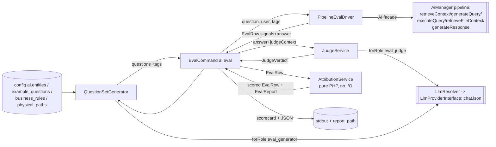

# Layer 15 — Eval Harness

## 1. Purpose (plain language)

This layer is the package's self-test. It asks the assistant a batch of questions
that are generated from the project's own config (no human-written answer key),
runs each one through the **real** pipeline — important words / query understanding
-> file & entity retrieval -> prompt build -> query -> answer — then grades the
answer with an LLM "judge" that has no gold reference, only the context that was
actually retrieved. Finally it blames the single weakest of four stages
(understanding / retrieval / prompt / generation) per question and rolls everything
up into a pass/fail scorecard. The whole thing is designed to keep running even
when the LLM, DB, and vector/graph stores are all down (it degrades to
deterministic signal-only scoring). It is the backbone of the separate analytical
"where is my pipeline weakest" workflow.

## 2. C4 component diagram

## 3. Data in / data out

In:
- `config('ai.entities' | 'ai.chat.example_questions' | 'ai.project.business_rules' | 'ai.file_context.physical_paths')` -> question seeds.
- `config('ai.eval.*')` -> thresholds, judge role/temp/max_tokens, report path (`generation.*`, `row_pass_threshold`, `offline_default` are read NOWHERE — see findings).
- CLI options: `--suite`, `--generate`, `--from-logs`, `--limit`, `--tags`, `--report`, `--offline`, `--user`.
- `AiQueryLog.question` (when `--from-logs`).
- The authenticated user (looked up from the auth model; logged in for the run).

Out:
- `EvalRow` per question (signals, answer, `JudgeVerdict`, per-stage `stageScores`, `weakestStage`, `verdictLabel`).
- `EvalReport` (per-stage average `scorecard`, `weakestStage`, `blameCounts`, `failedStages`, `passed`, `meta`).
- A printed SCORECARD table + an optional JSON report file.
- Process exit code: 0 = all stage averages met thresholds, 1 = any below.

## 4. Contracts (owned / consumed)

Owned (this layer): **none formal**. `PipelineEvalDriver`, `JudgeService`,
`AttributionService`, `QuestionSetGenerator` are concrete classes with no
interface and no DI binding (all autowired). DTOs `EvalReport`, `EvalRow`,
`JudgeVerdict` are the data contract.

Consumed:
- `Condoedge\Ai\Facades\AI` / `AiManager` — `retrieveContext`, `generateQuery`, `executeQuery`, `retrieveFileContext`, `generateResponse`.
- `LlmResolver::forRole('eval_judge' | 'eval_generator')` -> `LlmProviderInterface::{chatJson, getProvider}`.
- `PipelineContext`, `QueryGenerationResult`, `QueryExecutionResult` (re-assembled by the driver for the response stage).
- `AiQueryLog` (optional, `--from-logs`).

## 5. Findings

| ID | Sev | Type | File:line | What | Why it matters | Recommendation | Verified |
|----|-----|------|-----------|------|----------------|----------------|----------|
| L15-1 | P1 | bug | PipelineEvalDriver.php:85 | A **query-generation** failure is trapped as stage `'understanding'`. QU already ran (and succeeded) inside `retrieveContext` at line 57; query *generation* is a separate downstream stage. | Mis-directs blame: a broken Cypher generator (LLM/template fault) makes the scorecard say "understanding is your weakest stage", sending the operator to fix the wrong thing. This is the harness's one job. | The 4-stage enum has no "query-gen" slot; label query-gen errors `'retrieval'` (query+execution are the same stage by design) instead of `'understanding'`, or carry a sub-reason. | true |
| L15-2 | P1 | abstraction | AttributionService.php:230-256 | `prompt` and `generation` are not independently observable. `scorePrompt` = (faithfulness+grounding)/2, `scoreGeneration` = (relevance+usefulness)/2 — both are just the SAME judge verdict bisected arbitrarily. No signal isolates prompt construction from generation. | The headline feature is "per-stage attribution localises the weakest stage". For 2 of the 4 stages that localisation is a hand-wavy split of one judge call, not a measurement. A bad prompt and a bad model are indistinguishable; the harness will blame "prompt" vs "generation" on a coin-flip of which dimension scored lower. | Either collapse prompt+generation into one "answer quality" stage, or feed the judge a real prompt-level signal (e.g. ask whether the failure is "context not used" vs "context wrong/insufficient") so the two scores diverge meaningfully. | true |
| L15-3 | P1 | bug | AttributionService.php:92-97 + PipelineEvalDriver.php:120 | Offline/gate-passing rows are mislabeled. The driver sets `verdictLabel='judge-skipped'`, but `attribute()`'s `judge-skipped` branch only fires when `$row->verdict?->skipped` is truthy. Offline rows have `verdict === null`, so they fall to the else branch and get overwritten to `'passed'`/`'failed'` via `row_pass_threshold`. | The `judge-skipped` label the driver carefully sets is silently discarded for every offline row that passes the gate; the report claims those rows "passed"/"failed" on a neutral heuristic rather than honestly reporting "not judged". Confuses any CI gating on `verdict_label`. | In offline runs treat a null verdict as `judge-skipped` (`$row->verdict === null || $row->verdict?->skipped`), or have `attribute()` respect a label the driver already set. | true |
| L15-4 | P1 | coupling | EvalCommand.php:52-55 + AttributionService.php:43,95 | `AttributionService` is autowired (no binding in AiServiceProvider), so its `$config` is **always `[]`**. `row_pass_threshold` always defaults to 0.6 — the documented `ai.eval.row_pass_threshold` (config/ai.php:400) is dead. | A published, env-backed knob (`AI_EVAL_ROW_PASS_THRESHOLD`) that silently does nothing; row pass/fail in the report is never what was configured. | Bind `AttributionService` with `config('ai.eval')` (or `new AttributionService(config('ai.eval'))` in `handle()`), or delete the key. | true |
| L15-5 | P2 | dead-code | config/ai.php:408-412 | `ai.eval.generation.questions_per_entity`, `include_scopes`, `include_properties` are read nowhere. `QuestionSetGenerator` hardcodes behavior: always 2 data questions/entity (l.103-104), always emits scopes (l.107) and properties (`array_slice(...,0,2)` l.116); `makeGenerator()` (EvalCommand.php:259) never passes the block. | Three env-backed knobs that look authoritative but are inert; anyone tuning the question set is misled. | Honor them in `QuestionSetGenerator::generate()` (inject the `generation` config) or delete the block + its docblock. | true |
| L15-6 | P2 | dead-code | config/ai.php:388-389,416 | `ai.eval.offline_default` is documented ("when true, ai:eval skips the judge unless --offline...") but read nowhere. `$offline` is derived solely from the `--offline` flag (EvalCommand.php:57). | The advertised default-offline behavior does not exist. A CI box with `AI_EVAL_OFFLINE_DEFAULT=true` still tries the judge; it only "works" because `JudgeService::resolveJudge` independently bails on a missing key. The config lies. | Read `offline_default` in `handle()` as the default for `$offline`, or remove the key + docblock. | true |
| L15-7 | P1 | abstraction | JudgeService.php:111-132 + config/ai.php:366 | Self-preference / circularity risk: no judge model is pinned by default (`eval_judge` role is commented out), so `LlmResolver::forRole('eval_judge')` returns the **same provider/model** that generated the answer. The judge is also reference-free, so it grades the system-under-test with the system-under-test. | LLM-as-judge with the same model family shows documented self-preference bias; scores skew optimistic and the harness's value (catching regressions) is undermined. No warning fires when judge == generation provider. | Recommend a distinct judge model in the shipped config and `warn()` in `EvalCommand` when the resolved judge provider equals the generation provider. | true |
| L15-8 | P2 | single-path-violation | PipelineEvalDriver.php:208-248 | `retrieveFiles()` re-implements the multi-query file-context fan-out (build `[searchQuery, question, clarifiedQuestion, searchTags]`, loop `retrieveFileContext`, merge-by-relevance, `usort`) that also lives in `AiManager` and `TestQuestionCommand`. The docblock even says "mirrors AiManager". | The eval driver measures a DIFFERENT file-retrieval path than production; a relevance/merge fix in `AiManager` never reaches the eval. A reliability tool that doesn't exercise the real path reports the wrong numbers. | Extract one `FileContextRetriever` service used by `AiManager`, `TestQuestionCommand`, and the driver. | true |
| L15-9 | P2 | coupling | PipelineEvalDriver.php:124-152 | Stage 4 rebuilds a fresh `PipelineContext` + `QueryGenerationResult` + `QueryExecutionResult` from scattered arrays and re-enters `generateResponse`, instead of threading the single `PipelineContext` from `retrieveContext` the way `AiManager::answerQuestion` does. The `success` flag at l.137 (`!empty(data) || empty(errors)`) is a heuristic guess. | Another parallel-pipeline surface: the response stage sees a hand-assembled context (dropping `selectionInfo`, `qu`, `quality`) production never builds, so prompt-quality results may not match real runs. | Reuse the real `PipelineContext` from stage 1 and mutate it through the stages, mirroring `AiManager`. | true |
| L15-10 | P2 | missing | tests/Unit/Console/EvalCommandTest.php (whole) | Tests cover ONLY the offline graceful-degradation path. `PipelineEvalDriver` (stage walk, gate, error-label mapping incl. L15-1, signal capture, file merge), the online `JudgeService::judge` path, and `QuestionSetGenerator` have NO unit tests. | The driver is where the real risk lives. A tool whose job is measuring reliability leaves its most bug-prone unit unverified — one driver test would have caught L15-1. | Add driver tests with a fake AI facade: gate short-circuits, per-stage error labeling, `captureContextSignals` mapping, file dedupe; and a generator test on the deterministic template. | true |
| L15-11 | P2 | bug | AttributionService.php:266-278 | `neutralFromContext()` returns the **same** value for `scorePrompt` and `scoreGeneration` whenever the judge is skipped/null. The `weakest()` tie-break (l.299-315) then always picks `prompt` over `generation` (earlier in `STAGES`). | In every offline run, `generation` can never be named weakest of the two answer stages even when generation is the real problem; the offline scorecard structurally under-reports generation. With L15-2 this makes offline prompt/generation attribution meaningless. | Differentiate the two neutral scores (generation off answer length/non-emptiness, prompt off grounding signals), or collapse the two stages offline. | true |
| L15-12 | P2 | complexity-without-value | JudgeService.php:215-231 | `clamp()` auto-detects a 0-100 scale: values in `(2,100]` are divided by 100, `(1,2]` are clamped to 1.0. It guesses the judge's intent from magnitude. | A malformed `1.5` silently becomes 1.0 (inflated); a judge returning `2` (e.g. "2 of 5", or a bug) becomes 0.02. The heuristic invents data instead of failing loudly, and shouldn't be needed for a temp-0 strict-JSON judge. | Specify "0-1 only" in the prompt and clamp simply to `[0,1]`; drop or make explicit the /100 branch. | true |
| L15-13 | P3 | bug | AttributionService.php:122-136 | The report `offline` flag = "no row had a non-skipped verdict". An ONLINE run where every row was gated (`context-not-retrieved`, verdict null) reports `offline = true`. | Cosmetic but misleading: footer + JSON say "judge skipped / offline" for a run that genuinely tried and was just starved of context. | Track offline from the actual `--offline`/judge-availability decision and pass it into `aggregate()` via `meta`. | true |
| L15-14 | P3 | ux | EvalCommand.php:343-359 | The "Sample attributions" block filters on `verdictLabel in ['failed','context-not-retrieved','stage-error']` — it excludes `judge-skipped`. With L15-3 (offline rows relabeled) this is fragile, and offline runs (common CI case) show no samples for skipped rows. | The most useful diagnostic output (which questions blamed which stage) is empty exactly in offline mode, the mode CI uses most. | Show samples for the weakest-stage rows regardless of label, or include `judge-skipped`. | true |
| L15-15 | P3 | ai-comment | PipelineEvalDriver.php:206; AttributionService.php:16 | Narrated/archaeology docblocks: "mirrors AiManager" (becomes a lie once L15-8 is fixed), "this is the deterministic heart of the harness", "PURE-PHP". | Token-heavy and drift-prone; "mirrors AiManager" documents a duplication smell as if it were a feature. | Trim to one-line intents; drop "mirrors AiManager" in favor of the shared service from L15-8. | true |
| L15-16 | P3 | prompt-quality | QuestionSetGenerator.php:188-229 | `maybePolish()` sends ALL questions in one `chatJson` call (`max_tokens` 1500) and accepts the rephrase only if `count($rephrased) === count($questions)`. For a large entity set this truncates and silently falls back to templates. | The LLM polish (the only thing distinguishing this from a pure template generator) silently no-ops on big configs, and a wasted 1500-token call is incurred for nothing. | Batch/chunk the rephrase, or size `max_tokens` from question count; log when the count-mismatch fallback fires. | true |

## 6. File checklist

| File | Verdict | Note |
|------|---------|------|
| src/Console/Commands/EvalCommand.php | REFACTOR | Good CLI ergonomics and graceful degradation, but ignores `offline_default` (L15-6) and `row_pass_threshold` (L15-4, autowires AttributionService with empty config), and the sample block hides offline rows (L15-14). Orchestration (drive/judge/attribute loop) would be more reusable as an `EvalService`. |
| src/DTOs/Eval/EvalReport.php | KEEP | Clean aggregate DTO. Only nit: `offline` is filled by the caller's inference (L15-13), not by this class. |
| src/DTOs/Eval/EvalRow.php | KEEP | Well-documented signal carrier; `contextIsEmpty()` gate condition is sound. Default `verdictLabel='passed'` is a footgun (an unscored row looks passed) but is always overwritten by `attribute()`. |
| src/DTOs/Eval/JudgeVerdict.php | KEEP | Solid immutable verdict with a sensible `skipped()` neutral and `generationScore()`. No issues. |
| src/Services/Eval/AttributionService.php | REFACTOR | The deterministic core, but the prompt/generation split is a non-measurement (L15-2), offline rows mislabeled (L15-3), `row_pass_threshold` never received (L15-4), prompt==generation offline tie-break (L15-11). Empty-context and stage-error short-circuits are correct. |
| src/Services/Eval/JudgeService.php | REFACTOR | Clean reference-free judge with graceful offline. But the magnitude-guessing `clamp()` (L15-12) and the self-preference risk (no pinned judge model, L15-7) need addressing. |
| src/Services/Eval/PipelineEvalDriver.php | REFACTOR | Stage-walk + per-stage trap + generation gate are the right shape, but the query-gen->`understanding` mislabel (L15-1), duplicated file fan-out (L15-8), and reconstructed-not-threaded PipelineContext (L15-9) make it measure a slightly different pipeline than production. |
| src/Services/Eval/QuestionSetGenerator.php | KEEP | Cohesive, deterministic-fallback, label-free generator. Ignores `generation.*` knobs (L15-5), batch-polish can silently no-op (L15-16), and is untested (L15-10). |

## 7. What to add (next-level)

- **A real prompt-vs-generation signal.** Today 2 of 4 stages are one judge call bisected (L15-2). Add a judge field like `failure_mode: context_ignored | context_insufficient | reasoning_error` so prompt and generation diverge on evidence, not arithmetic.
- **Judge independence.** Pin a different `eval_judge` model by default and warn when judge provider == generation provider (L15-7). Optionally support a panel/ensemble or a small rubric-calibration set to estimate judge bias.
- **One shared retrieval path.** Extract `FileContextRetriever` and thread the real `PipelineContext` so the eval provably exercises the production pipeline (L15-8, L15-9). Until then every eval number carries an asterisk.
- **Honor (or delete) every `ai.eval.*` knob** end-to-end with tests so the published config is real (L15-4/5/6). Bind the eval services in the provider with `config('ai.eval')`.
- **Driver + generator unit tests** with a fake AI facade covering gate, per-stage labeling, signal capture, dedupe (L15-10).
- **Optional labeled mode.** Reference-free is good for breadth, but a small gold set (expected entities/row-count/answer-contains) would let the harness measure judge accuracy and catch silent retrieval regressions the reference-free judge can't see (it can't know rows are *missing* if the answer reads plausibly).
- **Determinism/variance reporting.** Sample N times per question and report score variance, so a "regression" isn't just judge noise.
- **Baseline diff.** Persist the previous report and diff scorecards/blame counts so CI fails on regression vs the last green run, not just on absolute thresholds.

## 8. Open questions / risks

- **Is the attribution actually trusted for action?** Given L15-1 (query-gen blamed on understanding) and L15-2 (prompt/generation = bisected judge score), the "weakest stage" headline can point at the wrong stage. If a human acts on this scorecard they may be misled. How is the output consumed downstream?
- **Reference-free blind spot:** the judge only sees retrieved context, so a confidently-wrong answer over *correct but incomplete* retrieval can score high on grounding/faithfulness. The harness can't detect "the right data was never retrieved" unless `row_count`/selection signals catch it. Is missed-recall an accepted blind spot?
- **`offline` semantics overloaded:** `--offline` means "skip judge AND skip response generation" (PipelineEvalDriver.php:119). So offline never scores prompt/generation from a real answer — it's a retrieval/understanding smoke test only. Is that the intended contract, or is an "answer-but-don't-judge" mode wanted?
- **No binding for eval services** means a host project can't swap the judge or attribution strategy via the container — the harness isn't injectable/extendable despite being billed "model- and domain-agnostic". Was extensibility a goal?
