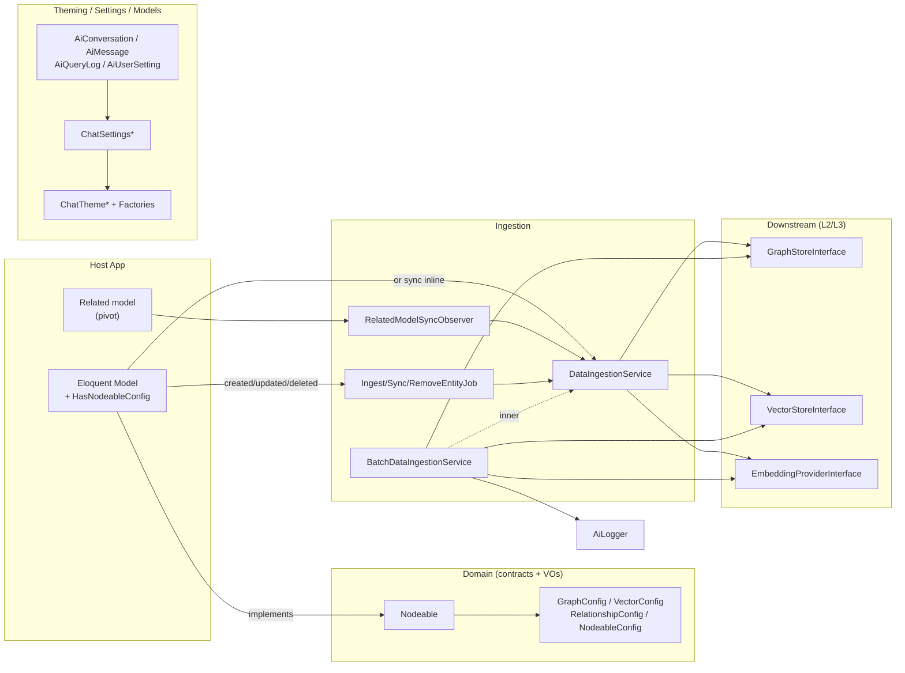

# Layer 16 — Entity Ingestion, Domain, Theming, Settings & Cross-cutting

## 1. Purpose (plain language)

This layer is the "write side" and the "presentation/plumbing side" of the RAG package. The **Domain** half defines what makes an application model indexable (the `Nodeable` contract + value objects describing how to store it in Neo4j and Qdrant) and the **Ingestion** half pushes those models into the graph and vector stores (single, batch, and via auto-sync model events / queue jobs). The **Theming/Settings** half decides how the chat UI looks and behaves per user, and **AiLogger** is the structured-logging spine threaded through the whole pipeline. In the "user asks → important words → files → enhance prompt → query → answer → actions" flow, this layer mostly runs *before* the user asks (it populates the stores that retrieval reads) and *around* the answer (logging, chat persistence models, theme). It does not itself answer questions.

## 2. C4 component diagram

## 3. Data in / data out

**In:**
- `Nodeable` entities (Eloquent models using `HasNodeableConfig`, or hand-rolled).
- Entity configuration arrays from `config('entities')` (top-level namespace, generated by `ai:discover`) and per-model properties (`$embedFields`, `$graphLabel`, ...).
- `config('ai.*')` for auto-sync toggles, sync triggers, UI theme/colors, chat settings.
- User row from `AiUserSetting` (theme + chat preferences).

**Out:**
- Side effects into `GraphStoreInterface` (nodes + relationships) and `VectorStoreInterface` (embedded points with payload metadata).
- Status arrays (`['graph_stored'=>bool, 'vector_stored'=>bool, 'relationships_created'=>int, 'errors'=>[]]`, batch summaries, sync summaries).
- `GraphConfig` / `VectorConfig` value objects.
- `ChatThemeInterface` (Tailwind class strings) and a settings array (`ChatSettingsInterface::toArray()`).
- Persisted `AiConversation` / `AiMessage` / `AiQueryLog` rows.
- Structured log entries with `ai_trace_id`.

## 4. Contracts (owned / consumed)

**Owned:**
- `Domain\Contracts\Nodeable`
- `Contracts\DataIngestionServiceInterface`
- `Services\Settings\ChatSettingsInterface`
- `Services\UI\ChatThemeInterface`, `Services\UI\ChatThemeFactoryInterface`
- Value objects `GraphConfig`, `VectorConfig`, `RelationshipConfig`, `NodeableConfig` (de-facto DTO contracts)

**Consumed:**
- `Contracts\VectorStoreInterface`, `Contracts\GraphStoreInterface`, `Contracts\EmbeddingProviderInterface` (L2/L3)
- `Facades\AI` (the `AiManager` orchestrator) — used from the trait, jobs, and observer
- `Services\Security\SensitiveDataSanitizer`, `GraphStore\CypherSanitizer`, `Support\AiLogger`
- `Services\Discovery\EntityAutoDiscovery` (soft dependency in `NodeableConfig::discover`)

## 5. Findings

| ID | Sev | Type | File:line | What | Why it matters | Recommendation | Verified |
|---|---|---|---|---|---|---|---|
| L16-1 | P1 | single-path-violation | BatchDataIngestionService.php:353-427 vs DataIngestionService.php:642-690 | Two full, divergent implementations of vector ingestion. The batch path (used by the primary `ai:ingest` bulk command) **does not exclude `sensibleColumns` from the embedded text** and **does not write `_owner_id`/security metadata**; the single path does both. | The package has two "ingest" code paths that produce *different vectors and different payloads* for the same entity. Bulk-ingested data embeds PII the per-row path is careful to strip, and carries no owner tag. Behavior depends on whether you ingested via model-event vs `artisan`. | Collapse to one implementation: have `BatchDataIngestionService` build per-entity payload via shared helpers on `DataIngestionService` (sensible-column filtering + owner metadata included), or extract a single `VectorPayloadBuilder`. | true |
| L16-2 | P1 | half-done | DataIngestionService.php:676-679; BatchDataIngestionService.php:415-426 | `_owner_id` is written into the Qdrant payload by the single path only, and **no retrieval code reads/filters on `_owner_id`** (repo search: only writer, no reader). | This looks like row-level access control but enforces nothing. It is write-only dead metadata in one path and absent in the other — a security feature that was started and never wired into retrieval. Either finish it (filter at search time) or stop pretending it exists. | Decide: implement owner filtering in the vector query layer and write `_owner_id` in BOTH paths, or remove it. Don't ship half an ACL. | true |
| L16-3 | P1 | coupling | DataIngestionService.php:676; BatchDataIngestionService.php:417-419 | `DataIngestionService` calls `$entity->getAttribute('user_id')` and reads `$sensibleColumns` via reflection on `$entity`, but `Nodeable` declares only `getGraphConfig/getVectorConfig/getId/toArray`. `getAttribute` is an Eloquent method, not on the contract. | A non-Eloquent `Nodeable` (the contract explicitly allows hand-rolled implementations) throws a fatal `Call to undefined method ...::getAttribute()` during ingest. The ingestion service is silently coupled to Eloquent despite the interface-only design it advertises in its own docblock. | Read owner/sensible data from `toArray()` (the contract method) or add the needed accessor to `Nodeable`; remove the reflection peek at a non-contract property. | true |
| L16-4 | P1 | single-path-violation | BatchDataIngestionService.php:30-43, 49-205 vs DataIngestionService.php; AiServiceProvider.php:227-247, 384-385 | `BatchDataIngestionService` implements the SAME interface, delegates `ingest/sync/remove` to `inner`, but **re-implements `ingestBatch` and `syncRelationships` from scratch** (UNWIND-based). The DI container binds `DataIngestionServiceInterface` → plain `DataIngestionService`; the batch class is only injected into two console commands. | `AiManager`/`AI` facade (model events, observer, `syncRelationships`) get the **non-batch** path; only `artisan` commands get the batch path. So `ingestBatch`/`syncRelationships` have two behaviors depending on entry point, and the "decorator" doesn't actually decorate the methods most callers reach. Maintenance trap and behavioral skew. | Make the batch service the single bound implementation (decorate properly), or move batch-only logic into the base service behind a flag. Don't keep two `syncRelationships`. | true |
| L16-5 | P2 | bug | DataIngestionService.php:223-258 | In `ingestBatch`, graph entities are filtered to skip already-ingested ids and re-indexed via `reject(...)->all()`, but aggregation reads `$graphResults[$index]` using indexes from the *unfiltered* `$entities`. The index spaces don't line up after `reject`. | Already-ingested entities (the common re-run case) get `graphSuccess=false` from a missing `$graphResults[$index]`, so are mis-reported as failed/partial even though they're fine; surviving entities may read the wrong result slot. Status summary is unreliable. (Path is superseded by L16-4 but still reachable via the plain service / tests.) | Key results by entity id, not positional index; or don't pre-filter. Add a test for the "all already ingested" case. | true |
| L16-6 | P2 | bug | HasNodeableConfig.php:107-117 vs 401-413 | `shouldAutoSync()` looks up `config("entities.{$entityKey}.auto_sync")` using `getConfigKey()` = **short class basename**, but `readFromEntitiesConfig()` shows `config('entities')` is keyed by **full namespaced class name** first. | Per-entity `auto_sync` overrides placed under the full class key (the normal `ai:discover` output, keyed by FQCN) are never found by `shouldAutoSync`, so the override silently no-ops. Inconsistent key resolution within the same trait. | Reuse `ResolvesEntityConfigKey::getEntityConfigKey()` (which already resolves short→full) in `shouldAutoSync`; the trait reinvents key lookup and gets it wrong. | true |
| L16-7 | P2 | bug | DataIngestionService.php:284-285 | `remove()` calls `$entity->getVectorConfig()` unconditionally at the top. For a graph-only entity, `HasNodeableConfig::getVectorConfig()` throws `LogicException` ("not vectorizable"). | Deleting a graph-only model throws before any deletion happens, so its Neo4j node is never removed on delete — and the auto-sync `delete` event surfaces an error. The batch path tolerates non-vectorizable entities; the single delete path doesn't. | Wrap vector config in try/catch (as `sync()` does) and skip vector deletion when absent. | true |
| L16-8 | P2 | single-path-violation | BatchDataIngestionService.php:489-525 | `extractProperties()` and `sanitizeForGraph()` are **copy-pasted verbatim** from `DataIngestionService` (the comment even admits "copied ... since they're private"). | Two copies of Neo4j sanitization logic drift independently (a fix to one is missed in the other). Classic duplication caused by making helpers `private` instead of extracting a small shared collaborator. | Extract a `GraphPropertyMapper`/trait used by both services. | true |
| L16-9 | P2 | bug | AbstractChatTheme.php:21-42; ConfigTheme.php:47-68 | `toArray()` omits `primary_light_gradient` even though `primaryLightGradient()` is declared on `ChatThemeInterface`, implemented by all themes, and consumed by `HasChatTheme::themeLightGradient()`. | Any consumer reading the theme as an array (serialized to frontend) loses the light-gradient class; object-method callers get it. Silent object-vs-array inconsistency. | Add `'primary_light_gradient' => $this->primaryLightGradient()` to both `toArray()` implementations. | true |
| L16-10 | P2 | abstraction | ChatThemeInterface.php (absent); Themes mainHexColor; HasChatTheme.php:57-60 | `mainHexColor()` is implemented on all three themes and consumed via `method_exists($this->theme(), 'mainHexColor')`, but is NOT declared on `ChatThemeInterface`. | A method required in practice is hidden behind `method_exists`, defeating the interface; a third-party theme implementing only the declared interface silently lacks it. | Declare `mainHexColor(): string` on `ChatThemeInterface` and add it to `toArray()`. | true |
| L16-11 | P1 | complexity-without-value | ConfigChatThemeFactory.php; UserChatThemeFactory.php; Themes/IndigoTheme.php; Themes/GreenTheme.php; Themes/ConfigTheme.php | Three hand-written palette classes + two near-identical factories (90% duplicated `create/register/available/has`) differing only by preference source. `ConfigTheme` itself proves every value is config-drivable. | Over-abstraction: ~5 classes + 2 interfaces to express "pick a color palette." Hard to inject/extend cleanly and a lot of surface for two color schemes. | One factory with an injectable preference source (config vs user), keep `ConfigTheme` + a `presets` config array for Indigo/Green; delete `Indigo`/`Green` classes and the duplicate factory. | true |
| L16-12 | P2 | dead-code | ConfigTheme.php:70-89 | `isComplete()` and `getMissingColors()` have no caller in the codebase (only referenced in docs). | Unused validation surface; either the discover/enhance flow was meant to call them and doesn't, or they're cruft. | Wire into `ai:validate-config`/discover, or delete. | true |
| L16-13 | P2 | bug | BatchDataIngestionService.php:295-347 | `syncRelationships` over-reports: `batchMergeRelationships` returns `$result[0]['total'] ?? count($chunk)`, and the MERGE `RETURN count(r)` counts *all* matched relationships (idempotent MERGE) as "created"; `relationships_skipped`/`relationships_failed` are never populated. | The returned summary inflates `relationships_created` (existing rels counted as new) and zeroes skips/failures. Metrics consumers (eval harness, logs) get wrong numbers. | Count only newly-created edges (e.g. `MERGE ... ON CREATE SET` + count), or compare pre/post; stop equating chunk size with created count. | true |
| L16-14 | P2 | bug | DataIngestionService.php:1164 | Collection dimension derived from `config('ai.embedding.{default}.dimensions', 1536)`, while `BatchDataIngestionService` uses `embeddingProvider->getDimensions()`. | Two sources of truth for vector dimension. If config and the live provider disagree (model swap without config update), the single path creates a wrong-sized collection that rejects later upserts. | Use `embeddingProvider->getDimensions()` in both paths. | true |
| L16-15 | P3 | ai-comment | DataIngestionService.php:702, 723; BatchDataIngestionService.php:485-487 | Commented-out transaction scaffolding (`// $transaction = ...`) and "copied ... since they're private" narration left in source. | Noise; signals unfinished intent (graph transactions never implemented) and copy-paste. | Remove dead comments; track "graph transaction support" as a real TODO/issue if intended. | true |
| L16-16 | P3 | abstraction | NodeableConfig.php:85-103 | `NodeableConfig::discover()` hard-references `Services\Discovery\EntityAutoDiscovery` from a Domain value object. | Domain VO reaches into a service layer (inverted dependency direction). Minor, but couples the pure config builder to a concrete service. | Inject discovery via callback/param, or move `discover()` out of the VO into the discovery layer. | true |
| L16-17 | P3 | bug | RelationshipConfig.php:55-60 | `foreignKey:` arg re-reads `$config['foreign_key'] ?? $config['foreignKey'] ?? null` even though it was already validated non-empty into `$foreignKey` above; redundant, and the trailing `?? null` would violate the non-empty constructor invariant if ever reached. | Harmless today (guarded), but the duplicated extraction is a refactor hazard and the `?? null` is misleading next to a constructor that rejects empty. | Pass the already-computed `$foreignKey`. | true |
| L16-18 | P3 | bug | AiConversation.php:59 | `scopeForFilter('pinned')` uses raw `JSON_EXTRACT(metadata,'$.pinned')=true` (MySQL-specific). | Breaks on non-MySQL drivers (SQLite/Postgres JSON syntax differs); the package otherwise aims to be store-agnostic. | Use `whereJsonContains`/portable JSON where, or document the MySQL requirement. | true |

## 6. File checklist

| File | Verdict | Note |
|---|---|---|
| Contracts/DataIngestionServiceInterface.php | KEEP | Well-documented contract. Docblock claims "interface-only / testable" that the impl partly violates (L16-3). |
| Domain/Contracts/Nodeable.php | REFACTOR | Minimal & clean, but impl relies on `getAttribute()`/`$sensibleColumns` not on the contract (L16-3). Consider adding an owner accessor. |
| Domain/Traits/HasNodeableConfig.php | REFACTOR | Large; does events, queue dispatch, and config resolution. Key-resolution bug L16-6; should reuse `ResolvesEntityConfigKey`. |
| Domain/Traits/ResolvesEntityConfigKey.php | KEEP | Small, correct, single responsibility. Under-used (L16-6). |
| Domain/ValueObjects/GraphConfig.php | KEEP | Solid immutable VO with validation. |
| Domain/ValueObjects/NodeableConfig.php | REFACTOR | Useful builder; `discover()` couples VO to a service (L16-16); otherwise fine. |
| Domain/ValueObjects/RelationshipConfig.php | KEEP | Minor redundancy L16-17. |
| Domain/ValueObjects/VectorConfig.php | KEEP | Clean; `getSeparator()` hardcodes a space (acceptable). |
| Jobs/IngestEntityJob.php | KEEP | Standard queue job; near-identical to the other two (acceptable for queue tags). Reachable via `HasNodeableConfig::dispatchSyncJob`. |
| Jobs/RemoveEntityJob.php | KEEP | See above. |
| Jobs/SyncEntityJob.php | KEEP | See above. The three jobs could share a base, but duplication is thin. |
| Models/AiConversation.php | REFACTOR | Many context-snapshot accessors; MySQL-specific JSON scope (L16-18). Big but cohesive. |
| Models/AiMessage.php | KEEP | Thin, fine. Dual `sources`/`referenced_files` key handling is reasonable BC. |
| Models/AiQueryLog.php | KEEP | Thin; used by `QueryExecutor` + `EvalCommand`. |
| Models/AiUserSetting.php | KEEP | Reasonable; defaults from config on create. |
| Observers/RelatedModelSyncObserver.php | KEEP | Correct; registered in provider only when `sync_triggers` set. Calls the non-batch `syncRelationships` (L16-4). |
| Services/BatchDataIngestionService.php | REFACTOR | Real perf win (UNWIND/batch embed) but diverges from base on PII filtering + owner metadata + duplicated helpers + over-reported counts (L16-1/4/8/13). Make it the single bound impl. |
| Services/DataIngestionService.php | REFACTOR | Core; compensating-transaction logic is solid. Bugs L16-3/5/7, dim source L16-14, dead comments L16-15. |
| Services/Settings/AbstractChatSettings.php | KEEP | Clean base; `toArray()` comment says "16 settings" but returns 18 (stale, nit). |
| Services/Settings/ChatSettingsInterface.php | KEEP | Fine. |
| Services/Settings/UserChatSettings.php | KEEP | Priority chain is clear; docblock mentions `chat_settings` JSON but impl reads direct columns (stale doc). |
| Services/UI/AbstractChatTheme.php | REFACTOR | `toArray()` drops `primary_light_gradient` (L16-9). |
| Services/UI/ChatThemeFactoryInterface.php | MERGE | Interface is fine but the two impls should collapse to one (L16-11). |
| Services/UI/ChatThemeInterface.php | REFACTOR | Missing `mainHexColor()` that all themes implement & HasChatTheme consumes (L16-10). |
| Services/UI/ConfigChatThemeFactory.php | MERGE | Near-duplicate of UserChatThemeFactory (L16-11). |
| Services/UI/SafeMarkdownRenderer.php | KEEP | Good XSS hygiene (extract-then-escape; URL-scheme allowlist). Reads camelCase theme keys (`activeBadge`,`primaryText`) that don't match `toArray()` snake_case — silently falls back to Indigo defaults (nit). |
| Services/UI/UserChatThemeFactory.php | MERGE | See L16-11. |
| Services/UI/Themes/ConfigTheme.php | KEEP | The one theme worth keeping; dead `isComplete/getMissingColors` (L16-12) and toArray gap (L16-9). |
| Services/UI/Themes/GreenTheme.php | DELETE | Hardcoded palette; move to a config preset (L16-11). |
| Services/UI/Themes/IndigoTheme.php | REFACTOR | Default palette; convert to config preset, keep its values as the fallback (L16-11). |
| Support/AiLogger.php | KEEP | Small, useful structured logger with trace id + timers. Good cross-cutting primitive. |

## 7. What to add (next-level)

- **One ingestion implementation.** Bind `BatchDataIngestionService` as the single `DataIngestionServiceInterface`, and have both paths call a shared `VectorPayloadBuilder` (sensible-column stripping + owner/security metadata) and `GraphPropertyMapper` so single and batch produce byte-identical payloads (fixes L16-1/3/8/14).
- **Finish or remove the owner ACL.** If multi-tenant isolation is intended, enforce `_owner_id`/`team_id` filtering in the vector + graph query layer and write it in every path; otherwise delete it (L16-2).
- **Idempotency + accurate counts.** Make `ingestBatch`/`syncRelationships` id-keyed and report true created-vs-skipped via Neo4j result counts (L16-5/13). Add tests for "re-ingest existing" and "graph-only entity delete".
- **Decouple Domain from Eloquent.** Add a minimal `getOwnerId()`/`getSensibleColumns()` to `Nodeable`, or derive everything from `toArray()`, so hand-rolled Nodeables actually work as advertised.
- **Collapse theming to config.** Single factory + injectable preference source + `ai.ui.presets` map; promote `mainHexColor()` and `primary_light_gradient` into the interface/`toArray()` as the single source of truth. Far easier to drop into another project.
- **Graph transactions.** Replace the commented-out scaffolding with real per-batch transaction support (currently best-effort per-statement), so a failed batch doesn't leave half-written nodes.
- **Portable JSON scopes** in `AiConversation` (or document the MySQL requirement).
- **Trace propagation into jobs.** `AiLogger`'s trace id is request-scoped; pass it into queued ingest/sync jobs so async ingestion is traceable end-to-end.

## 8. Open questions / risks

- **Which ingestion path is canonical?** Model-event auto-sync and the observer use the plain service; `artisan ai:ingest`/`ai:sync-relationships` use the batch service. Until unified, "is sensitive data embedded?" and "is owner metadata present?" both answer "depends." This is the single biggest risk in the lane.
- **Is `_owner_id` meant to enforce anything?** No reader exists. Needs a product decision before more code depends on it.
- **Does any host model implement `Nodeable` without Eloquent?** If yes, `getAttribute()` (L16-3) is a live crash; if no, the interface's "implement manually" promise is fiction.
- **`config('entities')` is a top-level namespace, not `config('ai.entities')`** — confirmed consistent across the codebase, so L16-6 is a key-shape mismatch (short vs FQCN), not a namespace mismatch.
- **Theme array keys are snake_case in `toArray()` but `SafeMarkdownRenderer` reads camelCase (`activeBadge`, `primaryText`).** Renderer silently uses Indigo defaults regardless of active theme — confirm whether links/badges should follow the chosen theme.
