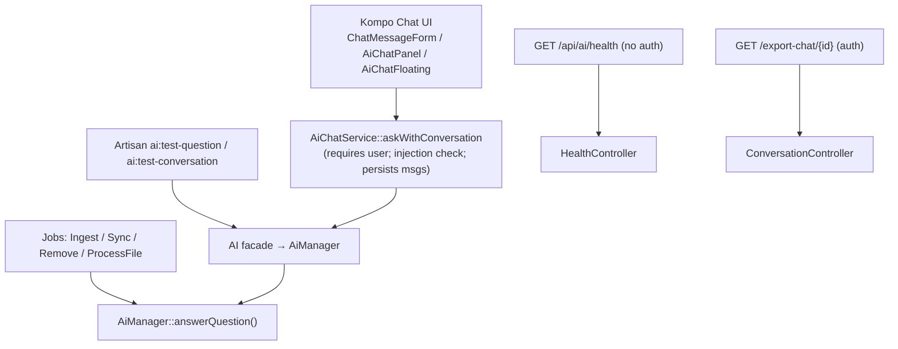
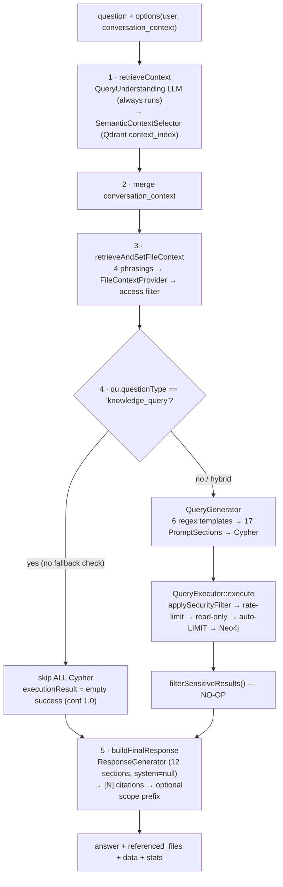
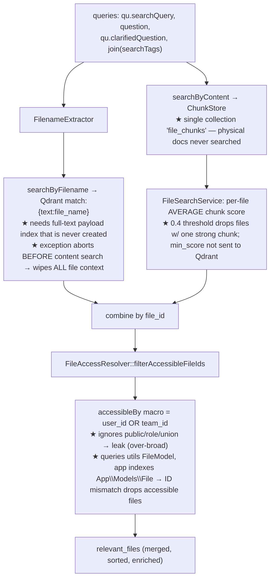
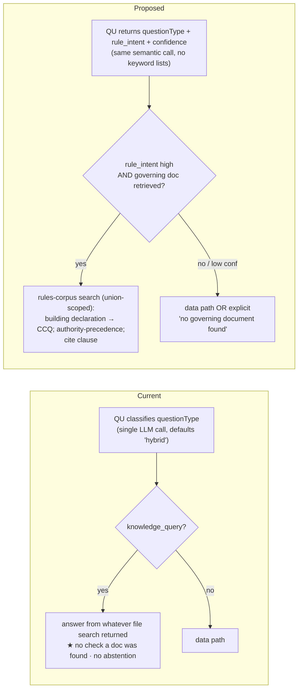

# Condoedge\Ai — Whole-Pipeline Audit, Diagrams & Smart-Agent Design

**Date:** 2026-06-07
**Scope:** Full map + audit of the `Condoedge\Ai` RAG package and its `CondoEdge` consumer — every entry point, configuration, and pipeline stage — plus a design for a "smart agent" that reliably finds **local files & team files** and interprets **rules/bylaws without explicit wording**.
**Method:** 13 subsystem deep-reads + 1 synthesis (14 agents, ~2M tokens, 609 tool calls), each instructed to **distrust comments/docblocks and verify against executable code**. The most consequential claims (security wiring, file access, docs collection) were re-verified by hand. Evidence is cited as `path:line`.

> **Headline:** the happy path works and is well-decomposed around one typed `PipelineContext`. But the system has a wide band of **silent-failure / wrong-answer** modes, **fail-open security** on both the graph and file paths, and **broken file-retrieval plumbing** that causes it to *miss files that exist and are accessible*. The implicit-rules capability exists *in spirit* (the Query-Understanding prompt is genuinely good) but is fragile and, in CondoEdge, has almost no structured rule data to land on.

---

## 1. Entry points (inventory)

| Type | Entry point | Evidence | Notes |
|---|---|---|---|
| Facade | `AI` → `'ai'` → `AiManager` | `src/Facades/AI.php:142` | Public API: `answerQuestion/ask/askQuestion/generateQuery/executeQuery/retrieveContext/generateResponse/retrieveFileContext/ingest/sync/remove`. `@method` docblock is stale. |
| Facade | `FileSearch` → `'file-search'` → `FileSearchService` | `src/Facades/FileSearch.php:151` | Single `file_chunks` collection. |
| UI (prod path) | Kompo chat: `ChatMessageForm`, `AiChatPanel`, `MessagesQuery` (regenerate/suggestion), `EditMessageModal`, `AiChatFloating` | `src/Kompo/*` | Real write path → `AiChatService::askWithConversation`. The JS staging/injector pipeline is **orphaned dead code** (UI re-renders `MessagesQuery` from DB). |
| Route | `GET api/ai/health` (**no auth/throttle**) | `routes/api.php:7`, `HealthController.php:26` | Leaks raw Neo4j/Qdrant exception text to anonymous callers. |
| Route | `GET export-chat/{id}` (web+auth) | `routes/web.php:6`, `ConversationController.php:10` | Owner-scoped by `auth()->id()`. |
| Command | `ai:discover {--enhance}` | `DiscoverEntitiesCommand.php:46` | LLM authors descriptions/aliases/**`cypher_pattern`** with no validation; `var_export` writer corrupts strings containing `)`. |
| Command | `ai:ingest {--docs}` | `IngestEntitiesCommand.php:67` | Uses `BatchDataIngestionService` (**skips PII/sensibleColumns**); `--docs` passes `collection=documentation_chunks` that `FileProcessor` **ignores**. |
| Command | `ai:process-files`, `ai:sync-relationships`, `ai:index-*`, `ai:config:validate`, `ai:enhance`, `ai:test-question`, `ai:test-conversation`, `ai:diagnose` | `src/Console/Commands/*` | `TestConversationCommand` hardcodes `\App\Models\User`. |
| Command | `ai:setup` (**BROKEN**) | `SetupCommand.php:95,101` | Calls non-existent `ai:validate-config` / `ai:ingest-entities` → `CommandNotFoundException`. |
| Jobs | `IngestEntityJob`, `SyncEntityJob`, `RemoveEntityJob`, `ProcessFileJob` | `src/Jobs/*` | Run **outside web auth** → `auth()->user()` is null → graph queries run **unfiltered** (see SEC‑2). |
| Observer | `RelatedModelSyncObserver` (**BROKEN**) | `Observers/RelatedModelSyncObserver.php:156` | Calls `AI::syncRelationships()` which doesn't exist → swallowed `BadMethodCallException`. Incremental re-sync silently dead (edited rule docs go stale). |
| Config | `config/ai.php` + `config/entities.php` | — | See §3. |

---

## 2. Workflow diagrams

### 2.1 Entry points → orchestrator

### 2.2 The answer pipeline (`AiManager::answerQuestion`, `src/Services/AiManager.php:754`)

### 2.3 File & team retrieval — with failure points (★ = bug)

### 2.4 Implicit-rule routing — current vs proposed

---

## 3. Configuration map (`config/ai.php`, 1033 lines)

| Block | Controls | Risk found |
|---|---|---|
| `project.business_rules` | Domain rules injected into prompts | Empty in package; CondoEdge fills some, but **no rule routing** uses them for documents. |
| `security.*` | Team filtering on graph (`permission_chain`, `team_path`, `global_count_permission`) | `on_permission_unexistent => 'bypass'` ships **less safe** than code default `'deny'` (`config/ai.php:181` vs `AiSecurityService.php:38`). |
| `file_context.*` | Dual file model: `physical_paths` (local docs) + `file_model`/`access_scope`/`fallback_filters` (DB/team files) | `file_model => App\Models\File` is **dead** (resolver hardcodes utils `FileModel`); `physical_collection => documentation_chunks` is **dead** (ignored). `min_relevance_score 0.4` mis-applied (avg). |
| `query_understanding.*` | Pre-processing LLM | Documented `confidence_threshold` gate **does not exist in code** — QU always runs. |
| `semantic_context.*` | Vector context selection | Effective threshold 0.45 vs code fallbacks 0.65 (operator confusion). Relationship indexing **dead** (wrong config key). |
| `discovery.*` | Entity config generation | Code reads `ai.auto_discovery.*` not `ai.discovery.*` → `role_mappings`/`excluded_models`/toggles are **inert**. |
| `query_generator_sections` (17) / `response_generator_sections` (12) | Composable prompt | Sent as a **single user message** (`system=null`) — see PROMPT‑1. |
| `entity_actions` / `generic_actions` | Action links | Wired sections, but left **empty** in CondoEdge. |

---

## 4. Audit — weaknesses (109 total: 9 critical · 34 high · 43 medium · 23 low)

### 4.1 Critical

- **SEC‑1 · File access ignores FilePolicy → confidential team files leak as answer text.** `accessibleBy` = `user_id OR team_id` only (`FileAccessScopePlugin.php:42-50`) vs CondoEdge `FilePolicy.php:33-49` (public column + role + union before team). For a *contact*, `safeCurrentTeamId()` is the management team → Qdrant snippets from **every** file with that team_id (other residents' insurance/loans, board minutes) are quoted to the user. No `union_id` → cross‑condo bleed. *Retrieval-layer authz gap; a prompt cannot fix it.*
- **SEC‑2 · Graph team filter keys off `auth()->user()`, ignoring threaded `$options['user']`.** `QueryExecutor.php:620`. In CLI / queues / regeneration / impersonation the user is null or wrong → `filter_applied=false` → **runs across ALL teams**. Fail‑open on the security-critical path; `filterSensitiveResults()` is a no-op backstop (`AiManager.php:1104`).
- **SEC‑3 · Security filter is regex string-injection that silently no-ops.** If `extractPrimaryEntity` can't parse the label (UNION, WITH-chains, multi-label, APOC) → unfiltered (`QueryExecutor.php:627`). `injectTeamFilter` rewrites only the first `RETURN/ORDER` (`:710`) → UNION/subquery branches mis-scoped. No validation that a filter was applied for a sensitive entity.

### 4.2 High (selected — full list in the workflow output)

- **WRONG‑1 · `knowledge_query` hard-skips ALL Cypher on one LLM label, no fallback.** `$hasFileContext` is computed (`AiManager.php:847`) but never checked; confidence reported as 1.0 regardless of whether any doc was found (`:850-858`).
- **WRONG‑2 · No anti-hallucination/abstention instruction anywhere in the live response prompt.** `GuidelinesSection.php:114` pushes "direct answer using the data" even on empty results; `generateEmptyResponse()` is **dead code**. For condo rule questions → fabricated permissions presented to residents.
- **WRONG‑3 · `success:true` + empty data when query *generation* failed.** `cypher=null` short-circuits to success/empty (`AiManager.php:479`, `QueryExecutor.php:80`, `AiManager.php:877`); user gets confident "no results found" for a translation failure.
- **FILE‑1 · Physical docs written to wrong collection.** `FileProcessor` ignores the `collection` option; `--docs` lands in `file_chunks`; `documentation_chunks` never created/queried. The two-collection design is fictional.
- **FILE‑2 · Filename search needs an uncreated Qdrant payload index; its exception wipes ALL file context.** `QdrantChunkStore.php:247` `match:{text:file_name}` + `QdrantStore::createCollection` makes no payload index → a question naming a file can return **zero** context (even content matches that would have worked).
- **FILE‑3 · `min_relevance_score 0.4` applied to per-file AVERAGE chunk score** (`FileSearchService.php:67`) drops a file with one 0.8 chunk + four 0.2 chunks (~0.32). `min_score` never forwarded to Qdrant.
- **PROMPT‑1 · Whole prompt (query-gen AND response) sent as a single user message** (`QueryGenerator.php:207`, `ResponseGenerator.php:244`, `system=null`). Persona, rules, read-only constraint, and the "CAN'T BE OVERRIDDEN" privacy block carry **no system-role weight** and are concatenated with attacker-controllable file snippets → real prompt-injection surface.
- **RULES‑1 · No structured home for declarations/bylaws.** No `Bylaw/Declaration` entity in `config/ai-entities/*`; coverage is incidental semantic match against one shipped `CCQ_Co-ownership_EN.md`. Per-building `règlements` (DB `File` type 20 / `Instruction`) are not graph nodes and nothing routes "can I have a dog?" to them.
- **DISC‑1 · LLM-authored `cypher_pattern` injected verbatim as "USE THIS EXACT PATTERN" with zero validation** (`AiConfigEnhancer.php:215` → `DetectedScopesSection.php:110`). Several CondoEdge File scope patterns are already syntactically broken.
- **DISC‑2 · `role_mappings`/`excluded_models`/toggles read a non-existent config key** (`ai.auto_discovery.*` vs `ai.discovery.*`) → role-based scopes never generate.
- **CTX‑1 · QU-rewritten `searchQuery` never used for graph/entity selection** (`ContextRetriever.php:243` embeds the raw question) — the central recall benefit is discarded for graph retrieval.
- **PII‑1 · `ai:ingest` (batch path) does NOT exclude sensible/PII columns** (`BatchDataIngestionService.php:391`) — SSN/medical/email embedded into Qdrant.

### 4.3 Notable medium/low

`my pets` user_entity_path uses a non-existent relationship type → "you have no pets" (`config/ai.php:592`). Conversations team-scoped on write but not read → cross-team cache leak. `FileProcessor` can't resolve S3/non-local disks → cloud files silently skipped. Read-only gate omits `CALL/LOAD CSV/DROP/FOREACH`. Physical-file citation crashes the whole message render (`MessagesQuery.php:476` `FileModel::find` → null). Hardcoded EN/FR keyword/regex lists drive live control flow (violates the project's no-hardcoded-semantics rule and breaks bilingual). `/api/ai/health` info leak. Selecting Anthropic embeddings silently breaks all ingestion.

---

## 5. Answers to the three core asks

### 5.1 Can it reliably find **local files** and **team files**? — *Partially; multiple confirmed gaps.*
- **Local/physical docs:** effectively **not retrievable** today — wrong collection (FILE‑1), filename search throws and wipes context (FILE‑2), and `FilenameExtractor`/extractors miss `mdx/rst/log`.
- **Team DB files:** path is wired but **over-broad** (SEC‑1 leak) and **mismatched** (resolver queries utils `FileModel`, app indexes `App\Models\File` → accessible IDs may not line up → legit files silently dropped). Plus FILE‑3 scoring, S3 skip, and queue/observer staleness.
- **Fix order:** create the `file_name` payload index + isolate sub-searches; best-chunk scoring + forward `min_score`; make `accessibleBy` reproduce `FilePolicy` (role + `linkedUnionIds` + public) and point at `App\Models\File`; honor/merge collections; resolve content via `Storage::disk()`.

### 5.2 Can it interpret **rules without explicit wording**? — *Mechanism exists, but fragile & under-grounded.*
- **What works:** the QU prompt (`QueryUnderstandingService.php:132-135`) already classifies "Can I tear down a wall?" as `knowledge_query` and emits regulatory/French `search_tags` + `clarified_question` — **pure semantics, no keyword list**. `knowledge_query` then answers from documents.
- **Gaps:** no confidence gate (defaults to `hybrid`); no abstention; `clarified_question` only feeds *file* search (not Cypher/response); and CondoEdge has **no rules corpus modeled** — règlements live as `Instruction` records / `File` type 20 / the CCQ markdown, unlinked from `Union`.
- **Add (LLM-driven):** QU returns `rule_intent` + `confidence`; gate the Cypher-skip on confidence **and** non-empty governing doc; a rules-corpus routing step (union-scoped `Instruction` + `File` type 20 + `Resource.description` + CCQ) with an **authority-precedence** instruction (building declaration overrides generic CCQ); model a `Bylaw/Declaration` concept (or formalize type 20) with embeddings + `Union→declaration` link; abstain when no doc is found.

### 5.3 Prompting & Security (summary)
- **Prompt:** structurally sound (sensible ordering, conditional sections, bilingual rule) but undermined by `system=null` (PROMPT‑1), **no abstention**, internal contradictions (privacy section forbids IDs while `ResponseEntityActionsSection` emits `Person/152463`), a fictional "URGENCE mode" instruction, and ALL-CAPS emphasis dilution.
- **Security:** graph filtering is **real but fail-open** on user-identity and unparseable-query axes; file filtering is **real but doesn't reproduce the app's authorization model**; result-filtering/audit-log/role-union/conversation-team-scoping are **not** wired.

---

## 6. Proposed remediation roadmap

> Full sketches (files + approach) are in the workflow synthesis. Condensed:

**P0 — correctness & confidentiality (block any resident-facing rollout)**
1. File access reproduces `FilePolicy` (role + union + public) and targets the indexed `App\Models\File`. *(fixes leak **and** missed files)*
2. Thread `$options['user']` into `QueryExecutor`; **fail closed** when a sensitive entity can't be filtered; ship `on_permission_unexistent='deny'`.
3. Gate `knowledge_query` on confidence **and** file presence with a data fallback.
4. Add grounding/abstention to the response prompt; wire `generateEmptyResponse()`.

**P1 — the "smart agent" the user asked for**
5. Fix file-retrieval plumbing: payload index, per-search isolation, best-chunk scoring, collection routing, `Storage::disk()`.
6. Confidence-gated `rule_intent` + rules-corpus routing (LLM/semantic, no keyword lists) with authority precedence.
7. Move persona/rules/privacy into the **system** prompt; delimit untrusted content; remove "URGENCE mode".
8. Use `qu.searchQuery` for graph/entity selection; align thresholds; fix relationship indexing.
9. Apply PII/sensibleColumns on the batch ingest path.

**P2 — hygiene**
10. Unify discovery config namespace; lint enhancer-produced Cypher in `ai:config:validate`.
11. Fix `ai:setup`, `RelatedModelSyncObserver`, `/api/ai/health`, physical-file UI crash, conversation team-scoping; rotate the committed OpenAI key.

---

## 7. Open product decisions (gate the implementation)

1. **Audience / blast radius:** is AI chat exposed to *residents (contacts)* or *management-only*? Determines whether SEC‑1 is an active confidentiality leak that blocks rollout.
2. **Rules data model:** dedicated `Bylaw/Declaration` entity (+`Union→declaration` link + embeddings) vs. formalizing existing `Instruction` + `File` type 20 as "the rules corpus".
3. **Security default** when an entity has no Permission record: `deny` (safer) vs current `bypass`.
4. **Conversation scoping:** team-scoped or intentionally user-global?
5. **Rule answers:** require confidence gating / abstention before stating permission-or-prohibition to residents?
