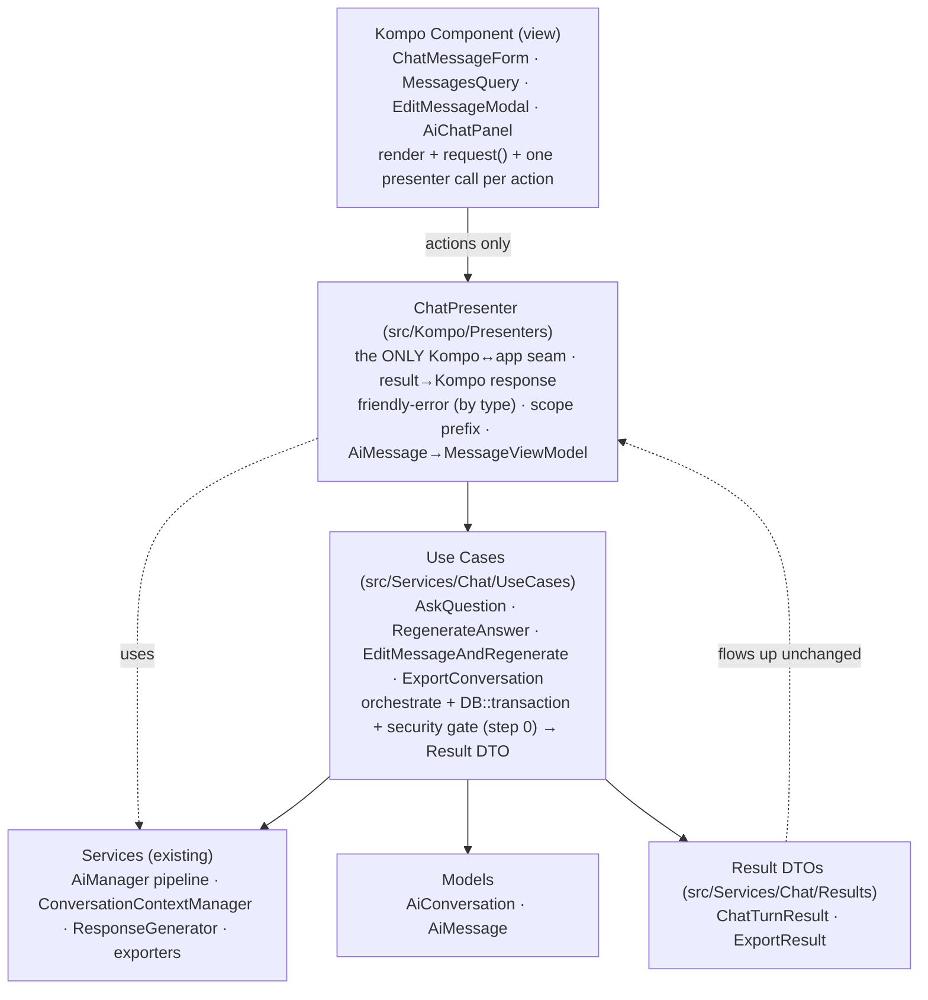

# Condoedge\Ai — Clean-Architecture Design (Presenters / Use Cases / Services)

**Date:** 2026-06-07
**Goal:** Separate AI-response generation and chat-conversation logic **out of Kompo components**, connected only through **Presenters**, with **Use Cases** and **Services** underneath — modeled on `../Sisc`, **without overengineering** — plus concrete robustness, prompt, response-quality, traceability, and Kompo-component improvements.
**Method:** 7-agent workflow (Sisc pattern study ×3, package problem-map ×3, synthesis) + firsthand validation of `ApproveInscriptionUseCase`/`InscriptionApprovalPresenter` and the package's `ChatMessageForm`/`AiChatService`. **67 package issues** found (15 layering, 14 Kompo, 15 robustness, 10 prompt/response, 13 traceability).

> The package today has **no** presenter or use-case layer (`glob src/**/*Presenter*.php` is empty), so Kompo components reach straight into services via `app()` and into Eloquent. We borrow only what removes the *real* coupling.

---

## 1. The Sisc pattern we're copying (and the part we're not)

From `InscriptionApprovalPresenter.php:9-11` (Sisc's own words): *"Presenters keep services isolated from Kompo. The domain orchestration lives in the UseCase, the Presenter only translates domain results into Kompo responses … **more testable than traits** and clearer."*

- **Use Case** (`app/Services/{Domain}/UseCases/{Verb}{Noun}UseCase.php`): concrete, container-autowired (never bound, never interfaced), one `execute()` (or domain-verb methods), injects **service *contracts***, wraps multi-writes in `DB::transaction`, returns an **immutable Result DTO** (`ApprovalResult` w/ `failed()`/`error`), fires events. No Kompo/HTTP.
- **Presenter** (`app/Kompo/**/Presenters/`): plain class, injects the use case, `handleX()` checks `$result->failed()` → returns `response()->kompoMulti([closeModal, successAlert, …])`. The **only** layer that knows Kompo responses; a `void` twin `abort()`s where a response can't be returned.
- **What we do NOT copy:** `*UseCaseContract`/`*PresenterInterface`, command bus, repository tier, per-method Result classes, per-domain folder trees, and the whole `ComplianceValidation` framework (BaseRule/RulesGetter/schedules). The package is essentially **one domain** (chat/RAG).

---

## 2. Target architecture

**Dependency rules (strictly inward):** `Kompo → Presenter → UseCase → Service → Model`.
- No UI vocabulary (`response()`, `_Link`, `closeModal`) **below** the presenter (today `FileCitationHandler.php:115` builds `_Link()` inside a Service — violation).
- No business logic / persistence / transactions **above** the use case.
- Only **Service contracts** get provider bindings; presenters & use cases are concrete & autowired.

---

## 3. Class-by-class mapping

| Current | Action | Target layer | Why |
|---|---|---|---|
| *(none)* | **new** | Presenter | `ChatPresenter` — single seam for send/regenerate/edit/feedback/pin/archive/delete. |
| *(none)* | **new** | Use Case | `AskQuestionUseCase`, `RegenerateAnswerUseCase`, `EditMessageAndRegenerateUseCase`, `ExportConversationUseCase`. |
| *(none)* | **new** | Result DTO | `ChatTurnResult`, `ExportResult` (readonly, `failed()`). |
| `AiChatService::askWithConversation` / `regenerateResponse` (~80% dup, `AiChatService.php:79-291`) | **split** | Use Case | Collapse into one private flow parameterized by `persistUserMessage`. Error-mapping + view-array move **up** to presenter; security gate moves **into** use case as step 0. |
| `RegenerateMessageService` | **move** | Use Case | Its truncate+delegate (`:36-57`) *is* `RegenerateAnswerUseCase`; gives the delete-trailing rule one home. |
| `AiManager` (1100-line god) | **split** | Service | Keep AI facade surface; extract `answerQuestion` pipeline → `AnswerQuestionPipeline`, Cypher (de)parameterization → `CypherParameterizer`; move scope-prefix `lcfirst` (`:900-910`) **up** to presenter. |
| `AiConversation::addMessage` (writes `context_snapshot` via refresh+merge, `:215-223`) | **extract** | Service | Three writers of one JSON column → `ConversationContextManager` becomes sole writer. |
| `ResponseGenerator` (600+ lines) | **split** | Service | Extract `InsightExtractor` (`:428-464`) + `VisualizationSuggester` (`:473-605`); keep `generate()`/`buildPrompt()`. |
| `generateEmptyResponse` (defined, interfaced, **never called**) | **keep+wire** | Service | Call from `AskQuestionUseCase` when data AND files empty; add logging to its silent catch. |
| `QueryInfoSection` (feeds Cypher into response prompt) | **delete** | Service | Contradicts `PrivacyAndSecurityGuidelinesSection`; gate behind `style==='technical'` if kept. |
| `HasStagedMessageRendering` + staging panel + `processServerResponse` JS | **delete** | View | Fully orphaned at runtime (only tests reference it); live flow is `precreateMessagePlaceholder` + `->refresh()`. |
| `HasConversationCreation` + `HasMessageActions` traits | **extract** | Presenter | Logic moves into `ChatPresenter`; removes the `property_exists`/session reflection in `getConversationForAction` (`:73-92`). |
| `HasChatTheme`/`HasChatSettings`, `ConversationListQuery`, `ChatHelpModal`, `TypingIndicator` | **keep** | View | Already thin; only move the inline `user_id` ownership rule to the presenter and unify the typing-animation HTML. |
| `ExportConversationMdService` | **keep+fix** | Service | Declare `implements ExportConversationServiceInterface`, add `getMimeType()`, resolve via `app()->make` in the factory. |

---

## 4. Presenter & use-case design

**`ChatPresenter`** (plain class, `app(ChatPresenter::class)`, like `InscriptionApprovalPresenter`): injects the use cases + `AiChatServiceInterface`. Handlers: `handleSend / handleRegenerate / handleEditAndRegenerate / handleFeedback / handleTogglePin / handleArchive / handleDelete` (the **single** `user_id=auth()->id()` ownership check, today copy-pasted in 5 files), plus `presentMessage(AiMessage): MessageViewModel` — the read-only mapping (SafeMarkdownRenderer + split ContentLink parser/renderer + **null-guarded** `FileModel::find`, fixing the `MessagesQuery.php:478` crash) so the view lays out primitives. `friendlyError(Throwable)` maps by **exception type** (not substring) to `ai.chat.error-*` keys; the scope prefix lives here too.

**Use cases** (`src/Services/Chat/UseCases`, `execute()`, autowired, not bound):
1. `AskQuestionUseCase::execute(AskQuestionInput): ChatTurnResult` — in `DB::transaction`: **step 0** `ChatSecurityGuard::assertSafe` (today inconsistently ordered between `:103-109` and `:222-225`) → context → store user msg → RAG → record (single snapshot write) → store assistant msg → return `ChatTurnResult{assistantMessage, answer, data, suggestions, sources, ?error, ?degraded}`. Empty data **and** empty files → abstention branch (`generateEmptyResponse`).
2. `RegenerateAnswerUseCase` — owns trailing-message truncation (one home for the rule duplicated in `RegenerateMessageService.php:47-49` + `EditMessageModal.php:151-153/186-188`); shares the private flow with `persistUserMessage=false`.
3. `EditMessageAndRegenerateUseCase` — update content + truncate + regenerate in one transaction (collapses the modal's two duplicate methods + double-delete).
4. `ExportConversationUseCase` — authorize + resolve exporter via container + `getMimeType()/getFileExtension()`; controller returns those three fields (fixes hardcoded `text/markdown` at `ConversationController.php:25`).

Persistence stays **inside** the use cases (Eloquent + `DB::transaction`, no repository tier — Sisc touches Eloquent directly). Tests: `tests/Feature/Services/Chat`, resolve the real use case via `app()`, mock `AiChatServiceInterface` via `app->instance()` (exactly как Sisc).

---

## 5. Robustness / prompt / response-quality / traceability improvements

**Robustness:** (1) send the security/role block as a **real system prompt** (today `ResponseGenerator.php:244` passes `system=null`); (2) explicit **abstention** branch on empty data+files + a non-negotiable anti-fabrication line; (3) security gate as **step 0**, identical in both flows; (4) fix export mime/DI bugs; (5) **single-writer** `context_snapshot`; (6) classify errors by **exception type**, not substring (breaks in FR); (7) fix `isAvailable` null-key concat + `?string` Cypher mismatch.

**Prompt:** (1) delete the **schema-leak contradiction** (`QueryInfoSection` feeds Cypher while privacy section forbids revealing schema); (2) rewrite the privacy block as a tight system policy — remove the **"URGENCE mode"** that a single false-positive permanently bricks → "decline this request and continue"; (3) make link/citation instructions **style-aware** (minimal/concise vs action-links contradiction); (4) relax QU "**exactly 10 tags**" → "5–10 high-precision, no padding".

**Response quality:** (1) stop **silently dropping** the chat system prompt (`AiChatService.php:59-74` builds it, `:125-130` ignores it); (2) move user-facing copy + scope prefix to **translation keys** (drop `lcfirst` that corrupts FR capitals/acronyms); (3) **single source of truth for citations** (3 duplicated regex paths; a literal `[12]` becomes a link); (4) **return the created `AiMessage`** so the view renders it directly instead of re-querying "latest assistant" (race-prone, `ChatMessageForm.php:182-192`).

**Traceability:** (1) put regenerate **on the interface** (today un-interfaced → `config('ai.chat.service')` swap can't override it); (2) delete the orphaned staging pipeline whose comments **claim a flow that doesn't run**; (3) collapse the **four** duplicate send routines; (4) remove dead `getSchemaForContext` branch + `MessagesQuery`'s re-implemented feedback/regenerate; (5) replace reflection-based conversation lookup with explicit passing.

**Rules pattern:** keep `HasInternalModules` (it's already a config-registry + Template-Method pipeline — the good part of Sisc's `RulesGetter`); the one upgrade: tag each section with a `role` (`system|context|instructions`) so the builder returns `{system, context, instructions}` and we get real chat roles. Do **not** import the ComplianceValidation framework.

---

## 6. Do-NOT (anti-overengineering guardrails)

No `*UseCaseContract`/`*PresenterInterface` · no command bus · no repository tier · no Result-DTO-per-method · no ComplianceValidation framework · no deep per-domain folder tree (one `src/Services/Chat/{UseCases,Results}` + `src/Kompo/Presenters`) · no presenter-per-component (only for `ChatMessageForm`/`MessagesQuery`/`EditMessageModal`) · no wizard/state-machine · no new class per section for role-tagging.

---

## 7. Phased migration (incremental, additive, ships value each phase)

- **Phase 0 — delete dead weight (no behavior change, LOW risk):** orphaned staging/injector pipeline, dead `getSchemaForContext` branch, `QueryInfoSection` from defaults, make `MessagesQuery` use `HasMessageActions`.
- **Phase 1 — introduce use cases under existing services (MED):** `ChatTurnResult`; `AskQuestionUseCase` (extract `askWithConversation`, security step 0, transaction); `RegenerateAnswerUseCase`/`EditMessageAndRegenerate`; old services delegate to them; wire `generateEmptyResponse`.
- **Phase 2 — `ChatPresenter` + route ONE component (MED):** `ChatPresenter` (handleSend + presentMessage + friendlyError + scope prefix); rewrite `ChatMessageForm` to one presenter call; `ChatTurnResult` carries the `AiMessage`.
- **Phase 3 — route remaining components + slim views (MED):** `MessagesQuery`/`EditMessageModal` through the presenter; `RichDataRenderer`; render bubbles from `MessageViewModel` (removes ContentLink/SafeMarkdown/FileModel from views, fixes the crash).
- **Phase 4 — structured prompt + export + cleanup (MED):** `role` accessor on sections → `{system,context,instructions}` → real system prompt; rewrite privacy policy; style-aware citations; exporter `getMimeType()` + `ExportConversationUseCase`; split `InsightExtractor`/`VisualizationSuggester` + ContentLink parser/renderer; single-writer snapshot.

---

## 8. Open questions (gate the work)

1. **Non-Kompo consumers** (HTTP API / queue / CLI like `TestQuestionCommand`) now or planned? → makes the split mandatory vs even thinner.
2. **PDF/TXT exporters** coming (commented at `ExporterConversationFactory.php:8-9`)? → moves the mime/DI fix earlier.
3. Keep `SendMessageService`/`RegenerateMessageService` as **thin guards** delegating to use cases, or remove entirely?
4. `ExportConversation` — own presenter, fold into `ChatPresenter`, or leave in controller?
5. Is regenerate meant to be **swappable** via `config('ai.chat.service')` like ask?
6. **"URGENCE mode"** — keep the irreversible conversation-bricking, or decline-and-continue (recommended)?
7. Confirm **FR + EN equal priority** so I move every hardcoded English string to translation keys.

> **Relationship to the earlier plan:** the prompt/abstention/robustness items here overlap with Phase D of `2026-06-07-smart-agent-implementation-plan.md`; do them **once**, via this architecture's Phase 4. The file/team retrieval (smart-agent Phase B) and rules-corpus routing (Phase C) are orthogonal and slot in at the Service layer.
