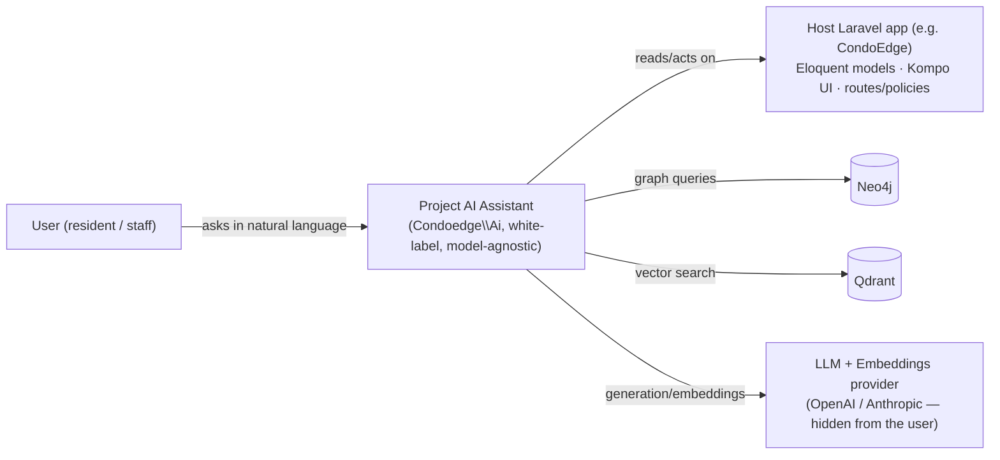
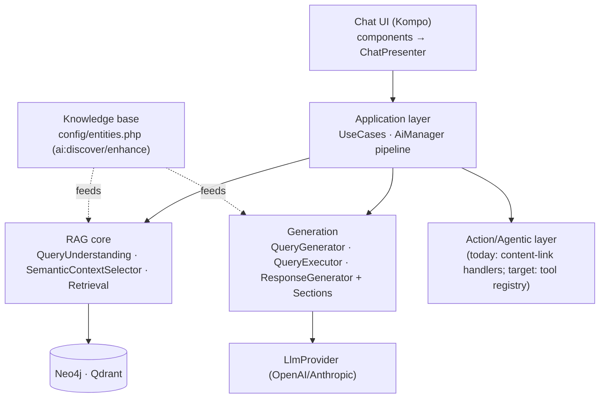
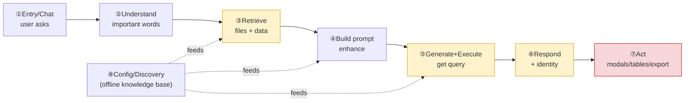

# Condoedge\Ai — Next-Level RAG Audit (layered, for review)

**Date:** 2026-06-07 · **Scope:** the AI package only (CondoEdge comes after you review).
**Method:** 16-agent workflow — 4 web/SOTA research + 8 C4 per-box value-audits + 4 designs (eval, prune, agentic actions, identity/prompts/tokens), cross-checked firsthand.
**How to read this:** §2 is the overall picture (C4 + flow). §3 walks each **layer/box** with a verdict, what to **add**, what to **improve**, what's **questionable/half-done**, and a **file checklist** to review. §4 is the four designs. §5 is the prioritized roadmap.

---

## 1. Verdict — is it a next-level RAG or a dumb bot?

**Neither yet — it's a sophisticated-but-half-finished pipeline that currently behaves more modestly than its parts allow.** It already has the right bones: an LLM **Query-Understanding** step (no hardcoded keyword lists), **semantic context selection** that genuinely saves tokens, a **modular config-driven prompt pipeline**, dual-store retrieval, security, and files. But five things hold it at "describe-only chatbot":

1. **No model-agnostic identity** — *nothing in the codebase stops it saying "I'm Claude/GPT,"* and the only project-named persona is dead code. (Your explicit ask.)
2. **`system` role is always `null`** — persona **and** the priority-1000 security policy ride in the *user* message next to untrusted file content → weak adherence + the cheapest injection hole.
3. **Retrieval is recall-biased, precision-thin** — **no re-ranking, no hybrid (dense+sparse)**, model-specific cosine thresholds; the right doc is often in the top-20 but not the top-5 that survive.
4. **The "rephrase to ground anything" promise is half-wired** — QU's `clarifiedQuestion`/`searchQuery` improve **file** search only; **data/Cypher grounding still runs off the raw question**.
5. **"Acting in-app" is closures-in-config + markdown-regex** — no real tool-calling, **no approval gate, no table injection, no Excel/PDF**; ships empty.

Plus a meaningful amount of **half-done/dead weight** (orphaned staging pipeline, dead presenter methods, two parallel semantic indexers, inert config keys, unused budget/confidence functions). The good news: **~80% of the agentic capability already exists** (closure registry, Kompo render substrate, export DTO/factory) — the missing keystone is provider tool-calling.

---

## 2. The overall picture (C4)

### C4 L1 — System Context

### C4 L2 — Containers

### Overall pipeline flow (the 8 boxes)

*(yellow = highest-leverage improve; red = biggest capability gap)*

---

## 3. Layer-by-layer (review each box)

### ① Entry / Chat / Conversation — **IMPROVE (finish the migration, delete the dead half)**
The Presenter/UseCase/Result/SecurityGuard refactor is good and should become the **only** path, but today **three parallel send/regenerate/edit implementations** coexist (presenter path, legacy services, orphaned staging).
- **Add:** route ALL turns (send/regenerate/edit/suggestion) through `ChatPresenter`; surface `degraded`/soft-failure in the UI (the result is currently discarded); conversation-context **budget + pruning**; wire proposed-actions into `ChatTurnResult`; optional token **streaming**.
- **Improve:** `ChatMessageForm` discards the `ChatTurnResult` then re-queries; `MessagesQuery`/`EditMessageModal` bypass the presenter with inline raw `DELETE`; 3 copies of substring error-mapping still exist.
- **Questionable/half-done:** the **entire staging pipeline** (`HasStagedMessageRendering` + `temp-message-staging` + ~250 lines injector JS) is dead; `handleRegenerate`/`handleEditAndRegenerate` + `EditMessageAndRegenerateUseCase` orphaned; `getLatestMessages`, `updateEntityContext` write-only.
- **Checklist:** `src/Kompo/{ChatMessageForm,MessagesQuery,AiChatPanel,Modals/EditMessageModal,Presenters/ChatPresenter}.php`, `src/Kompo/Traits/HasStagedMessageRendering.php`, `src/Services/Chat/{AiChatService,SendMessageService,RegenerateMessageService}.php`, `src/Services/Chat/UseCases/*`, `src/Services/Context/ConversationContextManager.php`, `resources/js/chat-message-injector.js`.

### ② Query Understanding — **KEEP & strengthen** (highest-leverage box for grounding)
One LLM call, no keyword lists — the right bet. But its rephrase only helps file search.
- **Add:** LLM follow-up/coreference (delete the legacy regex `EntityExtractor`/`ReferenceResolver` keyword lists — they violate the no-hardcoded-semantics rule); an **answerability/grounding self-check** (ask ONE clarifying question instead of returning nothing); an **action-intent** signal; two-tier cheap-classify to skip doc-only fields on data queries.
- **Improve:** validate `entityTypes` against the catalog (hallucinated labels get injected at score 0.8); feed `clarifiedQuestion`/`searchQuery` into **Cypher gen + entity re-selection** (today data grounding ignores the rephrase); relax "**exactly 10 tags**".
- **Questionable/half-done:** `confidence_threshold` config is **never read**; `searchTags` forced-but-discarded for data queries.
- **Checklist:** `src/Services/QueryUnderstandingService.php`, `src/DTOs/QueryUnderstandingResult.php`, `src/Services/Context/{EntityExtractor,ReferenceResolver,FilenameExtractor}.php`, `src/Services/ContextRetriever.php`.

### ③ Retrieval — **KEEP + IMPROVE** (the single most value-defining box)
Semantic-first selection is right and token-efficient, but **recall-biased, precision-thin**.
- **Add:** a **re-ranker** (cross-encoder or cheap LLM) over the merged candidates — *the highest-leverage precision win*; **hybrid dense+sparse + RRF** (Qdrant supports sparse natively) for IDs/codes/French legal terms; **score normalization across unioned collections** + composite file IDs (physical vs DB id collision); a **real retrieval-confidence** signal feeding a rephrase loop (`getContextConfidence` already exists, unused); multi-query expansion on the doc path.
- **Improve:** `getExampleEntities` does `RETURN n` (all properties → PII/token bloat) → project configured props; centralize the scattered **model-specific cosine thresholds**; snippet truncation cuts mid-word.
- **Questionable/half-done:** **two parallel semantic indexers** (`SemanticIndexer` vs `SemanticContextSelector::indexContext`); `SemanticMatcher` unused; `getContextWithBudget`/`getContextConfidence` never called; `ScopeSemanticMatcher` hardcoded English stopword list (latent landmine).
- **Checklist:** `src/Services/{ContextRetriever,SemanticContextSelector,SemanticMatcher,ScopeSemanticMatcher,SemanticIndexer,FileSearchService,QdrantChunkStore}.php`, `src/Services/Context/{FileContextProvider,FileAccessResolver}.php`, `src/VectorStore/QdrantStore.php`.

### ④ Prompt building — **KEEP the architecture, IMPROVE the content**
Modular, priority-ordered, config-driven — the package's strongest asset.
- **Add:** **move stable instructions to a real system prompt** (role tag per section) — unlocks adherence + caching; relevance-gate `PatternLibrary` (today dumps ALL patterns); make the persona **project-branded & stack-agnostic** (it hardcodes "Neo4j Cypher expert"); consume the unused QU signals (`clarifiedQuestion`/`intent`/`questionType`).
- **Improve:** the same 4 rules are repeated up to **4×** across sections; `GenericContextSection` gated by a hardcoded English `TIME_KEYWORDS` list.
- **Questionable/half-done:** the entire `HasInternalModules` before/after-callback + global-extensions machinery is **never invoked**; `SemanticPromptBuilder::minimal()/simple()` unused; QU fields `intent/questionType/clarifiedQuestion/searchTags` **never read by any section**.
- **Checklist:** `src/Services/{SemanticPromptBuilder,HasInternalModules,PatternLibrary}.php`, all `src/Services/PromptSections/*`, `src/Services/QueryGenerator.php` (the `system=null` call).

### ⑤ Query generation + execution — **IMPROVE (harden security)**
Templates + retry-with-error-feedback are sound; three trust problems undermine it.
- **Add:** **schema-grounded validation** of LLM Cypher before execution (today only regex); an execution-feedback self-heal loop; **Cypher-aware, parameterized team-filter** injection; **fail-closed** security posture (`on_permission_unexistent → deny`); one unified `CypherPolicy`.
- **Improve:** security is **fail-open** by default and injected via brittle regex string-splicing; `injectTeamFilter` ignores `WITH`/`UNION` (and its docblock describes logic it doesn't implement — a test asserts behavior the code lacks); `AiQueryLog` records `question='N/A'` on the real path; the timeout is never actually sent to Neo4j (cosmetic).
- **Questionable/half-done:** `executeCount/Paginated/explain/test/cancel` unused; 6 hardcoded English regex templates with `rtrim('s')` singularization; `calculateConfidence`/`calculateComplexityScore` are theatre; `sanitize()` never called in the live path.
- **Checklist:** `src/Services/{QueryGenerator,QueryExecutor}.php`, `src/Services/Security/*`, `src/GraphStore/*`.

### ⑥ Response + Identity — **IMPROVE (identity is P0)**
Section pipeline, styles, citations are valuable; it fails two north-star requirements.
- **Add:** a real **`IdentitySection`** (project persona + "never reveal the model/provider") delivered via the **system role**; route persona+security → system, data → user; grounding/abstention path (`generateEmptyResponse` is defined but **never called**); advertise richer ACT verbs (export/modal/table) to the model.
- **Improve:** `complete($prompt, null)` → split by role; `SystemPromptSection` is a generic "data analyst", not the project's assistant; the project-named persona in `AiChatService` is **dead plumbing**.
- **Questionable/half-done:** `ResponseGenerator` setters (`setSystemPrompt`/`setProjectContext`…) never invoked; `ResponseEntityEnricher` output has no consumer; `suggestVisualizations` greps Cypher for chart guesses no one renders; `generateEmptyResponse` dead.
- **Checklist:** `src/Services/ResponseGenerator.php`, all `src/Services/ResponseSections/*`, `src/Services/Response/*`, `src/Services/Chat/AiChatService.php` (dead persona).

### ⑦ Actions / Agentic — **IMPROVE (substantial — biggest capability gap)**
Today: the LLM emits markdown links, regex-parsed into **PHP closures stored in config** (ships empty). No params, no approval, no tables, no export; the JS-injection path for entity/generic actions is **knowingly unhandled** (console.warns).
- **Add (the design):** a model-agnostic **Action/Tool registry** with typed `inputSchema` + defaults; **native tool-calling** on both providers; **approval-required** primitive (server-side Gate re-check before any mutation); **table/component injection**; **Excel/PDF** exporters; `ai:discover --suggest-actions`.
- **Improve:** the actions section feeds raw IDs into the prompt while the privacy section forbids revealing IDs (**self-contradiction**); missing resolvers are silently dropped (no telemetry).
- **Questionable/half-done:** `MessagesQuery::entityActionLink/genericActionLink` dead; `EntityAutoDiscovery::getActionResolver` `@deprecated`; `ResponseEntityEnricher` no-op.
- **Checklist:** `src/Services/Response/{ContentLinkProcessor,ActionLinkHandler,FileCitationHandler,ResponseEntityEnricher}.php`, `src/Services/PromptSections/EntityActionAwarenessSection.php`, `src/Services/ResponseSections/ResponseEntityActionsSection.php`, `config/ai.php` (entity_actions/generic_actions), `src/Kompo/MessagesQuery.php`, `resources/js/chat-message-injector.js`, `src/Services/Chat/Exporter/*`.

### ⑧ Config / Entities / Discovery — **KEEP, targeted improvements** (the knowledge base)
The enhancer (iterative test-feedback) is the most differentiated asset; discovery **only adds, never prunes** → context noise.
- **Add:** **per-entity action discovery** (`--suggest-actions`); **entity value-scoring + pruning** (`ai:prune` design); alias de-dup against embedding space; an enhancer-output Cypher validation gate.
- **Improve:** **inert config keys** — code reads `ai.auto_discovery.*` while config defines `ai.discovery.*`, so role-mappings/excluded-models/toggles are all dead; `AliasGenerator` ships a hardcoded EN/FR condo synonym map (not reusable, violates no-hardcoded-semantics); over-emits bidirectional + FK-inferred relations and trivial property descriptions.
- **Questionable/half-done:** `TraversalScopeGenerator.getDefaultMappings` always `[]`; the whole `ai.discovery` toggle block is documentation-only; enhancer never produces the `entity_actions` everything downstream references.
- **Checklist:** `src/Services/Discovery/*`, `src/Console/Commands/{DiscoverEntitiesCommand,EnhanceConfigCommand}.php`, `config/ai.php` (discovery block), `config/entities.php`.

---

## 4. The four designs (concise)

- **`ai:eval` — closed-Q&A eval with per-stage attribution.** Auto-generates questions from configs (label-free), drives the real pipeline stage-by-stage, **verifies context was retrieved first**, gets the answer, grades it (faithfulness/grounding/relevance/usefulness via cheap LLM-judge), and **attributes failure to the weakest stage** (understanding/retrieval/prompt/generation) → a per-stage scorecard. Reuses `TestQuestionCommand`'s stage walk + `TestConversation` JSON; skips gracefully offline. *Prerequisite for safely adopting every other change — turns "feels off" into a number.*
- **`ai:prune` — value-scored entity pruning.** Scores each entity (query-relevance, ambiguity via embedding-collision, redundancy, retrieval-usefulness from `AiQueryLog`); recommends KEEP/**DEMOTE**(strip from index, keep graph)/**PRUNE**(reversible `ai_pruned` flag). Report-first, reversible, config-driven. *Closes discovery's one-way ratchet → sharper selection, fewer tokens.*
- **Agentic Action System.** `AiAction` contract (key, `inputSchema`, presentation, `requiresApproval`, `authorize`, `handle`) + registry + `AiToolCompiler` → provider-native tools; `chatWithTools()` on both providers; `ActionResponseOrchestrator` runs validate→authorize→execute-or-defer; **approval cards** for mutations; generative-UI actions (open_modal/render_table/export_excel/export_pdf) ship built-in; backward-compatible with today's closures. *~80% of the substrate already exists; the keystone is provider tool-calling.*
- **Model-agnostic Identity + Prompt overhaul + Token efficiency.** One `config('ai.identity')` (name/persona/language + **non-disclosure rule**); **true system/user role separation** across all three prompts (fixes `system=null`, hardens the priority-1000 policy, unlocks caching); **spotlight** untrusted file/question content ("data, not instructions"); de-duplicate the 3× guidelines; `config('ai.prompt')` token caps. *Cheapest, highest-value cluster.*

---

## 5. Prioritized roadmap

**P0 — cheap, high value, low risk (do first)**
1. **Model-agnostic identity + role separation** (`IdentitySection`, `system` prompt split, non-disclosure rule, spotlighting). Box ④⑥. *Your explicit ask; also hardens security & injection.*
2. **Wire QU rephrase into data grounding** (`clarifiedQuestion`/`searchQuery` → Cypher gen + a 2nd entity-selection pass). Box ②④. *Makes "ground anything" real.*
3. **`ai:eval` harness** — so every later change is measured, not guessed. *Prerequisite.*
4. **Finish the chat migration + delete the dead staging/half-done** (route all turns through the presenter). Box ①. *Removes drift risk + dead weight.*
5. **Fail-closed security + parameterized team filter.** Box ⑤. *Multi-tenant trust.*

**P1 — capability/quality**
6. **Re-ranking + hybrid (dense+sparse)+RRF + score-normalization.** Box ③. *The precision leap.*
7. **Agentic Action System** (tool registry + tool-calling + approval + tables + Excel/PDF). Box ⑦.
8. **De-dup + relevance-gate prompts; consume QU signals; centralize thresholds.** Box ④③.

**P2 — hygiene/scale**
9. **`ai:prune`** + fix inert discovery config keys + alias de-dup. Box ⑧.
10. Consolidate the duplicate semantic indexers; remove dead executor/builder surface; schema-grounded Cypher validation.

**Token efficiency (cross-cutting):** move static rules to a cached system prefix; relevance-gate PatternLibrary; cap example-row properties (`RETURN n` → projection), file snippets, and `last_result_sample`; make `searchTags` conditional; centralize thresholds. The audit estimates **30-50% of fixed prompt overhead** is removable with no quality loss.

---

## 6. Open questions
1. Re-ranker: cheap **LLM-as-reranker** (PHP-only, model-agnostic) vs a self-hosted cross-encoder service? (Package is PHP-only — LLM reranker keeps it dependency-light.)
2. Hybrid sparse index: **Qdrant native sparse vectors** vs a Scout/Meilisearch sidecar?
3. Agentic actions: ship the **tool-calling** path now, or first do the lighter "structured action intent + approval" on the existing closure registry?
4. Identity default name — `config('app.name').' Assistant'`, or a configured brand?
5. Should `ai:eval`/`ai:prune` ever run in CI, or stay manual (cost)?
