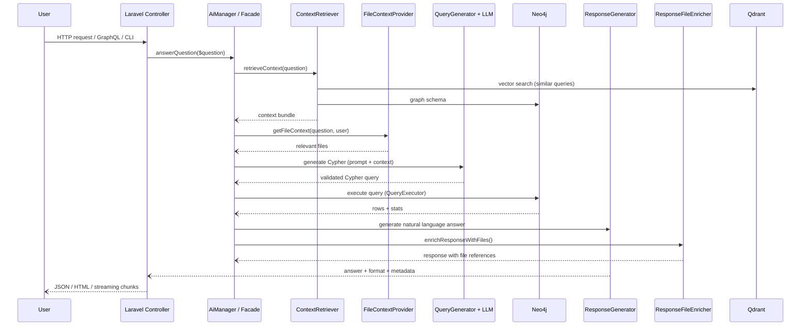
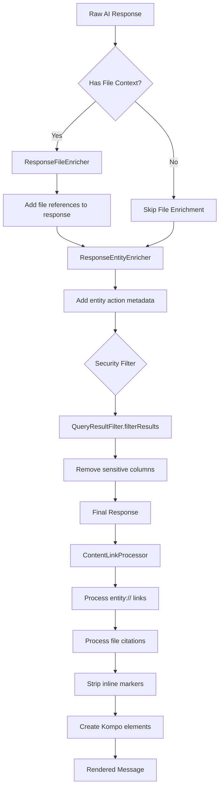
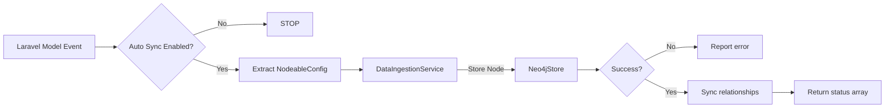
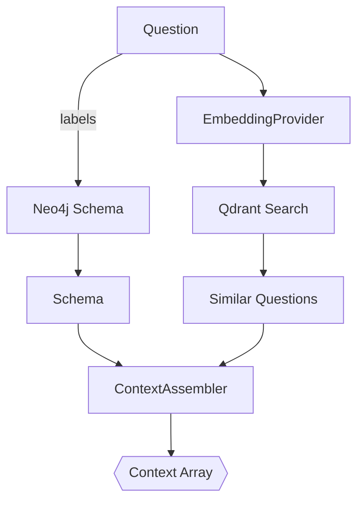

# Data & Control Flows

Understanding the order of operations makes it easier to debug issues or add instrumentation. This chapter summarizes the most important flows with Mermaid diagrams you can tweak or paste into monitoring docs.

---

## Complete AI Package Architecture

Here's the complete flow from configuration to response:

```
┌─────────────────────────────────────────────────────────────────────────────────┐
│                           AI PACKAGE COMPLETE FLOW                               │
└─────────────────────────────────────────────────────────────────────────────────┘

┌──────────────────┐    ┌──────────────────┐    ┌──────────────────┐
│   PHASE 1        │    │   PHASE 2        │    │   PHASE 3        │
│  CONFIGURATION   │───▶│   INGESTION      │───▶│ CONTEXT RETRIEVAL│
│  (One-time)      │    │  (Sync/Batch)    │    │  (Per Question)  │
└──────────────────┘    └──────────────────┘    └──────────────────┘
         │                       │                       │
         ▼                       ▼                       ▼
┌──────────────────┐    ┌──────────────────┐    ┌──────────────────┐
│ • Model props    │    │ • Neo4j nodes    │    │ • Semantic search│
│ • nodeableConfig │    │ • Neo4j rels     │    │ • Graph traversal│
│ • entities.php   │    │ • Qdrant indexes │    │ • Access filter  │
│ • Auto-discovery │    │ • Scope patterns │    │ • Entity detect  │
└──────────────────┘    └──────────────────┘    └──────────────────┘
                                                         │
         ┌───────────────────────────────────────────────┘
         ▼
┌──────────────────┐    ┌──────────────────┐    ┌──────────────────┐
│   PHASE 4        │    │   PHASE 5        │    │   PHASE 6        │
│ PROMPT BUILDING  │───▶│ QUERY GENERATION │───▶│    RESPONSE      │
│                  │    │                  │    │                  │
└──────────────────┘    └──────────────────┘    └──────────────────┘
         │                       │                       │
         ▼                       ▼                       ▼
┌──────────────────┐    ┌──────────────────┐    ┌──────────────────┐
│ • System prompt  │    │ • LLM generates  │    │ • Execute query  │
│ • Context inject │    │   Cypher/SQL     │    │ • Filter results │
│ • Access tags    │    │ • Pattern match  │    │ • LLM formats    │
│ • Thresholds     │    │ • Scope resolve  │    │ • Return answer  │
└──────────────────┘    └──────────────────┘    └──────────────────┘
```

---

## Question → Answer Pipeline



Key safeguards:
- Context retrieval tolerates partial failures (e.g., Qdrant offline) and still proceeds with available data.
- Query validation enforces read-only patterns unless explicitly overridden.
- Query execution enforces `AI_MAX_RESULTS` and `AI_EXEC_TIMEOUT`.

---

## Chat Message Flow

This diagram shows the complete flow when a user sends a message through the chat interface. The chat components (`ChatMessageForm`, `MessagesQuery`) call `ChatPresenter`, which runs `AskQuestionUseCase` - the single owner of chat-turn orchestration (security gate, conversation context, persistence). Programmatic callers use the same use case directly; `AiChatService` only provides the availability check (`isAvailable()`).

```mermaid
sequenceDiagram
    participant User
    participant Modal as Chat UI (ChatMessageForm / MessagesQuery)
    participant Presenter as ChatPresenter
    participant Chat as AskQuestionUseCase
    participant Guard as ChatSecurityGuard
    participant CtxMgr as ConversationContextManager
    participant AI as AI Facade
    participant Context as ContextRetriever
    participant FileCtx as FileContextProvider
    participant QueryGen as QueryGenerator
    participant QueryExec as QueryExecutor
    participant Response as ResponseGenerator
    participant LinkProc as ContentLinkProcessor

    User->>Modal: Send message
    Modal->>Presenter: handleSend(conversation, question, ...)
    Presenter->>Chat: execute(AskQuestionInput)

    Note over Chat: Step 1: Security Gate (first)
    Chat->>Guard: assertSafe(question, user)
    alt Injection detected
        Guard-->>Chat: false
        Chat-->>User: Security blocked response
    end
    Guard-->>Chat: true

    Note over Chat: Step 2: Build Conversation Context (no pre-QU question analysis)
    Chat->>CtxMgr: buildPromptContext(conversation)
    CtxMgr-->>Chat: conversationContext

    Note over Chat: Step 3: Store User Message
    Chat->>Chat: conversation.addMessage('user', question)

    Note over Chat: Step 4: Call AI Pipeline (question verbatim; QU judges follow-up/entities)
    Chat->>AI: answerQuestion(question, options)
    AI->>Context: retrieveContext(question)
    AI->>FileCtx: getFileContext(question, user)
    AI->>QueryGen: generate(question, context)
    QueryGen->>QueryGen: buildPrompt via SemanticPromptBuilder
    QueryGen-->>AI: {cypher, confidence, ...}
    AI->>QueryExec: execute(cypher, params)
    QueryExec-->>AI: {data, stats}
    AI->>Response: generate(question, result, cypher)
    Response-->>AI: {answer, format, metadata}
    AI-->>Chat: complete response

    Note over Chat: Step 5: Record & Store Response
    Chat->>CtxMgr: recordResponse(conversation, answer, cypher, {data, referenced_files, metadata})
    Chat->>Chat: conversation.addMessage('assistant', answer)

    Note over Chat: Step 6: Process Response Links
    Chat-->>Presenter: ChatTurnResult (answer, data, suggestions, sources)
    Presenter-->>Modal: ChatTurnResult
    Modal->>LinkProc: processForDirectRendering(content)
    LinkProc-->>Modal: {content, elements, file_citations}
    Modal-->>User: Formatted response with links
```

### Key Components in Chat Flow

| Component | Responsibility |
|-----------|----------------|
| `ChatPresenter` | Single seam between the Kompo chat components and the chat use cases |
| `AskQuestionUseCase` | Orchestrates a chat turn: security gate, conversation context, AI call, persistence |
| `AiChatService` | Availability check only (`isAvailable()`, the chat surface's online badge) |
| `ChatSecurityGuard` | Runs the precondition + prompt-injection scan (via `InputSanitizer`) before any processing |
| `ConversationContextManager` | Extracts entities, resolves references (e.g., "that person"), builds context |
| `ContentLinkProcessor` | Processes entity links and file citations in responses |

---

## Response Processing Pipeline

After the AI generates a response, it goes through several enrichment stages before being displayed to the user.



### Response Enrichment Details

The response passes through multiple enrichers:

1. **ResponseFileEnricher**: Adds `referenced_files` array with file metadata (name, path, relevance score)
2. **ResponseEntityEnricher**: Adds `has_actions`, `available_actions`, `entity_type` to result rows
3. **QueryResultFilter**: Server-side security - removes sensitive columns based on user permissions
4. **ContentLinkProcessor**: Handles inline content processing for display:
   - `ActionLinkHandler`: Processes `entity://Person/123` and `action://view` links
   - `FileCitationHandler`: Processes `[1]`, `[2]` citation markers

---

## Phase 1: Configuration

How entities are defined through the 4-layer configuration resolution:

```
┌─────────────────────────────────────────────────────────────────────────────────┐
│                         PHASE 1: CONFIGURATION                                   │
│                         "How entities are defined"                               │
└─────────────────────────────────────────────────────────────────────────────────┘

                     ┌─────────────────────────────────────┐
                     │         CONFIG RESOLUTION           │
                     │      (HasNodeableConfig trait)      │
                     └─────────────────────────────────────┘
                                      │
             ┌────────────────────────┼────────────────────────┐
             ▼                        ▼                        ▼
    ┌─────────────────┐     ┌─────────────────┐     ┌─────────────────┐
    │  LAYER 1 (Base) │     │ LAYER 2 (Override)│   │ LAYER 3 (Legacy)│
    │ Model Properties│     │ nodeableConfig() │   │ entities.php    │
    └─────────────────┘     └─────────────────┘     └─────────────────┘
             │                        │                        │
             ▼                        ▼                        ▼
    ┌─────────────────┐     ┌─────────────────┐     ┌─────────────────┐
    │ $graphLabel     │     │ return [        │     │ 'Person' => [   │
    │ $sensibleColumns│     │   'graph' => [  │     │   'graph' => [  │
    │ $graphRelations │     │     'label' =>  │     │     'label' =>  │
    │ $nodeableAliases│     │   ],            │     │   ],            │
    └─────────────────┘     │   ...           │     │   ...           │
                            │ ];              │     │ ]               │
                            └─────────────────┘     └─────────────────┘
                                      │
                                      ▼
                     ┌─────────────────────────────────────┐
                     │       LAYER 4: AUTO-DISCOVERY       │
                     │  (Fills missing parts automatically)│
                     └─────────────────────────────────────┘
                                      │
             ┌────────────────────────┼────────────────────────┐
             ▼                        ▼                        ▼
    ┌─────────────────┐     ┌─────────────────┐     ┌─────────────────┐
    │  PropertyDisc.  │     │ RelationshipDisc│     │ CypherScopeAdpt │
    │  - fillable     │     │ - belongsTo     │     │ - scopeActive() │
    │  - casts        │     │ - hasMany       │     │ - scopeVolunteer│
    │  - dates        │     │ - morphTo       │     │ - whereHas()    │
    └─────────────────┘     └─────────────────┘     └─────────────────┘
                                      │
                                      ▼
                     ┌─────────────────────────────────────┐
                     │         FINAL MERGED CONFIG         │
                     │  (GraphConfig + SecurityConfig +    │
                     │   ScopeConfig)                      │
                     └─────────────────────────────────────┘
```

**Priority Order** (later overrides earlier):
1. Model Properties - Base layer (convention)
2. nodeableConfig() - Developer override (explicit)
3. config/entities.php - Legacy/global override
4. Auto-Discovery - Fills missing parts only

---

## Phase 2: Entity Ingestion Flow



### ASCII Detail: Populating Neo4j

```
┌─────────────────────────────────────────────────────────────────────────────────┐
│                           PHASE 2: INGESTION                                     │
│                           "Populating Neo4j"                                     │
└─────────────────────────────────────────────────────────────────────────────────┘

                          ┌──────────────────┐
                          │  Nodeable Model  │
                          │  (Person, Event) │
                          └────────┬─────────┘
                                   │
                                   ▼
                        ┌─────────────────────┐
                        │   GRAPH INGESTION   │
                        │      (Neo4j)        │
                        └──────────┬──────────┘
                                   │
                     ┌─────────────┴─────────────┐
                     ▼                           ▼
                 ┌────────┐                ┌───────────┐
                 │ Step 1 │                │  Step 2   │
                 │ Create │                │  Create   │
                 │ Nodes  │                │   Rels    │
                 └────────┘                └───────────┘
                     │                           │
                     ▼                           ▼
                 ┌────────┐                ┌───────────┐
                 │(:Person│                │(:Person)  │
                 │ {id:1, │                │    │      │
                 │ name:  │                │[HAS_TEAM] │
                 │ "John"}│                │    │      │
                 │)       │                │    ▼      │
                 └────────┘                │(:Team)    │
                                           └───────────┘
```

**Commands:**
```bash
php artisan ai:discover      # Analyze models, generate config cache
php artisan ai:ingest        # Create Neo4j nodes from entities
php artisan ai:sync-rels     # Create Neo4j relationships
php artisan ai:index-scopes  # Parse scopes → Cypher patterns
php artisan ai:index-semantic # Generate embeddings → Qdrant
```

Notes:
- Records are written to the graph only: ingestion makes no embedding call and no Qdrant write, so there is no second store to keep consistent and no compensating transaction or rollback. A failed graph write is reported to the caller.
- `php artisan ai:ingest` uses `BatchDataIngestionService`: nodes are written with Cypher `UNWIND` batches, then relationships.
- Qdrant holds files, documentation and the context indexes (`ai:index-context`, `ai:index-scopes`, `ai:index-semantic`), never records - see [What is stored where](/docs/{{version}}/usage/data-ingestion#what-is-stored-where).

### Scope Discovery Deep Dive

```
                          ┌────────────────────┐
                          │  SCOPE DISCOVERY   │
                          │   (Deep Dive)      │
                          └────────────────────┘
                                   │
                     ┌─────────────┴─────────────┐
                     ▼                           ▼
          ┌─────────────────────┐     ┌─────────────────────┐
          │   Simple Scope      │     │   Complex Scope     │
          │                     │     │   (Nested)          │
          └─────────────────────┘     └─────────────────────┘
                     │                           │
                     ▼                           ▼
          ┌─────────────────────┐     ┌─────────────────────┐
          │ scopeActive($q)     │     │ scopeVolunteers($q) │
          │ {                   │     │ {                   │
          │   $q->where(        │     │   $q->whereHas(     │
          │     'status',       │     │     'personTeams',  │
          │     'active'        │     │     fn($q) =>       │
          │   );                │     │       $q->volunteer │
          │ }                   │     │   );                │
          └─────────────────────┘     │ }                   │
                     │                └─────────────────────┘
                     ▼                           │
          ┌─────────────────────┐                ▼
          │ CypherQueryBuilder  │     ┌─────────────────────┐
          │ Spy records:        │     │ __call() resolves:  │
          │ [where, status,     │     │ 1. Get related model│
          │  active]            │     │ 2. Find scope method│
          │                     │     │ 3. Execute with spy │
          └─────────────────────┘     │ 4. Capture calls    │
                     │                └─────────────────────┘
                     ▼                           │
          ┌─────────────────────┐                ▼
          │ Cypher Generated:   │     ┌─────────────────────┐
          │ MATCH (n:Person)    │     │ Cypher Generated:   │
          │ WHERE n.status =    │     │ MATCH (n:Person)    │
          │   'active'          │     │ -[:HAS_TEAM]->(t)   │
          │ RETURN n            │     │ WHERE t.role_type=3 │
          └─────────────────────┘     │ RETURN n            │
                                      └─────────────────────┘
```

---

## Auto-Discovery Flow

```mermaid
stateDiagram-v2
    [*] --> Start
    Start --> CacheCheck: ConfigCache::remember
    CacheCheck --> Discovered: hit
    CacheCheck --> Reflect: miss
    Reflect --> Properties: fillable/casts/dates
    Properties --> Relationships: belongsTo()
    Relationships --> Scopes: scopeX() + CypherSpy
    Scopes --> Merge: merge explicit config overrides
    Merge --> CacheWrite
    CacheWrite --> Discovered
```

- Cache keys follow `ai:discovery:{EntityClass}`.
- You can pre-warm everything with `php artisan ai:discover:cache`.

---

## Phase 3: Context Retrieval Flow



Each context payload contains:
- `similar_queries` - question text + top matching Cypher
- `graph_schema` - labels, relationships, indexed properties
- `scopes` - discovered semantic filters

### ASCII Detail: Finding Relevant Data for Questions

```
┌─────────────────────────────────────────────────────────────────────────────────┐
│                       PHASE 3: CONTEXT RETRIEVAL                                 │
│                    "Finding relevant data for question"                          │
└─────────────────────────────────────────────────────────────────────────────────┘

                     ┌─────────────────────────────────────┐
                     │         USER QUESTION               │
                     │  "Show me all active volunteers"    │
                     └─────────────────────────────────────┘
                                      │
                                      ▼
                     ┌─────────────────────────────────────┐
                     │      STEP 1: ENTITY DETECTION       │
                     │      (What entities involved?)      │
                     └─────────────────────────────────────┘
                                      │
             ┌────────────────────────┼────────────────────────┐
             ▼                        ▼                        ▼
    ┌─────────────────┐     ┌─────────────────┐     ┌─────────────────┐
    │  Keyword Match  │     │  Alias Match    │     │  LLM Detection  │
    │  "volunteers"   │     │  "people" →     │     │  (fallback)     │
    │   → Person      │     │   Person        │     │                 │
    └─────────────────┘     └─────────────────┘     └─────────────────┘
                                      │
                                      ▼
                     ┌─────────────────────────────────────┐
                     │  DETECTED: [Person, PersonTeam]     │
                     └─────────────────────────────────────┘
                                      │
               ┌──────────────────────┴──────────────────────┐
               ▼                                             ▼
 ┌───────────────────────────┐              ┌───────────────────────────┐
 │  STEP 2A: SEMANTIC SEARCH │              │  STEP 2B: SCOPE MATCHING  │
 │         (Qdrant)          │              │      (Entity Scopes)      │
 └───────────────────────────┘              └───────────────────────────┘
               │                                             │
               ▼                                             ▼
 ┌───────────────────────────┐              ┌───────────────────────────┐
 │ 1. Embed question         │              │ 1. Match "volunteers"     │
 │    → vector[1536]         │              │    to scope patterns      │
 │                           │              │                           │
 │ 2. Search Qdrant          │              │ 2. Find matching scope:   │
 │    collection: questions  │              │    scopeVolunteers        │
 │    limit: 5               │              │                           │
 │                           │              │ 3. Get Cypher pattern:    │
 │ 3. Return similar:        │              │    MATCH (n:Person)       │
 │    past questions with    │              │    -[:HAS_TEAM]->(t)      │
 │    their Cypher (0.89)    │              │    WHERE t.role_type = 3  │
 └───────────────────────────┘              └───────────────────────────┘
               │                                             │
               └──────────────────────┬──────────────────────┘
                                      ▼
                     ┌─────────────────────────────────────┐
                     │    STEP 3: ACCESS CONTROL FILTER    │
                     │    (What can THIS user see?)        │
                     └─────────────────────────────────────┘
                                      │
                                      ▼
                     ┌─────────────────────────────────────┐
                     │      AccessLevelResolver            │
                     └─────────────────────────────────────┘
                                      │
     ┌────────────────────────────────┼────────────────────────────────┐
     ▼                                ▼                                ▼
 ┌────────────┐              ┌────────────────┐              ┌────────────────┐
 │ User: null │              │ User: TeamMem  │              │ User: Admin    │
 │ (Guest)    │              │ (Basic access) │              │ (Full access)  │
 └────────────┘              └────────────────┘              └────────────────┘
       │                              │                              │
       ▼                              ▼                              ▼
 ┌────────────┐              ┌────────────────┐              ┌────────────────┐
 │ Tags:      │              │ Tags:          │              │ Tags:          │
 │ • global_  │              │ • global_count │              │ • global_count │
 │   count    │              │ • team_count   │              │ • team_count   │
 │            │              │ • team_details │              │ • team_details │
 │            │              │                │              │ • team_sensitive│
 └────────────┘              └────────────────┘              └────────────────┘
                                      │
                                      ▼
                     ┌─────────────────────────────────────┐
                     │       STEP 4: AGGREGATE DATA        │
                     │   (Pre-calculate safe aggregates)   │
                     └─────────────────────────────────────┘
                                      │
                     ┌────────────────┼────────────────┐
                     ▼                ▼                ▼
            ┌──────────────┐ ┌──────────────┐ ┌──────────────┐
            │ Total Count  │ │ Team Count   │ │ Filtered     │
            │   (Global)   │ │  (Scoped)    │ │  (Threshold) │
            └──────────────┘ └──────────────┘ └──────────────┘
                     │                │                │
                     ▼                ▼                ▼
            ┌──────────────┐ ┌──────────────┐ ┌──────────────┐
            │ "150 total   │ │ "45 in your  │ │ "12 active   │
            │  persons"    │ │  teams"      │ │  volunteers" │
            └──────────────┘ └──────────────┘ └──────────────┘
```

---

## Phases 4-6: Prompt → Query → Response

```
┌─────────────────────────────────────────────────────────────────────────────────┐
│                    PHASES 4-6: PROMPT → QUERY → RESPONSE                         │
│                         "Generating the answer"                                  │
└─────────────────────────────────────────────────────────────────────────────────┘

                     ┌─────────────────────────────────────┐
                     │    FROM PHASE 3: CONTEXT READY      │
                     │ • Semantic results                  │
                     │ • Matched scopes                    │
                     │ • Access tags                       │
                     │ • Aggregates                        │
                     └─────────────────────────────────────┘
                                      │
                                      ▼
┌─────────────────────────────────────────────────────────────────────────────────┐
│                          PHASE 4: PROMPT BUILDING                                │
└─────────────────────────────────────────────────────────────────────────────────┘
                                      │
     ┌────────────────────────────────┼────────────────────────────────┐
     ▼                                ▼                                ▼
 ┌────────────────┐          ┌────────────────┐          ┌────────────────┐
 │ SYSTEM PROMPT  │          │ CONTEXT SECTION│          │ ACCESS RULES   │
 └────────────────┘          └────────────────┘          └────────────────┘
          │                           │                           │
          ▼                           ▼                           ▼
 ┌─────────────────────────────────────────────────────────────────────────┐
 │  You are an AI assistant with access to:                                │
 │                                                                         │
 │  <schema>                                                               │
 │    ...graph schema, relationships...                                    │
 │  </schema>                                                              │
 │                                                                         │
 │  <access_rules>                                                         │
 │    ...tags, thresholds...                                               │
 │  </access_rules>                                                        │
 │                                                                         │
 │  [USER]: Show me volunteers                                             │
 └─────────────────────────────────────────────────────────────────────────┘
                                      │
                                      ▼
┌─────────────────────────────────────────────────────────────────────────────────┐
│                       PHASE 5: QUERY GENERATION                                  │
└─────────────────────────────────────────────────────────────────────────────────┘
                                      │
                                      ▼
                     ┌─────────────────────────────────────┐
                     │         LLM (Claude/GPT)            │
                     │    Analyzes context + question      │
                     └─────────────────────────────────────┘
                                      │
               ┌──────────────────────┴──────────────────────┐
               ▼                                             ▼
 ┌───────────────────────────┐              ┌───────────────────────────┐
 │   Option A: Use Scope     │              │   Option B: Generate New  │
 │   (Pattern matched)       │              │   (Custom query needed)   │
 └───────────────────────────┘              └───────────────────────────┘
               │                                             │
               ▼                                             ▼
 ┌───────────────────────────┐              ┌───────────────────────────┐
 │ Found: scopeVolunteers    │              │ LLM generates Cypher:     │
 │                           │              │                           │
 │ Use pre-indexed Cypher:   │              │ MATCH (p:Person)          │
 │ MATCH (n:Person)          │              │ -[:HAS_TEAM]->(t:Team)    │
 │ -[:HAS_TEAM]->(t)         │              │ WHERE t.role_type = 3     │
 │ WHERE t.role_type = 3     │              │ AND t.status = 'active'   │
 │ RETURN n                  │              │ RETURN p.name, p.email    │
 └───────────────────────────┘              └───────────────────────────┘
               │                                             │
               └──────────────────────┬──────────────────────┘
                                      ▼
┌─────────────────────────────────────────────────────────────────────────────────┐
│                         PHASE 6: RESPONSE                                        │
└─────────────────────────────────────────────────────────────────────────────────┘
                                      │
          ┌───────────────────────────┼───────────────────────────┐
          ▼                           ▼                           ▼
 ┌─────────────────┐         ┌─────────────────┐         ┌─────────────────┐
 │ STEP 1: Execute │         │ STEP 2: Filter  │         │ STEP 3: Format  │
 │ Query           │         │ Results         │         │ Response        │
 └─────────────────┘         └─────────────────┘         └─────────────────┘
          │                           │                           │
          ▼                           ▼                           ▼
 ┌─────────────────┐         ┌─────────────────┐         ┌─────────────────┐
 │ Neo4j/MySQL     │         │ Apply access:   │         │ LLM formats:    │
 │ returns:        │         │ • Team filter   │         │                 │
 │                 │         │ • Remove ssn,   │         │ "Found 12 active│
 │ [               │         │   salary cols   │         │  volunteers in  │
 │  {id:5, name:   │         │ • Check thresh  │         │  your teams:    │
 │   "John",...},  │         │                 │         │                 │
 │  {id:12,...},   │         │ Result: 12 rows │         │  1. John Doe    │
 │  ...            │         │ (below thresh?) │         │  2. Jane Smith  │
 │ ]               │         │ → Show actual   │         │  ..."           │
 └─────────────────┘         └─────────────────┘         └─────────────────┘
                                      │
                                      ▼
                     ┌─────────────────────────────────────┐
                     │         FINAL RESPONSE              │
                     │  "Found 12 active volunteers in     │
                     │   your teams:                       │
                     │   1. John Doe - Software Developer  │
                     │   2. Jane Smith - Marketing         │
                     │   ..."                              │
                     └─────────────────────────────────────┘
```

---

## Error Reporting Flow

1. Any exception during ingestion or querying is wrapped with a contextual array:
   ```php
   [
       'operation' => 'ingest',
       'entity' => Customer::class,
       'graph_stored' => false,
       'errors' => [...],
   ]
   ```
2. If `fail_silently=false`, the exception bubbles up. Otherwise it is logged via Laravel's logger (with secrets automatically redacted).
3. LaRecipe docs can embed these patterns so on-call engineers know what to expect.

Review the [Resilience & Security chapter](/docs/{{version}}/internals/resilience) for deeper coverage of retries, circuit breakers, and sanitization.

---

## Code Structure Map

```
src/
├── Domain/
│   ├── Contracts/
│   │   └── Nodeable.php                 ← Interface for AI-enabled models
│   ├── Traits/
│   │   └── HasNodeableConfig.php        ← Main trait (config resolution)
│   │       ├── readModelProperties()    ← Reads $graphLabel, etc.
│   │       ├── resolveConfig()          ← 4-layer config merge
│   │       └── getGraphConfig()         ← Returns GraphConfig VO
│   └── ValueObjects/
│       ├── GraphConfig.php              ← Neo4j config (label, props, rels)
│       ├── RelationshipConfig.php       ← Graph relationship definition
│       └── NodeableConfig.php           ← Fluent builder for config
│
├── Services/
│   ├── Discovery/
│   │   ├── EntityAutoDiscovery.php      ← Main discovery orchestrator
│   │   ├── PropertyDiscoverer.php       ← Discovers model properties
│   │   ├── RelationshipDiscoverer.php   ← Discovers Eloquent relationships
│   │   ├── CypherScopeAdapter.php       ← Converts scopes to Cypher
│   │   ├── CypherQueryBuilderSpy.php    ← Records query builder calls
│   │   │   └── __call()                 ← Handles nested scope resolution
│   │   └── CypherPatternGenerator.php   ← Generates Cypher from calls
│   │
│   ├── Security/
│   │   ├── AccessLevelResolver.php      ← Determines user access tags
│   │   └── PromptContextBuilder.php     ← Builds access-aware prompts
│   │
│   ├── Ingestion/
│   │   └── DataIngestionService.php     ← Orchestrates data ingestion
│   │
│   ├── Context/
│   │   └── ContextRetriever.php         ← Retrieves relevant context
│   │
│   ├── Query/
│   │   ├── QueryGenerator.php           ← LLM generates queries
│   │   └── QueryExecutor.php            ← Executes & filters results
│   │
│   └── Response/
│       └── ResponseGenerator.php        ← Formats final response
│
├── Stores/
│   ├── Neo4j/
│   │   └── Neo4jStore.php               ← Neo4j operations
│   └── Qdrant/
│       └── QdrantStore.php              ← Qdrant operations
│
└── Console/Commands/
    ├── DiscoverEntitiesCommand.php      ← php artisan ai:discover
    ├── IngestEntitiesCommand.php        ← php artisan ai:ingest
    ├── SyncRelationshipsCommand.php     ← php artisan ai:sync-rels
    ├── IndexScopesCommand.php           ← php artisan ai:index-scopes
    └── IndexSemanticCommand.php         ← php artisan ai:index-semantic
```
